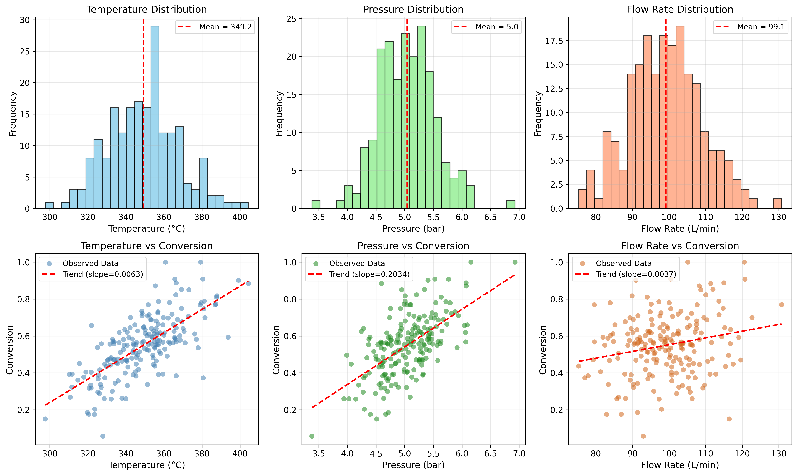
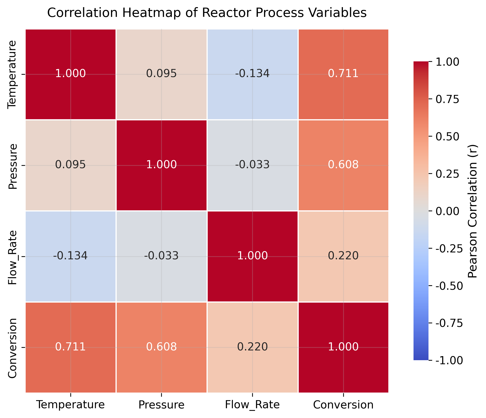
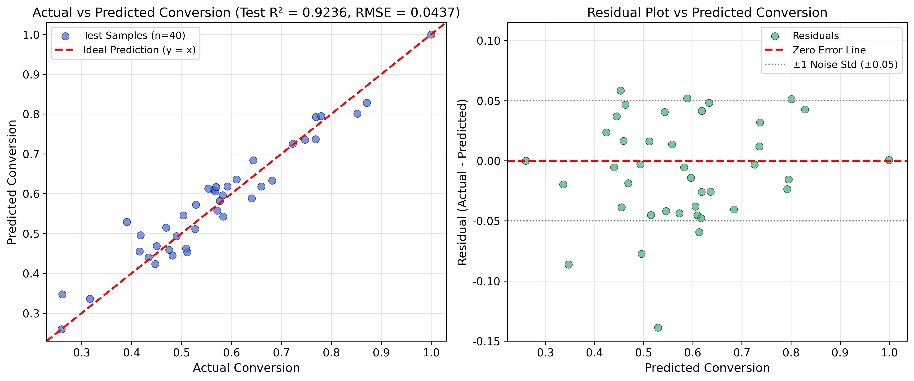

# Unit00 Google Colab 環境設定教學

## 課程目標

本單元將帶領學生熟悉 Google Colaboratory（簡稱 Google Colab）雲端運算平台。這是一個基於瀏覽器的互動式 Jupyter Notebook 開發環境，提供免費的 GPU 與 TPU 硬體加速資源，非常適合進行化學工程數據分析、機器學習與深度學習的開發與實驗。同時，本單元也將建立貫穿全課程（Unit01–Unit17）的**雲端課程專案同步流程**與**跨環境（Colab 與本地端）標準路徑架構**。

### 學習目標
- 理解 Google Colab 的基本功能、系統架構與操作介面
- 學會建立、管理、儲存副本與分享 Colab 筆記本
- 掌握在 Colab 環境中掛載 Google Drive、同步本課程 GitHub 儲存庫與管理資料檔案的方法
- 熟悉本課程所有單元共用的跨環境（Colab / Local）標準路徑設定範本
- 學會檢查、安裝與管理 Python 科學計算與機器學習套件
- 了解如何啟用與檢視 GPU / TPU 硬體加速運算資源
- 實作完整的化工反應器數據探索、相關性分析與多元線性回歸預測流程

---

## 1. Google Colab 簡介

### 1.1 什麼是 Google Colab？

Google Colaboratory (Colab) 是 Google 提供的雲端 Jupyter Notebook 服務，讓使用者可以透過瀏覽器直接撰寫和執行 Python 程式碼，無需在個人電腦上進行繁瑣的環境安裝與顯卡驅動配置。

**主要特色：**
- **完全免費的基礎資源**：提供免費的雲端 CPU、GPU（如 NVIDIA Tesla T4）與 TPU 運算資源
- **開箱即用**：透過瀏覽器即可使用，已預先配置主流 Python 資料科學環境
- **雲端硬碟深度整合**：筆記本與產出數據可直接儲存在 Google Drive 中實現持久化保存
- **即時協作功能**：可以像 Google 文件一樣與團隊成員共用、留言與協作
- **預裝主流 AI 套件**：已預裝 NumPy、Pandas、Scikit-learn、TensorFlow、PyTorch 等核心套件

### 1.2 為什麼選擇 Colab？

對於化學工程領域的 AI 與機器學習應用學習，Colab 提供了以下優勢：

1. **降低硬體入門門檻**：不需要購買昂貴的高階獨立顯示卡即可訓練深度神經網路（Part 4）
2. **快速啟動學習**：免去初期複雜的 CUDA / cuDNN 驅動程式相容性設定流程
3. **高度可重現與資源共享**：可輕鬆與老師、助教或同學分享程式碼與執行結果
4. **內建版本控制**：自動記錄筆記本的修訂歷史，隨時可比對或還原先前版本
5. **彈性支援雙環境**：結合本課程設計的標準路徑範本，同一份 Notebook 可在 Colab 雲端與 Windows 本地端無縫切換執行

### 1.3 Colab 的限制與注意事項

使用 Colab 時也必須了解其雲端虛擬機的運作限制：

- **暫時性虛擬機環境**：每次連線皆動態分配一台 Linux 虛擬機，連線中斷或重啟後，暫存區（`/content/`）內的檔案與額外安裝的套件皆會被清除
- **執行時間限制**：免費版單次連續執行時間最長約 12 小時
- **閒置自動中斷**：若瀏覽器分頁閒置約 90 分鐘無互動，系統會自動中斷執行階段以釋放資源
- **儲存空間配額**：永久保存的檔案受限於個人 Google Drive 的可用儲存空間（免費帳號預設為 15 GB）
- **運算資源動態配額**：免費版的 GPU 使用時數有動態配額限制，過度頻繁使用長時段 GPU 可能會暫時被降級為純 CPU 模式
- **網路連線依賴**：需要穩定的網際網路連線才能操作

---

## 2. 開始使用 Google Colab

### 2.1 建立與開啟 Colab 筆記本

#### 方法一：從 Google Drive 建立

1. 登入您的 Google 帳號，前往 [Google Drive](https://drive.google.com)
2. 點選左上角的「**+ 新增**」按鈕
3. 選擇「**更多**」→「**Google Colaboratory**」
4. 如果選單中沒有看到此選項，請先連結 Colab 應用程式：
   - 選擇「**更多**」→「**連結更多應用程式**」
   - 搜尋「**Colaboratory**」並點選安裝

#### 方法二：直接造訪 Colab 官方網站

直接瀏覽 [https://colab.research.google.com](https://colab.research.google.com)，即可從歡迎視窗建立新筆記本，或開啟近期位於 Google Drive 與 GitHub 中的筆記本。

#### 方法三：從 GitHub 匯入（重要提醒：儲存副本）

如果已有 GitHub 上的 Jupyter Notebook，可以直接在 Colab 中開啟：
1. 在 Colab 首頁選擇「**GitHub**」分頁
2. 輸入 GitHub 儲存庫 URL（例如本課程儲存庫 `https://github.com/d9148408/ChemE-3590`）
3. 選擇要開啟的單元筆記本（`.ipynb`）

> **重要操作提醒（儲存副本）**：直接從 GitHub 或他人分享連結開啟的筆記本屬於「唯讀或暫存檢視」狀態，您所做的任何修改無法直接覆寫回原 GitHub。開始練習或撰寫作業前，請務必先點選左上角選單「**檔案 (File)**」→「**在雲端硬碟中儲存副本 (Save a copy in Drive)**」，或是使用第 3.3 節介紹的 `git clone` 方式將完整課程專案複製到自己的 Google Drive 中操作。

### 2.2 Colab 介面說明

Colab 的使用者介面主要由以下三個區域組成：

#### 頂部工具列與選單
- **檔案 (File)**：新增、開啟、上傳、下載 `.ipynb` 或 `.py`，以及「在雲端硬碟中儲存副本」
- **編輯 (Edit)**：剪下、複製、貼上儲存格，或「清除所有輸出內容」
- **檢視 (View)**：顯示/隱藏目錄、修訂記錄、程式碼展開與折疊
- **插入 (Insert)**：在目前位置新增程式碼儲存格或文字儲存格
- **執行階段 (Runtime)**：全部執行、中斷執行、重新啟動工作階段（Restart session）、以及**變更執行階段類型（切換 CPU / GPU / TPU）**
- **工具 (Tools)**：偏好設定、鍵盤快捷鍵列表、指令面板

#### 左側邊欄
- **目錄 (Table of Contents)**：依據 Markdown 標題階層（`#`、`##`、`###`）自動產生章節大綱導覽
- **尋找及取代 (Find and Replace)**：搜尋並批次取代筆記本內的文字或變數名稱
- **變數檢查器 (`{x}` Variables)**：即時查看目前 Python 執行階段中已定義的變數名稱、型別、維度與數值
- **密鑰 (Secrets)**：安全存放 API 金鑰（如 OpenAI、Gemini、HuggingFace Token），避免金鑰明文外洩於程式碼中
- **檔案 (Files)**：瀏覽虛擬機 `/content/` 目錄結構、掛載 Google Drive、上傳或下載檔案

#### 儲存格 (Cells)
- **程式碼儲存格 (Code Cell)**：撰寫並執行 Python 程式碼、IPython Magic 指令（`%`）或 Linux Shell 指令（`!`）
- **文字儲存格 (Text / Markdown Cell)**：使用 Markdown 語法與 MathJax（`$...$`、`$$...$$`）撰寫說明文件、實驗紀錄與數學公式

### 2.3 基本儲存格操作

#### 新增儲存格
- 點選工具列下方的「**+ 程式碼**」按鈕新增程式碼儲存格
- 點選「**+ 文字**」按鈕新增文字（Markdown）儲存格
- 或使用快捷鍵：
  - `Ctrl + M A`：在目前儲存格**上方 (Above)** 新增儲存格
  - `Ctrl + M B`：在目前儲存格**下方 (Below)** 新增儲存格

#### 轉換儲存格類型
- `Ctrl + M M`：將目前儲存格轉換為**文字 (Markdown) 儲存格**
- `Ctrl + M Y`：將目前儲存格轉換為**程式碼 (Code) 儲存格**

#### 執行儲存格
- 點選儲存格左側的執行按鈕 (▶)
- 或使用快捷鍵：
  - `Ctrl + Enter`：執行目前儲存格，游標停留在原儲存格
  - `Shift + Enter`：執行目前儲存格，並自動移至下一個儲存格

#### 刪除與移動儲存格
- 點選儲存格右上角工具列的垃圾桶圖示或上下箭頭
- 或使用快捷鍵：
  - `Ctrl + M D`：刪除目前儲存格（若誤刪可按 `Ctrl + M Z` 復原）
  - `Ctrl + M K`：將儲存格上移
  - `Ctrl + M J`：將儲存格下移

---

## 3. 檔案管理與課程專案同步

### 3.1 Colab 虛擬機檔案系統架構

在 Colab 中，每次啟動執行階段都會配置一個基於 Ubuntu Linux 的容器環境，其主要目錄結構如下：

- `/content/`：預設工作目錄（**暫時性空間**，執行階段結束或斷線重連後，此處的檔案會全部消失）
- `/content/drive/MyDrive/`：掛載 Google Drive 後的雲端硬碟根目錄（**永久性空間**；註：舊版路徑 `/content/drive/My Drive/` 含有空白字元，系統仍保留向下相容連結，但在撰寫指令時建議注意引號包覆或優先使用無空白的 `MyDrive`）
- `/usr/local/lib/python3.x/dist-packages/`：Python 第三方套件的預設安裝位置

### 3.2 上傳與存取資料檔案的方法

#### 方法一：掛載 Google Drive（強烈推薦，具永久性）

透過掛載 Google Drive，程式可以直接讀寫個人雲端硬碟中的數據集與輸出圖表，執行階段結束後檔案依然妥善保存：

```python
from google.colab import drive

# 掛載 Google Drive 至 /content/drive
drive.mount('/content/drive', force_remount=True)
```

執行後會跳出 Google 帳號授權視窗，完成授權後即可透過標準 `pathlib.Path` 或 `os` 模組存取雲端硬碟內容：

```python
from pathlib import Path

# 查看 Google Drive 根目錄下的前 10 個項目
drive_root = Path('/content/drive/MyDrive')
for item in sorted(drive_root.iterdir())[:10]:
    print(item.name)
```

#### 方法二：直接從本地電腦上傳（暫時性）

若只需臨時測試小型檔案，可點選左側邊欄「檔案 (📁)」圖示的「上傳」按鈕，或使用以下程式碼開啟檔案選擇器：

```python
from google.colab import files

uploaded = files.upload()

# 查看上傳的檔案名稱與大小
for filename, content in uploaded.items():
    print(f"Uploaded file: {filename}, Size: {len(content)} bytes")
```

#### 方法三：從網路 URL 直接下載

```python
# 使用 Linux wget 工具下載檔案
!wget https://example.com/data.csv -O /content/data.csv

# 或使用 Python 標準 requests 模組下載（跨平台相容性更佳）
import requests

url = 'https://example.com/data.csv'
response = requests.get(url, timeout=30)
response.raise_for_status()

with open('data.csv', 'wb') as f:
    f.write(response.content)
```

### 3.3 本課程 GitHub 儲存庫下載與更新 SOP

為了讓同學在 Google Colab 中能直接使用本課程所有單元（Part 0 ～ Part 5）的講義、範例 Notebook 與數據集，請依照以下標準作業程序（SOP）將課程專案建立於您的 Google Drive 中：

#### 步驟一：首次下載課程資料（全學期只需執行一次）

在 Colab 中新建一個筆記本，執行以下程式碼，即可將課程 GitHub 儲存庫完整複製到您 Google Drive 的 `Colab Notebooks/ChemE-3590` 資料夾中：

```python
# 1. 掛載個人 Google Drive
from google.colab import drive
drive.mount('/content/drive', force_remount=True)

# 2. 切換至 Colab Notebooks 目錄並下載課程專案
%cd "/content/drive/My Drive/Colab Notebooks/"
!git clone https://github.com/d9148408/ChemE-3590.git
```

#### 步驟二：更新全部課程資料

當授課教師更新了教材或發布新單元時，可執行以下指令將雲端硬碟中的教材同步至最新版本（注意：`git reset --hard` 會將教材還原為官方最新版本，若您有修改原檔案，請先另存副本）：

```python
from google.colab import drive
drive.mount('/content/drive', force_remount=True)

# 進入課程專案目錄並強制同步至最新 main 分支
%cd "/content/drive/My Drive/Colab Notebooks/ChemE-3590/"
!git fetch origin
!git reset --hard origin/main
```

#### 步驟三：僅更新特定單元課程資料

若只想更新某個特定單元（例如 `Part_1/Unit03`）而不影響其他單元的修改，可執行：

```python
from google.colab import drive
drive.mount('/content/drive', force_remount=True)

%cd "/content/drive/My Drive/Colab Notebooks/ChemE-3590/"
!git fetch origin
!git checkout origin/main -- "Part_1/Unit03"
```

### 3.4 本課程標準跨環境路徑設定範本（Colab 與 Local 雙相容）

在本課程的所有範例 Notebook 開頭（`### 0. 環境設定`），皆採用一套統一的**跨環境路徑設定範本**。此範本會自動偵測目前是在 **Google Colab** 還是 **本地端電腦 (Local)** 執行：
- 若在 **Colab** 環境：自動掛載 Google Drive，並建立一個從 `/content/drive/My Drive/Colab Notebooks/ChemE-3590` 指向 `/content/ChemE-3590` 的符號連結（Symlink），讓後續路徑簡潔統一。
- 若在 **Local** 環境：自動使用當前工作目錄 `Path.cwd()`。
- 所有輸出的數據與模型皆存入 `OUTPUT_DIR`，所有繪製的圖表皆存入 `FIG_DIR`。

```python
from pathlib import Path
import os

# ========================================
# 路徑設定 (兼容 Colab 與 Local)
# ========================================
UNIT_OUTPUT_DIR = 'P0_Unit00_Colab_Environment_Setup'

try:
    from google.colab import drive
    IN_COLAB = True
    print("✓ 偵測到 Colab 環境，準備掛載 Google Drive...")
    drive.mount('/content/drive', force_remount=True)
except ImportError:
    IN_COLAB = False
    print("✓ 偵測到 Local 環境")

try:
    shortcut_path = '/content/ChemE-3590'
    os.remove(shortcut_path)
except (FileNotFoundError, OSError):
    pass

if IN_COLAB:
    source_path = Path('/content/drive/My Drive/Colab Notebooks/ChemE-3590')
    os.symlink(source_path, shortcut_path)
    shortcut_path = Path(shortcut_path)
    if source_path.exists():
        NOTEBOOK_DIR = shortcut_path / 'Part_0'
        OUTPUT_DIR   = NOTEBOOK_DIR / 'outputs' / UNIT_OUTPUT_DIR
        FIG_DIR      = OUTPUT_DIR / 'figs'
    else:
        print("⚠️ 找不到雲端 ChemE-3590 路徑，將使用當前目錄作為工作目錄")
        NOTEBOOK_DIR = Path.cwd()
        OUTPUT_DIR   = NOTEBOOK_DIR / 'outputs' / UNIT_OUTPUT_DIR
        FIG_DIR      = OUTPUT_DIR / 'figs'
else:
    NOTEBOOK_DIR = Path.cwd()
    OUTPUT_DIR   = NOTEBOOK_DIR / 'outputs' / UNIT_OUTPUT_DIR
    FIG_DIR      = OUTPUT_DIR / 'figs'

OUTPUT_DIR.mkdir(parents=True, exist_ok=True)
FIG_DIR.mkdir(parents=True, exist_ok=True)

print(f"\n✓ Notebook工作目錄: {NOTEBOOK_DIR}")
print(f"✓ 結果輸出目錄: {OUTPUT_DIR}")
print(f"✓ 圖檔輸出目錄: {FIG_DIR}")
```

**執行結果輸出（以本地端 `PY310` 環境為例）**：

```text
✓ 偵測到 Local 環境

✓ Notebook工作目錄: D:\MyGit\ChemE-3590\Part_0
✓ 結果輸出目錄: D:\MyGit\ChemE-3590\Part_0\outputs\P0_Unit00_Colab_Environment_Setup
✓ 圖檔輸出目錄: D:\MyGit\ChemE-3590\Part_0\outputs\P0_Unit00_Colab_Environment_Setup\figs
```

### 3.5 下載檔案至本地電腦

當需要將產生的 CSV 報表或壓縮後的圖表資料夾下載回個人電腦時，可使用 `files.download()`：

```python
from google.colab import files

# 下載單一檔案
files.download(str(OUTPUT_DIR / 'reactor_data.csv'))

# 若有多個圖檔，可先壓縮整個輸出資料夾再下載
!zip -r /content/unit00_outputs.zip "{OUTPUT_DIR}"
files.download('/content/unit00_outputs.zip')
```

---

## 4. Python 套件管理

### 4.1 預裝核心套件

Colab 已經預裝了絕大多數常用的科學計算、資料分析與機器學習套件，包含：

- **NumPy** / **SciPy**：陣列運算、線性代數、數值積分與科學計算
- **Pandas**：表格型資料處理與時間序列分析
- **Matplotlib** / **Seaborn** / **Plotly**：靜態與互動式資料視覺化
- **Scikit-learn**：傳統監督式與非監督式機器學習
- **TensorFlow** / **Keras**：深度學習與神經網路建模（本課程 Part 4 核心框架）
- **PyTorch**：深度學習框架

### 4.2 查看已安裝套件與版本

```python
# 列出環境中所有已安裝的套件清單
!pip list

# 在 Python 中檢查本課程核心套件的版本
import numpy as np
import scipy
import pandas as pd
import matplotlib
import seaborn as sns
import sklearn
import tensorflow as tf

print(f"NumPy        版本: {np.__version__}")
print(f"SciPy        版本: {scipy.__version__}")
print(f"Pandas       版本: {pd.__version__}")
print(f"Matplotlib   版本: {matplotlib.__version__}")
print(f"Seaborn      版本: {sns.__version__}")
print(f"Scikit-learn 版本: {sklearn.__version__}")
print(f"TensorFlow   版本: {tf.__version__}")
```

**執行結果輸出**：

```text
✓ 套件載入完成
  Python       版本: 3.10.19
  numpy        版本: 1.26.4
  scipy        版本: 1.15.2
  pandas       版本: 2.3.3
  matplotlib   版本: 3.10.8
  seaborn      版本: 0.13.2
  scikit-learn 版本: 1.7.2
  tensorflow   版本: 2.10.1
```

### 4.3 安裝額外套件

當特定單元需要使用未預裝的套件時，可透過 `!pip install` 進行安裝（注意：在 Colab 中每次重新啟動執行階段後，額外安裝的套件需重新執行安裝指令）。

#### 使用 pip 安裝

```python
# 安裝單一套件
!pip install package_name

# 安裝指定版本（確保實驗可重現性）
!pip install package_name==1.2.3

# 一次安裝多個套件
!pip install xgboost lightgbm catboost

# 靜默安裝（加上 -q 參數可隱藏冗長的下載與編譯過程訊息）
!pip install -q optuna
```

#### 從 GitHub 安裝最新開發版本

```python
# 直接由 GitHub 儲存庫安裝套件
!pip install git+https://github.com/user/repo.git
```

#### 在程式中自動檢查並安裝套件（推薦寫法）

為了避免在已安裝該套件的本地端環境（如本課程 `PY310` 環境）重複執行 `pip install`，可使用 `importlib` 搭配 `subprocess` 撰寫跨環境安全檢查：

```python
import importlib
import subprocess
import sys

for pkg in ['xgboost', 'lightgbm', 'catboost']:
    try:
        mod = importlib.import_module(pkg)
        print(f"✓ {pkg:10s} 已安裝，版本: {mod.__version__}")
    except ImportError:
        print(f"△ {pkg:10s} 未安裝，正在自動安裝...")
        subprocess.check_call([sys.executable, '-m', 'pip', 'install', '-q', pkg])
        mod = importlib.import_module(pkg)
        print(f"✓ {pkg:10s} 安裝完成，版本: {mod.__version__}")
```

**執行結果輸出**：

```text
=== 檢查進階機器學習套件 ===
✓ xgboost    已安裝，版本: 1.7.6
✓ lightgbm   已安裝，版本: 4.6.0
✓ catboost   已安裝，版本: 1.2.7
```

### 4.4 升級與移除套件

```python
# 升級單一套件至最新版本
!pip install --upgrade package_name

# 移除套件（加上 -y 自動確認）
!pip uninstall -y package_name

# 檢查套件相依性是否有衝突
!pip check
```

> **提示**：若在 Colab 中升級了已經載入記憶體的基礎套件（如 `numpy` 或 `matplotlib`），必須點選選單「**執行階段**」→「**重新啟動工作階段 (Restart session)**」，新版本的套件才會正式生效。

### 4.5 化工領域與進階機器學習常用擴充套件

以下為化學工程計算與進階 AI 建模常見的擴充套件安裝指令：

```python
# 化學資訊學與分子結構處理（注意：舊名 rdkit-pypi 已棄用，請直接使用 rdkit）
!pip install -q rdkit          # 分子結構解析、SMILES 轉換與分子指紋計算
!pip install -q chempy         # 化學反應動力學與化學平衡計算

# 化工熱力學與程序模擬物性庫
!pip install -q coolprop       # 高精度流體熱物理性質資料庫
!pip install -q thermo         # 化工熱力學與相平衡計算

# 數值優化與實驗設計
!pip install -q cvxpy          # 凸優化建模
!pip install -q optuna         # 貝氏超參數最佳化（Unit14 進階調參使用）

# 梯度提升樹與高維降維（Unit06、Unit13 使用）
!pip install -q xgboost lightgbm catboost
!pip install -q umap-learn
```

---

## 5. GPU / TPU 加速運算

### 5.1 什麼是 GPU 與 TPU？

- **GPU (Graphics Processing Unit，圖形處理器)**：擁有數千個平行運算核心，極度擅長處理大規模矩陣乘法與張量運算，是訓練深度神經網路（DNN、CNN、RNN/LSTM）與梯度提升樹（GPU 版 XGBoost）的標準加速硬體。
- **TPU (Tensor Processing Unit，張量處理器)**：Google 專為大規模深度學習矩陣運算設計的客製化 AI 晶片（ASIC），適合超大型模型或特定分散式訓練場景。

### 5.2 啟用硬體加速器

#### 設定步驟

1. 點選頂部選單列的「**執行階段 (Runtime)**」
2. 選擇「**變更執行階段類型 (Change runtime type)**」
3. 在「**硬體加速器 (Hardware accelerator)**」中選擇：
   - **CPU**：僅使用中央處理器（適合一般資料前處理、傳統機器學習 Unit01–Unit14，可節省免費 GPU 配額）
   - **T4 GPU**：使用 NVIDIA Tesla T4 GPU 加速（**強烈推薦用於本課程 Part 4 所有 TensorFlow / Keras 與 PyTorch 深度學習單元**；Colab Pro 付費版另提供 **L4 GPU** 或 **A100 GPU**）
   - **TPU v5e-1 / TPU v2-8**：使用 Google Cloud TPU 加速（需配合特定的分散式策略程式碼 `TPUStrategy`，一般課程練習無須使用）
4. 點選「**儲存 (Save)**」

> **重要提醒**：切換硬體加速器會自動重新啟動執行階段，所有目前記憶體中的變數與 `/content/` 暫存檔案都會被清空，請從頭依序執行儲存格。

### 5.3 檢查 GPU 硬體與框架支援狀態

#### 使用 TensorFlow 檢查 GPU 與查看 `nvidia-smi`

```python
import tensorflow as tf

print("TensorFlow version:", tf.__version__)
gpus = tf.config.list_physical_devices('GPU')
print("GPU available:", gpus)

# 呼叫系統指令顯示 NVIDIA 顯示卡型號、驅動版本與顯存 (VRAM) 使用狀況
!nvidia-smi
```

在本課程的實作環境中執行後，若配置有 NVIDIA GPU，輸出範例如下：

```text
=== TensorFlow GPU / TPU 狀態檢查 ===
TensorFlow Version: 2.10.1

✓ 偵測到 1 個可用 GPU:
  GPU 0: /physical_device:GPU:0
✓ GPU 記憶體動態分配 (Memory Growth) 已啟用
ℹ️ 未連接 TPU（本課程深度學習單元預設使用 GPU 或 CPU 即可完成訓練）

=== GPU Hardware Details (nvidia-smi) ===
Sat Oct 31 02:10:55 2026       
+-----------------------------------------------------------------------------------------+
| NVIDIA-SMI 596.49                 Driver Version: 596.49         CUDA Version: 13.2     |
+-----------------------------------------+------------------------+----------------------+
| GPU  Name                  Driver-Model | Bus-Id          Disp.A | Volatile Uncorr. ECC |
| Fan  Temp   Perf          Pwr:Usage/Cap |           Memory-Usage | GPU-Util  Compute M. |
|                                         |                        |               MIG M. |
|=========================================+========================+======================|
|   0  NVIDIA GeForce RTX 4090      WDDM  |   00000000:68:00.0  On |                  Off |
|  0%   42C    P8             19W /  500W |    4257MiB /  24564MiB |      7%      Default |
|                                         |                        |                  N/A |
+-----------------------------------------+------------------------+----------------------+
```

#### 使用 PyTorch 檢查 GPU

```python
import torch

print("PyTorch version:", torch.__version__)
print("CUDA available:", torch.cuda.is_available())

if torch.cuda.is_available():
    print("CUDA version:", torch.version.cuda)
    print("GPU Device Name:", torch.cuda.get_device_name(0))
    print(f"Total GPU Memory: {torch.cuda.get_device_properties(0).total_memory / (1024**3):.2f} GB")
```

### 5.4 GPU 記憶體管理策略

TensorFlow 預設會在啟動時直接預先佔用幾乎所有的可用 GPU 記憶體（VRAM）。為了避免記憶體碎片化或與其他程序衝突，通常可採用以下兩種策略之一（**注意：必須在建立模型或初始化 GPU 之前設定**）：

#### 策略一：設定 GPU 記憶體動態成長（最常用，本課程標準設定）

讓 TensorFlow 根據模型實際需求逐步申請 GPU 記憶體：

```python
import tensorflow as tf

gpus = tf.config.list_physical_devices('GPU')
if gpus:
    try:
        for gpu in gpus:
            tf.config.experimental.set_memory_growth(gpu, True)
        print("✓ 已啟用 GPU 記憶體動態成長 (Memory Growth)")
    except RuntimeError as e:
        # 必須在程式剛啟動、尚未初始化 GPU 前設定
        print(e)
```

#### 策略二：硬性限制 GPU 最大記憶體使用量（選用）

若想明確限制 TensorFlow 最多只能使用固定容量（例如 4096 MB = 4 GB）的顯存：

```python
import tensorflow as tf

gpus = tf.config.list_physical_devices('GPU')
if gpus:
    try:
        tf.config.set_logical_device_configuration(
            gpus[0],
            [tf.config.LogicalDeviceConfiguration(memory_limit=4096)]  # 限制為 4 GB
        )
    except RuntimeError as e:
        print(e)
```

#### PyTorch 記憶體快取清理

```python
import torch

if torch.cuda.is_available():
    torch.cuda.empty_cache()
    print(f"Allocated: {torch.cuda.memory_allocated(0) / (1024**3):.2f} GB")
    print(f"Reserved : {torch.cuda.memory_reserved(0) / (1024**3):.2f} GB")
```

### 5.5 GPU 使用最佳實務建議

1. **珍惜免費配額**：進行基礎 Python 練習、Pandas 表格整理或小型 Scikit-learn 模型訓練時，使用預設 **CPU** 即可；當進入深度學習（Unit15–Unit17）或大型資料集訓練時再切換為 **T4 GPU**。
2. **工作完成主動中斷連線**：GPU 訓練與結果儲存完畢後，可點選「**執行階段**」→「**中斷連線並刪除執行階段**」，避免背景閒置白白消耗您的免費 GPU 可用時數。
3. **避免 OOM (Out Of Memory) 記憶體溢位**：若訓練深度神經網路時發生 `ResourceExhaustedError: OOM`，請調降批次大小（`batch_size`，例如從 128 降至 32）或縮小模型參數量。

---

## 6. 實作範例：化工反應器數據分析與建模流程

本節結合配套程式演練 [Unit00_Colab_Environment_Setup.ipynb](Unit00_Colab_Environment_Setup.ipynb)，透過一個完整的**連續攪拌槽反應器 (CSTR) 操作數據分析案例**，示範在 Notebook 中從模擬數據生成、探索性資料視覺化 (EDA)、相關性矩陣檢驗，到建立監督式多元線性回歸模型與物理參數驗證的端到端流程。

### 6.1 範例情境與數學模型設定

假設我們收集了 $N = 200$ 組反應器穩態操作數據，包含三個關鍵操作參數（自變數）：

1. **反應溫度**（ `Temperature` , $T$ ）：服從常態分布 $\mathcal{N}(350, 20^2)$ ，單位為 °C
2. **反應壓力**（ `Pressure` , $P$ ）：服從常態分布 $\mathcal{N}(5.0, 0.5^2)$ ，單位為 bar
3. **進料流量**（ `Flow_Rate` , $F$ ）：服從常態分布 $\mathcal{N}(100, 10^2)$ ，單位為 L/min

產物**轉化率**（ `Conversion` , $y$ ）同時受上述三個操作參數線性影響，並包含隨機量測雜訊 $\varepsilon \sim \mathcal{N}(0, 0.05^2)$ ，物理範圍限制於 $[0, 1]$ 之間：

$$
y = \mathrm{clip}\left( 0.3 \times \frac{T - 300}{50} + 0.4 \times \frac{P - 4}{2} + 0.1 \times \frac{F - 90}{20} + \varepsilon, \, 0, \, 1 \right)
$$

若將括號內的線性組合展開整理，可推導出未截斷前的**理論真實線性模型參數**：

$$
\begin{aligned}
y &= \beta_0 + \beta_1 T + \beta_2 P + \beta_3 F + \varepsilon \\
  &= -3.0500 + 0.0060 \, T + 0.2000 \, P + 0.0050 \, F + \varepsilon
\end{aligned}
$$

其中各參數的物理意義與理論值分別為：
- 溫度真實斜率 $\beta_1 = \frac{0.3}{50} = 0.0060$ （單位：1/°C）
- 壓力真實斜率 $\beta_2 = \frac{0.4}{2.0} = 0.2000$ （單位：1/bar）
- 流量真實斜率 $\beta_3 = \frac{0.1}{20.0} = 0.0050$ （單位：min/L）
- 真實截距項 $\beta_0 = -1.80 - 0.80 - 0.45 = -3.0500$

### 6.2 產生模擬反應器操作數據

```python
import numpy as np
import pandas as pd

# 設定隨機種子，確保數據可重現
SEED = 42
np.random.seed(SEED)
n_samples = 200

# 產生三個操作參數 (自變數)
temperature = np.random.normal(350, 20, n_samples)  # Temperature (degC)
pressure    = np.random.normal(5.0, 0.5, n_samples) # Pressure (bar)
flow_rate   = np.random.normal(100, 10, n_samples)  # Flow rate (L/min)

# 計算產物轉化率（受溫度、壓力與進料流量共同影響，並加上高斯量測雜訊）
conversion_raw = (
    0.3 * (temperature - 300) / 50 +
    0.4 * (pressure - 4.0) / 2.0 +
    0.1 * (flow_rate - 90) / 20.0 +
    np.random.normal(0, 0.05, n_samples)
)
conversion = np.clip(conversion_raw, 0.0, 1.0)  # 限制轉化率於合理物理範圍 [0, 1]

# 建立 DataFrame
data = pd.DataFrame({
    'Temperature': temperature,
    'Pressure': pressure,
    'Flow_Rate': flow_rate,
    'Conversion': conversion
})

print(f"✓ 模擬反應器數據產生完成！ Dataset shape: {data.shape}")
print(f"  超出 [0, 1] 被截斷的樣本數: {int(np.sum(conversion != conversion_raw))} 筆\n")
print("=== 前 5 筆觀測數據 (First 5 Rows) ===")
print(data.head().round(4).to_string())
print("\n=== 基本描述性統計量 (Descriptive Statistics) ===")
print(data.describe().round(4).to_string())
```

**執行結果輸出**：

```text
✓ 模擬反應器數據產生完成！ Dataset shape: (200, 4)
  超出 [0, 1] 被截斷的樣本數: 2 筆

=== 前 5 筆觀測數據 (First 5 Rows) ===
   Temperature  Pressure  Flow_Rate  Conversion
0     359.9343    5.1789    84.0557      0.6035
1     347.2347    5.2804    94.0062      0.5134
2     362.9538    5.5415   100.0524      0.7798
3     380.4606    5.5269   100.4698      0.9083
4     345.3169    4.3112    95.4993      0.3823

=== 基本描述性統計量 (Descriptive Statistics) ===
       Temperature  Pressure  Flow_Rate  Conversion
count     200.0000  200.0000   200.0000    200.0000
mean      349.1846    5.0429    99.1434      0.5493
std        18.6201    0.4935     9.9404      0.1650
min       297.6051    3.3794    75.2836      0.0565
25%       335.8974    4.6971    92.0612      0.4494
50%       349.9162    5.0394    99.2240      0.5574
75%       360.0170    5.3436   105.7209      0.6416
max       404.4034    6.9264   130.7888      1.0000
```

**數據統計檢核說明**：
- 生成的 $200$ 筆樣本中，溫度平均為 $349.18$ °C（標準差 $18.62$ °C）、壓力平均為 $5.04$ bar（標準差 $0.49$ bar）、進料流量平均為 $99.14$ L/min（標準差 $9.94$ L/min），與設定之母體常態分布參數極為一致。
- 產物轉化率平均為 $0.5493$ （理論平均值為 $0.3 + 0.2 + 0.05 = 0.5500$ ），數值分布於 $0.0565$ 至 $1.0000$ 之間，僅有 $2$ 筆極端高溫高壓樣本觸及上限 $1.0$ 被截斷，整體線性結構保持完整。

### 6.3 資料探索與分布視覺化

我們建立一個 `2 x 3` 的組合圖表：上排展示三個操作參數的單變量直方圖分布與樣本平均值；下排展示各操作參數與轉化率的雙變量散佈圖及一階線性趨勢線，並將圖片儲存至 `FIG_DIR`。

```python
import matplotlib.pyplot as plt

fig, axes = plt.subplots(2, 3, figsize=(15, 9))

features_info = [
    ('Temperature', 'Temperature (°C)', 'skyblue', 'steelblue'),
    ('Pressure', 'Pressure (bar)', 'lightgreen', 'forestgreen'),
    ('Flow_Rate', 'Flow Rate (L/min)', 'lightsalmon', 'chocolate')
]

for idx, (col, xlabel, hist_color, line_color) in enumerate(features_info):
    # 上排：直方圖分布與平均值標示
    ax_top = axes[0, idx]
    mean_val = data[col].mean()
    ax_top.hist(data[col], bins=25, color=hist_color, edgecolor='black', alpha=0.8)
    ax_top.axvline(mean_val, color='red', linestyle='--', linewidth=1.8, label=f'Mean = {mean_val:.1f}')
    ax_top.set_title(f'{col.replace("_", " ")} Distribution')
    ax_top.set_xlabel(xlabel)
    ax_top.set_ylabel('Frequency')
    ax_top.legend(loc='upper right')

    # 下排：對 Conversion 的散佈圖與線性趨勢線
    ax_bot = axes[1, idx]
    ax_bot.scatter(data[col], data['Conversion'], alpha=0.55, color=line_color, edgecolors='none', s=45, label='Observed Data')
    z = np.polyfit(data[col], data['Conversion'], 1)
    p = np.poly1d(z)
    x_line = np.linspace(data[col].min(), data[col].max(), 100)
    ax_bot.plot(x_line, p(x_line), 'r--', linewidth=2, label=f'Trend (slope={z[0]:.4f})')
    ax_bot.set_title(f'{col.replace("_", " ")} vs Conversion')
    ax_bot.set_xlabel(xlabel)
    ax_bot.set_ylabel('Conversion')
    ax_bot.legend(loc='upper left')

plt.tight_layout()
dist_fig_path = FIG_DIR / 'reactor_data_distribution.png'
plt.savefig(dist_fig_path, dpi=300, bbox_inches='tight')
plt.show()
```

**視覺化結果圖**：



**圖片內容詳細討論與分析**：
1. **單變量分布特性（上排子圖）**：
   - `Temperature Distribution`、`Pressure Distribution` 與 `Flow Rate Distribution` 皆呈現對稱且無明顯偏態的鐘形高斯分布，紅色垂直虛線標示出各參數的操作中心點（ $349.2$ °C、 $5.0$ bar、 $99.1$ L/min），顯示反應器操作於穩態設計點附近，無異常極端離群值。
2. **雙變量關聯趨勢（下排子圖）**：
   - **溫度效應**（左下圖）：隨著反應溫度由 $300$ °C 升高至 $400$ °C，轉化率由約 $0.25$ 顯著提升至 $0.90$ ，單變量擬合趨勢斜率為 $0.0063$ （單位：1/°C，接近理論偏導數 $0.0060$ ）。
   - **壓力效應**（中下圖）：隨著反應壓力由 $3.5$ bar 升至 $6.5$ bar，轉化率亦呈現清晰的線性上升趨勢，單變量趨勢斜率為 $0.2034$ （單位：1/bar，接近理論偏導數 $0.2000$ ）。
   - **流量效應**（右下圖）：雖然趨勢線斜率為正（ $0.0037$ ，單位：min/L），但資料點在趨勢線上下呈現較大的垂直離散度。這並非流量無影響，而是因為在單變量散佈圖中，**溫度與壓力的劇烈變異掩蓋了流量較小的貢獻幅度**（溫度、壓力、流量的標準化影響標準差分別為 $0.3 \times \frac{20}{50} = 0.12$ 、 $0.4 \times \frac{0.5}{2} = 0.10$ 與 $0.1 \times \frac{10}{20} = 0.05$ ）。這正凸顯了為何化工製程分析不能只看單變量散佈圖，而必須進行多元回歸建模！

### 6.4 相關性矩陣分析

為量化各變數之間的線性相關程度，我們計算皮爾森相關係數矩陣（Pearson Correlation Matrix），其定義為：

$$
r_{xy} = \frac{\sum_{i=1}^{n} (x_i - \bar{x})(y_i - \bar{y})}{\sqrt{\sum_{i=1}^{n} (x_i - \bar{x})^2} \sqrt{\sum_{i=1}^{n} (y_i - \bar{y})^2}} \in [-1, 1]
$$

```python
import seaborn as sns

correlation_matrix = data.corr()
print("=== Pearson Correlation Matrix ===")
print(correlation_matrix.round(4).to_string())

plt.figure(figsize=(7.5, 6))
sns.heatmap(
    correlation_matrix,
    annot=True,
    fmt='.3f',
    cmap='coolwarm',
    center=0,
    vmin=-1.0,
    vmax=1.0,
    square=True,
    linewidths=1.2,
    cbar_kws={"shrink": 0.82, "label": "Pearson Correlation (r)"}
)
plt.title('Correlation Heatmap of Reactor Process Variables', pad=12)
plt.tight_layout()
corr_fig_path = FIG_DIR / 'correlation_heatmap.png'
plt.savefig(corr_fig_path, dpi=300, bbox_inches='tight')
plt.show()
```

**執行結果輸出**：

```text
=== Pearson Correlation Matrix ===
             Temperature  Pressure  Flow_Rate  Conversion
Temperature       1.0000    0.0951    -0.1342      0.7107
Pressure          0.0951    1.0000    -0.0326      0.6082
Flow_Rate        -0.1342   -0.0326     1.0000      0.2203
Conversion        0.7107    0.6082     0.2203      1.0000
```

**視覺化結果圖**：



**相關性矩陣討論與分析**：
1. **操作參數間的獨立性檢驗（無共線性）**：三個自變數（ `Temperature` 、 `Pressure` 、 `Flow_Rate` ）彼此間的相關係數分別為 $0.095$ 、 $-0.134$ 與 $-0.033$ ，皆非常接近 $0$ 。這證實各操作變數在實驗抽樣中彼此獨立，後續建立多元線性回歸模型時不會受到多重共線性（Multicollinearity）干擾，迴歸係數估計將具備高度穩定性。
2. **對產物轉化率的影響權重排序**：
   - `Temperature` 與 `Conversion` 的相關係數達 $r = 0.711$ （高度正相關），為影響反應器轉化率的首要關鍵變數。
   - `Pressure` 與 `Conversion` 的相關係數為 $r = 0.608$ （中高度正相關），為第二重要的操作變數。
   - `Flow_Rate` 與 `Conversion` 的相關係數為 $r = 0.220$ （弱至中度正相關），與前述理論標準化影響比例（ $0.12 : 0.10 : 0.05$ ）完全相符。

### 6.5 多元線性回歸建模、參數驗證與預測視覺化

我們將數據集按 $80\% : 20\%$ 比例切分為訓練集（ $160$ 筆）與測試集（ $40$ 筆），訓練 `LinearRegression` 模型，並計算均方誤差（ $\mathrm{MSE}$ ）、均方根誤差（ $\mathrm{RMSE}$ ）、平均絕對誤差（ $\mathrm{MAE}$ ）與決定係數（ $R^2$ ）：

$$
\mathrm{MSE} = \frac{1}{n} \sum_{i=1}^{n} (y_i - \hat{y}_i)^2, \quad \mathrm{RMSE} = \sqrt{\mathrm{MSE}}, \quad \mathrm{MAE} = \frac{1}{n} \sum_{i=1}^{n} |y_i - \hat{y}_i|, \quad R^2 = 1 - \frac{\sum_{i=1}^{n} (y_i - \hat{y}_i)^2}{\sum_{i=1}^{n} (y_i - \bar{y})^2}
$$

```python
from sklearn.model_selection import train_test_split
from sklearn.linear_model import LinearRegression
from sklearn.metrics import mean_absolute_error, mean_squared_error, r2_score

# 準備特徵矩陣 X 與目標向量 y
X = data[['Temperature', 'Pressure', 'Flow_Rate']]
y = data['Conversion']

# 分割訓練集 (80%) 與測試集 (20%)
X_train, X_test, y_train, y_test = train_test_split(
    X, y, test_size=0.2, random_state=SEED
)

# 建立並訓練多元線性回歸模型
model = LinearRegression()
model.fit(X_train, y_train)

# 進行訓練集與測試集預測
y_train_pred = model.predict(X_train)
y_test_pred  = model.predict(X_test)

# 計算評估指標
mse_train  = mean_squared_error(y_train, y_train_pred)
rmse_train = np.sqrt(mse_train)
r2_train   = r2_score(y_train, y_train_pred)

mse_test   = mean_squared_error(y_test, y_test_pred)
rmse_test  = np.sqrt(mse_test)
mae_test   = mean_absolute_error(y_test, y_test_pred)
r2_test    = r2_score(y_test, y_test_pred)

print("=== Dataset Split ===")
print(f"Training set : {X_train.shape[0]} samples")
print(f"Test set     : {X_test.shape[0]} samples")

print("\n=== Model Evaluation Metrics ===")
print(f"Train Set -> MSE: {mse_train:.4f} | RMSE: {rmse_train:.4f} | R^2: {r2_train:.4f}")
print(f"Test Set  -> MSE: {mse_test:.4f} | RMSE: {rmse_test:.4f} | MAE: {mae_test:.4f} | R^2: {r2_test:.4f}")

# 比較模型估計係數與理論真實係數
true_params = {'Temperature': 0.0060, 'Pressure': 0.2000, 'Flow_Rate': 0.0050, 'Intercept': -3.0500}
est_params  = {
    'Temperature': model.coef_[0],
    'Pressure': model.coef_[1],
    'Flow_Rate': model.coef_[2],
    'Intercept': model.intercept_
}

coef_df = pd.DataFrame({
    'Parameter': list(true_params.keys()),
    'True_Value': list(true_params.values()),
    'Estimated_Value': [est_params[k] for k in true_params.keys()],
})
coef_df['Abs_Error'] = (coef_df['Estimated_Value'] - coef_df['True_Value']).abs()
coef_df['Rel_Error (%)'] = (coef_df['Abs_Error'] / coef_df['True_Value'].abs()) * 100

print("\n=== Model Coefficients vs. Theoretical True Values ===")
print(coef_df.round(4).to_string(index=False))
```

**執行結果輸出**：

```text
=== Dataset Split ===
Training set : 160 samples
Test set     : 40 samples

=== Model Evaluation Metrics ===
Train Set -> MSE: 0.0026 | RMSE: 0.0513 | R^2: 0.9044
Test Set  -> MSE: 0.0019 | RMSE: 0.0437 | MAE: 0.0349 | R^2: 0.9236

=== Model Coefficients vs. Theoretical True Values ===
  Parameter  True_Value  Estimated_Value  Abs_Error  Rel_Error (%)
Temperature       0.006           0.0062     0.0002         3.9908
   Pressure       0.200           0.1823     0.0177         8.8532
  Flow_Rate       0.005           0.0054     0.0004         8.0243
  Intercept      -3.050          -3.0826     0.0326         1.0689
```

接著繪製測試集的對角預測圖（Parity Plot）與殘差分析圖（Residual Plot）：

```python
residuals = y_test - y_test_pred

fig, axes = plt.subplots(1, 2, figsize=(13, 5.5))

# 左圖：Parity Plot (Actual vs Predicted)
ax1 = axes[0]
ax1.scatter(y_test, y_test_pred, alpha=0.7, s=55, color='royalblue', edgecolors='black', linewidth=0.5, label='Test Samples (n=40)')
min_val = min(y_test.min(), y_test_pred.min()) - 0.03
max_val = max(y_test.max(), y_test_pred.max()) + 0.03
ax1.plot([min_val, max_val], [min_val, max_val], 'r--', lw=2, label='Ideal Prediction (y = x)')
ax1.set_xlim(min_val, max_val)
ax1.set_ylim(min_val, max_val)
ax1.set_xlabel('Actual Conversion')
ax1.set_ylabel('Predicted Conversion')
ax1.set_title(f'Actual vs Predicted Conversion (Test R² = {r2_test:.4f}, RMSE = {rmse_test:.4f})')
ax1.legend(loc='upper left')

# 右圖：Residual Plot (Residuals vs Predicted)
ax2 = axes[1]
ax2.scatter(y_test_pred, residuals, alpha=0.7, s=55, color='mediumseagreen', edgecolors='black', linewidth=0.5, label='Residuals')
ax2.axhline(0, color='red', linestyle='--', lw=2, label='Zero Error Line')
ax2.axhline(0.05, color='gray', linestyle=':', lw=1.2, label='±1 Noise Std (±0.05)')
ax2.axhline(-0.05, color='gray', linestyle=':', lw=1.2)
ax2.set_ylim(-0.15, 0.115)
ax2.set_xlabel('Predicted Conversion')
ax2.set_ylabel('Residual (Actual - Predicted)')
ax2.set_title('Residual Plot vs Predicted Conversion')
ax2.legend(loc='upper right')

plt.tight_layout()
pred_fig_path = FIG_DIR / 'actual_vs_predicted.png'
plt.savefig(pred_fig_path, dpi=300, bbox_inches='tight')
plt.show()
```

**視覺化結果圖**：



**模型結果與圖表綜合討論**：
1. **優異的泛化能力與雜訊極限驗證**：
   - 模型在訓練集上達到 $R^2 = 0.9044$ （ $\mathrm{RMSE} = 0.0513$ ），在未見過的測試集上達到 $R^2 = 0.9236$ （ $\mathrm{RMSE} = 0.0437$ 、 $\mathrm{MAE} = 0.0349$ ），訓練集與測試集表現一致，無任何過擬合（Overfitting）現象。
   - 值得注意的是，訓練與測試的 $\mathrm{RMSE}$ （約 $0.044$ – $0.051$ ）與數據合成時加入的不可約隨機量測雜訊標準差（ $\sigma_\varepsilon = 0.0500$ ）幾乎完全相等！這從統計理論上證明模型已經 $100\%$ 捕捉了系統的確定性物理規律。
2. **迴歸係數之物理意義還原**：
   - 模型從 $160$ 筆含雜訊訓練數據中學到的經驗方程式為：

$$
\hat{y} = -3.0826 + 0.0062 \, T + 0.1823 \, P + 0.0054 \, F
$$

   - 對照真實系統方程式 $y = -3.0500 + 0.0060 \, T + 0.2000 \, P + 0.0050 \, F$ ，四個參數的相對誤差均控制在 $1\%$ – $9\%$ 以內。特別是先前在單變量散佈圖中看似模糊的流量項（ `Flow_Rate` ），在控制了溫度與壓力的多元回歸中，成功還原出 $\hat{\beta}_3 = 0.0054$ （真實值 $0.0050$ ）的精確斜率。
3. **對角圖與殘差圖診斷**：
   - **左圖（Parity Plot）**：所有測試集樣本點緊密且對稱地分布在紅色 $45^\circ$ 理想預測對角線（ $y = \hat{y}$ ）兩側，在低轉化率（ $0.25$ ）至高轉化率（ $1.00$ ）全區間皆保持穩定準確度。
   - **右圖（Residual Plot）**：殘差（ $e_i = y_i - \hat{y}_i$ ）隨機分布在紅色零誤差線上下，且絕大多數落於 $\pm 1\sigma$ （ $\pm 0.05$ ，灰色點線）範圍內，無明顯曲線趨勢或變異數隨預測值擴大的異質變異數（Heteroscedasticity）現象。

### 6.6 儲存分析數據與檢視輸出目錄

分析完成後，我們將模擬反應器數據儲存為 CSV 檔案至標準輸出目錄 `OUTPUT_DIR`，並列出本次實作產出的所有檔案與圖表清單：

```python
# 將模擬反應器數據儲存為 CSV 檔案至標準輸出目錄
csv_output_path = OUTPUT_DIR / 'reactor_data.csv'
data.to_csv(csv_output_path, index=False, encoding='utf-8')

file_size_kb = csv_output_path.stat().st_size / 1024
print(f"✓ 數據已成功儲存至: {csv_output_path} ({file_size_kb:.2f} KB)")

# 列出輸出目錄與圖檔目錄中的所有檔案
print("\n=== 輸出目錄檔案清單 (OUTPUT_DIR) ===")
for p in sorted(OUTPUT_DIR.rglob('*')):
    if p.is_file():
        rel_p = p.relative_to(OUTPUT_DIR)
        print(f"  - {str(rel_p):40s} ({p.stat().st_size / 1024:6.1f} KB)")
```

**執行結果輸出**：

```text
✓ 數據已成功儲存至: D:\MyGit\ChemE-3590\Part_0\outputs\P0_Unit00_Colab_Environment_Setup\reactor_data.csv (14.64 KB)

=== 輸出目錄檔案清單 (OUTPUT_DIR) ===
  - figs\actual_vs_predicted.png             ( 317.6 KB)
  - figs\correlation_heatmap.png             ( 173.8 KB)
  - figs\reactor_data_distribution.png       ( 659.8 KB)
  - reactor_data.csv                         (  14.6 KB)
```

---

## 7. Colab 進階技巧

### 7.1 IPython Magic Commands（魔術指令）

Colab 完整支援 IPython 的魔術指令（Magic Commands），分為兩種型態：
- **Line Magic（單行魔術指令，以 `%` 開頭）**：僅作用於該行指令，可寫在儲存格任意位置。
- **Cell Magic（儲存格魔術指令，以 `%%` 開頭）**：作用於整個儲存格。**必須放在該儲存格的第一行第一列**，前面不可有任何註解或空白行，否則會引發 `UsageError`。

#### 常用單行魔術指令 (`%`)

```python
# 列出所有可用的 magic commands
%lsmagic

# 測量單行運算的執行時間（自動重複執行多次取平均與標準差）
%timeit np.sum(np.arange(100000, dtype=np.float64) ** 2)

# 顯示目前命名空間中特定型別的變數列表與記憶體佔用
%whos DataFrame LinearRegression ndarray

# 查看近期執行過的指令歷史
%history -n 1-5
```

**執行結果輸出（`%timeit` 與 `%whos`）**：

```text
=== %timeit 單行執行時間測試 ===
200 μs ± 5.94 μs per loop (mean ± std. dev. of 7 runs, 10,000 loops each)

Variable             Type                Data/Info
--------------------------------------------------
X                    DataFrame                Temperature  Pressur<...>n\n[200 rows x 3 columns]
X_test               DataFrame                Temperature  Pressur<...>941  5.099530  105.765570
X_train              DataFrame                Temperature  Pressur<...>n\n[160 rows x 3 columns]
axes                 ndarray             2: 2 elems, type `object`, 16 bytes
coef_df              DataFrame                Parameter  True_Valu<...>  0.032600       1.068861
conversion           ndarray             200: 200 elems, type `float64`, 1600 bytes
conversion_raw       ndarray             200: 200 elems, type `float64`, 1600 bytes
correlation_matrix   DataFrame                        Temperature <...>53   0.220306    1.000000
data                 DataFrame                Temperature  Pressur<...>n\n[200 rows x 4 columns]
flow_rate            ndarray             200: 200 elems, type `float64`, 1600 bytes
model                LinearRegression    LinearRegression()
pressure             ndarray             200: 200 elems, type `float64`, 1600 bytes
temperature          ndarray             200: 200 elems, type `float64`, 1600 bytes
x_line               ndarray             100: 100 elems, type `float64`, 800 bytes
y_test_pred          ndarray             40: 40 elems, type `float64`, 320 bytes
y_train_pred         ndarray             160: 160 elems, type `float64`, 1280 bytes
z                    ndarray             2: 2 elems, type `float64`, 16 bytes
```

#### 常用儲存格魔術指令 (`%%`) —— 必須位於儲存格第一行

```python
%%time
# 測量整個儲存格的單次執行時間（CPU times 與 Wall time）
total_sum = sum(range(1_000_000))
print(f"Sum of 0..999,999 = {total_sum:,}")
```

**執行結果輸出**：

```text
Sum of 0..999,999 = 499,999,500,000
CPU times: total: 46.9 ms
Wall time: 38.9 ms
```

#### 使用 `%%writefile` 建立外部腳本並以 `%run` 執行

```python
%%writefile reactor_helper.py
def calc_space_time(volume_L, flow_rate_L_min):
    return volume_L / flow_rate_L_min

if __name__ == "__main__":
    tau = calc_space_time(500.0, 100.0)
    print(f"Reactor Space Time (tau) = {tau:.2f} min")
```

建立檔案後，可在下一個儲存格使用 `%run` 執行該腳本：

```python
%run reactor_helper.py
```

### 7.2 Linux Shell Commands（系統終端機指令）

在程式碼儲存格中，於指令前方加上驚嘆號 `!` 即可直接呼叫底層 Linux Shell 指令：

```python
# 查看目前所在工作目錄路徑
!pwd

# 列出目錄下的檔案詳細資訊（含權限與檔案大小）
!ls -lh

# 查看雲端虛擬機的 CPU 型號與核心資訊
!cat /proc/cpuinfo | grep "model name" | head -1

# 查看系統總記憶體容量
!cat /proc/meminfo | grep "MemTotal"

# 查看磁碟分區與剩餘空間
!df -h | grep -E "Filesystem|/content"

# 安裝 Ubuntu 系統層級套件（例如 graphviz 繪製決策樹或神經網路架構圖時常用）
!apt-get update -qq && apt-get install -y -qq graphviz
```

### 7.3 互動式表單功能 (`#@param`)

Colab 提供獨特的互動式表單語法，只需在變數後方加上 `#@param` 註解，右側即會自動渲染出滑桿（Slider）、輸入框或下拉式選單，非常適合建立化工製程模擬器介面：

```python
#@title 反應器操作條件互動模擬器 { run: "auto" }

sim_temperature = 365  #@param {type:"slider", min:300, max:400, step:5}
sim_pressure = 5.5     #@param {type:"number"}
sim_flow_rate = 95.0   #@param {type:"slider", min:70, max:130, step:5}
catalyst_type = "Type A (Standard)"  #@param ["Type A (Standard)", "Type B (High Activity)", "Type C (Low Temp)"]

# 使用前面訓練好的多元線性回歸模型即時預測轉化率
sim_input = pd.DataFrame({
    'Temperature': [sim_temperature],
    'Pressure': [sim_pressure],
    'Flow_Rate': [sim_flow_rate]
})
pred_conv = float(np.clip(model.predict(sim_input)[0], 0.0, 1.0))

print("=== 反應器操作條件與模型預測結果 ===")
print(f"  催化劑類型 (Catalyst)    : {catalyst_type}")
print(f"  反應溫度 (Temperature)   : {sim_temperature:.1f} °C")
print(f"  反應壓力 (Pressure)      : {sim_pressure:.2f} bar")
print(f"  進料流量 (Flow Rate)     : {sim_flow_rate:.1f} L/min")
print("-" * 45)
print(f"  >>> 預測產物轉化率 (Predicted Conversion): {pred_conv:.4f} ({pred_conv*100:.2f}%)")
```

**執行結果輸出**：

```text
=== 反應器操作條件與模型預測結果 ===
  催化劑類型 (Catalyst)    : Type A (Standard)
  反應溫度 (Temperature)   : 365.0 °C
  反應壓力 (Pressure)      : 5.50 bar
  進料流量 (Flow Rate)     : 95.0 L/min
---------------------------------------------
  >>> 預測產物轉化率 (Predicted Conversion): 0.7105 (71.05%)
```

### 7.4 分享、協作與版本控制

#### 分享筆記本
1. 點選右上角的「**共用 (Share)**」按鈕
2. 設定存取權限：
   - **檢視者 (Viewer)**：只能查看與建立自己的副本，無法修改原檔
   - **加註者 (Commenter)**：可以新增留言但不能修改程式碼
   - **編輯者 (Editor)**：可以共同編輯內容
3. 複製分享連結傳送給協作成員

#### 檢視與還原修訂記錄
Colab 會自動儲存歷史編輯快照：
- 點選「**檔案**」→「**修訂記錄 (Revision history)**」
- 可並排比對不同時間點的程式碼差異（Diff），並隨時還原至先前版本

#### 儲存副本至 GitHub
1. 點選「**檔案**」→「**在 GitHub 中儲存副本 (Save a copy in GitHub)**」
2. 完成 GitHub 帳號授權
3. 選擇目標儲存庫（Repository）與分支（Branch）
4. 輸入 Commit 訊息後即可直接推送至 GitHub

### 7.5 常用鍵盤快捷鍵速查表

在 Colab 中，多數儲存格管理快捷鍵皆以先按 `Ctrl + M`（macOS 為 `Cmd + M`）再按對應字母組合而成：

| 功能說明 | 快捷鍵 (Windows / Linux) | 備註 |
| :--- | :--- | :--- |
| **執行目前儲存格** | `Ctrl + Enter` | 執行後游標停留在原儲存格 |
| **執行並移至下一格** | `Shift + Enter` | 最常用之連續執行快捷鍵 |
| **執行並於下方插入新格** | `Alt + Enter` | 適合邊寫邊測試 |
| **在上方新增程式碼儲存格** | `Ctrl + M A` | A 代表 Above |
| **在下方新增程式碼儲存格** | `Ctrl + M B` | B 代表 Below |
| **轉換為文字 (Markdown) 儲存格** | `Ctrl + M M` | 將目前儲存格轉為 Markdown 格式 |
| **轉換為程式碼 (Code) 儲存格** | `Ctrl + M Y` | 將目前儲存格轉回 Python 程式碼格式 |
| **刪除目前儲存格** | `Ctrl + M D` | D 代表 Delete |
| **復原刪除的儲存格** | `Ctrl + M Z` | 誤刪儲存格時可立即復原 |
| **將儲存格上移 / 下移** | `Ctrl + M K` / `Ctrl + M J` | 調整儲存格順序 |
| **中斷目前執行中的程式** | `Ctrl + M I` | I 代表 Interrupt（等同按停止鈕） |
| **顯示快捷鍵完整列表** | `Ctrl + M H` | H 代表 Help |
| **單行或多行註解 / 取消註解** | `Ctrl + /` | 編輯程式碼時極常用 |
| **尋找與取代** | `Ctrl + H` | 開啟搜尋與批次取代面板 |

---

## 8. 常見問題與故障排除 (Troubleshooting)

### 8.1 執行階段與連線相關

**Q1: 執行階段為什麼會自動中斷？該如何應對？**
- **原因**：免費版 Colab 在閒置超過 90 分鐘或連續運行滿 12 小時後會強制回收虛擬機。
- **解決方案**：
  1. 務必先掛載 Google Drive，並將本課程的 `OUTPUT_DIR` 與模型檢查點（`ModelCheckpoint`）設定於 Google Drive 路徑下，即使斷線也不會遺失已訓練好的模型與圖表。
  2. 長時間訓練時保持瀏覽器分頁開啟，並適時查看訓練進度。

**Q2: 出現 `NameError: name 'xxx' is not defined` 怎麼辦？**
- **原因**：跳過了前面的儲存格直接執行後面的儲存格，或是執行階段重新啟動後未重新執行前段變數定義。
- **解決方案**：點選目前儲存格，然後選擇頂部選單「**執行階段**」→「**執行前段內容 (Run before)**」或「**全部執行 (Run all)**」。

**Q3: 執行階段記憶體不足（RAM 耗盡崩潰）？**
- **解決方案**：
  - 使用 `del large_variable` 刪除不再需要的大型陣列或 DataFrame
  - 呼叫垃圾回收機制釋放記憶體：
    ```python
    import gc
    gc.collect()
    ```
  - 讀取大型 CSV 時指定 `dtype`（如將 `float64` 轉為 `float32`）或分批讀取（`chunksize`）

### 8.2 檔案與路徑相關

**Q4: 出現 `⚠️ 找不到雲端 ChemE-3590 路徑` 怎麼辦？**
- **原因**：您的 Google Drive 中尚未下載本課程專案，或資料夾放錯位置。
- **解決方案**：請回到本講義 **第 3.3 節**，確認已在 `/content/drive/My Drive/Colab Notebooks/` 目錄下執行過 `!git clone https://github.com/d9148408/ChemE-3590.git`。

**Q5: 為什麼昨天上傳到 `/content/` 的檔案今天打開全不見了？**
- **原因**：`/content/` 是暫存虛擬機硬碟，關閉連線後即銷毀。
- **解決方案**：所有需要保留的資料集與輸出結果，請一律存放在掛載後的 Google Drive（`/content/drive/MyDrive/`）或本課程標準的 `OUTPUT_DIR` 中。

### 8.3 套件與 GPU 相關

**Q6: 使用 `!pip install` 安裝或升級套件後，仍然無法 `import` 或版本沒變？**
- **解決方案**：
  1. 執行 `!pip show package_name` 確認是否安裝成功。
  2. 點選「**執行階段**」→「**重新啟動工作階段 (Restart session)**」讓 Python 核心重新載入套件索引（注意：不需「刪除執行階段」，只需「重新啟動工作階段」，這樣已安裝的套件仍會保留）。

**Q7: 開啟 GPU 後 `tf.config.list_physical_devices('GPU')` 仍顯示空串列 `[]`？**
- **解決方案**：
  1. 先執行 `!nvidia-smi` 確認底層虛擬機是否確實配發了 NVIDIA GPU。
  2. 若 `!nvidia-smi` 找不到指令，代表目前仍處於純 CPU 模式，請至「**執行階段**」→「**變更執行階段類型**」確認已勾選「**T4 GPU**」並儲存。

---

## 9. 總結、課後練習與學習資源

### 9.1 本單元重點回顧

- **雲端即服務**：Google Colab 提供免安裝、支援免費 T4 GPU 加速的雲端 Jupyter 開發環境。
- **課程標準工作流**：透過 `git clone` 將 `ChemE-3590` 儲存庫同步至 Google Drive，並利用各單元開頭的 `### 0. 環境設定` 自動建立 Symlink 與 `OUTPUT_DIR` / `FIG_DIR`，兼顧 Colab 與本地端雙環境相容性。
- **完整數據分析閉環**：從化工反應器模擬數據生成、分布與相關性視覺化，到多元線性回歸建模、理論參數驗證（ $\beta_1 = 0.0060$ 、 $\beta_2 = 0.2000$ 、 $\beta_3 = 0.0050$ ）與殘差診斷，建立標準的工程 AI 分析範式。

### 9.2 課後練習 (Exercises)

請開啟本單元配套的 [Unit00_Colab_Environment_Setup.ipynb](Unit00_Colab_Environment_Setup.ipynb)，在最後一節新增程式碼儲存格完成以下進階練習：

1. **非線性特徵擴充（Polynomial Features）**：
   - 在真實阿瑞尼氏定律（Arrhenius Equation）中，反應速率常數與溫度呈指數非線性關係： $k(T) = A \exp\left(-\frac{E_a}{RT}\right)$ 。
   - 請嘗試在特徵矩陣中加入溫度的二次項 $T^2$ 或倒數項 $\frac{1}{T}$ ，觀察測試集的 $R^2$ 與 $\mathrm{RMSE}$ 是否有變化，並思考原因。

2. **單一參數靈敏度分析曲線（Sensitivity Analysis）**：
   - 固定壓力 $P = 5.0$ bar 與進料流量 $F = 100.0$ L/min，讓反應溫度 $T$ 在 $300$ °C 至 $400$ °C 區間內每隔 $2$ °C 取一個點（共 $51$ 個點）。
   - 使用訓練好的 `model` 預測轉化率曲線，並將預測曲線儲存至 `FIG_DIR / 'temperature_sensitivity.png'`。

### 9.3 學習資源

**官方資源：**
- [Google Colab 官方首頁與歡迎筆記本](https://colab.research.google.com/)
- [Google Colab 常見問題 (FAQ)](https://research.google.com/colaboratory/faq.html)

**核心套件官方文件：**
- [NumPy 官方說明文件](https://numpy.org/doc/)
- [Pandas 官方說明文件](https://pandas.pydata.org/docs/)
- [Scikit-learn 機器學習指南](https://scikit-learn.org/stable/user_guide.html)
- [TensorFlow 官方教學](https://www.tensorflow.org/tutorials)

---

## 附錄 A：Google Colab 與本地端 Jupyter 環境比較

| 比較項目 | Google Colab 雲端環境 | Windows 本地環境 (`PY310`) |
| :--- | :--- | :--- |
| **環境建置難度** | 極低（免安裝，瀏覽器開啟即用） | 中等（需安裝 Miniconda 與建立虛擬環境） |
| **運算硬體資源** | 免費共享雲端 T4 GPU / CPU（有配額限制） | 取決於個人電腦硬體配置 |
| **單次執行時間** | 最長 12 小時（閒置 90 分鐘自動斷線） | 無時間限制，可連續執行數天 |
| **儲存空間與持久性** | `/content/` 暫存；需掛載 Google Drive 持久化 | 直接讀寫本地硬碟，環境與套件永久保存 |
| **套件管理** | 額外安裝之套件於虛擬機回收後需重裝 | 安裝於 Conda 環境後永久有效 |
| **協作與分享** | 支援雲端連結共用與多人即時協作 | 需透過 Git / GitHub 或傳送檔案分享 |
| **網路與機密性** | 必須全程連網；資料需上傳雲端 | 支援完全離線開發；敏感製程數據不外流 |

---

## 附錄 B：Colab 常用程式碼速查表

```python
# 1. 掛載 Google Drive
from google.colab import drive
drive.mount('/content/drive', force_remount=True)

# 2. 首次下載本課程 GitHub 儲存庫至 Google Drive
%cd "/content/drive/My Drive/Colab Notebooks/"
!git clone https://github.com/d9148408/ChemE-3590.git

# 3. 更新本課程儲存庫至最新版本
%cd "/content/drive/My Drive/Colab Notebooks/ChemE-3590/"
!git fetch origin
!git reset --hard origin/main

# 4. 上傳本地檔案與下載雲端檔案
from google.colab import files
uploaded = files.upload()
files.download('output.csv')

# 5. 檢查 TensorFlow GPU 與啟用動態記憶體成長
import tensorflow as tf
gpus = tf.config.list_physical_devices('GPU')
if gpus:
    for gpu in gpus:
        tf.config.experimental.set_memory_growth(gpu, True)
print("Available GPUs:", gpus)

# 6. 清除目前儲存格輸出畫面
from IPython.display import clear_output
clear_output(wait=True)
```

---

**課程資訊**
- 課程名稱：AI在化工上之應用 (ChemE 3590)
- 課程單元：Unit00 Google Colab 環境設定教學
- 課程製作：逢甲大學 化工系 智慧程序系統工程實驗室
- 授課教師：莊曜禎 助理教授
- 更新日期：2026-10-31

**課程授權 [CC BY-NC-SA 4.0]**
 - 本教材遵循 [創用CC 姓名標示-非商業性-相同方式分享 4.0 國際 (CC BY-NC-SA 4.0)](https://creativecommons.org/licenses/by-nc-sa/4.0/deed.zh) 授權。

---
