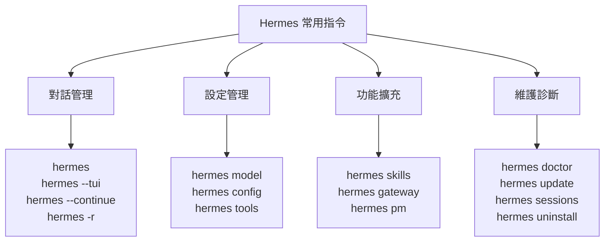
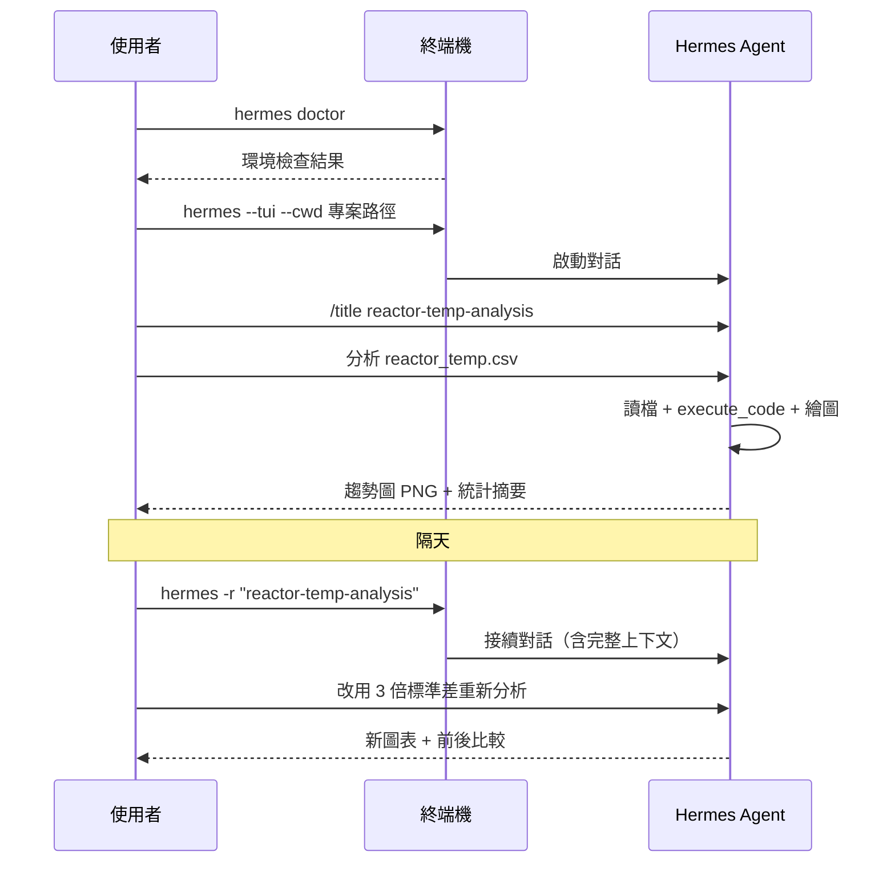

# Unit00 Hermes Agent 常用指令詳細教學

## 課程目標

本單元是 [Unit00 Hermes Agent 安裝與使用教學](Unit00_Hermes_Agent_Setup.md) 的續篇。前一份文件帶領同學完成安裝與初次設定，本文件則聚焦於 **常用指令的深入說明與實戰範例**——每一個指令都會說明其用途、語法、常用參數、執行後的預期輸出，並搭配化工學習情境的完整範例。

### 學習目標

- 熟練 Hermes Agent 的對話管理指令（`hermes`、`hermes --continue`、`hermes -r`）
- 掌握設定管理指令（`hermes config`、`hermes model`、`hermes tools`）
- 學會技能系統操作（`hermes skills`）與訊息閘道設定（`hermes gateway`）
- 能使用診斷與維護指令（`hermes doctor`、`hermes update`、`hermes pm`）自行排除問題
- 熟悉對話內斜線指令（Slash Commands）的日常應用
- 透過完整實戰範例，將指令應用於化工資料分析工作流程

### 前置需求

- 已依照 [Unit00 Hermes Agent 安裝與使用教學](Unit00_Hermes_Agent_Setup.md) 完成 Hermes Agent 安裝
- 已完成至少一次模型供應商設定，並成功進行一次對話
- 作業系統：Windows 10 / 11（本文件以 PowerShell 為主）

### 指令總覽地圖



---

## 1. 對話管理指令

### 1.1 `hermes`：開始新對話

**用途**：啟動一次全新的代理對話，這是最基本的指令。

**語法**：

```powershell
hermes [選項] [初始提示]
```

**常用參數**：

| 參數 | 說明 |
|------|------|
| （無參數） | 進入互動模式，直接輸入提示開始對話 |
| `--tui` | 以現代終端介面（TUI）啟動，介面較友善，**推薦初學者使用** |
| `--yolo` | 略過本次對話所有危險指令核准提示（**危險，慎用**） |
| `--cwd <路徑>` | 指定代理的工作目錄 |
| `--model <模型>` | 暫時指定本次對話使用的模型 |

**範例 1：互動模式開始對話**

```powershell
hermes
```

執行後會進入對話提示符，直接輸入問題即可：

```text
> 你好，請自我介紹，並列出你目前可用的工具。
```

**範例 2：直接帶入初始提示（單次任務）**

```powershell
hermes "檢查 D:\MyGit\ChemE-3590 資料夾結構，列出所有 .ipynb 檔案"
```

**範例 3：指定工作目錄與 TUI 介面**

```powershell
hermes --tui --cwd D:\MyGit\ChemE-3590\Part_1
```

> **化工情境**：做反應動力學作業時，用 `--cwd` 直接把工作目錄指到作業資料夾，代理讀寫檔案就不用每次都寫完整路徑。

### 1.2 `hermes --continue`：接續最近對話

**用途**：接續最近一次（或指定索引）的對話，保留完整上下文。

**語法**：

```powershell
hermes --continue [索引]
hermes -c [索引]
```

**範例**：

```powershell
hermes -c          # 接續最近一次對話
hermes -c 2        # 接續倒數第二次對話
```

**使用時機**：昨天做到一半的資料清理任務，今天開終端機直接 `hermes -c`，代理還記得昨天讀過哪些檔案、處理到哪一步。

### 1.3 `hermes -r`：依標題接續對話

**用途**：以對話標題搜尋並接續特定對話，適合管理多個並行專案。

**語法**：

```powershell
hermes -r "<對話標題>"
```

**範例**：

```powershell
hermes -r "kinetics-homework"
```

> **搭配技巧**：先用 `/title kinetics-homework` 為對話命名，日後才能用 `-r` 精準找回。標題建議使用英文小寫加連字號，方便輸入與搜尋。

### 1.4 `hermes sessions`：對話清單管理

**用途**：列出、檢視與管理所有歷史對話。

**常用子指令**：

| 子指令 | 說明 |
|--------|------|
| `hermes sessions list` | 列出所有對話（含標題、時間、模型） |
| `hermes sessions show <id>` | 檢視特定對話的內容摘要 |

**範例**：

```powershell
hermes sessions list
```

**預期輸出（示意）**：

```text
ID    TITLE                 MODEL                  UPDATED
3     kinetics-homework     anthropic/claude-...   2026-10-07 14:32
2     reactor-temp-analysis openai/gpt-...         2026-10-06 09:15
1     first-chat            nous/...               2026-10-05 20:01
```

---

## 2. 設定管理指令

### 2.1 `hermes model`：選擇供應商與模型

**用途**：互動式選擇 LLM 供應商（Provider）與模型（Model），或進行 OAuth 登入。

**語法**：

```powershell
hermes model
```

**互動流程**：

1. 列出所有支援的供應商（Nous Portal、Anthropic、OpenAI、OpenRouter 等）
2. 選擇供應商後，若需要認證會引導登入或輸入 API 金鑰
3. 列出該供應商可用的模型清單，選擇一個設為預設

**常見情境對照**：

| 情境 | 操作 |
|------|------|
| 第一次設定，想用 Nous Portal | 執行 `hermes setup --portal`（更快） |
| 想從 Claude 換成 GPT | 執行 `hermes model`，選 OpenAI 供應商 |
| API 金鑰過期，對話報錯 | 執行 `hermes model` 重新認證 |

> **成本提醒**：切換模型會重置提示快取（prompt cache），長對話中頻繁切換會增加成本。若只是想換個模型試試，建議另開新對話。

### 2.2 `hermes config`：設定值的讀寫

**用途**：直接讀寫個別設定值，適合腳本化或快速調整。

**語法**：

```powershell
hermes config set <key> <value>
hermes config get <key>
hermes config check
hermes config migrate
```

**常用設定項範例**：

```powershell
# 設定預設模型
hermes config set model anthropic/claude-opus-4.6

# 設定 OpenRouter API 金鑰（會自動寫入 .env）
hermes config set OPENROUTER_API_KEY sk-or-...

# 讓終端機指令在 Docker 容器中執行（沙箱隔離）
hermes config set terminal.backend docker

# 查看目前預設模型
hermes config get model
```

**設定檢查與修復**：

```powershell
hermes config check      # 檢查設定是否有缺失或過時
hermes config migrate    # 自動遷移／修復舊版設定
```

> **機密分離原則**：`hermes config set` 會自動把金鑰類的值寫入 `HERMES_HOME\.env`、一般設定寫入 `config.yaml`，不需要（也不應該）手動編輯這些檔案。

### 2.3 `hermes tools`：工具啟用管理

**用途**：檢視與設定代理可使用哪些工具（終端機、檔案、網頁搜尋、瀏覽器等）。

**語法**：

```powershell
hermes tools
```

**使用建議**：

- 初學者建議維持預設（檔案操作 + 終端機 + 網頁搜尋）
- 若代理誤用工具造成困擾，可在此關閉特定工具
- 想要瀏覽器自動化能力，需先安裝 `agent-browser`（見 3.3 節 `hermes pm`）

### 2.4 `hermes setup`：完整設定精靈

**用途**：互動式完成所有設定（供應商、模型、工具、閘道）。

**三種模式**：

| 模式 | 指令 | 適用對象 |
|------|------|---------|
| Quick Setup | `hermes setup --portal` | 有 Nous Portal 帳號（**推薦**） |
| Full Setup | `hermes setup` | 想逐一自訂所有項目 |
| Blank Slate | 精靈中選擇 | 進階使用者，只開最低限度 |

**範例**：

```powershell
hermes setup --portal
```

執行後會開啟瀏覽器進行 OAuth 登入，完成後自動設定模型供應商與工具閘道（網頁搜尋、影像生成、TTS、雲端瀏覽器）。

---

## 3. 功能擴充指令

### 3.1 `hermes skills`：技能系統操作

**用途**：瀏覽、搜尋與安裝技能（Skills）。技能是「隨需載入」的程序性知識文件，教代理如何完成特定任務。

**語法**：

```powershell
hermes skills browse                    # 列出所有可用技能
hermes skills search <關鍵字>           # 依關鍵字搜尋技能
hermes skills install <來源/路徑>       # 安裝技能（安裝前自動安全掃描）
```

**範例 1：搜尋資料分析相關技能**

```powershell
hermes skills search pandas
```

**範例 2：安裝技能**

```powershell
hermes skills install openai/skills/k8s
```

**安裝後的效果**：每個已安裝的技能會自動成為一個斜線指令，例如安裝 `k8s` 技能後：

```text
/k8s deploy the staging manifest
```

> **化工情境**：把「讀取實驗 CSV → 清理離群值 → 繪製趨勢圖 → 輸出統計摘要」的固定流程存成自訂技能，日後一個斜線指令就能重複執行整個分析流程。

### 3.2 `hermes gateway`：訊息閘道設定

**用途**：將 Hermes 連接到通訊平台（Telegram、Discord、Slack、WhatsApp、Signal、Email、Microsoft Teams 等），讓代理變成隨時可用的機器人助理。

**語法**：

```powershell
hermes gateway setup    # 互動式平台設定
hermes gateway status   # 查看閘道連線狀態
```

**範例：設定 Telegram 機器人**

```powershell
hermes gateway setup
```

互動流程會引導你：

1. 選擇平台（Telegram）
2. 輸入 BotFather 給予的 Bot Token
3. 設定允許清單（哪些使用者可以跟你的代理對話）
4. 啟動閘道並驗證連線

**驗證狀態**：

```powershell
hermes gateway status
```

> **安全提醒**：Bot Token 屬於機密，`hermes gateway setup` 會自動將其寫入 `HERMES_HOME\.env`，切勿手動貼到對話中或上傳 Git。

### 3.3 `hermes pm`：套件管理器

**用途**：管理 Hermes 內建的執行環境元件（Python、Node.js、瀏覽器工具等）。

**常用子指令**：

| 子指令 | 說明 |
|--------|------|
| `hermes pm install agent-browser` | 安裝瀏覽器自動化工具（含 Chromium） |
| `hermes pm install cua-driver` | 安裝電腦操作驅動（滑鼠鍵盤控制） |

**範例**：安裝時若用了 `-SkipBrowser` 旗標跳過瀏覽器工具，日後想補裝：

```powershell
hermes pm install agent-browser
```

### 3.4 `hermes desktop`：啟動桌面應用

**用途**：從命令列啟動 Hermes 桌面應用，沿用現有的設定、金鑰、對話與技能。

**語法**：

```powershell
hermes desktop [--cwd <路徑>]
```

**範例**：

```powershell
# 啟動桌面應用並直接開啟專案目錄
hermes desktop --cwd D:\MyGit\ChemE-3590
```

> **多介面共用**：桌面應用、CLI、TUI 共用同一份狀態。你可以在 CLI 開始一個對話，稍後用 `hermes desktop` 打開桌面應用接續，反之亦然。

---

## 4. 維護與診斷指令

### 4.1 `hermes doctor`：萬用診斷

**用途**：全面檢查安裝與設定狀態，明確指出缺少什麼以及如何修正。**遇到任何問題，第一個該執行的就是它。**

**語法**：

```powershell
hermes doctor
```

**預期輸出（示意）**：

```text
✓ Hermes core installed
✓ Python 3.10 (pinned)
✗ No model provider configured
  → Run: hermes model
✓ Terminal tools available
✗ Browser tools not installed
  → Run: hermes pm install agent-browser
```

**排查順序建議**：

1. `hermes doctor` — 先看整體健康狀態
2. `hermes model` — 供應商或金鑰問題
3. `hermes config check` — 設定值缺失或過時
4. `hermes sessions list` — 找不到舊對話時

### 4.2 `hermes update`：更新版本

**用途**：更新 Hermes Agent 到最新版本。

**語法**：

```powershell
hermes update
```

> **更新後注意**：若更新後出現設定異常，依序執行 `hermes config check` 與 `hermes config migrate` 修復。

### 4.3 `hermes uninstall`：解除安裝

**用途**：移除 Hermes Agent，可選擇移除範圍。

**移除範圍對照**：

| 指令 | 移除範圍 |
|------|---------|
| `hermes uninstall --gui` | 僅桌面應用（保留代理、設定與對話） |
| `hermes uninstall` | 應用與代理（保留設定與對話資料） |
| `hermes uninstall --full` | 全部移除（**含所有使用者資料，不可復原**） |

> **危險操作提醒**：`--full` 會刪除 `HERMES_HOME` 下所有資料（含對話記錄、記憶、技能、API 金鑰）。執行前請確認已備份重要對話或技能檔案。

---

## 5. 對話內斜線指令（Slash Commands）

在對話輸入框中輸入 `/` 會出現自動完成選單。這些指令在對話「過程中」使用，與前面的終端機指令不同。

### 5.1 常用斜線指令詳解

| 指令 | 說明 | 使用時機 |
|------|------|---------|
| `/help` | 顯示所有可用指令 | 忘記指令時 |
| `/tools` | 列出目前可用的工具 | 確認代理有哪些能力 |
| `/model` | 互動式切換模型 | 對話中途想換模型 |
| `/save` | 儲存目前對話 | 完成重要階段時 |
| `/title <名稱>` | 為對話命名 | 開始長任務前（方便日後 `-r` 接續） |
| `/compress` | 壓縮（摘要）對話歷史 | 對話很長、token 用量高時 |
| `/usage` | 查看 token 用量 | 監控成本 |
| `/verbose` | 切換工具輸出顯示模式 | 想看（或隱藏）工具執行細節 |
| `/yolo` | 切換 YOLO 模式 | **危險**：略過危險指令核准，僅在受控環境使用 |

**範例：長對話的成本管理流程**

```text
> /title reactor-analysis        ← 命名對話
> /usage                         ← 檢查用量
> （進行多輪資料分析...）
> /compress                      ← token 變多時壓縮歷史
> /usage                         ← 確認壓縮後用量下降
```

### 5.2 斜線指令 vs 終端機指令

| 面向 | 斜線指令（`/model`） | 終端機指令（`hermes model`） |
|------|---------------------|------------------------------|
| 執行位置 | 對話輸入框內 | PowerShell 終端機 |
| 影響範圍 | 通常僅目前對話 | 全域設定（寫入 config） |
| 適用場景 | 對話進行中的即時調整 | 對話開始前的環境準備 |

> **記憶口訣**：斜線指令管「這場對話」，終端機指令管「整個代理」。

---

## 6. 實戰範例：化工資料分析工作流程

以下用一個完整情境串連所有指令：**分析反應器溫度數據並產生報告**。

### 6.1 情境描述

你有一批反應器溫度感測器數據（`reactor_temp.csv`），需要：清理離群值、繪製趨勢圖、計算統計摘要，並在隔天繼續追加分析。

### 6.2 步驟一：環境準備（終端機）

```powershell
# 1. 確認環境健康
hermes doctor

# 2. 以專案目錄為工作目錄，開啟 TUI 對話
hermes --tui --cwd D:\ChemE-projects\reactor-data
```

### 6.3 步驟二：對話內操作

```text
> /title reactor-temp-analysis
> 讀取 reactor_temp.csv，檢查缺失值與離群值，
  繪製溫度對時間的趨勢圖並存成 PNG，輸出統計摘要。
```

代理會自動：讀檔 → 用 `execute_code` 執行 Python（pandas / matplotlib）→ 產生圖檔與摘要。

> **多行輸入提示**：在 TUI 中輸入多行提示時，以 `Alt+Enter` 或 `Ctrl+J` 換行，最後才按 `Enter` 送出。

### 6.4 步驟三：隔天接續（終端機）

```powershell
# 方式一：接續最近對話
hermes -c

# 方式二：依標題精準接續
hermes -r "reactor-temp-analysis"
```

接續後直接追加新需求：

```text
> 把離群值判定改用 3 倍標準差，重新繪圖並比較前後差異。
```

### 6.5 步驟四：流程固化為技能（進階）

若此分析流程會反覆執行，可請代理把做法存成技能：

```text
> 把剛剛的溫度數據分析流程存成一個技能，命名為 temp-analysis
```

日後在新資料上只需：

```text
> /temp-analysis 分析 batch_2026_10.csv
```

### 6.6 完整指令時序圖



---

## 7. 常用指令速查表

### 7.1 終端機指令（依使用頻率排序）

| 頻率 | 指令 | 一句話說明 |
|------|------|-----------|
| ★★★ | `hermes` | 開始對話 |
| ★★★ | `hermes --tui` | 以 TUI 介面開始對話（推薦） |
| ★★★ | `hermes -c` | 接續最近對話 |
| ★★★ | `hermes -r "<標題>"` | 依標題接續對話 |
| ★★☆ | `hermes model` | 選擇供應商與模型 |
| ★★☆ | `hermes doctor` | 診斷問題（萬用） |
| ★★☆ | `hermes setup --portal` | Nous Portal 快速設定 |
| ★★☆ | `hermes config set/get` | 讀寫設定值 |
| ★★☆ | `hermes desktop` | 啟動桌面應用 |
| ★☆☆ | `hermes sessions list` | 列出對話清單 |
| ★☆☆ | `hermes skills browse/search/install` | 技能管理 |
| ★☆☆ | `hermes gateway setup/status` | 訊息閘道 |
| ★☆☆ | `hermes tools` | 工具啟用管理 |
| ★☆☆ | `hermes pm install <套件>` | 安裝環境元件 |
| ★☆☆ | `hermes update` | 更新版本 |
| ★☆☆ | `hermes config check/migrate` | 設定檢查與修復 |
| 慎用 | `hermes --yolo` / `/yolo` | 略過核准提示（危險） |
| 慎用 | `hermes uninstall [--full]` | 解除安裝（`--full` 不可復原） |

### 7.2 對話內斜線指令

| 指令 | 一句話說明 |
|------|-----------|
| `/help` | 顯示所有指令 |
| `/title <名稱>` | 命名對話（方便 `-r` 接續） |
| `/compress` | 壓縮對話歷史省 token |
| `/usage` | 查看 token 用量 |
| `/model` | 對話中途切換模型 |
| `/save` | 儲存對話 |
| `/tools` | 列出可用工具 |
| `/verbose` | 切換工具輸出顯示 |

---

## 8. 常見錯誤與排除

| 症狀 | 可能原因 | 解決指令 |
|------|---------|---------|
| `hermes: command not found` | PATH 未更新 | 重開終端機；無效則 `hermes doctor` |
| `API key not set` | 金鑰未設定或過期 | `hermes model` 重新認證 |
| 對話回覆空白 | 供應商認證或模型錯誤 | `hermes model` → `hermes doctor` |
| `hermes -r` 找不到對話 | 對話未命名或設定檔不同 | `hermes sessions list` 確認 |
| 更新後設定異常 | 設定格式過時 | `hermes config check` → `hermes config migrate` |
| token 用量暴增 | 對話過長或頻繁切換模型 | `/compress`；必要時另開新對話 |

---

## 9. 小結

本文件深入說明了 Hermes Agent 的常用指令，涵蓋四大類：

1. **對話管理**：`hermes`、`--continue`、`-r`、`sessions` — 日常使用的主戰場
2. **設定管理**：`model`、`config`、`tools`、`setup` — 環境準備與調整
3. **功能擴充**：`skills`、`gateway`、`pm`、`desktop` — 進階能力
4. **維護診斷**：`doctor`、`update`、`uninstall` — 排除問題

**學習建議**：先熟練 ★★★ 等級的四個對話指令，搭配 `/title` 與 `/compress` 兩個斜線指令，就足以應付日常的化工資料分析工作。其餘指令在需要時再回來查閱即可。

> **延伸閱讀**：安裝與介面導覽請見 [Unit00 Hermes Agent 安裝與使用教學](Unit00_Hermes_Agent_Setup.md)；完整官方文件請參考 [Hermes Agent Docs](https://hermes-agent.nousresearch.com/docs)。

---

**課程資訊**
- 課程名稱：AI在化工上之應用 (ChemE 3590)
- 課程單元：Hermes Agent 常用指令詳細教學
- 課程製作：逢甲大學 化工系 智慧程序系統工程實驗室
- 授課教師：莊曜禎 助理教授
- 更新日期：2026-10-07

**課程授權 [CC BY-NC-SA 4.0]**
 - 本教材遵循 [創用CC 姓名標示-非商業性-相同方式分享 4.0 國際 (CC BY-NC-SA 4.0)](https://creativecommons.org/licenses/by-nc-sa/4.0/deed.zh) 授權。

