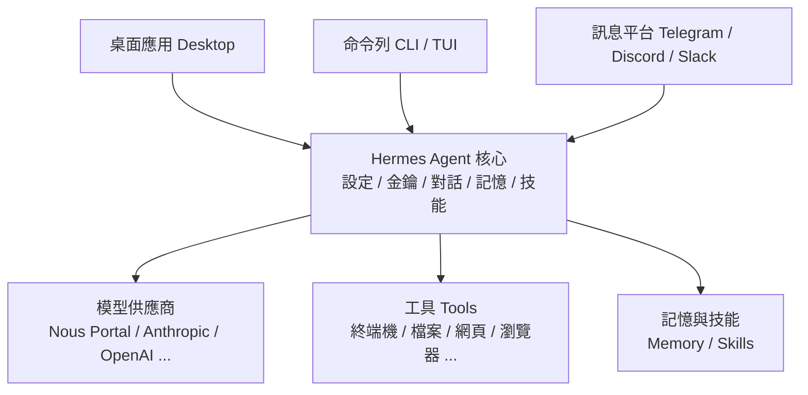

# Unit00 Hermes Agent 安裝與使用教學

## 課程目標

本單元將帶領學生認識並實際操作 **Hermes Agent**——由 [Nous Research](https://nousresearch.com/) 開發的自主型 AI 代理（AI Agent）。有別於綁定在 IDE 內的程式輔助工具或單純的聊天機器人，Hermes Agent 是一個「會隨著使用而成長」的智慧代理：它擁有持久記憶、能自動產生並改進技能（Skills）、可呼叫多種工具（Tools），並且能同時在桌面應用、命令列（CLI）與多種通訊平台上運作。

在化工領域的 AI 學習與研究中，一個能夠自主執行多步驟任務、串接檔案系統與終端機、並保留長期記憶的代理，對於資料前處理、文獻整理、程式碼輔助、流程模擬腳本撰寫等工作都極具價值。本單元將以 **Windows 桌面應用程式** 為主軸，帶領學生完成安裝、初次設定，並掌握基本操作與核心功能。

### 學習目標

- 理解 AI Agent 的基本概念，以及 Hermes Agent 與一般聊天機器人的差異
- 完成 Windows 平台上 Hermes Agent 的安裝（桌面安裝程式與命令列兩種方式）
- 使用 Nous Portal 完成模型（Provider/Model）與工具的初次設定
- 熟悉 Hermes 桌面應用的介面與基本操作流程
- 認識記憶系統、技能系統、子代理、排程與訊息閘道等核心功能
- 掌握常用 CLI 指令，並能處理常見的安裝與設定問題

---

## 1. 什麼是 Hermes Agent？

### 1.1 基本概念

**Hermes Agent** 是一個「自我改進」的 AI 代理程式。它的核心特色是內建了一個 **學習迴圈（Learning Loop）**：從實際操作經驗中建立技能、在使用過程中持續改進這些技能、主動提醒自己保存知識，並在多次對話（Session）之間逐步建立對使用者與專案的理解。

與常見工具的差異：

| 工具類型 | 特性 | 與 Hermes 的差異 |
|---------|------|-----------------|
| IDE 內的程式輔助（如 Copilot） | 綁定編輯器、聚焦於程式碼補全 | Hermes 是獨立自主代理，可跨平台運作、執行多步驟任務 |
| 一般聊天機器人 | 單一 API 的對話包裝、無持久記憶 | Hermes 具備跨對話的持久記憶與工具呼叫能力 |
| Hermes Agent | 自主、可成長、跨平台、可呼叫工具 | 同一個代理、同一份記憶，存在於各種介面上 |

### 1.2 主要特色

Hermes Agent 官方文件列出以下重點特色：

- **持久記憶（Persistent Memory）**：代理會學習你的專案、自動產生技能，並且不會忘記解決過問題的方法。
- **技能系統（Skills System）**：以 `SKILL.md` 檔案描述的「程序性記憶」，代理只在任務需要時才載入完整技能內容，因此新增技能不會拖累每次請求的效能。相容於開放標準 [agentskills.io](https://agentskills.io/)。
- **無所不在（Lives Everywhere）**：同一個代理可在 CLI、Telegram、Discord、Slack、WhatsApp、Signal、Email 等 30 多個平台上運作，共用同一份記憶。
- **排程自動化（Scheduled Automation）**：內建 cron，可用自然語言排定報告、備份、簡報等自動化任務。
- **委派與平行化（Delegate）**：可產生獨立的子代理（Subagents），各自擁有對話、終端機與 Python RPC 腳本，用於零上下文成本的平行工作流程。
- **網頁與工具能力（Search & Tools）**：網頁搜尋、瀏覽器自動化、視覺辨識、影像生成、文字轉語音（TTS）與多模型推理。
- **隔離沙箱（Isolated Sandboxing）**：內建六種終端機後端——local、Docker、SSH、Modal、Daytona 與 Vercel Sandbox，並可透過外掛加入 Singularity／Apptainer 等容器後端，提供容器強化與命名空間隔離。
- **多種前端介面**：桌面應用（Desktop App）、命令列（CLI `hermes`）、現代終端介面（TUI `hermes --tui`）與網頁儀表板（Web Dashboard）——它們共用同一份狀態，可在其中一個介面開始、在另一個介面接續。

> **注意**：Hermes Agent 為開源專案（MIT License），原始碼位於 [GitHub](https://github.com/NousResearch/hermes-agent)。

### 1.3 架構概觀：同一個代理，多種介面

Hermes 的核心是一個代理執行環境（agent runtime）。無論你使用桌面應用、CLI、TUI 或訊息平台，背後其實是同一個代理、同一份設定、金鑰、對話、記憶與技能。桌面應用會在本機啟動一個 `hermes serve` 後端程序，各介面再與它溝通，因此你可以在某個介面開始對話、在另一個介面接續。



---

## 2. 系統需求與事前準備

### 2.1 作業系統需求

- **Windows 10 / 11**（本單元主軸）
- 其他平台：macOS 12+（Apple Silicon）、各種 Linux 發行版亦有支援

### 2.2 事前準備

1. **穩定的網路連線**：安裝過程與模型推理皆需連網。
2. **Nous Portal 帳號（建議）**：最快的上手方式是使用 Nous Portal，一次訂閱即可存取數百種模型（涵蓋 Claude、GPT、Gemini 等，共 300 種以上）與內建的工具閘道（Tool Gateway，包含網頁搜尋、影像生成、TTS、雲端瀏覽器）。
   - 前往 [Nous Portal](https://portal.nousresearch.com/) 建立帳號。
   - Portal 提供免費方案（價格為 0、僅限免費模型、標準速率限制，且不含託管工具）與多種付費方案（Plus／Super／Ultra）；只有付費方案才包含工具閘道（網頁搜尋、影像生成、TTS、雲端瀏覽器）。
3. **（選用）自備 API 金鑰**：若不使用 Nous Portal，Hermes 也支援 OpenAI、Anthropic、OpenRouter、Google AI Studio、GitHub Copilot 等多家供應商，屆時需準備對應的 API 金鑰。

> **模型最低需求：至少 64K tokens 上下文**
> Hermes Agent 需要上下文視窗至少 64,000 tokens 的模型，才能維持多步驟工具呼叫所需的工作記憶。大多數雲端模型（Claude、GPT、Gemini、Qwen、DeepSeek）都能輕鬆滿足此需求。

---

## 3. 安裝 Hermes Agent

Windows 平台提供兩種安裝方式：**桌面安裝程式（推薦）** 與 **命令列安裝**。兩者安裝的其實是同一個 Hermes Agent 核心，使用相同的設定、金鑰、對話與技能，因此可以互通。

### 3.1 方式一：桌面安裝程式（推薦）

這是最簡單的方式。其中 `Hermes-Setup.exe` 會一次安裝命令列工具與桌面應用程式；Microsoft Store 版則是「隨裝即用」的打包版本（已內含代理、Python 與相依套件），第一次啟動不需要在本機建置執行環境。

**安裝步驟：**

1. 前往官方網站 [https://hermes-agent.nousresearch.com/](https://hermes-agent.nousresearch.com/)。
2. 在 **Hermes Desktop App** 區塊找到 **Windows**（Windows 10/11），此處提供兩種下載方式：
   - **MICROSOFT STORE**：從 Microsoft Store 安裝商店版（MSIX 套件）。此版本需要 **Windows 11 22H2 或更新版本**，Windows 10 不支援。
   - **Download .exe instead**：下載 `Hermes-Setup.exe`，適用於 Windows 10/11，且**不需要系統管理員權限**。
3. 執行下載的安裝檔，依照畫面指示完成安裝。
   - `Hermes-Setup.exe` 是一個「引導式安裝程式」：它會下載 Hermes 原始碼並在本機建置桌面應用，同時一併安裝命令列工具。
   - 此過程需要網路連線與一些磁碟空間，並可能花費數分鐘，請耐心等候。
4. 安裝完成後，從「開始」功能表啟動 **Hermes** 桌面應用；若已安裝命令列工具，也可在終端機執行 `hermes desktop` 啟動。
5. **驗證安裝**（適用於 `Hermes-Setup.exe` 與命令列安裝）：**重新開啟**一個 PowerShell 視窗（讓新的 PATH 生效），執行：

```powershell
hermes --version
```

若顯示版本資訊（例如 `Hermes Agent v0.22.5 ...`、安裝目錄與 Python 版本），代表命令列工具安裝成功。

> **MSIX／Store 版差異**：MSIX 打包版同樣提供 `hermes`、`hermes-agent` 與 `hermes-acp` 三個**執行別名**，因此命令列也能直接使用；但它不會在 `%LOCALAPPDATA%\hermes\` 下建立 `hermes-agent\` 原始碼目錄（原始碼安裝才有）。若 `hermes` 被其他安裝遮蔽，可用 `Get-Command hermes -All` 檢查，並在 Windows 設定 → 應用程式 → 進階應用程式設定 → 應用程式執行別名中調整。

> **提示**：若你只需要命令列版本、不想安裝桌面應用，可跳過本節，直接採用 3.2 的方式二；日後想加上桌面應用時再執行 `hermes desktop` 即可。

**Windows 上的資料位置：**

所有使用者資料（設定、金鑰、對話、記憶、技能）都集中在 `HERMES_HOME`，在 Windows 上預設為 `%LOCALAPPDATA%\hermes\`（`HERMES_HOME` 是可覆寫的環境變數，若想改放到其他磁碟，須在安裝前先設定）：

```text
%LOCALAPPDATA%\hermes\          ← HERMES_HOME（使用者資料根目錄）
├─ config.yaml                  ← 非機密設定
├─ .env                         ← 機密（API 金鑰、權杖）
├─ state.db                     ← 對話歷史（SQLite，含 FTS5 全文索引）
├─ memories\                    ← 持久記憶（MEMORY.md、USER.md）
├─ skills\                      ← 技能
├─ sessions\                    ← 對話暫存檔與除錯用請求傾印
├─ logs\                        ← 日誌
├─ bin\                         ← 命令列啟動器（原始碼安裝才有；MSIX 改用執行別名）
└─ hermes-agent\                ← 程式主體與相依套件（原始碼安裝才有）
```

> **說明**：對話歷史（Session）儲存在 `state.db`（SQLite）中，而非 `sessions\` 目錄；`sessions\` 只存放暫存檔與除錯用的請求傾印。持久記憶則是 `memories\` 下的 `MEMORY.md` 與 `USER.md`。

### 3.2 方式二：命令列安裝（PowerShell）

若只想安裝命令列版本（不含桌面應用），可使用 PowerShell 一行指令安裝。

1. 開啟 **PowerShell**。
2. 執行以下指令（`iex (irm ...)` 等同於 `irm ... | iex`，都是下載並執行安裝指令碼）：

```powershell
iex (irm https://hermes-agent.nousresearch.com/install.ps1)
```

安裝程式會將 Hermes 安裝到 `%LOCALAPPDATA%\hermes\`，並把 `hermes` 加入**使用者 PATH**（不需要系統管理員權限），因此安裝完成後必須**重新開啟**終端機才會生效。

> **安全提醒**：此指令會直接執行從網路下載的指令碼。請務必確認網址為官方網域 `hermes-agent.nousresearch.com`，避免執行來路不明的指令碼。

3. 安裝完成後即為命令列版本；若之後想加上桌面應用，執行：

```powershell
hermes desktop
```

這個指令會先安裝桌面應用所需的 Node 相依套件、建置桌面應用，再啟動它；設定、金鑰、對話與技能都會沿用既有資料。

**安裝程式做了什麼？**

命令列安裝程式會複製原始碼、啟動 uv，並透過內建套件管理器（PM）準備相依套件。PM 會提供釘選版本的 Python、Node.js、npm、pnpm、ripgrep 與 FFmpeg，並預設安裝瀏覽器工具（`agent-browser` 與其內附的 Chromium）與電腦操作驅動（`cua-driver`）。

若不需要瀏覽器工具或電腦操作驅動，可在安裝時傳入對應旗標 `-SkipBrowser`／`-SkipComputerUse`。由於指令碼是透過網路下載執行，需以 scriptblock 形式傳入參數，例如：

```powershell
& ([scriptblock]::Create((irm https://hermes-agent.nousresearch.com/install.ps1))) -SkipBrowser
```

> **說明**：此處改用 `[scriptblock]::Create()` 而非直接 `iex`，是因為 `iex` 無法接收 `-SkipBrowser` 這類命令列參數；轉成 ScriptBlock 後才能用 `&` 呼叫並傳入旗標。

日後可用 `hermes pm install agent-browser` 重新安裝瀏覽器工具。

> **疑難排解**：若 PowerShell 因執行原則（ExecutionPolicy）阻擋腳本，可先執行 `Get-ExecutionPolicy -Scope CurrentUser` 檢查；必要時以 `Set-ExecutionPolicy -Scope CurrentUser RemoteSigned` 放寬目前使用者的設定（無需系統管理員權限），但請先了解其安全意涵。

---

## 4. 首次設定（Setup）

安裝完成後，第一件事是設定 **模型供應商（Provider）** 與 **模型（Model）**。這是整個設定流程中最重要的一步——若 Hermes 無法完成一次正常的對話，請先讓對話正常運作，再加入其他功能。

本教學以 **Windows 桌面應用** 為主，建議初學者採用下方 **4.1 的圖形介面（GUI）流程**，全程使用滑鼠即可完成、不必碰終端機；若你偏好命令列或想批次設定，可參考 4.2 的命令列流程。

### 4.1 桌面應用首次設定（GUI 導向，推薦）

第一次啟動 Hermes 桌面應用時，會出現「首次設定精靈（onboarding）」，引導你在幾分鐘內完成到第一次對話。步驟如下：

1. **啟動應用**：從「開始」功能表點擊 **Hermes** 圖示。
2. **進入首次設定精靈（onboarding）**：首次啟動會顯示歡迎與設定畫面（onboarding 精靈）。你可以直接在精靈中設定供應商，或點選 **I'll choose a provider later**（稍後再選供應商）先進入應用主畫面、之後再到設定面板完成。
3. **登入 Nous Portal（推薦）**：可直接在精靈中操作；若已略過精靈，請開啟 **設定面板**——點擊左側邊欄下方的齒輪圖示（Settings）或按 `Ctrl+,`，再選擇 **Providers（供應商）**：
   - 在 Providers 面板，Nous Portal 等 OAuth 供應商可點選 **Sign in with Nous Research** 以瀏覽器登入；登入後憑證會自動儲存。
   - 若使用其他供應商，可在 **Accounts / API keys** 區輸入對應的 API 金鑰。
4. **選擇預設模型**：開啟 **Settings → Model** 設定新對話的「主要模型（main model）」；也可用對話輸入框的模型選擇器即時切換（詳見 5.6）。
5. **確認完成**：回到對話區，輸入一句簡單的提示（例如「你好，請自我介紹」），若收到正常回覆即代表設定成功。

> **提示**：桌面應用中所有設定都有圖形介面，不需要手動編輯 YAML。供應商、模型、工具、MCP 伺服器、訊息閘道與對話管理都能在 Settings 面板中完成。

### 4.2 命令列首次設定（進階／替代路徑）

若你偏好命令列，可在安裝後執行設定精靈。最快的方式是使用 Nous Portal：

```powershell
hermes setup --portal
```

這個指令會：登入你的 Nous 帳號、將 Nous 設為模型供應商，並選擇啟用工具閘道（Tool Gateway，涵蓋網頁搜尋、影像生成、TTS、雲端瀏覽器）。

> **前提**：工具閘道僅包含在 Nous Portal 的**付費方案**中；免費方案只能使用免費模型，不含託管工具（但你仍可自行設定各家工具的 API 金鑰）。

**首次安裝**執行 `hermes setup` 時，會提供三種設定模式（既有安裝則預設進入重新設定流程）：

- **Quick Setup（Nous Portal）**：OAuth 登入、免管理 API 金鑰，一次設定好模型與工具閘道（對應指令 `hermes setup --portal`）。**建議的快速路徑**。
- **Full Setup**：自行逐一設定每個供應商、工具與選項（自備金鑰）。
- **Blank Slate**：除了執行代理所需的最低限度（供應商與模型、檔案操作工具集、終端機工具集）外，其餘全部關閉。適合想要完全掌控的進階使用者。

桌面應用與命令列共用同一份設定，因此在任一邊完成設定，另一邊都會沿用。

### 4.3 選擇其他供應商

若不使用 Nous Portal，可用以下指令以互動方式選擇供應商與模型：

```powershell
hermes model
```

Hermes 支援眾多供應商，常見選擇包括：

| 供應商 | 說明 | 設定方式 |
|--------|------|---------|
| Nous Portal | 訂閱制、零設定 | 透過 `hermes model` 進行 OAuth 登入 |
| Anthropic | 直接使用 Claude 模型 | OAuth 登入，或提供 Anthropic API 金鑰 |
| OpenAI Codex | ChatGPT / Codex 訂閱 | 透過 `hermes model` 進行裝置碼認證 |
| OpenRouter | 跨多家供應商路由 | 輸入 API 金鑰 |
| GitHub Copilot | GitHub Copilot 訂閱 | 透過 `hermes model` 進行 OAuth 裝置碼認證（或設 `COPILOT_GITHUB_TOKEN`／`GH_TOKEN`） |
| Google AI Studio | Gemini 模型 | 設定 `GOOGLE_API_KEY` / `GEMINI_API_KEY` |
| Custom Endpoint | VLLM、Ollama 等 OpenAI 相容 API | 設定 base URL 與 API 金鑰 |

### 4.4 設定的儲存位置

Hermes 將「機密」與「一般設定」分開存放：

- **機密與權杖（Secrets / Tokens）** → `HERMES_HOME\.env`
- **非機密設定** → `HERMES_HOME\config.yaml`

最保險的設定方式是透過 CLI 或桌面 GUI，讓正確的值自動寫入正確的檔案：

```powershell
hermes config set model <provider/model>
```

> **安全提醒**：`.env` 檔案內含 API 金鑰等機密資訊，切勿將其上傳至版本控制系統（如 Git）或公開分享。
>
> **避免把金鑰打在命令列**：若執行 `hermes config set OPENROUTER_API_KEY sk-or-...`，金鑰會以明文留在 PowerShell 歷史紀錄（`ConsoleHost_history.txt`）中。建議改用桌面 GUI 的 **Settings → Providers**，或 `hermes model` 的互動式輸入；若已誤用，請立即至供應商後台更換（revoke）該金鑰，並清除歷史紀錄。

可用 `hermes config path` 與 `hermes config env-path` 查詢 `config.yaml` 與 `.env` 的實際位置。

---

## 5. Hermes 桌面應用介面導覽

Hermes 桌面應用是以「對話優先（chat-first）」設計的原生應用程式，左側為導覽側邊欄，可同時管理多個代理對話、設定訊息供應商、瀏覽專案資料夾並同時處理多個專案。若已透過命令列安裝，也可直接執行 `hermes desktop` 啟動，它會沿用你現有的設定、金鑰、對話與技能。

桌面應用的主要區塊：

### 5.1 對話區（Chat）

應用程式的核心。提供：

- **串流回應**：即時顯示模型回覆與工具呼叫的活動摘要。
- **共用的對話歷史**：在此開始的對話可在 CLI / TUI 接續，反之亦然。
- **拖放檔案**：可將檔案拖曳到對話區，作為下一則訊息的附件。
- **模型選擇器**：對話輸入框（composer）左側有模型選擇器，可即時切換目前對話使用的模型（詳見 5.6）。
- **右側預覽軌（Preview Rail）**：可並排渲染網頁、檔案與工具輸出，一邊檢視一邊對話。
- **對話時間軸**：長對話會在側邊出現一條細長的標記軌，每個提示各一個標記；滑鼠移上去會展開提示清單，點選即可跳到該處。跳轉後可用對話上方的 **Show earlier** 繼續往前翻頁。

### 5.2 底部狀態列（Status Bar）

顯示即時的對話狀態與快速控制：

- **每對話 YOLO 切換**：可針對單一對話開關 YOLO 模式。YOLO 會略過危險指令的核准提示，請務必了解你關閉的是什麼保護。（按住 `Shift` 再點擊則改為全域切換。）
- **上下文使用量計量表**：即時顯示對話上下文視窗的「已使用百分比」，點擊可展開 **Context Usage** 面板，查看各類別的 token 用量明細：系統提示（System prompt）、工具定義（Tool definitions）、子代理定義（Subagent definitions）、MCP、技能（Skills）、記憶（Memory）、規則（Rules）與對話本身（Conversation）。面板中也可直接執行「Compact conversation」壓縮對話。
- **快取命中率與 tokens/秒**：預設可能不顯示；在狀態列上按**右鍵**開啟選單，即可勾選要顯示的項目（包含快取命中率、tokens/秒、工作區、代理、cron 等），也可在此隱藏整個狀態列。勾選後可觀察對話「暖機」後成本降低的情形（例如 `87%` 快取命中率、`42 t/s` 滾動吞吐量）。

### 5.3 檔案瀏覽器（File Browser）

可在不離開應用的情況下瀏覽與預覽工作目錄，方便跟著代理讀寫、編輯檔案。可用 `hermes desktop --cwd <path>` 設定初始專案目錄。

### 5.4 內建終端機（Terminal）

右側邊欄內建真正的終端機，位於檔案瀏覽器旁：

- 快捷鍵 `` Ctrl+` `` （Control 加反引號）顯示終端機。
- 隱藏面板時 shell 仍保持運作，scrollback 與執行中的程序不會中斷。
- 可將終端機輸出選取後加入對話，作為下一則訊息的上下文。

### 5.5 Git 檢視與 Worktrees

對於在 Git 儲存庫內執行的對話，應用內建原始碼控制介面：

- **檢視窗格**：`Cmd/Ctrl+G` 切換工作樹檢視，顯示分支與 ahead/behind 狀態、變更檔案（清單或樹狀）與差異；差異可切換 **Uncommitted**、**Branch** 或 **Last turn**（僅顯示代理最近一回合的變更）三種範圍。可暫存／取消暫存、還原變更、撰寫 commit 訊息（或 **Generate commit message**），再 **Commit** 或 **Commit & Push**；也可透過 GitHub CLI（`gh`）按 **Create PR**，或直接 **Ask Hermes to open PR** 交給代理處理。此處也能建立與切換分支。
- **Worktrees**：`Cmd/Ctrl+Shift+B`（或側邊欄專案上的 **New worktree**）可建立 Git worktree，讓代理在平行副本上作業而不影響你的 checkout；移除時可選擇刪除 worktree 目錄（分支保留）或只隱藏該 lane 而留在磁碟上。

### 5.6 設定與管理面板

透過真正的 UI（而非手動編輯 YAML）管理供應商、模型、工具與憑證：

- **Providers（供應商）**：管理推理供應商，提供 Accounts / API 金鑰的登入與憑證儲存。
- **Model（模型）**：在 Settings → Model 設定新對話的預設「主要模型」；也可在對話輸入框左側的 **模型選擇器** 即時切換目前對話使用的模型（可設定 thinking / effort / fast 等選項）。即時切換只影響目前對話，且會重置提示快取。
- **Skills（技能）**：`Capabilities → Skills` 管理已安裝技能，並可從技能中心（Skills Hub）瀏覽安裝。
- **Plugins（外掛）**、**Cron（排程）**、**Profiles（設定檔）**、**Messaging（訊息閘道）** 等管理介面。

### 5.7 其他實用功能

- **命令面板（Command Palette）**：`Ctrl+K` 或 `Ctrl+P` 快速跳至任何頁面或動作（開啟設定、切換模型/主題、搜尋對話等）。
- **多分頁與多視窗**：`Ctrl+T` 開新對話分頁、`Ctrl+Shift+N` 開新視窗，方便一邊對話一邊查看檔案。
- **介面模式（Simple / Advanced）**：可在 Settings → Appearance（外觀）或命令面板切換。**Advanced（進階，預設）** 顯示完整面板；**Simple（簡易）** 以對話為主、收起終端機與檔案瀏覽器等技術性面板，適合初學者。
- **介面語言切換到繁體中文**：在 Settings → Appearance（外觀）中可將介面語言切換為繁體中文（zh-Hant），另支援簡體中文、英文、日文等。
- **HUD 模式**：`Ctrl+Shift+H` 將對話分離成無邊框、永遠置頂的浮動列，疊在你正在處理的視窗上。
- **Quick Entry（快速輸入）**：以全域快捷鍵（預設 `Ctrl+Shift+Space`）從任何地方叫出小型輸入框，不必切換到主視窗即可送出提示。此功能預設關閉，需先在 **Settings → Advanced → Quick Entry** 啟用；若該組合鍵已被其他應用占用，同一處會提示並可改綁。
- **Bot Mode**：內建的「一個代理一個對話」的機器人名冊，可建立專精的代理團隊並互相協作；適合需要多個各司其職代理的專案。

### 5.8 桌面應用快捷鍵速查表

| 快捷鍵 | 功能 |
|--------|------|
| `Ctrl+N` | 開新對話 |
| `Ctrl+T` | 開新對話分頁 |
| `Ctrl+Tab` / `Ctrl+Shift+Tab` | 循環切換分頁 |
| `Ctrl+1`～`9` | 跳至第 N 個分頁 |
| `Ctrl+W` | 關閉目前分頁 |
| `Ctrl+Shift+N` | 開新視窗 |
| `Ctrl+K` 或 `Ctrl+P` | 命令面板 |
| `Ctrl+,` | 開啟設定（Settings） |
| `Ctrl+/` | 鍵盤快捷鍵設定 |
| `Ctrl+B` | 切換左側邊欄 |
| `Ctrl+J` | 切換右側邊欄（桌面應用；在 CLI / TUI 輸入框中 `Ctrl+J` 則為換行） |
| `` Ctrl+` `` | 顯示終端機 |
| `Ctrl+G` | Git 檢視窗格 |
| `Ctrl+F` | 在對話中尋找 |
| `Ctrl+Shift+F` | 搜尋對話 |
| `Ctrl+Shift+H` | HUD 模式 |
| `Ctrl+Shift+Space` | Quick Entry 快速輸入（全域，需先於設定啟用、可自訂） |
| `Shift+X` | 切換淺色／深色 |

> **提示**：桌面應用的快捷鍵可在 **Settings → Keyboard Shortcuts**（或按 `Ctrl+/`）自訂。

---

## 6. 基本使用

### 6.1 第一次對話

#### 在桌面應用中（推薦）

1. 從「開始」功能表啟動 **Hermes** 桌面應用（或在終端機執行 `hermes desktop`）。
2. 在中央 **對話區** 下方的輸入框（composer）輸入你的提示。
3. 按 **Enter** 送出；若要換行，在桌面應用按 `Shift+Enter`（CLI / TUI 的換行按鍵見 6.3）。
4. Hermes 會以 **串流方式** 即時顯示回覆，並在需要時呼叫工具（終端機、讀檔、網頁搜尋），你可在對話中看到工具活動摘要。
5. 若要 **中斷** 代理，直接輸入新訊息送出即可覆蓋目前任務，或按介面上的停止鈕（在 CLI / TUI 中也可按 `Ctrl+C`）。
6. 可將檔案 **拖放** 到對話區，作為下一則訊息的附件；或按 `Ctrl+V` 貼上剪貼簿圖片。

建議用「具體且容易驗證」的提示開始，例如：

```text
你好，請自我介紹，並列出你目前可用的工具。
檢查我指定的資料夾，告訴我哪個看起來像主要的專案檔案。
```

#### 在命令列（CLI / TUI）中

若你偏好終端機，也可用以下兩種介面開始對話：

```powershell
hermes            # 傳統 CLI
hermes --tui      # 現代 TUI（偏好終端機者推薦）
```

**成功的樣子：**

- 標題列或狀態列顯示你選擇的模型／供應商
- Hermes 正常回覆，沒有錯誤
- 需要時能呼叫工具（終端機、讀檔、網頁搜尋）
- 對話能持續超過一個回合

> **若沒有收到回覆或出現錯誤**：依序檢查 (1) 供應商是否已登入、(2) API 金鑰是否正確、(3) 網路連線是否正常、(4) 所選模型是否可用。更多協助見 11.1 常見錯誤對照表。

### 6.2 斜線指令（Slash Commands）

在對話輸入框（桌面應用的 composer 或 CLI）中輸入 `/` 會出現自動完成的指令下拉選單：

| 指令 | 說明 |
|------|------|
| `/help` | 顯示所有可用指令（`/help skills` 列出技能指令） |
| `/tools [list\|disable\|enable]` | 管理工具（僅 CLI） |
| `/model` | 互動式切換模型（`--global` 可寫入預設值） |
| `/personality pirate` | 試試有趣的人格設定 |
| `/save <json\|md\|html> [檔名]` | 匯出目前對話；CLI 需指定格式，TUI／桌面應用可省略（桌面會開儲存對話框） |
| `/title <名稱>` | 為目前對話命名 |
| `/compress` | 壓縮（摘要）對話歷史以節省 token |
| `/usage` | 查看 token 用量 |
| `/verbose` | 切換工具輸出顯示模式（僅 CLI；桌面應用請改用內建終端機面板） |
| `/yolo` | 切換 YOLO 模式（略過危險指令核准，詳見 8.3） |
| `/approvals [manual\|smart\|off]` | 檢視或切換危險指令核准模式（詳見 8.2） |

> **適用範圍**：多數斜線指令在桌面應用、CLI 與 TUI 中通用，但少數指令只在特定介面提供。例如 `/tools` 僅限 CLI／TUI；`/verbose`、`/cron`、`/platforms` 在桌面應用會提示改在終端機執行。若透過訊息閘道（Telegram / Discord 等）運作，另有部分指令只在閘道提供（如 `/approve`、`/deny`、`/pause`、`/sethome`）；詳見 7.4。

### 6.3 多行輸入與中斷

- **多行輸入**：桌面應用按 `Shift+Enter` 換行；CLI / TUI 可用 `Alt+Enter`、`Ctrl+J` 或 `Shift+Enter`（`Shift+Enter` 需終端機支援 Kitty 鍵盤協定，如 Kitty、WezTerm、Ghostty；macOS 內建 Terminal 與 Windows Terminal 預設無法區分）。
- **Windows Terminal 注意**：`Alt+Enter` 會被 Windows Terminal 攔截（切換全螢幕），不會送到 Hermes；在 Windows Terminal 請改用 `Ctrl+J`（或 `Ctrl+Enter`，會被視為 `Ctrl+J`）換行。
- **中斷代理**：若代理執行太久，直接輸入新訊息並按 Enter 即可中斷目前任務、切換到新指令；在 CLI / TUI 中 `Ctrl+C` 也可以。

### 6.4 對話的延續（Sessions）

Hermes 會保存對話，可隨時接續最近的對話：

```powershell
hermes --continue    # 接續最近一次對話
hermes -c            # 同上（簡寫）
hermes -c "my research project"    # 依名稱接續對話（取該名稱最新的一筆）
```

> **說明**：單獨使用 `-c`（不帶名稱）時是「終端機感知」的：每個 CLI 對話會在 `%LOCALAPPDATA%\hermes\terminal-sessions\` 留下一個以終端機識別碼為鍵的記錄，因此同一個終端機再次執行 `hermes -c` 會接續「該終端機自己的」對話，而不是全域最近的一筆；若沒有記錄（首次使用、記錄過期超過 30 天）則回退為接續全域最近一次。可用 `session.terminal_continue: false` 關閉此行為。

也可以用 `--resume`（簡寫 `-r`），以「對話 ID **或** 標題」接續指定對話：

```powershell
hermes -r "my research project"    # 依標題接續對話
hermes -r <session_id>             # 依對話 ID 接續（ID 可由 hermes sessions list 取得）
hermes -r latest                   # 等同 hermes -c
```

### 6.5 效率技巧（Power Tips）

- **貼上偵測**：CLI 會自動偵測多行貼上，可直接貼上整段程式碼或錯誤訊息，不會被拆成多則訊息。
- **貼上剪貼簿圖片**：在桌面應用直接按 `Ctrl+V` 即可把剪貼簿中的圖片貼入對話；CLI 則可執行 `/paste` 附加剪貼簿圖片（或用 `/image <路徑>` 附加本機圖檔）。代理會用視覺能力分析截圖、圖表或錯誤彈窗。
- **指令自動完成**：輸入 `/` 再按 `Tab`，可瀏覽所有內建指令與已安裝技能。
- **壓縮對話**：長對話累積過多 token 時，執行 `/compress` 摘要對話歷史，保留重點同時大幅降低 token 量。
- **查看用量**：執行 `/usage` 查看目前 token 消耗；`/model` 可在對話中途切換模型。
- **命名對話**：用 `/title auth-refactor` 為對話命名，方便日後以 `hermes sessions list` 尋找、以 `hermes -r` 接續。
- **控制工具輸出**：`/verbose` 可切換工具輸出顯示模式（off → new → all → verbose）。

> **成本提醒**：切換模型（`/model`）會重置提示快取（prompt cache），使下一則訊息以完整輸入價格重新讀取整段對話。偶爾切換沒問題，但在長對話中頻繁切換會增加成本——此時另開新對話往往更划算。

---

## 7. 核心功能簡介

當基本對話可以穩定運作後，可以逐步加入以下功能。**原則是：在基本對話穩定前，先不要急著加入更多功能。**

### 7.1 記憶系統（Memory）

Hermes 具備跨對話的持久記憶。它會由代理自行維護記憶，週期性地提醒自己保存知識，並透過 FTS5 全文檢索跨對話回憶過往內容，逐步建立對使用者與專案的深入理解。

### 7.2 技能系統（Skills）

技能是「隨需載入」的指令文件，教 Hermes 如何完成特定任務（例如部署到 Kubernetes、開 GitHub PR、微調模型）。每個技能是一個 `SKILL.md` 檔案，包含名稱、描述與逐步程序。代理只在任務需要時才載入完整內容。

```powershell
hermes skills browse                    # 列出所有可用技能
hermes skills search kubernetes         # 依關鍵字搜尋技能
hermes skills install openai/skills/k8s # 安裝技能（安裝前會先做安全掃描）
```

每個已安裝的技能都會自動成為一個斜線指令：

```text
/k8s deploy the staging manifest        # 帶著請求執行技能
```

### 7.3 子代理與委派（Delegation）

Hermes 可產生獨立的子代理（Subagents）進行平行工作，每個子代理擁有各自的對話與終端機。在桌面應用中，當有委派的工作進行時，對話上方會出現 Subagents 框，顯示數量、任務名稱、經過時間與最新活動，並提供 Steer（引導）與 Stop（停止）控制。

### 7.4 訊息閘道（Messaging Gateway）

可將 Hermes 連接到通訊平台，讓它成為機器人或共用助理：

```powershell
hermes gateway setup    # 互動式平台設定
hermes gateway run      # 在前景執行閘道（Windows 建議使用此方式）
hermes gateway status   # 查看閘道狀態
```

> **Windows 注意**：Windows 原生支援 `hermes gateway install` 與 `hermes gateway start`。在 Windows 上，它們是以 **Scheduled Task（`schtasks`）** 註冊「登入時啟動」的背景服務，**不需要系統管理員權限**；若群組原則封鎖 `schtasks`，會自動改為在「啟動」資料夾寫入 `Hermes_Gateway.vbs` 啟動器作為備援（Linux / macOS 則對應 systemd / launchd）。若只想在前景執行（例如除錯），仍可直接使用 `hermes gateway run`。
>
> 另可用 `hermes gateway stop`、`hermes gateway restart`、`hermes gateway uninstall` 管理該服務；`hermes gateway status` 會合併顯示排程工作、啟動資料夾與執行中的 PID。

支援 Telegram、Discord、Slack、WhatsApp、Signal、Email、Microsoft Teams 等平台。

### 7.5 排程自動化（Cron）

內建 cron，可用自然語言排定報告、備份、簡報等自動化任務，並將結果遞送到任何平台。建議在 CLI 或機器人設定穩定之後再使用。

### 7.6 沙箱化終端機（Sandboxed Terminal）

為了安全，可讓代理在 Docker 容器或遠端伺服器中執行：

```powershell
hermes config set terminal.backend docker    # Docker 隔離
hermes config set terminal.backend ssh        # 遠端伺服器
```

### 7.7 MCP 整合

Hermes 支援 Model Context Protocol（MCP），可連接任何 MCP 伺服器以擴充工具能力。設定方式為在 `config.yaml` 中加入 `mcp_servers` 區塊。

### 7.8 上下文檔案：SOUL.md 與 AGENTS.md 設定教學

Hermes 每次建立對話時，都會自動把「上下文檔案」注入系統提示，因此你不必在每一則訊息重複交代相同規則。這類檔案有兩種截然不同的用途，分別由 **`SOUL.md`** 與 **`AGENTS.md`** 承擔。本節從分工、載入規則、實際撰寫到除錯，完整說明這兩個檔案該怎麼設定。

#### 7.8.1 先分清兩者的分工

| 檔案 | 存放位置 | 作用範圍 | 適合放什麼 | 不適合放什麼 |
|------|---------|---------|-----------|-------------|
| `SOUL.md` | `HERMES_HOME`（Windows 預設 `%LOCALAPPDATA%\hermes\SOUL.md`） | 整個 Hermes 實例，跨專案、跨對話 | 身分、語氣、風格、直接程度、如何處理不確定與歧義 | 專案路徑、repo 慣例、一次性任務 |
| `AGENTS.md` | 專案目錄（Git 專案會從 repo 根目錄一路串到工作目錄） | 只在該專案生效 | 專案架構、程式慣例、指令、連接埠、部署注意事項 | 人格與語氣設定 |

一句話原則：**「跟到哪裡都成立」的放 `SOUL.md`；「只屬於這個專案」的放 `AGENTS.md`。**

還有一個容易混淆的第三類：`MEMORY.md` 與 `USER.md`（位於 `memories\`）是**代理自己維護的事實記憶**，由記憶工具寫入，不是給你手動寫規則的地方。三者的界線是：身分放 `SOUL.md`、專案規則放 `AGENTS.md`、學到的事實放記憶。

#### 7.8.2 SOUL.md：代理的身分（Identity）

`SOUL.md` 佔用系統提示的**第 1 個位置**（身分欄），是整個提示最前面的一段。它的載入規則如下：

- **只從 `HERMES_HOME` 載入**：Windows 預設路徑為 `%LOCALAPPDATA%\hermes\SOUL.md`；若你設定了自訂的 `HERMES_HOME`，則為 `%HERMES_HOME%\SOUL.md`。
- **不會到工作目錄尋找**：即使專案裡放了 `SOUL.md`，也不會被當成身分載入。這是刻意設計，避免你在不同專案間啟動時人格突然改變。
- **不存在時自動建立**：第一次執行時，Hermes 會自動寫入一份預設的 `SOUL.md`（內容為內建的預設身分文字）。
- **你客製過的內容不會被覆寫**：唯一會被就地替換的情況，是檔案內容恰好等於「已知的舊版自動種子模板」（例如早期安裝程式留下的純註解骨架）——那種內容不帶任何使用者意圖，所以會被升級成新版預設文字；只要你自己改過任何一個字，就不會被動到。
- **空檔案則回退**：若檔案存在但內容為空、只有空白，或無法讀取，Hermes 會改用內建的預設身分。
- **內容原樣插入**：有內容時，會先做提示注入掃描與截斷，再**原樣**放進身分欄，不加任何額外的包裝文字；而且不會在「上下文檔案」區重複出現一次。
- **子代理預設不載入**：委派出去的預設子代理會以 `skip_context_files` 建立，因此不會載入 `SOUL.md`，改用內建的預設身分；但若該子代理被指定路由到某個**具名 profile**，它會改載入那個 profile 自己的 `SOUL.md`（子代理有獨立身分）。

**撰寫重點**：`SOUL.md` 應該描述「你是誰、怎麼說話」，而不是「這個專案怎麼做」。建議涵蓋語氣、溝通風格、直接程度、預設互動方式、風格上要避免什麼，以及面對不確定、意見分歧或模糊需求時該怎麼反應。

官方建議的結構是四個區塊：`# Identity`（你是誰）、`# Style`（怎麼說話）、`# Avoid`（不要做什麼）、`# Defaults`（遇到模糊時怎麼反應）。這不是強制格式，但用標題能讓你檢查有沒有前後矛盾。下一小節提供可直接套用的完整範本。

##### 7.8.2.1 通用型研究助理範本（推薦直接套用）

以下範本採用官方建議的四段結構，並針對「化工領域的學習與研究」這個通用情境設計——不論你是做實驗數據分析、製程模擬、文獻回顧或專題報告，都能直接沿用，不需要為了不同任務切換人格。

```markdown
# Identity
你是一位嚴謹的研究助理，協助我完成化工領域的學習與研究工作。
你重視證據、可重現性與可執行的結論，而不是聽起來漂亮的說法。

# Style
- 先給結論或答案，再給依據；直接但不冷淡
- 用具體數字與單位說話（例如 25 °C、1.2 bar、0.85 mol/L），避免空泛形容詞
- 解釋長度與問題份量相符：一句話能答完就一句話，需要深入時再展開
- 圖表與表格一律標明軸標籤、單位與樣本數
- 整理三個以上發現、選項或風險時，使用穩定編號（F1、O1、R1）方便後續討論

# Avoid
- 客套話與奉承（「這是個好問題」「我很樂意協助」之類）
- 重述我已經說過的需求，或總結我剛看過的內容
- 在沒有數據或文獻支撐時下結論
- 編造引用、DOI、作者、數值或實驗結果
- 把單一研究的結論外推成通則
- 用「看起來」「應該是」取代可驗證的檢定或計算

# Defaults
- 資訊不足時，先問最關鍵的那一個問題，而不是一次問五個
- 不確定時明白說出不確定，並指出缺哪一項證據、如何補
- 動手前先確認單位、資料來源與缺失值成因；先做資料品質檢查再分析
- 涉及數值計算時，附上可重現的指令或程式碼片段，並固定隨機種子
- 涉及安全、法規、成本或人員風險時，主動指出並建議人工確認
- 優先簡單可維護的做法，而非聰明的做法；邊界條件視為設計的一部分
- 完成後簡短報告：改了什麼、如何驗證、還有什麼沒做
```

**為什麼這樣設計**：

| 區塊 | 對應的研究需求 |
|------|---------------|
| `# Identity` | 定位成「研究助理」而非特定角色，適用實驗、模擬、文獻、報告等多種任務 |
| `# Style` | 要求數字帶單位、圖表標示完整、長度與問題份量相符——這些是研究溝通的基本要求 |
| `# Avoid` | 直接擋掉最常見的學術風險：編造引用、無證據下結論、單一研究外推、模糊用語 |
| `# Defaults` | 定義「遇到模糊時怎麼辦」：只問關鍵一題、明說不確定、先檢查資料品質、附可重現步驟、主動提示風險 |

**調整方式**：這份範本刻意保持中性。你可以只改 `# Identity` 的第一句來微調定位（例如改成「協助我完成製程模擬與質能平衡計算」），其餘三段建議保留——它們處理的是研究工作的通則，改動反而容易引入矛盾。

**套用步驟**：

1. 開啟 `%LOCALAPPDATA%\hermes\SOUL.md`，先備份原檔（例如複製成 `SOUL.md.bak`）。
2. 貼上上面的範本，取代原有內容。
3. 只修改 `# Identity` 的第一句，讓它符合你目前的專題方向。
4. 開新對話實測一兩週，記錄哪些地方還是不順。
5. 針對不順的地方補 1～3 條規則，不要一次大改。

官方建議的迭代流程正是如此：**先從預設檔案開始，刪掉不像你的部分，加上 4～8 行明確的語氣規則，用一段時間後再調整**，這比一次設計出「完美人格」有效得多。

**什麼樣的 `SOUL.md` 算好、什麼算差**：

| 好的 `SOUL.md` | 差的 `SOUL.md` |
|---------------|---------------|
| 跨情境穩定適用 | 塞滿專案細節（那屬於 `AGENTS.md`） |
| 語氣具體、可感受 | 條目之間互相矛盾 |
| 只寫真正會改變行為的偏好 | 試圖微管理每一種回答格式 |
| 精簡（核心 4～8 行即可） | 大量空泛的「要有幫助」「要清楚」 |

> **提醒**：Hermes 本來就會盡量做到「有幫助」「清楚」，所以 `SOUL.md` 的價值在於**加上真正的人格與風格差異**，而不是重述這些預設值。另外，官方建議的結構（`# Identity`／`# Style`／`# Avoid`／`# Defaults`）不是強制格式，但用標題能讓你檢查有沒有前後矛盾。

**與 `/personality` 的關係**：`SOUL.md` 是**長期基線**；`/personality` 則是**單一對話的臨時覆蓋**。例如你可以保留上面這份研究助理的 `SOUL.md`，在教學情境時用 `/personality teacher` 切換成耐心講解模式，結束後再切回預設。內建的 personality 共 14 種：`helpful`、`concise`、`technical`、`creative`、`teacher`、`kawaii`、`catgirl`、`pirate`、`shakespeare`、`surfer`、`noir`、`uwu`、`philosopher`、`hype`。若要自訂，可在 `config.yaml` 的 `agent.personalities` 底下新增（頂層的 `personalities:` 區塊也有效；同名時 `agent.personalities` 優先，且會覆蓋內建項目）：

```yaml
agent:
  personalities:
    reviewer: >
      你是嚴格的技術審查者。檢查假設是否合理、單位是否一致、
      安全裕度是否足夠，並指出不合理之處。
```

之後用 `/personality reviewer` 即可切換。

**安全注意事項**：

- `SOUL.md` 是你自己撰寫的檔案，因此即使掃到疑似提示注入的樣式，Hermes 只會**警告並照常載入**（用 `/context` 會看到 `⚠ SOUL.md ... loaded — matched prompt-injection pattern(s)`）。這是為了讓「說明攻擊手法的安全教材」這類內容仍能正常運作。
- 但由 `hermes profile install`／`hermes profile update` 帶進來的**第三方** `SOUL.md` 不適用此例外，掃到可疑樣式會直接封鎖。
- 因此不要把專案規則、檔案路徑或奇怪的中繼指令塞進 `SOUL.md`；那些屬於 `AGENTS.md`。

#### 7.8.3 AGENTS.md：專案的工作規則

`AGENTS.md` 是專案層級的主要上下文檔案，用來告訴代理這個專案長什麼樣子、該遵守哪些慣例。

**優先順序（每個工作階段只載入一種專案上下文類型，先找到者勝出）**：

| 優先序 | 檔案 | 搜尋範圍 |
|-------|------|---------|
| 1 | `.hermes.md` / `HERMES.md` | 從工作目錄往上走到 Git 根目錄 |
| 2 | `AGENTS.md` 目錄鏈（每個目錄內 `AGENTS.override.md` 優先於 `AGENTS.md`） | 啟動時載入整條鏈（Git 根目錄 → 工作目錄）；工作目錄以下的子目錄則漸進式發現 |
| 3 | `CLAUDE.md` | 啟動時僅工作目錄；子目錄亦可能在漸進式發現時載入 |
| 4 | `.cursorrules`（子目錄亦可能在漸進式發現時載入）／`.cursor/rules/*.mdc`（僅工作目錄） | 啟動時僅工作目錄 |

也就是說，如果你同時有 `.hermes.md` 與 `AGENTS.md`，只有 `.hermes.md` 會被載入，`AGENTS.md` 會被視為「被更高優先者遮蔽」。而 `AGENTS.override.md` 是**逐目錄**生效的：同一個目錄裡若同時存在 `AGENTS.override.md` 與 `AGENTS.md`，該目錄只會貢獻 override 的內容（檔名比對也接受小寫的 `agents.md`）。

> **`.hermes.md` 的額外規則**：它的 YAML frontmatter 會被剝除（保留給未來的設定覆寫用途）；此外，若你在工作目錄往上到 Git 根目錄之間有多個 `.hermes.md`，只會採用**最靠近工作目錄**的那一個。

**目錄鏈（Git 根目錄 → 工作目錄）**：當工作目錄位於 Git 儲存庫內時，Hermes 會把從 repo 根目錄到工作目錄之間的**所有** `AGENTS.md` 合併載入，越深層的檔案排在越後面，因此越具體的規則優先權越高。每個檔案都會附上來源標頭（例如 `## ../../AGENTS.md`），完全相同的副本會去重：

```text
monorepo/                      ← Git 根目錄
├─ AGENTS.md                   ← 最先載入（全 repo 共用慣例）
└─ packages/
   ├─ AGENTS.md                ← 第二個載入
   └─ webapp/                  ← 目前工作目錄
      └─ AGENTS.md             ← 最後載入（最具體，優先權最高）
```

**Git 儲存庫外的行為**：只有工作目錄本身會被檢查，**不會往上找父目錄**。這是為了避免放在 `C:\Temp` 或使用者家目錄的 `AGENTS.md` 洩漏到無關的工作階段。

**漸進式子目錄發現**：啟動時會把整條目錄鏈（Git 根目錄 → 工作目錄）的 `AGENTS.md` 放進系統提示；但**工作目錄以下**的子目錄不會預先載入，而是等代理在對話過程中讀取該子目錄的檔案（透過 `read_file`、`terminal`、`search_files` 等工具）時，才把該目錄的上下文檔案注入進來：

```text
my-project/
├─ AGENTS.md                   ← 啟動時載入（系統提示）
├─ frontend/
│  └─ AGENTS.md                ← 代理讀取 frontend/ 檔案時才發現
├─ backend/
│  └─ AGENTS.md                ← 代理讀取 backend/ 檔案時才發現
└─ shared/
   └─ AGENTS.md                ← 代理讀取 shared/ 檔案時才發現
```

這樣做有兩個好處：**不會讓系統提示一開始就膨脹**，而且**維持提示快取穩定**。每個子目錄在單一工作階段中最多只檢查一次，且會往上追溯最多 5 層父目錄，因此讀取 `backend/src/main.py` 時也能發現 `backend/AGENTS.md`。子目錄檔案同樣會經過提示注入掃描，且單檔上限固定為 32,000 字元。

**`AGENTS.override.md`：個人化的覆寫**：若某個目錄同時存在 `AGENTS.override.md` 與 `AGENTS.md`，會載入 override 而**忽略**已提交的 `AGENTS.md`。適合你不想改動版本控制中的共用規則、但需要個人化設定的情況（記得把 override 加入 `.gitignore`）。

**用 `/init` 快速產生**：不想從零開始，可在 CLI、TUI、桌面應用或訊息閘道中執行：

```text
/init 這是一個蒸餾塔模擬專案，重點是 Aspen 匯出的 CSV 前處理
```

代理會用唯讀工具檢視專案結構、套件清單與工具鏈設定，然後寫出一份精簡的 `AGENTS.md`；若已存在則**合併更新並保留你原本的內容**。後面接的文字可用來引導撰寫重點。

以下是化工專題的範例：

```markdown
# Project Context

本專案是「反應器溫度軟測量」期末專題，以 Python 進行資料分析與建模。

## Architecture
- 原始數據：`data/raw/`（各批次 CSV，欄位含 timestamp, T_in, T_out, F, P）
- 清理後資料：`data/processed/`（不得手動修改，一律由 `src/preprocess.py` 產生）
- 模型：`src/models/`，以 scikit-learn 與 PyTorch 為主
- 報告與圖表：`reports/`，圖檔一律存 PNG，檔名用英文小寫加底線

## Conventions
- 所有程式碼使用 UTF-8，變數與註解用英文，文件說明用繁體中文
- 物理量一律附單位，並在變數名稱標示（例如 `T_in_C`, `P_kPa`）
- 隨機性一律設定 `random_state=42` 以便重現
- 新分析請開新 notebook，命名 `NN_主題.ipynb`，不要改動舊 notebook 的輸出

## Commands
- 建立環境：`conda env create -f environment.yml`
- 前處理：`python src/preprocess.py`
- 訓練：`python src/train.py --model rf`
- 測試：`pytest tests/ -q`

## Important Notes
- `data/raw/` 內含真實實驗數據，不得提交到 Git
- 溫度單位可能是 °C 或 K，讀檔後第一步務必統一
- 缺失值不要直接 `dropna()`，先確認是感測器斷線還是真實停機
```

#### 7.8.4 實作演練：在 Windows 上建立這兩個檔案

以下以 PowerShell 操作，建立一個同時具備個人身分與專案規則的環境。

**步驟 1：檢查並建立 `SOUL.md`**

```powershell
# 先看是否已存在預設檔（Hermes 首次執行時會自動建立）
Get-Content "$env:LOCALAPPDATA\hermes\SOUL.md"
```

若檔案不存在或想改成自己的版本，直接用編輯器開啟並貼上 7.8.2.1 的通用研究助理範本：

```powershell
notepad "$env:LOCALAPPDATA\hermes\SOUL.md"
```

> **提醒**：請保留原檔備份（例如先複製成 `SOUL.md.bak`），因為這是全機器共用的身分設定，改壞會影響所有專案。

**步驟 2：在專案根目錄建立 `AGENTS.md`**

```powershell
cd D:\MyGit\my-cheme-project
notepad AGENTS.md
```

貼上 7.8.3 的範例並依實際情況修改路徑、指令與注意事項。若專案在 Git 儲存庫內，`AGENTS.md` 應該**納入版本控制**，讓同組成員共用同一份規則。

**步驟 3：驗證是否正確載入**

在該專案目錄啟動 Hermes，然後執行：

```text
/context
```

輸出最後會有一段 **Context files** 清單，逐檔列出 token 估算與狀態（✓／◐／○／✗／⚠）。你應該看到 `AGENTS.md` 的載入路徑與 token 數，以及清單最後一行的 `SOUL.md`（它獨立列在最後，因為它走的是身分欄，不屬於專案上下文）。

**步驟 4：依需要微調**

- 若 `AGENTS.md` 太長而被截斷，先精簡內容；必要時才用 `hermes config set context_file_max_chars 60000` 固定上限（預設為 `null`，依模型上下文視窗自動調整，下限約 20,000 字元、上限 500,000 字元）。
- 若只是某個子資料夾需要額外規則，在該子資料夾放一份較短的 `AGENTS.md` 即可，不必塞進根目錄那份。

#### 7.8.5 驗證與除錯

**`/context [all]` 是你的主要診斷工具**。它會在最後列出每個上下文檔案的狀態，並直接回答「為什麼我的 `AGENTS.md` 沒生效」：

| `/context` 顯示的狀態 | 意義與處理方式 |
|---------------------|--------------|
| ✓ 已載入（loaded） | 正常；可對照 token 估算判斷是否佔用過多預算 |
| ◐ 被截斷（truncated） | 超過 `context_file_max_chars`；請精簡內容或調高上限 |
| ○ 被遮蔽（shadowed） | 有更高優先的檔案存在（例如 `.hermes.md` 讓 `AGENTS.md`、`CLAUDE.md` 不被載入）；移除更高優先的檔案，或改用同目錄的 `AGENTS.override.md` |
| ✗ 被阻擋（blocked） | 提示注入掃描命中，檔案以 `[BLOCKED: ...]` 取代；請檢查是否有隱藏註解或可疑字句 |
| ⚠ 已載入但被標記（flagged） | 只有你自己的 `SOUL.md` 會如此：掃到可疑樣式仍照常載入，但請確認是你自己寫的內容 |
| ○ 空白（empty）／✗ 無法讀取（unreadable） | 檔案存在但沒有內容，或權限／編碼導致讀不到；確認存成 UTF-8 |
| ○ 被抑制（suppressed） | 工作目錄回退到 Hermes 安裝目錄，因此不載入專案上下文；請 `cd` 到真正的專案目錄 |

**常見症狀對照**：

| 症狀 | 可能原因 | 解決方式 |
|------|---------|---------|
| `AGENTS.md` 完全沒被讀到 | 工作目錄不在該專案；或專案不在 Git 儲存庫內卻把檔案放在父目錄 | 確認 `cd` 到正確目錄；Git 儲存庫外只在工作目錄尋找 |
| 改了 `AGENTS.md` 或 `SOUL.md` 但對話沒反應 | 系統提示在對話開始時就已組好，中途不會重讀 | CLI／桌面：開新對話（`Ctrl+N` 或 `/new`）。若是**長駐的閘道對話**不想中斷，可用 `hermes sessions refresh-prompts` 讓它們在下一回合重建提示 |
| 想暫時忽略所有上下文檔案 | 需要排除干擾做對照測試 | 啟動時加 `--ignore-rules`，或設環境變數 `HERMES_IGNORE_RULES=1` |
| 懷疑是外掛、MCP 或設定造成異常 | 需要乾淨環境 | 啟動時加 `--safe-mode`（會同時忽略使用者設定、上下文檔案、外掛與 MCP 伺服器） |

> **注意**：`SOUL.md`、`AGENTS.md`、`CLAUDE.md`、`.cursorrules` 這類「代理指令檔」的**寫入一律需要人工核准**，即使開啟 YOLO 也無法繞過。這是為了避免代理在你不知情的情況下改動自己的行為規則。

#### 7.8.6 撰寫原則

1. **精簡優先**：這些檔案會佔用每次對話的 token 預算，只寫「代理不知道就會做錯」的事。
2. **寫規則，不寫散文**：用條列與具體指令（「測試放在 `tests/`，用 `pytest -q`」），避免長篇背景說明。
3. **可驗證**：寫出實際路徑、指令與單位，讓代理能照著執行並自我檢查。
4. **分層擺放**：全 repo 共用的放根目錄，子系統專屬的放子目錄；不要把所有東西塞進一份檔案。
5. **版本控制策略**：`AGENTS.md` 進 Git；`SOUL.md` 與 `AGENTS.override.md` 屬個人設定，不進 Git。
6. **定期清理**：專案慣例改變時同步更新 `AGENTS.md`；過時規則會讓代理做出錯誤判斷。

### 7.9 記憶 vs 技能：該放哪裡？

- **記憶（Memory）記錄「事實」**：你的環境、偏好、專案位置，以及代理對你學到的事。記憶容量是刻意受限的，填滿時代理會自行整併。
- **技能（Skills）記錄「程序」**：多步驟工作流程、工具專用指令與可重複使用的做法。

簡單原則：**「是什麼」放記憶，「怎麼做」放技能。** 你可以在一次有成效的對話後對代理說「把這個記起來」或「把剛剛的做法存成一個技能」，讓它逐步累積知識。

若要分辨「該寫進記憶、還是寫進 `AGENTS.md`」，記住另一個界線：**代理自己學到的事實**由記憶工具寫入 `MEMORY.md`／`USER.md`；**你要求它遵守的專案規則**則由你手動寫進 `AGENTS.md`（詳見 7.8）。

---

## 8. 指令核准與安全機制

Hermes Agent 能執行終端機指令、讀寫檔案並存取網路，因此內建了「縱深防禦（defense-in-depth）」的多層安全機制。了解這些機制有助於安全地使用代理。

### 8.1 危險指令核准（Dangerous Command Approval）

在執行任何指令前，Hermes 會比對一份「危險樣式」清單（例如遞迴刪除 `rm -rf`、SQL `DROP TABLE`、將網路內容導入 shell、格式化磁碟等）。若命中，會要求使用者明確核准，在 CLI 中一般會顯示四個選項（預設游標停在 **once**）：

| 選項 | 說明 |
|------|------|
| **once（一次）** | 僅允許本次執行（預設選項） |
| **session（本次對話）** | 本次對話中允許此樣式 |
| **always（永久）** | 加入永久允許清單（寫入 `config.yaml`） |
| **deny（拒絕）** | 封鎖此指令 |

> **例外**：當輔助模型已判定為危險（smart deny），或該樣式被設為「每次都問」時，選項只會剩下 **once** 與 **deny**；若永久允許被關閉，則不顯示 **always**。

> **最佳實務**：選擇 **always** 前務必三思——它會永久允許該樣式。建議先用 **session**，等到確定安全後再考慮永久允許。

> **桌面應用中的核准**：桌面應用同樣會在對話中顯示核准提示，你可直接在介面上選擇核准或拒絕（對應 once / session / always / deny）；底部狀態列也會顯示 approvals 與 YOLO 狀態。

核准逾時（預設 300 秒，可由 `approvals.timeout` 調整）未回應時，指令會以「拒絕」處理（fail-closed，安全優先）。

### 8.2 三種核准模式

可於 `config.yaml` 的 `approvals.mode` 設定，或在對話中用 `/approvals [manual|smart|off]` 檢視／切換：

- **smart（智慧，預設）**：用輔助模型評估風險。低風險指令自動核准、明顯危險指令自動拒絕、不確定時才詢問使用者。
- **manual（手動）**：所有危險指令一律詢問。
- **off（關閉）**：停用所有核准檢查。其作用範圍是**該設定檔的所有對話與 cron 工作**，比 `/yolo`（只影響輸入指令的那個對話）與 `--yolo`（只影響該次啟動的行程）更廣。僅在受信任環境（CI/CD、容器等）使用。

可用 `hermes approvals test -- "<指令>"` 乾跑（dry-run）某個指令的核准判定：它會依實際的硬性封鎖清單、拒絕規則、危險樣式與允許清單評估並印出判定結果，但**不會執行**該指令（結束碼：0 允許、2 需詢問、3 拒絕）。`--` 的作用是避免指令本身的旗標被誤判為 `hermes` 的參數。

### 8.3 YOLO 模式

**YOLO 模式會略過危險指令的所有核准提示。** 啟用方式有三種，作用範圍不同：

- `hermes --yolo`：該次啟動的整個行程。
- `/yolo`：在對話中切換（桌面應用底部狀態列也可針對單一對話切換）。
- 環境變數 `HERMES_YOLO_MODE=1`：該環境下所有啟動的行程。

啟用時會顯示紅色警示橫幅與狀態列 `⚠ YOLO` 提示。

> **危險**：YOLO 模式會停用本次對話的所有危險指令安全檢查。請僅在你完全信任所產生指令的情況下使用（例如在可拋棄式環境中執行經過充分測試的自動化腳本）。

### 8.4 硬性封鎖清單（Hardline Blocklist）

有些指令太具毀滅性，Hermes 會一律拒絕執行，**即使開啟了 YOLO、`approvals.mode: off` 或曾點選「always」也無法繞過**。這是位於 YOLO 之下的「地板」，在核准層之前就會攔截，且沒有覆寫旗標。典型被封鎖的指令包括：

- `rm -rf /`（及其明顯變形，抹除整個檔案系統根目錄）
- `:(){ :|:& };:`（bash fork bomb，癱瘓主機直到重開機）
- `dd if=/dev/zero of=/dev/sd*`（歸零實體磁碟）
- 對已掛載根裝置執行 `mkfs.*`（格式化運作中的系統）

> **Windows 使用者請注意**：上列為 Linux / macOS 典型範例。實測 `hermes approvals test` 的結果顯示，`rm -rf /` 為硬性封鎖（`hardline-deny`，連 YOLO 也無法繞過），但 Windows 的 `format C:` 與 `Remove-Item -Recurse -Force C:\` 僅屬「危險樣式」（`ask-approval`），**會詢問核准、而非一律封鎖**；因此在 Windows 上一旦開啟 YOLO 或 `approvals.mode: off`，這類指令將不再被攔截。實際清單依版本而定，建議自行用 `hermes approvals test -- "<指令>"` 驗證。

若確實需要執行這類指令，請在代理外部自行執行。

> **完整清單**：硬性封鎖清單由 Hermes 代理在執行時期（runtime）維護，實際內容依版本而定（官方文件註明「非窮舉」）；詳見官方安全文件。

### 8.5 檔案寫入保護與容器隔離

- **檔案寫入保護**：`write_file` / `patch` 在寫入前會比對一份 denylist，擋下對機密路徑的寫入（例如 `~/.ssh/` 金鑰、`~/.aws/`、`~/.kube/`、`/etc/sudoers`、`.env` 等憑證檔案）。被擋下時**直接回傳錯誤、不會跳出核准提示**，也無法從對話介面覆寫。
  - **例外**：`~/.ssh/config` 採核准制（once／session／always），而非一律封鎖；專案目錄下的 `.env` 只是「禁止讀取」，仍允許寫入（代理可以幫你建立或修改，但讀不回內容）。
  - **限制**：寫入保護只管 `write_file` 與 `patch`；`terminal` 工具以同一個作業系統使用者身分執行，仍可用 shell 指令 `cat` 或覆寫被拒路徑。這層防護是為了降低誤傷，並非對抗惡意代理的沙箱。
- **選擇性寫入沙箱**：可用 `HERMES_WRITE_SAFE_ROOT` 把寫入範圍限制在某個目錄前綴內，超出範圍一律硬性封鎖。
- **容器隔離**：若將終端機後端設為 `docker`、`modal`、`daytona`、`vercel_sandbox`（或 Singularity／Sprites 等外掛容器後端），容器本身即為安全邊界，此時會略過危險指令檢查（因為容器內的破壞性指令無法傷害主機）。處理不信任的程式碼時，建議使用容器後端。

---

## 9. 化工領域應用情境

Hermes Agent 的自主執行、工具串接與持久記憶能力，可應用於化工學習與研究的多種情境。以下為幾個範例方向：

- **資料前處理與探索**：請代理讀取實驗數據 CSV、進行清理、繪製趨勢圖，並用 `execute_code` 撰寫並執行 Python 腳本完成批次處理（例如「將這個資料夾內所有感測器 CSV 合併，移除異常值後輸出摘要統計」）。
- **程序模擬腳本輔助**：協助撰寫、除錯與說明程序模擬或數值計算的 Python 程式碼（如質能平衡、反應動力學、蒸餾塔計算）。
- **文獻與資料整理**：利用網頁搜尋與瀏覽器工具蒐集特定主題的資料，整理成結構化摘要。
- **重複性工作自動化**：將常做的多步驟流程（如產生實驗報告、整理數據、繪製標準圖表）存成技能（Skill），日後用一個斜線指令重複執行。
- **專案知識累積**：透過 `AGENTS.md` 記錄專題的資料位置、命名慣例與分析流程，讓代理在整個專題期間都能延續一致的做法。

**使用案例示例（桌面應用）**：假設你要分析一批反應器溫度數據，可在桌面應用對話區這樣操作：

1. 將數據檔（如 `reactor_temp.csv`）拖放到對話區。
2. 輸入提示：「讀取這個 CSV，檢查是否有缺失值與離群值，然後繪製溫度對時間的趨勢圖並存成 PNG。」
3. Hermes 會呼叫檔案讀取工具讀入資料，用 `execute_code` 執行 Python（pandas / matplotlib）完成清理與繪圖，並在右側預覽軌顯示產生的圖檔。
4. 若結果需調整，直接在對話中追加要求（例如「把離群值改用 3 倍標準差判定」），代理會迭代修正。

> **安全建議**：在化工資料分析中若需讓代理執行系統指令或處理不信任的程式碼，建議搭配 Docker 沙箱後端，並妥善保管 `.env` 中的 API 金鑰。

---

## 10. 常用 CLI 指令速查表

| 指令 | 說明 |
|------|------|
| `hermes` | 開始對話 |
| `hermes --tui` | 以現代 TUI 介面開始對話 |
| `hermes --version` | 顯示版本與安裝資訊 |
| `hermes desktop` | 啟動桌面應用（可加 `--cwd <路徑>` 指定初始專案目錄） |
| `hermes serve` | 啟動代理後端服務（桌面應用與各介面溝通的基礎，詳見 1.3） |
| `hermes model` | 選擇 LLM 供應商與模型 |
| `hermes tools` | 設定要啟用哪些工具 |
| `hermes setup` | 完整設定精靈（一次設定所有項目） |
| `hermes setup --portal` | 以 Nous Portal 快速設定模型與工具閘道 |
| `hermes doctor` | 診斷問題 |
| `hermes update` | 更新到最新版本 |
| `hermes gateway setup` / `run` / `status` | 設定、前景執行、查看訊息閘道（Windows 另有 `install` / `start` / `stop` / `restart` / `uninstall`） |
| `hermes --continue` | 接續最近一次對話 |
| `hermes -r "<標題或ID>"` | 依標題或 ID 接續指定對話 |
| `hermes sessions list` | 列出對話清單 |
| `hermes sessions rename <ID> <標題>` | 為對話命名 |
| `hermes config set <key> <value>` | 設定個別設定值 |
| `hermes config get <key>` | 查看個別設定值 |
| `hermes config check` | 檢查設定是否有問題 |
| `hermes config migrate` | 遷移／修復設定 |
| `hermes skills browse` | 瀏覽可安裝的技能 |
| `hermes skills install <來源/路徑>` | 安裝技能 |
| `hermes pm install agent-browser` | 安裝瀏覽器工具 |
| `hermes uninstall` | 解除安裝（可加 --gui / --data / --full，另有 --dry-run 預覽） |

---

## 11. 常見問題與故障排除

### 11.1 常見錯誤對照表

| 症狀 | 可能原因 | 解決方式 |
|------|---------|---------|
| PowerShell 顯示「無法辨識 'hermes' 詞彙是否為 Cmdlet、函數、指令檔或可執行程式的名稱」（英文系統為 `The term 'hermes' is not recognized...`） | 安裝後尚未重新載入 PATH，或安裝未完成 | **重新開啟** PowerShell；仍無效則執行安裝程式修復，並檢查使用者 PATH 是否包含 `%LOCALAPPDATA%\hermes\bin` |
| `API key not set` | 未設定供應商金鑰 | 執行 `hermes model` 設定（避免把金鑰直接打在命令列，見 4.4） |
| 對話回覆空白或錯誤 | 供應商認證或模型選擇錯誤 | 重新執行 `hermes model`，確認供應商、模型與認證 |
| 閘道啟動但無法收訊息 | Bot 權杖或允許清單設定不完整 | 重新執行 `hermes gateway setup` 並檢查 `hermes gateway status` |
| `hermes --continue` 找不到舊對話 | 切換了設定檔，或對話未儲存 | 檢查 `hermes sessions list`，確認在正確的設定檔中 |
| 更新後設定遺失 | 設定值缺失或過時 | 執行 `hermes config check` 再 `hermes config migrate` |

### 11.2 復原工具箱（Recovery Toolkit）

當感覺有問題時，依以下順序排查：

1. `hermes doctor`
2. `hermes model`
3. `hermes config check`
4. `hermes setup`
5. `hermes sessions list`
6. `hermes --continue`
7. `hermes gateway status`

> **萬用診斷指令**：執行 `hermes doctor`，它會明確告訴你缺少什麼以及如何修正。

### 11.3 更新與解除安裝

**桌面應用（GUI）：**

- **更新**：應用會在背景自動檢查更新，就緒時提供一鍵更新；也可從 **About（關於）面板的 Update now**、命令面板（`Ctrl+K` → Update Hermes）或更新提示通知手動觸發。更新完成後應用會自動重啟。
- **解除安裝**：於 **Settings → About → Danger zone** 選擇移除範圍：
  - **Uninstall Chat GUI only**：僅移除桌面應用（保留代理、設定與對話）
  - **Uninstall GUI + agent, keep my data**：移除應用與代理，保留設定與對話
  - **Uninstall everything**：移除應用、代理與所有使用者資料

**命令列（CLI）：**

- 更新：`hermes update`
- 解除安裝：`hermes uninstall --gui`（僅 GUI）、`hermes uninstall`（含代理、保留資料）、`hermes uninstall --data`（僅移除使用者資料、保留程式）、`hermes uninstall --full`（全部移除）；加上 `--dry-run` 可先預覽將被移除的內容

---

## 12. 最佳實務建議

1. **先讓一次對話正常運作**：若 Hermes 無法完成一次正常對話，先不要加入閘道、cron、技能、語音或路由等功能。
2. **善用 Nous Portal 快速上手**：`hermes setup --portal` 是最省事的路徑，一次搞定模型與（付費方案下的）工具。
3. **保護你的機密**：`.env` 內含 API 金鑰，切勿上傳至 Git 或公開分享。
4. **謹慎使用 YOLO 模式**：YOLO 會略過危險指令的核准提示，務必了解風險後再開啟。
5. **考慮沙箱隔離**：讓代理在 Docker 或遠端伺服器中執行，可降低誤操作本機的風險。
6. **多介面共用狀態**：桌面應用、CLI、TUI 共用同一份設定與對話，可依情境彈性切換。
7. **逐步累積技能與記憶**：讓代理在日常使用中自然累積技能與記憶，隨著時間越用越順手。
8. **提示要具體**：明確說明檔案路徑、錯誤訊息與期望結果，一則清楚的訊息勝過三輪來回澄清。
9. **善用上下文檔案**：把重複性的專案規則寫進 `AGENTS.md`，把長期語氣與身分寫進 `SOUL.md`，讓代理每次對話自動遵循（詳見 7.8）。
10. **控制成本**：長對話用 `/compress` 壓縮、`/usage` 監看用量，並避免在長對話中頻繁切換模型。
11. **放手讓代理使用工具**：交代目標（如「找出並修正失敗的測試」）而非逐步操作，讓代理自行探索與迭代。

---

## 13. 小結

本單元介紹了 Hermes Agent 的核心概念、在 Windows 平台上的安裝方式（桌面安裝程式與命令列）、使用 Nous Portal 的初次設定流程，以及桌面應用的介面導覽與基本操作。同時也認識了記憶、技能、子代理、訊息閘道、排程與 MCP 等核心功能。

Hermes Agent 最大的價值在於它是一個「會隨著使用而成長」的自主代理——透過持久記憶與自動累積的技能，它會越用越了解你的專案與工作習慣。建議同學先從基本對話開始，確認一切正常運作後，再逐步探索更進階的功能，將其應用於化工領域的資料處理、程式輔助與研究工作中。

> **延伸閱讀**：
> - 終端機與斜線指令大全：[Unit00 Hermes Agent 常用指令詳細教學](Unit00_Hermes_Agent_Command.md)
> - 化工系必裝技能與外掛推薦：[Unit00 Hermes Agent 必裝技能（Skills）與外掛（Plugins）推薦指南](Unit00_Hermes_Agent_Skills&Plugins.md)
> - 官方文件：[Hermes Agent Docs](https://hermes-agent.nousresearch.com/docs)、[Quickstart 教學](https://hermes-agent.nousresearch.com/docs/getting-started/quickstart) 與 [GitHub 原始碼](https://github.com/NousResearch/hermes-agent)。

---

**課程資訊**
- 課程名稱：AI在化工上之應用 (ChemE 3590)
- 課程單元：Hermes Agent 安裝與使用教學
- 課程製作：逢甲大學 化工系 智慧程序系統工程實驗室
- 授課教師：莊曜禎 助理教授
- 更新日期：2026-11-12

**課程授權 [CC BY-NC-SA 4.0]**
 - 本教材遵循 [創用CC 姓名標示-非商業性-相同方式分享 4.0 國際 (CC BY-NC-SA 4.0)](https://creativecommons.org/licenses/by-nc-sa/4.0/deed.zh) 授權。

---
