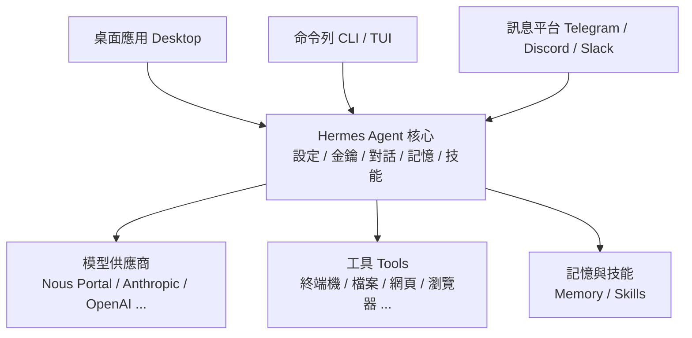

# Unit00 Hermes Agent 安裝與使用教學

## 課程目標

本單元將帶領學生認識並實際操作 **Hermes Agent**——由 [Nous Research](https://nousresearch.com/) 開發的自主型 AI 代理（AI Agent）。有別於綁定在 IDE 內的程式輔助工具或單純的聊天機器人，Hermes Agent 是一個「會隨著使用而成長」的智慧代理：它擁有持久記憶、能自動產生並改進技能（Skills）、可呼叫多種工具（Tools），並且能同時在桌面應用、命令列（CLI）與多種通訊平台上運作。

在化工領域的 AI 學習與研究中，一個能夠自主執行多步驟任務、串接檔案系統與終端機、並保留長期記憶的代理，對於資料前處理、文獻整理、程式碼輔助、流程模擬腳本撰寫等工作都極具價值。本單元將以 **Windows 桌面應用程式** 為主軸，帶領學生完成安裝、初次設定，並掌握基本操作與核心功能。

### 學習目標

- 理解 AI Agent 的基本概念，以及 Hermes Agent 與一般聊天機器人的差異
- 完成 Windows 平台上 Hermes Agent 的安裝（桌面安裝程式與命令列兩種方式）
- 使用 Nous Portal 完成模型（Provider/Model）與工具的初次設定
- 熟悉 Hermes 桌面應用的介面與基本操作流程
- 認識記憶系統、技能系統、子代理、排程與訊息閘道等核心功能
- 掌握常用 CLI 指令，並能處理常見的安裝與設定問題

---

## 1. 什麼是 Hermes Agent？

### 1.1 基本概念

**Hermes Agent** 是一個「自我改進」的 AI 代理程式。它的核心特色是內建了一個 **學習迴圈（Learning Loop）**：從實際操作經驗中建立技能、在使用過程中持續改進這些技能、主動提醒自己保存知識，並在多次對話（Session）之間逐步建立對使用者與專案的理解。

與常見工具的差異：

| 工具類型 | 特性 | 與 Hermes 的差異 |
|---------|------|-----------------|
| IDE 內的程式輔助（如 Copilot） | 綁定編輯器、聚焦於程式碼補全 | Hermes 是獨立自主代理，可跨平台運作、執行多步驟任務 |
| 一般聊天機器人 | 單一 API 的對話包裝、無持久記憶 | Hermes 具備跨對話的持久記憶與工具呼叫能力 |
| Hermes Agent | 自主、可成長、跨平台、可呼叫工具 | 同一個代理、同一份記憶，存在於各種介面上 |

### 1.2 主要特色

Hermes Agent 官方文件列出以下重點特色：

- **持久記憶（Persistent Memory）**：代理會學習你的專案、自動產生技能，並且不會忘記解決過問題的方法。
- **技能系統（Skills System）**：以 `SKILL.md` 檔案描述的「程序性記憶」，代理只在任務需要時才載入完整技能內容，因此新增技能不會拖累每次請求的效能。相容於開放標準 [agentskills.io](https://agentskills.io/)。
- **無所不在（Lives Everywhere）**：同一個代理可在 CLI、Telegram、Discord、Slack、WhatsApp、Signal、Email 等 20 多個平台上運作，共用同一份記憶。
- **排程自動化（Scheduled Automation）**：內建 cron，可用自然語言排定報告、備份、簡報等自動化任務。
- **委派與平行化（Delegate）**：可產生獨立的子代理（Subagents），各自擁有對話、終端機與 Python RPC 腳本，用於零上下文成本的平行工作流程。
- **網頁與工具能力（Search & Tools）**：網頁搜尋、瀏覽器自動化、視覺辨識、影像生成、文字轉語音（TTS）與多模型推理。
- **隔離沙箱（Isolated Sandboxing）**：支援 local、Docker、SSH、Singularity、Modal 等多種後端，提供容器強化與命名空間隔離。
- **多種前端介面**：桌面應用（Desktop App）、命令列（CLI `hermes`）、現代終端介面（TUI `hermes --tui`）與網頁儀表板（Web Dashboard）——它們共用同一份狀態，可在其中一個介面開始、在另一個介面接續。

> **注意**：Hermes Agent 為開源專案（MIT License），原始碼位於 [GitHub](https://github.com/NousResearch/hermes-agent)。

### 1.3 架構概觀：同一個代理，多種介面

Hermes 的核心是一個代理執行環境（agent runtime）。無論你使用桌面應用、CLI、TUI 或訊息平台，背後其實是同一個代理、同一份設定、金鑰、對話、記憶與技能。桌面應用會在本機啟動一個 `hermes serve` 後端程序，各介面再與它溝通，因此你可以在某個介面開始對話、在另一個介面接續。



---

## 2. 系統需求與事前準備

### 2.1 作業系統需求

- **Windows 10 / 11**（本單元主軸）
- 其他平台：macOS 12+（Apple Silicon）、各種 Linux 發行版亦有支援

### 2.2 事前準備

1. **穩定的網路連線**：安裝過程與模型推理皆需連網。
2. **Nous Portal 帳號（建議）**：最快的上手方式是使用 Nous Portal，一次訂閱即可存取數百種模型（涵蓋 Claude、GPT、Gemini 等，共 300 種以上）與內建的工具閘道（Tool Gateway，包含網頁搜尋、影像生成、TTS、雲端瀏覽器）。
   - 前往 [Nous Portal](https://portal.nousresearch.com/) 建立帳號。
   - Portal 提供免費方案（僅限免費模型、標準速率限制）與多種付費方案。
3. **（選用）自備 API 金鑰**：若不使用 Nous Portal，Hermes 也支援 OpenAI、Anthropic、OpenRouter、Google AI Studio、GitHub Copilot 等多家供應商，屆時需準備對應的 API 金鑰。

> **模型最低需求：至少 64K tokens 上下文**
> Hermes Agent 需要上下文視窗至少 64,000 tokens 的模型，才能維持多步驟工具呼叫所需的工作記憶。大多數雲端模型（Claude、GPT、Gemini、Qwen、DeepSeek）都能輕鬆滿足此需求。

---

## 3. 安裝 Hermes Agent

Windows 平台提供兩種安裝方式：**桌面安裝程式（推薦）** 與 **命令列安裝**。兩者安裝的其實是同一個 Hermes Agent 核心，使用相同的設定、金鑰、對話與技能，因此可以互通。

### 3.1 方式一：桌面安裝程式（推薦）

這是最簡單的方式，會一次安裝命令列與桌面應用程式。

**安裝步驟：**

1. 前往官方網站 [https://hermes-agent.nousresearch.com/](https://hermes-agent.nousresearch.com/)。
2. 在 **Hermes Desktop App** 區塊點選 **Windows**（適用 Windows 10/11）的 **DOWNLOAD DESKTOP APP** 按鈕，下載安裝檔。
3. 執行下載的安裝檔，依照畫面指示完成安裝。
   - 從官網下載的 Windows 安裝檔（`Hermes-Setup.exe`）是一個「引導式安裝程式」：它會下載 Hermes 原始碼並在本機建置桌面應用，同時一併安裝命令列工具。
   - 此過程需要網路連線與一些磁碟空間，並可能花費數分鐘，請耐心等候。
4. 安裝完成後，從「開始」功能表啟動 **Hermes** 桌面應用；若已安裝命令列工具，也可在終端機執行 `hermes desktop` 啟動。

**Windows 上的資料位置：**

所有使用者資料（設定、金鑰、對話、記憶、技能）都集中在 `HERMES_HOME`，在 Windows 上即 `%LOCALAPPDATA%\hermes\`：

```text
%LOCALAPPDATA%\hermes\          ← HERMES_HOME（使用者資料根目錄）
├─ config.yaml                  ← 非機密設定
├─ .env                         ← 機密（API 金鑰、權杖）
├─ skills\                      ← 技能
├─ sessions\                    ← 對話記錄
├─ logs\                        ← 日誌
├─ bin\                         ← 命令列啟動器
└─ hermes-agent\                ← 程式主體與相依套件
```

### 3.2 方式二：命令列安裝（PowerShell）

若只想安裝命令列版本（不含桌面應用），可使用 PowerShell 一行指令安裝。

1. 開啟 **PowerShell**。
2. 執行以下指令（`iex (irm ...)` 等同於 `irm ... | iex`，都是下載並執行安裝指令碼）：

```powershell
iex (irm https://hermes-agent.nousresearch.com/install.ps1)
```

> **安全提醒**：此指令會直接執行從網路下載的指令碼。請務必確認網址為官方網域 `hermes-agent.nousresearch.com`，避免執行來路不明的指令碼。

3. 安裝完成後，若想安裝並啟動桌面應用，執行：

```powershell
hermes desktop
```

**安裝程式做了什麼？**

命令列安裝程式會複製原始碼、啟動 uv，並透過內建套件管理器（PM）準備相依套件。PM 會提供釘選版本的 Python、Node.js、npm、ripgrep 與 FFmpeg，並預設安裝瀏覽器工具（`agent-browser` 與其內附的 Chromium）與電腦操作驅動（`cua-driver`）。

若不需要瀏覽器工具或電腦操作驅動，可在安裝時傳入對應旗標 `-SkipBrowser`／`-SkipComputerUse`。由於指令碼是透過網路下載執行，需以 scriptblock 形式傳入參數，例如：

```powershell
& ([scriptblock]::Create((irm https://hermes-agent.nousresearch.com/install.ps1))) -SkipBrowser
```

> **說明**：此處改用 `[scriptblock]::Create()` 而非直接 `iex`，是因為 `iex` 無法接收 `-SkipBrowser` 這類命令列參數；轉成 ScriptBlock 後才能用 `&` 呼叫並傳入旗標。

日後可用 `hermes pm install agent-browser` 重新安裝瀏覽器工具。

---

## 4. 首次設定（Setup）

安裝完成後，第一件事是設定 **模型供應商（Provider）** 與 **模型（Model）**。這是整個設定流程中最重要的一步——若 Hermes 無法完成一次正常的對話，請先讓對話正常運作，再加入其他功能。

本教學以 **Windows 桌面應用** 為主，建議初學者採用下方 **4.1 的圖形介面（GUI）流程**，全程使用滑鼠即可完成、不必碰終端機；若你偏好命令列或想批次設定，可參考 4.2 的命令列流程。

### 4.1 桌面應用首次設定（GUI 導向，推薦）

第一次啟動 Hermes 桌面應用時，會出現「首次設定精靈（onboarding）」，引導你在幾分鐘內完成到第一次對話。步驟如下：

1. **啟動應用**：從「開始」功能表點擊 **Hermes** 圖示。
2. **進入首次設定精靈（onboarding）**：首次啟動會顯示歡迎與設定畫面（onboarding 精靈）。你可以直接在精靈中設定供應商，或點選「稍後再選（Choose provider later）」先進入應用主畫面、之後再到設定面板完成。
3. **登入 Nous Portal（推薦）**：可直接在精靈中操作；若已略過精靈，請開啟 **設定面板**——點擊左側邊欄下方的齒輪圖示（Settings）或按 `Ctrl+,`，再選擇 **Providers（供應商）**：
   - 在 Providers 面板，Nous Portal 等 OAuth 供應商可點選 **Sign in with Nous Research** 以瀏覽器登入；登入後憑證會自動儲存。
   - 若使用其他供應商，可在 **Accounts / API keys** 區輸入對應的 API 金鑰。
4. **選擇預設模型**：
   - 開啟 **Settings → Model**，在此設定「主要模型（main model）」，也就是新對話的預設模型。
   - 或在對話輸入框（composer）左側的 **模型選擇器** 直接點選要用的模型。
5. **確認完成**：回到對話區，輸入一句簡單的提示（例如「你好，請自我介紹」），若收到正常回覆即代表設定成功。

> **提示**：桌面應用中所有設定都有圖形介面，不需要手動編輯 YAML。供應商、模型、工具、MCP 伺服器、訊息閘道與對話管理都能在 Settings 面板中完成。

### 4.2 命令列首次設定（進階／替代路徑）

若你偏好命令列，可在安裝後執行設定精靈。最快的方式是使用 Nous Portal：

```powershell
hermes setup --portal
```

這個指令會：登入你的 Nous 帳號、將 Nous 設為模型供應商，並開啟工具閘道（Tool Gateway，涵蓋網頁搜尋、影像生成、TTS、雲端瀏覽器）——全部一次完成。

執行 `hermes setup` 時，會提供三種設定模式：

- **Quick Setup（Nous Portal）**：OAuth 登入、免管理 API 金鑰，一次設定好模型與工具閘道（對應指令 `hermes setup --portal`）。**建議的快速路徑**。
- **Full Setup**：自行逐一設定每個供應商、工具與選項（自備金鑰）。
- **Blank Slate**：除了執行代理所需的最低限度（供應商與模型、檔案操作工具集、終端機工具集）外，其餘全部關閉。適合想要完全掘控的進階使用者。

桌面應用與命令列共用同一份設定，因此在任一邊完成設定，另一邊都會沿用。

### 4.3 選擇其他供應商

若不使用 Nous Portal，可用以下指令以互動方式選擇供應商與模型：

```powershell
hermes model
```

Hermes 支援眾多供應商，常見選擇包括：

| 供應商 | 說明 | 設定方式 |
|--------|------|---------|
| Nous Portal | 訂閱制、零設定 | 透過 `hermes model` 進行 OAuth 登入 |
| Anthropic | 直接使用 Claude 模型 | OAuth 登入，或提供 Anthropic API 金鑰 |
| OpenAI Codex | ChatGPT / Codex 訂閱 | 透過 `hermes model` 進行裝置碼認證 |
| OpenRouter | 跨多家供應商路由 | 輸入 API 金鑰 |
| GitHub Copilot | GitHub Copilot 訂閱 | 透過 `hermes model` 進行 OAuth |
| Google AI Studio | Gemini 模型 | 設定 `GOOGLE_API_KEY` / `GEMINI_API_KEY` |
| Custom Endpoint | VLLM、Ollama 等 OpenAI 相容 API | 設定 base URL 與 API 金鑰 |

### 4.4 設定的儲存位置

Hermes 將「機密」與「一般設定」分開存放：

- **機密與權杖（Secrets / Tokens）** → `HERMES_HOME\.env`
- **非機密設定** → `HERMES_HOME\config.yaml`

最保險的設定方式是透過 CLI，讓正確的值自動寫入正確的檔案：

```powershell
hermes config set model anthropic/claude-opus-4.6
hermes config set OPENROUTER_API_KEY sk-or-...
```

> **安全提醒**：`.env` 檔案內含 API 金鑰等機密資訊，切勿將其上傳至版本控制系統（如 Git）或公開分享。

---

## 5. Hermes 桌面應用介面導覽

Hermes 桌面應用是以「對話優先（chat-first）」設計的原生應用程式，左側為導覽側邊欄，可同時管理多個代理對話、設定訊息供應商、瀏覽專案資料夾並同時處理多個專案。若已透過命令列安裝，也可直接執行 `hermes desktop` 啟動，它會沿用你現有的設定、金鑰、對話與技能。

桌面應用的主要區塊：

### 5.1 對話區（Chat）

應用程式的核心。提供：

- **串流回應**：即時顯示模型回覆與工具呼叫的活動摘要。
- **共用的對話歷史**：在此開始的對話可在 CLI / TUI 接續，反之亦然。
- **拖放檔案**：可將檔案拖曳到對話區，作為下一則訊息的附件。
- **模型選擇器**：對話輸入框（composer）左側（麥克風圖示旁）有模型選擇器，點選即可切換目前對話使用的模型，並可設定 thinking / effort / fast 等選項。
- **右側預覽軌（Preview Rail）**：可並排渲染網頁、檔案與工具輸出，一邊檢視一邊對話。
- **對話時間軸**：長對話會在側邊出現標記軌，可快速跳到某個提問點。

### 5.2 底部狀態列（Status Bar）

顯示即時的對話狀態與快速控制：

- **每對話 YOLO 切換**：可針對單一對話開關 YOLO 模式。YOLO 會略過危險指令的核准提示，請務必了解你關閉的是什麼保護。
- **上下文使用量計量表**：即時顯示對話上下文視窗的「已使用百分比」，點擊可展開各類別（系統提示、工具定義、技能、記憶、規則、對話本身）的 token 用量明細。
- **快取命中率與 tokens/秒**：可從右鍵選單開啟，觀察對話「暖機」後成本降低的情形。

### 5.3 檔案瀏覽器（File Browser）

可在不離開應用的情況下瀏覽與預覽工作目錄，方便跟著代理讀寫、編輯檔案。可用 `hermes desktop --cwd <path>` 設定初始專案目錄。

### 5.4 內建終端機（Terminal）

右側邊欄內建真正的終端機，位於檔案瀏覽器旁：

- 快捷鍵 `` Ctrl+` `` （Control 加反引號）顯示終端機。
- 隱藏面板時 shell 仍保持運作，scrollback 與執行中的程序不會中斷。
- 可將終端機輸出選取後加入對話，作為下一則訊息的上下文。

### 5.5 Git 檢視與 Worktrees

對於在 Git 儲存庫內執行的對話，應用內建原始碼控制介面：

- **檢視窗格**：`Cmd/Ctrl+G` 切換工作樹檢視，顯示分支、變更檔案與差異；可暫存/取消暫存、還原、撰寫 commit 訊息、Commit 或 Commit & Push，甚至透過 GitHub CLI（`gh`）建立 PR。
- **Worktrees**：可建立 Git worktree，讓代理在平行副本上作業而不影響你的 checkout。

### 5.6 設定與管理面板

透過真正的 UI（而非手動編輯 YAML）管理供應商、模型、工具與憑證：

- **Providers（供應商）**：管理推理供應商，提供 Accounts / API 金鑰的登入與憑證儲存。
- **Model（模型）**：在 Settings → Model 設定新對話的預設「主要模型」；也可在對話輸入框左側的 **模型選擇器** 即時切換目前對話使用的模型（可設定 thinking / effort / fast 等選項）。即時切換只影響目前對話，且會重置提示快取。
- **Skills（技能）**：`Capabilities → Skills` 管理已安裝技能，並可從技能中心（Skills Hub）瀏覽安裝。
- **Plugins（外掛）**、**Cron（排程）**、**Profiles（設定檔）**、**Messaging（訊息閘道）** 等管理介面。

### 5.7 其他實用功能

- **命令面板（Command Palette）**：`Ctrl+K` 或 `Ctrl+P` 快速跳至任何頁面或動作（開啟設定、切換模型/主題、搜尋對話等）。
- **多分頁與多視窗**：`Ctrl+T` 開新對話分頁、`Ctrl+Shift+N` 開新視窗，方便一邊對話一邊查看檔案。
- **介面模式（Simple / Advanced）**：可在 Settings → Appearance（外觀）或命令面板切換。**Advanced（進階，預設）** 顯示完整面板；**Simple（簡易）** 以對話為主、收起終端機與檔案瀏覽器等技術性面板，適合初學者。
- **介面語言切換到繁體中文**：在 Settings → Appearance（外觀）中可將介面語言切換為繁體中文（zh-Hant），另支援簡體中文、英文、日文等。
- **HUD 模式**：`Ctrl+Shift+H` 將對話分離成無邊框、永遠置頂的浮動列，疊在你正在處理的視窗上。
- **Quick Entry（快速輸入）**：以全域快捷鍵（預設 `Ctrl+Shift+Space`）從任何地方叫出小型輸入框，不必切換到主視窗即可送出提示。
- **Bot Mode**：內建的「一個代理一個對話」的機器人名冊，可建立專精的代理團隊並互相協作；適合需要多個各司其職代理的專案。

### 5.8 桌面應用快捷鍵速查表

| 快捷鍵 | 功能 |
|--------|------|
| `Ctrl+N` | 開新對話 |
| `Ctrl+T` | 開新對話分頁 |
| `Ctrl+Tab` / `Ctrl+Shift+Tab` | 循環切換分頁 |
| `Ctrl+1`～`9` | 跳至第 N 個分頁 |
| `Ctrl+W` | 關閉目前分頁 |
| `Ctrl+Shift+N` | 開新視窗 |
| `Ctrl+K` 或 `Ctrl+P` | 命令面板 |
| `Ctrl+,` | 開啟設定（Settings） |
| `Ctrl+/` | 鍵盤快捷鍵設定 |
| `Ctrl+B` / `Ctrl+J` | 切換左／右側邊欄 |
| `` Ctrl+` `` | 顯示終端機 |
| `Ctrl+G` | Git 檢視窗格 |
| `Ctrl+F` | 在對話中尋找 |
| `Ctrl+Shift+F` | 搜尋對話 |
| `Ctrl+Shift+H` | HUD 模式 |
| `Ctrl+Shift+Space` | Quick Entry 快速輸入（全域，可自訂） |
| `Shift+X` | 切換淺色／深色 |

> **提示**：桌面應用的快捷鍵可在 **Settings → Keyboard Shortcuts**（或按 `Ctrl+/`）自訂。

---

## 6. 基本使用

### 6.1 第一次對話

#### 在桌面應用中（推薦）

1. 從「開始」功能表啟動 **Hermes** 桌面應用（或在終端機執行 `hermes desktop`）。
2. 在中央 **對話區** 下方的輸入框（composer）輸入你的提示。
3. 按 **Enter** 送出；若要換行，按 `Shift+Enter`、`Alt+Enter` 或 `Ctrl+J`。
4. Hermes 會以 **串流方式** 即時顯示回覆，並在需要時呼叫工具（終端機、讀檔、網頁搜尋），你可在對話中看到工具活動摘要。
5. 若要 **中斷** 代理，直接輸入新訊息送出即可覆蓋目前任務；也可按介面上的停止鈕或 `Ctrl+C`。
6. 可將檔案 **拖放** 到對話區，作為下一則訊息的附件；或按 `Ctrl+V` 貼上剪貼簿圖片。

建議用「具體且容易驗證」的提示開始，例如：

```text
你好，請自我介紹，並列出你目前可用的工具。
檢查我指定的資料夾，告訴我哪個看起來像主要的專案檔案。
```

#### 在命令列（CLI / TUI）中

若你偏好終端機，也可用以下兩種介面開始對話：

```powershell
hermes            # 傳統 CLI
hermes --tui      # 現代 TUI（推薦）
```

**成功的樣子：**

- 標題列或狀態列顯示你選擇的模型／供應商
- Hermes 正常回覆，沒有錯誤
- 需要時能呼叫工具（終端機、讀檔、網頁搜尋）
- 對話能持續超過一個回合

> **若沒有收到回覆或出現錯誤**：依序檢查 (1) 供應商是否已登入、(2) API 金鑰是否正確、(3) 網路連線是否正常、(4) 所選模型是否可用。更多協助見 11.1 常見錯誤對照表。

### 6.2 斜線指令（Slash Commands）

在對話輸入框（桌面應用的 composer 或 CLI）中輸入 `/` 會出現自動完成的指令下拉選單：

| 指令 | 說明 |
|------|------|
| `/help` | 顯示所有可用指令 |
| `/tools` | 列出可用工具 |
| `/model` | 互動式切換模型 |
| `/personality pirate` | 試試有趣的人格設定 |
| `/save` | 儲存對話 |
| `/title <名稱>` | 為目前對話命名 |
| `/compress` | 壓縮（摘要）對話歷史以節省 token |
| `/usage` | 查看 token 用量 |
| `/verbose` | 切換工具輸出顯示模式 |

> **適用範圍**：多數斜線指令在桌面應用、CLI 與 TUI 中通用。若透過訊息閘道（Telegram / Discord 等）運作，部分指令可能不適用；詳見 7.4。

### 6.3 多行輸入與中斷

- **多行輸入**：按 `Alt+Enter`、`Ctrl+J` 或 `Shift+Enter` 換行。`Alt+Enter` 與 `Ctrl+J` 在所有終端機都可用。
- **中斷代理**：若代理執行太久，直接輸入新訊息並按 Enter 即可中斷目前任務、切換到新指令；`Ctrl+C` 也可以。

### 6.4 對話的延續（Sessions）

Hermes 會保存對話，可隨時接續最近的對話：

```powershell
hermes --continue    # 接續最近一次對話
hermes -c            # 同上（簡寫）
```

也可以用對話標題接續：

```powershell
hermes -r "my research project"    # 依標題接續對話
```

### 6.5 效率技巧（Power Tips）

- **貼上偵測**：CLI 會自動偵測多行貼上，可直接貼上整段程式碼或錯誤訊息，不會被拆成多則訊息。
- **貼上剪貼簿圖片**：按 `Ctrl+V` 可將剪貼簿中的圖片直接貼入對話，代理會用視覺能力分析截圖、圖表或錯誤彈窗。
- **指令自動完成**：輸入 `/` 再按 `Tab`，可瀏覽所有內建指令與已安裝技能。
- **壓縮對話**：長對話累積過多 token 時，執行 `/compress` 摘要對話歷史，保留重點同時大幅降低 token 量。
- **查看用量**：執行 `/usage` 查看目前 token 消耗；`/model` 可在對話中途切換模型。
- **命名對話**：用 `/title auth-refactor` 為對話命名，方便日後以 `hermes sessions list` 尋找、以 `hermes -r` 接續。
- **控制工具輸出**：`/verbose` 可切換工具輸出顯示模式（off → new → all → verbose）。

> **成本提醒**：切換模型（`/model`）會重置提示快取（prompt cache），使下一則訊息以完整輸入價格重新讀取整段對話。偶爾切換沒問題，但在長對話中頻繁切換會增加成本——此時另開新對話往往更划算。

---

## 7. 核心功能簡介

當基本對話可以穩定運作後，可以逐步加入以下功能。**原則是：在基本對話穩定前，先不要急著加入更多功能。**

### 7.1 記憶系統（Memory）

Hermes 具備跨對話的持久記憶。它會由代理自行維護記憶，週期性地提醒自己保存知識，並透過 FTS5 全文檢索跨對話回憶過往內容，逐步建立對使用者與專案的深入理解。

### 7.2 技能系統（Skills）

技能是「隨需載入」的指令文件，教 Hermes 如何完成特定任務（例如部署到 Kubernetes、開 GitHub PR、微調模型）。每個技能是一個 `SKILL.md` 檔案，包含名稱、描述與逐步程序。代理只在任務需要時才載入完整內容。

```powershell
hermes skills browse                    # 列出所有可用技能
hermes skills search kubernetes         # 依關鍵字搜尋技能
hermes skills install openai/skills/k8s # 安裝技能（安裝前會先做安全掃描）
```

每個已安裝的技能都會自動成為一個斜線指令：

```text
/k8s deploy the staging manifest        # 帶著請求執行技能
```

### 7.3 子代理與委派（Delegation）

Hermes 可產生獨立的子代理（Subagents）進行平行工作，每個子代理擁有各自的對話與終端機。在桌面應用中，當有委派的工作進行時，對話上方會出現 Subagents 框，顯示數量、任務名稱、經過時間與最新活動，並提供 Steer（引導）與 Stop（停止）控制。

### 7.4 訊息閘道（Messaging Gateway）

可將 Hermes 連接到通訊平台，讓它成為機器人或共用助理：

```powershell
hermes gateway setup    # 互動式平台設定
hermes gateway status   # 查看閘道狀態
```

支援 Telegram、Discord、Slack、WhatsApp、Signal、Email、Microsoft Teams 等平台。

### 7.5 排程自動化（Cron）

內建 cron，可用自然語言排定報告、備份、簡報等自動化任務，並將結果遞送到任何平台。建議在 CLI 或機器人設定穩定之後再使用。

### 7.6 沙箱化終端機（Sandboxed Terminal）

為了安全，可讓代理在 Docker 容器或遠端伺服器中執行：

```powershell
hermes config set terminal.backend docker    # Docker 隔離
hermes config set terminal.backend ssh        # 遠端伺服器
```

### 7.7 MCP 整合

Hermes 支援 Model Context Protocol（MCP），可連接任何 MCP 伺服器以擴充工具能力。設定方式為在 `config.yaml` 中加入 `mcp_servers` 區塊。

### 7.8 上下文檔案：引導代理的行為

你可以用「上下文檔案」讓代理在每次對話都自動遵循特定規則，不必重複交代：

- **`AGENTS.md`（專案大腦）**：放在專案根目錄，記錄專案架構、程式風格與慣例（例如「資料庫操作一律使用 async/await」「測試放在 tests/ 並使用 pytest」）。代理每次對話會自動讀取。
- **`SOUL.md`（人格設定）**：放在 `HERMES_HOME`，定義代理的預設語氣與風格（例如「簡潔直接、除非被要求否則不解釋」）。
- **相容 `.cursorrules`**：若你已有 `.cursorrules` 或 `.cursor/rules/*.mdc`，Hermes 也會自動從工作目錄載入。

> **提醒**：上下文檔案會被注入每一則訊息，因此應保持精簡；每個字元都會占用 token 預算。

> **安全機制**：Hermes 會在載入上下文檔案前掃描是否有提示注入（prompt injection）攻擊，例如「忽略先前指示」的字句、隱藏的 HTML 註解、竊取機密的企圖或不可見的 Unicode 字元。偵測到可疑內容的專案檔案會被阻擋並顯示警告。

### 7.9 記憶 vs 技能：該放哪裡？

- **記憶（Memory）記錄「事實」**：你的環境、偏好、專案位置，以及代理對你學到的事。記憶容量是刻意受限的，填滿時代理會自行整併。
- **技能（Skills）記錄「程序」**：多步驟工作流程、工具專用指令與可重複使用的做法。

簡單原則：**「是什麼」放記憶，「怎麼做」放技能。** 你可以在一次有成效的對話後對代理說「把這個記起來」或「把剛剛的做法存成一個技能」，讓它逐步累積知識。

---

## 8. 指令核准與安全機制

Hermes Agent 能執行終端機指令、讀寫檔案並存取網路，因此內建了「縱深防禦（defense-in-depth）」的多層安全機制。了解這些機制有助於安全地使用代理。

### 8.1 危險指令核准（Dangerous Command Approval）

在執行任何指令前，Hermes 會比對一份「危險樣式」清單（例如遞迴刪除 `rm -rf`、SQL `DROP TABLE`、將網路內容導入 shell、格式化磁碟等）。若命中，會要求使用者明確核准，在 CLI 中會顯示四個選項：

| 選項 | 說明 |
|------|------|
| **once（一次）** | 僅允許本次執行 |
| **session（本次對話）** | 本次對話中允許此樣式 |
| **always（永久）** | 加入永久允許清單（寫入 `config.yaml`） |
| **deny（拒絕，預設）** | 封鎖此指令 |

> **最佳實務**：選擇 **always** 前務必三思——它會永久允許該樣式。建議先用 **session**，等到確定安全後再考慮永久允許。

> **桌面應用中的核准**：桌面應用同樣會在對話中顯示核准提示，你可直接在介面上選擇核准或拒絕（對應 once / session / always / deny）；底部狀態列也會顯示 approvals 與 YOLO 狀態。

核准逾時（預設 300 秒）未回應時，指令會以「拒絕」處理（fail-closed，安全優先）。

### 8.2 三種核准模式

可於 `config.yaml` 的 `approvals.mode` 設定：

- **smart（智慧，預設）**：用輔助模型評估風險。低風險指令自動核准、明顯危險指令自動拒絕、不確定時才詢問使用者。
- **manual（手動）**：所有危險指令一律詢問。
- **off（關閉）**：停用所有核准檢查，等同於 `--yolo`。僅在受信任環境（CI/CD、容器等）使用。

### 8.3 YOLO 模式

**YOLO 模式會略過本次對話所有的危險指令核准提示。** 可用 `hermes --yolo` 啟動、或在對話中以 `/yolo` 切換、或設定環境變數 `HERMES_YOLO_MODE=1`。啟用時會顯示紅色警示橫幅與狀態列 `⚠ YOLO` 提示。

> **危險**：YOLO 模式會停用本次對話的所有危險指令安全檢查。請僅在你完全信任所產生指令的情況下使用（例如在可拋棄式環境中執行經過充分測試的自動化腳本）。

### 8.4 硬性封鎖清單（Hardline Blocklist）

有些指令太具毀滅性，Hermes 會一律拒絕執行，**即使開啟了 YOLO、`approvals.mode: off` 或曾點選「always」也無法繞過**。這是位於 YOLO 之下的「地板」，在核准層之前就會攔截，且沒有覆寫旗標。典型被封鎖的指令包括：

- `rm -rf /`（及其明顯變形，抹除整個檔案系統根目錄）
- `:(){ :|:& };:`（bash fork bomb，癱瘩主機直到重開機）
- `dd if=/dev/zero of=/dev/sd*`（歸零實體磁碟）
- 對已掛載根裝置執行 `mkfs.*`（格式化運作中的系統）

若確實需要執行這類指令，請在代理外部自行執行。

> **完整清單**：硬性封鎖清單由 Hermes 代理在執行時期（runtime）維護，實際內容依版本而定（官方文件註明「非窮舉」）；詳見官方安全文件。

### 8.5 檔案寫入保護與容器隔離

- **檔案寫入保護**：`write_file` / `patch` 會擋下對機密路徑的寫入，例如 `~/.ssh/`、`.env`、`~/.aws/` 等憑證檔案，且無法從對話介面覆寫。
- **容器隔離**：若將終端機後端設為 `docker`、`singularity`、`modal` 等，容器本身即為安全邊界，此時會略過危險指令檢查（因為容器內的破壞性指令無法傷害主機）。處理不信任的程式碼時，建議使用容器後端。

---

## 9. 化工領域應用情境

Hermes Agent 的自主執行、工具串接與持久記憶能力，可應用於化工學習與研究的多種情境。以下為幾個範例方向：

- **資料前處理與探索**：請代理讀取實驗數據 CSV、進行清理、繪製趨勢圖，並用 `execute_code` 撰寫並執行 Python 腳本完成批次處理（例如「將這個資料夾內所有感測器 CSV 合併，移除異常值後輸出摘要統計」）。
- **程序模擬腳本輔助**：協助撰寫、除錯與說明程序模擬或數值計算的 Python 程式碼（如質能平衡、反應動力學、蒸餾塔計算）。
- **文獻與資料整理**：利用網頁搜尋與瀏覽器工具蒐集特定主題的資料，整理成結構化摘要。
- **重複性工作自動化**：將常做的多步驟流程（如產生實驗報告、整理數據、繪製標準圖表）存成技能（Skill），日後用一個斜線指令重複執行。
- **專案知識累積**：透過 `AGENTS.md` 記錄專題的資料位置、命名慣例與分析流程，讓代理在整個專題期間都能延續一致的做法。

**使用案例示例（桌面應用）**：假設你要分析一批反應器溫度數據，可在桌面應用對話區這樣操作：

1. 將數據檔（如 `reactor_temp.csv`）拖放到對話區。
2. 輸入提示：「讀取這個 CSV，檢查是否有缺失值與離群值，然後繪製溫度對時間的趨勢圖並存成 PNG。」
3. Hermes 會呼叫檔案讀取工具讀入資料，用 `execute_code` 執行 Python（pandas / matplotlib）完成清理與繪圖，並在右側預覽軌顯示產生的圖檔。
4. 若結果需調整，直接在對話中追加要求（例如「把離群值改用 3 倍標準差判定」），代理會迭代修正。

> **安全建議**：在化工資料分析中若需讓代理執行系統指令或處理不信任的程式碼，建議搭配 Docker 沙箱後端，並妥善保管 `.env` 中的 API 金鑰。

---

## 10. 常用 CLI 指令速查表

| 指令 | 說明 |
|------|------|
| `hermes` | 開始對話 |
| `hermes --tui` | 以現代 TUI 介面開始對話 |
| `hermes desktop` | 啟動桌面應用 |
| `hermes model` | 選擇 LLM 供應商與模型 |
| `hermes tools` | 設定要啟用哪些工具 |
| `hermes setup` | 完整設定精靈（一次設定所有項目） |
| `hermes setup --portal` | 以 Nous Portal 快速設定模型與工具閘道 |
| `hermes doctor` | 診斷問題 |
| `hermes update` | 更新到最新版本 |
| `hermes gateway` | 啟動訊息閘道 |
| `hermes --continue` | 接續最近一次對話 |
| `hermes -r "<標題>"` | 依標題接續指定對話 |
| `hermes sessions list` | 列出對話清單 |
| `hermes config set <key> <value>` | 設定個別設定值 |
| `hermes config get <key>` | 查看個別設定值 |
| `hermes config check` | 檢查設定是否有問題 |
| `hermes config migrate` | 遷移／修復設定 |
| `hermes skills browse` | 瀏覽可安裝的技能 |
| `hermes skills install <來源/路徑>` | 安裝技能 |
| `hermes pm install agent-browser` | 安裝瀏覽器工具 |
| `hermes uninstall` | 解除安裝（可加 --gui / --full） |

---

## 11. 常見問題與故障排除

### 11.1 常見錯誤對照表

| 症狀 | 可能原因 | 解決方式 |
|------|---------|---------|
| `hermes: command not found` | 未重新載入 shell 或 PATH 未設定 | 重新開啟終端機，或檢查 PATH |
| `API key not set` | 未設定供應商金鑰 | 執行 `hermes model` 設定，或 `hermes config set OPENROUTER_API_KEY your_key` |
| 對話回覆空白或錯誤 | 供應商認證或模型選擇錯誤 | 重新執行 `hermes model`，確認供應商、模型與認證 |
| 閘道啟動但無法收訊息 | Bot 權杖或允許清單設定不完整 | 重新執行 `hermes gateway setup` 並檢查 `hermes gateway status` |
| `hermes --continue` 找不到舊對話 | 切換了設定檔，或對話未儲存 | 檢查 `hermes sessions list`，確認在正確的設定檔中 |
| 更新後設定遺失 | 設定值缺失或過時 | 執行 `hermes config check` 再 `hermes config migrate` |

### 11.2 復原工具箱（Recovery Toolkit）

當感覺有問題時，依以下順序排查：

1. `hermes doctor`
2. `hermes model`
3. `hermes setup`
4. `hermes sessions list`
5. `hermes --continue`
6. `hermes gateway status`

> **萬用診斷指令**：執行 `hermes doctor`，它會明確告訴你缺少什麼以及如何修正。

### 11.3 更新與解除安裝

**桌面應用（GUI）：**

- **更新**：應用會在背景自動檢查更新，就緒時提供一鍵更新；也可從 **About（關於）面板的 Update now**、命令面板（`Ctrl+K` → Update Hermes）或更新提示通知手動觸發。更新完成後應用會自動重啟。
- **解除安裝**：於 **Settings → About → Danger zone** 選擇移除範圍：
  - **Uninstall Chat GUI only**：僅移除桌面應用（保留代理、設定與對話）
  - **Uninstall GUI + agent, keep my data**：移除應用與代理，保留設定與對話
  - **Uninstall everything**：移除應用、代理與所有使用者資料

**命令列（CLI）：**

- 更新：`hermes update`
- 解除安裝：`hermes uninstall --gui`（僅 GUI）、`hermes uninstall`（含代理、保留資料）、`hermes uninstall --full`（全部移除）

---

## 12. 最佳實務建議

1. **先讓一次對話正常運作**：若 Hermes 無法完成一次正常對話，先不要加入閘道、cron、技能、語音或路由等功能。
2. **善用 Nous Portal 快速上手**：`hermes setup --portal` 是最省事的路徑，一次搞定模型與工具。
3. **保護你的機密**：`.env` 內含 API 金鑰，切勿上傳至 Git 或公開分享。
4. **謹慎使用 YOLO 模式**：YOLO 會略過危險指令的核准提示，務必了解風險後再開啟。
5. **考慮沙箱隔離**：讓代理在 Docker 或遠端伺服器中執行，可降低誤操作本機的風險。
6. **多介面共用狀態**：桌面應用、CLI、TUI 共用同一份設定與對話，可依情境彈性切換。
7. **逐步累積技能與記憶**：讓代理在日常使用中自然累積技能與記憶，隨著時間越用越順手。
8. **提示要具體**：明確說明檔案路徑、錯誤訊息與期望結果，一則清楚的訊息勝過三輪來回澄清。
9. **善用上下文檔案**：把重複性的專案規則寫進 `AGENTS.md`，讓代理每次對話自動遵循。
10. **控制成本**：長對話用 `/compress` 壓縮、`/usage` 監看用量，並避免在長對話中頻繁切換模型。
11. **放手讓代理使用工具**：交代目標（如「找出並修正失敗的測試」）而非逐步操作，讓代理自行探索與迭代。

---

## 13. 小結

本單元介紹了 Hermes Agent 的核心概念、在 Windows 平台上的安裝方式（桌面安裝程式與命令列）、使用 Nous Portal 的初次設定流程，以及桌面應用的介面導覽與基本操作。同時也認識了記憶、技能、子代理、訊息閘道、排程與 MCP 等核心功能。

Hermes Agent 最大的價值在於它是一個「會隨著使用而成長」的自主代理——透過持久記憶與自動累積的技能，它會越用越了解你的專案與工作習慣。建議同學先從基本對話開始，確認一切正常運作後，再逐步探索更進階的功能，將其應用於化工領域的資料處理、程式輔助與研究工作中。

> **延伸閱讀**：更完整的官方文件請參考 [Hermes Agent Docs](https://hermes-agent.nousresearch.com/docs)、[Quickstart 教學](https://hermes-agent.nousresearch.com/docs/getting-started/quickstart) 與 [GitHub 原始碼](https://github.com/NousResearch/hermes-agent)。

---

**課程資訊**
- 課程名稱：AI在化工上之應用 (ChemE 3590)
- 課程單元：Hermes Agent 安裝與使用教學
- 課程製作：逢甲大學 化工系 智慧程序系統工程實驗室
- 授課教師：莊曜禎 助理教授
- 更新日期：2026-10-01

**課程授權 [CC BY-NC-SA 4.0]**
 - 本教材遵循 [創用CC 姓名標示-非商業性-相同方式分享 4.0 國際 (CC BY-NC-SA 4.0)](https://creativecommons.org/licenses/by-nc-sa/4.0/deed.zh) 授權。

---
