# Unit00 Hermes Agent 必裝技能（Skills）與外掛（Plugins）推薦指南

> **本課程說明**：本文介紹的外掛與遠端 MCP 伺服器，多數需要連到雲端服務，屬課外參考。課程作業與共同任務依 [Unit00 安裝教學](Unit00_Hermes_Agent_Setup.md) 4.5 的規定，只使用實驗室端點，雲端工具與外掛預設不啟用；只在本機執行、不連網的技能，可依教師說明使用。

## 課程目標

本單元是 [Unit00 Hermes Agent 安裝與使用教學](Unit00_Hermes_Agent_Setup.md) 與 [Unit00 Hermes Agent 常用指令詳細教學](Unit00_Hermes_Agent_Command.md) 的進階延伸。當同學完成 Hermes Agent 的基礎安裝並能正常對話後，下一步就是透過 **技能（Skills）**、**外掛（Plugins）** 與 **MCP 伺服器（Model Context Protocol Servers）** 為代理裝備專業能力。

對化學工程與材料工程領域的**大學部學生**與**研究所碩博士生**而言，日常工作高度依賴：實驗數據清理、Jupyter Notebook 互動式建模、工程文書（PDF / Word / Excel / PowerPoint）自動化、化學分子與熱力學計算、學術文獻與專利檢索、以及長篇學位論文與知識庫管理。本講義從 Hermes 官方內建庫、官方選用庫（`official/*`）、受信任機構庫（Anthropic / OpenAI / Hugging Face / NVIDIA）與經過驗證的社群目錄中，嚴選出**化工系學生務必安裝與啟用的核心清單**，並提供實機驗證過的安裝指令與化工實戰工作流。

### 學習目標

- 釐清 Hermes Agent 三大擴充機制：**Skills（程序性知識）**、**Plugins（系統與工具擴充）** 與 **MCP Servers（外部協定工具）** 的定位差異與搭配原則
- 認識技能與外掛各自的信任分級（技能：`builtin`、`official`、`trusted`、`community`、`local`；外掛 tier：`official`、`verified`、`community`）與安全審核機制
- 熟練使用 `hermes skills`、`hermes plugins` 與 `hermes mcp` 系列指令管理擴充套件
- 依據自身學習階段（**大學部基礎包** vs. **專題生／研究生進階包** vs. **論文撰寫與實驗設計補強包**），完成必備技能與外掛的一鍵部署
- 學會將多個技能與外掛串聯應用於「反應器數據分析與結報生成」、「碩士論文文獻探討與引用核實」、「自訂化工專業技能開發」及「從實驗設計到投稿的完整論文產線」四大情境
- 掌握研究生論文最關鍵的四項能力對應技能：**實驗設計（DOE）**、**統計檢定力與樣本數**、**量測不確定度與單位傳遞**、**投稿格式與同儕審查**

### 前置需求

- 已依照 [Unit00 Hermes Agent 安裝與使用教學](Unit00_Hermes_Agent_Setup.md) 完成 Hermes Agent 安裝與模型設定
- 熟悉 [Unit00 Hermes Agent 常用指令詳細教學](Unit00_Hermes_Agent_Command.md) 的基本終端機與斜線指令操作
- 建議先備妥一個已安裝科學計算套件（`pandas`、`matplotlib`、`scipy` 等）的 Python 環境，並記下其**解譯器絕對路徑**，供代理執行 Python 腳本時明確指定（原因見 3.0 節）

> **版本說明**：本講義的技能／外掛名稱、識別碼、信任等級與指令參數，均已於 **Hermes Agent v0.22.5** 實際執行 `hermes skills`、`hermes plugins`、`hermes mcp`、`hermes curator` 系列指令逐項核對。由於 Hermes 迭代快速，官方選用技能與精選外掛目錄會持續增減；若你安裝的版本較新而某個識別碼失效，請先執行 `hermes skills search <關鍵字>` 或 `hermes plugins search <關鍵字>` 重新確認正確識別碼，再依本講義的原則挑選替代方案。

---

## 1. Skills、Plugins 與 MCP 擴充生態系概觀

許多初學者容易混淆 Skills、Plugins 與 MCP Servers。在開始安裝前，先用一句話區分三者：

- **Skills（技能）＝「教代理怎麼做某件事的標準作業程序（SOP 講義）」**
- **Plugins（外掛）＝「替 Hermes 本體加裝新工具、生命週期掛鉤（Hooks）或桌面介面面板」**
- **MCP Servers（模型上下文協定伺服器）＝「讓代理透過標準協定連線外部資料庫、計算引擎或軟體」**

### 1.1 三大擴充機制詳細比較

| 比較面向 | Skills（技能） | Plugins（外掛） | MCP Servers（MCP 伺服器） |
| :--- | :--- | :--- | :--- |
| **本質** | 以 `SKILL.md` 撰寫的「程序性記憶」與腳本範本 | 執行的 Python / JS 程式碼模組、Hooks、Middleware 或 Desktop 面板 | 遵循開放標準 Model Context Protocol 的獨立服務（遠端 HTTP 或本地 stdio） |
| **載入時機** | **隨需載入（On-demand）**：平時僅載入名稱與簡短描述，任務需要或輸入 `/技能名` 時才展開全文，**幾乎不耗平時 token** | 啟動對話或桌面應用時載入，直接註冊新工具或攔截對話事件 | 啟動時連線並將外部工具註冊進代理的工具清單 |
| **主要管理指令** | `hermes skills ...` | `hermes plugins ...` | `hermes mcp ...` |
| **呼叫方式** | 代理自動判斷載入，或手動輸入 `/技能名 <需求>`（若與內建指令同名則用 `/skill <技能名>`） | 透過其提供的工具、斜線指令或桌面應用分頁自動／手動觸發 | 由代理在推理過程中像呼叫內建工具一樣直接呼叫 |
| **化工典型範例** | `pdf`（擷取論文表格）、`jupyter-notebook`（互動式跑程式）、`rdkit`（分子描述符計算 SOP） | `openalex`（學術文獻與引用圖譜搜尋）、`hermes-memory-wiki`（研究筆記 Wiki 面板）、`office-desk`（受保護的 Office 編輯） | `wolfram`（Wolfram Alpha 工程數學與單位換算）、`context7`（最新套件文件）、自建 `aspen-plus` 模擬器連線 |

### 1.2 信任分級（Trust Levels）與來源說明

Hermes 在安裝技能與外掛時內建靜態安全掃描，並以「信任等級」標示來源可信度。此處最容易被混淆的是：**Skills 與 Plugins 使用兩套不同的分級名稱**，不能混為一談。

**（A）Skills 的信任等級**（對應 `hermes skills list` 的 Trust 欄位，Hermes v0.22.5 實測共五種）：

1. **`builtin`（官方內建）**：隨 Hermes 核心安裝即植入的隨附技能，來源為核心倉庫 `skills/`（v0.22.5 實測 58 個 `SKILL.md`，如 `pdf`、`docx`、`systematic-debugging`）。
2. **`official`（官方選用）**：Nous Research 官方選用庫 `optional-skills/`（v0.22.5 實測為 162 項），識別碼格式為 `official/<類別>/<名稱>`，例如 `official/data-science/jupyter-notebook`。
3. **`trusted`（受信任機構）**：來自知名 AI 機構官方倉庫的技能，例如 Anthropic（`anthropics/skills/skills/*`）、OpenAI（`openai/skills/skills/.curated/*`）、Hugging Face（`huggingface/skills/skills/*`）與 NVIDIA（`NVIDIA/skills/skills/*`）。
4. **`community`（社群貢獻）**：來自 `skills.sh`、GitHub（如 `K-Dense-AI/scientific-agent-skills`）、`clawhub` 等社群索引的技能。數量龐大（Skills Hub 索引逾 10 萬筆，含大量跨來源重複條目），其中不乏專業科學計算技能，但安裝前務必先用 `inspect` 檢視內容。
5. **`local`（本地／專案自建）**：你自己撰寫、或放在專案倉庫（`.hermes/skills`、`.agents/skills`）中的技能。

**（B）Plugins 的 tier 分級**（對應 `hermes plugins browse` 的 Tier 欄位，共三種）：

1. **`official`（官方）**：由 Nous Research 官方維護，如 `hermes-memory-wiki`、`hermes-security`、`advanced-delegation`。
2. **`verified`（已驗證合作夥伴）**：經官方驗證的第三方外掛，如 `tavily-plugin`。
3. **`community`（社群貢獻）**：社群投稿，佔目錄絕大多數。以 2026-11-08 更新的精選目錄快取統計，約 1,200 個外掛中 `community` 約 1,170、`official` 約 21、`verified` 約 11。

建議同學**優先使用 `builtin`、`official` 與 `trusted` 等級的技能，以及 `official` 與 `verified` 等級的外掛**；安裝 `community` 等級前務必先以 `hermes skills inspect`（技能）或 `hermes plugins info`（外掛）預覽內容並檢查權限宣告。

### 1.3 化工系學生擴充配置全景圖

```mermaid
flowchart TD
    A["化工系學生 Hermes Agent 擴充配置"] --> B["核心必裝 Skills<br/>（SOP 與領域工作流）"]
    A --> C["精選 Plugins<br/>（研究工具與桌面面板）"]
    A --> D["推薦 MCP Servers<br/>（外部計算與文件引擎）"]

    B --> B1["工程文書與結報<br/>pdf / docx / xlsx / powerpoint<br/>ppt-master（原生可編輯 PPTX）"]
    B --> B2["科學計算與程式除錯<br/>jupyter-notebook / systematic-debugging<br/>test-driven-development / github<br/>computer-user（僅 macOS 的社群技能）"]
    B --> B3["學術文獻與知識庫<br/>arxiv / grounded-citations<br/>llm-wiki / obsidian / humanizer"]
    B --> B4["化工與化學資訊專業<br/>drug-discovery / rdkit / cantera<br/>pubchem-database / matplotlib"]
    B --> B5["實驗設計與統計<br/>experimental-design / statistical-power<br/>statistical-analysis / uncertainty-and-units"]
    B --> B6["論文寫作與投稿<br/>scientific-writing / venue-templates<br/>scientific-visualization / peer-review<br/>ResearchStudio（詳見 3.12 節）"]
    B --> B7["文獻管理與研究自動化<br/>pyzotero / citation-management<br/>markitdown / paper-lookup<br/>（Zotero 詳見 4.5 節）"]

    C --> C1["文獻與專利檢索<br/>openalex / patsnap / tavily-plugin"]
    C --> C2["本地知識與記憶管理<br/>hermes-memory-wiki / mediarag<br/>memory-review / obsidian-memory"]
    C --> C3["文書保護與資安控管<br/>office-desk / pdf-surgeon<br/>hermes-security / usage-guard"]

    D --> D1["工程計算與熱物性<br/>wolfram（Wolfram Alpha）"]
    D --> D2["套件文件與開源專案理解<br/>context7 / deepwiki / hugging_face"]
    D --> D3["協作與知識管理<br/>notion / craft / todoist / miro / dropbox"]
    D --> D4["進階製程模擬整合<br/>自訂 MCP（如 Aspen Plus / DWSIM）"]
    D --> D5["本機自架開源 MCP<br/>filesystem / sqlite / duckdb<br/>arxiv / jupyter（詳見 4.6 節）"]
```



---

## 2. 技能（Skills）、外掛（Plugins）與 MCP 管理核心指令

在挑選推薦項目之前，先掌握管理這三類擴充的標準指令。

### 2.1 Skills 管理指令（`hermes skills`）

Hermes 的技能分為兩部分：一是安裝時預設植入（seeded）到 `%LOCALAPPDATA%\hermes\skills\` 的**隨附技能（bundled skills）**，二是可從官方選用庫或外部技能中心（Skills Hub）額外安裝的技能。

```powershell
# 1. 列出目前已安裝的技能、來源、信任等級與啟用狀態
hermes skills list

# 2. 瀏覽可用技能（可加 --source official 只看官方選用庫）
hermes skills browse --source official --page 1 --size 30

# 3. 依關鍵字搜尋技能（可加 --source 過濾來源，如 official、anthropic、openai、nvidia）
hermes skills search jupyter
hermes skills search chemistry --limit 15

# 4. 安裝前先預覽 SKILL.md 內容與安全資訊（養成好習慣！）
hermes skills inspect official/data-science/jupyter-notebook

# 5. 安裝技能（安裝前會自動執行安全掃描；加 --yes 可略過確認提示）
hermes skills install official/data-science/jupyter-notebook

# 6. 檢查與更新已安裝的 Hub 技能，或重新執行安全稽核
hermes skills check
hermes skills update
hermes skills audit

# 7. 互動式啟用／停用個別技能（不想移除、只想暫時關閉時使用）
hermes skills config

# 8. 移除已從 Hub 安裝的技能
hermes skills uninstall <技能名稱>
```

> **如何復原被 Curator 封存（`.archive`）的隨附技能？**
> Hermes 內建的 **Curator** 會把長期未使用的技能移入 `%LOCALAPPDATA%\hermes\skills\.archive\`，並將其名稱寫入 `.curator_suppressed` 清單。此時這些技能雖然在磁碟上還存在，卻不會出現在 `hermes skills list` 中。**注意：`hermes skills opt-in --sync` 無法救回這類技能**——同步機制刻意跳過被 Curator 抑制（suppressed）的內建技能，以免它們在每次更新時「復活」。正確做法是先列出封存清單，再用 `hermes curator restore` 逐一把技能搬回：

```powershell
# 1. 列出目前被封存的技能
hermes curator list-archived

# 2. 將指定技能從 .archive 搬回正常位置（同時解除抑制）
hermes curator restore pdf
hermes curator restore docx

# 3. 若想一次核對所有技能的使用統計與來源（判斷哪些已被封存或閒置）
hermes curator usage
```

> **注意**：`hermes curator restore` 對「內建（bundled）技能」有一項前置條件——必須先開啟 `curator.prune_builtins`（Curator 才被允許封存內建技能；能封存就代表此設定已開啟）。可用 `hermes config get curator.prune_builtins` 確認，若回傳 `false` 而技能仍在 `.archive`，先執行 `hermes config set curator.prune_builtins true` 再 restore。

> **補充：`hermes skills opt-in --sync` 的正確用途**
> 這個指令主要用於**整個設定檔曾被 `hermes skills opt-out` 關閉自動植入**（即存在 `.no-bundled-skills` 標記）的情境：它會移除該標記並立刻重新植入隨附技能。但它**只會補回「未被 Curator 抑制」的隨附技能**；已被搬進 `.archive` 並記入 `.curator_suppressed` 的技能會被刻意跳過（設計上避免每次更新都讓已淘汰的技能「復活」）。因此「技能消失」要先用 `hermes curator list-archived` 分辨是哪一種原因，再選對應指令。
>
> **補充：`hermes skills repair-official`**
> 若 `official/*` 選用技能的本體或中繼資料損毀（例如手動改壞、來源記錄遺失），可用下列指令修復：
>
> ```powershell
> hermes skills repair-official <技能名稱>            # 補回 hub 來源中繼資料
> hermes skills repair-official <技能名稱> --restore --yes   # 從官方選用庫覆蓋還原
> hermes skills repair-official all --restore --yes     # 一次修復全部官方選用技能
> ```
>
> 若某個隨附技能曾被修改過、想還原成官方原始版本（仍在正常位置、只是內容被改），則執行：
>
> ```powershell
> hermes skills reset <技能名稱> --restore --yes
> ```

### 2.2 Plugins 管理指令（`hermes plugins`）

外掛提供比技能更深度的系統整合（例如新增工具函數、在每次工具呼叫前後執行檢查的 Hooks、或桌面應用的專屬分頁）：

```powershell
# 1. 列出目前已安裝的外掛
hermes plugins list

# 2. 瀏覽或搜尋官方精選外掛目錄（Curated Catalog）
hermes plugins browse
hermes plugins search openalex

# 3. 安裝外掛（可指定目錄名稱、Git URL 或 owner/repo）
hermes plugins install hermes-memory-wiki
hermes plugins install openalex

# 4. 檢視已安裝外掛的詳細資訊與權限宣告（宣告 vs. 實際授予的能力）
hermes plugins show <外掛名稱>
hermes plugins capabilities

# 5. 啟用或停用外掛（不移除檔案，方便暫時關閉）
hermes plugins enable <外掛名稱>
hermes plugins disable <外掛名稱>

# 6. 檢查更新、一鍵更新所有外掛，以及外掛健康診斷
hermes plugins check-updates
hermes plugins update
hermes plugins doctor

# 7. 移除外掛
hermes plugins remove <外掛名稱>
```

### 2.3 MCP 伺服器管理指令（`hermes mcp`）

Hermes 內建一份經過 Nous 官方審核的 **MCP 目錄（Nous-approved MCP catalog）**，裡面的許多遠端 MCP 伺服器（如 `wolfram`、`context7`、`deepwiki`）**完全免設定 API 金鑰、免在本地啟動額外程序**，一行指令即可安裝使用：

```powershell
# 1. 查看所有官方核准的 MCP 伺服器目錄與目前連線狀態
hermes mcp catalog

# 2. 一鍵安裝官方目錄中的 MCP 伺服器（或直接執行 hermes mcp 開啟互動式選擇器）
hermes mcp install wolfram
hermes mcp install context7
hermes mcp install deepwiki

# 3. 列出目前已設定的 MCP 伺服器並測試連線
hermes mcp list
hermes mcp test wolfram

# 4. 挑選某個 MCP 伺服器要啟用哪些子工具（避免載入過多不常用工具占 token）
hermes mcp configure <名稱>

# 5. 手動新增自訂的本地或遠端 MCP 伺服器（如實驗室自建的模擬器 MCP）
hermes mcp add
```

### 2.4 專案級技能與信任機制（`hermes skills trust`）

當你在進行本課程作業或實驗室專題時，有些技能只屬於該專案（例如放在本倉庫 `D:\MyGit\ChemE-3590\.agents\skills\` 或 `.hermes\skills\` 下的講義檢查、Notebook 檢查與轉換技能）。為了防止惡意專案夾帶提示注入，Hermes 預設要求你**明確信任該專案資料夾**後才會載入專案內技能：

```powershell
# 在專案目錄下執行，授權載入 ./.hermes/skills 與 ./.agents/skills
cd D:\MyGit\ChemE-3590
hermes skills trust

# 若日後不再信任某個外部下載的倉庫，可撤銷授權
hermes skills untrust
```

---

## 3. 化工系必裝核心技能（Skills）推薦清單

以下將推薦技能依化工系學生的實際應用場景分為十二大類。每個技能皆標註**適用對象**（🎓 大學部必備 ／ 🔬 研究生與專題生必備）、**信任等級**與**實機驗證過的安裝／啟用方式**。

### 3.0 Hermes 未指定 Python 環境時的預設解譯器行為（必讀）

Hermes 內建一套**自己的 Python 執行環境**，與你機器上的任何 Conda 環境或 virtualenv 完全隔離。因此**只要在提示中沒有明確指定解譯器路徑，代理預設就會用 Hermes 自己的 Python 執行**，而不是你專案裡的環境。

#### (A) Hermes 自帶的 Python 是什麼

| 項目 | 說明 |
| :--- | :--- |
| `hermes --version` | 會列出安裝目錄與 `Python: <版本>` |
| `hermes doctor` | `◆ Python Environment` 區塊顯示 `✓ Python <版本>` 與 `✓ Runtime venv staged (<路徑>)` |
| 實際位置 | `%LOCALAPPDATA%\hermes\installs\<install-key>\environments\<generation>\venv\`（由 Hermes 套件管理器 PM 管理的 generation venv，基底為 `%LOCALAPPDATA%\hermes\tools\python-<版本>`） |
| 隔離性 | 該 venv 的 `pyvenv.cfg` 標示 `include-system-site-packages = false`，看不到你系統上的任何套件 |

#### (B) `execute_code` 的解譯器解析規則

設定鍵為 `code_execution.mode`，預設值 `project`；可用 `hermes config get code_execution.mode` 確認目前值。

| 模式 | 解譯器選擇行為 |
| :--- | :--- |
| `project`（**預設**） | 先讀取 session 的 `VIRTUAL_ENV` 或 `CONDA_PREFIX`：若該環境下存在可用（Python ≥ 3.8）的解譯器就用它；**找不到或不可用時，回退到 Hermes 自己的 Python** |
| `strict` | 一律使用 Hermes 自己的 Python（`sys.executable`），並在獨立暫存目錄中執行 |

換句話說，**「未指定環境」的預設行為就是 Hermes 自己的 Python**，只有在 session 真的綁定了 venv／conda toolchain 變數時才會改用外部環境。

#### (C) ⚠️ Windows 上 conda 環境不會被自動選用

在 Windows 上，`project` 模式會把候選路徑固定拼成 `<環境根目錄>\Scripts\python.exe`。但 **conda 環境的 `python.exe` 位於環境根目錄，不在 `Scripts\` 底下**（conda 環境的 `<根目錄>\Scripts\python.exe` 不存在，`<根目錄>\python.exe` 才存在）。因此即使你在某個 conda 環境下啟動 Hermes，`execute_code` 仍會判定「找不到可用解譯器」而**回退到 Hermes 自己的 Python**。只有 venv 佈局（`<根目錄>\Scripts\python.exe`）會被正確選中。

#### (D) Hermes 自己的環境裡到底裝了什麼

Hermes 的 generation venv 只安裝 Hermes 自身的相依（由 lockfile 管理），典型內容如下：

| 套件 | 典型狀態 |
| :--- | :--- |
| `numpy` | 通常隨 Hermes 相依一併存在 |
| `pandas` / `matplotlib` / `scipy` / `scikit-learn` | **通常不存在** |
| `pip` | **通常不存在**（`Scripts\pip.exe` 缺席） |

所以未指定環境就直接執行 `execute_code`，最常見的失敗就是 `ModuleNotFoundError: No module named 'pandas'`。也因為該 venv 沒有 `pip`，無法直接 `pip install`；只能用 `uv pip install --python <該venv的python>`，或改用你自己的環境。

#### (E) `terminal` 工具同樣以 Hermes 的 Python 為第一順位

`hermes pm env` 印出的 `PATH` 第一順位即 `%LOCALAPPDATA%\hermes\tools\python-<版本>`。若 session 未綁定 venv／conda 的 toolchain 變數，在該終端機裡執行 `python` 會解析到 Hermes 自帶的版本。

#### (F) `hermes skills install` 不會安裝任何 Python 套件

`hermes skills install` 只把 `SKILL.md` 與附屬檔案複製進技能目錄（可用旗標僅 `--category`、`--name`、`--force`、`--yes`，**沒有任何依賴安裝旗標**）。技能宣告的 `compatibility` 與套件需求純粹是文字指引，Hermes 不會代為安裝。真正會更動 Hermes 自身環境的是 `hermes pm install`，那是為 Hermes 本體補相依用的，不是讓你裝科學計算套件的地方。

#### (G) 實務結論

1. **一律在提示中寫明解譯器的絕對路徑**，不要依賴「我已經 activate 某個環境」——`project` 模式對 conda 的偵測在 Windows 上會失效。
2. 技能需要的套件（`pandas`、`rdkit`、`pint` 等）請**先自己在目標環境安裝好**，否則代理照著 `SKILL.md` 寫出的程式會在 `import` 時就失敗。
3. 需要較新 Python 版本的技能，請另建一個獨立環境並指定其絕對路徑，**不要**改動既有環境以免破壞既有套件版本。

> **重要：Python 版本相容性**
> **K-Dense-AI 科學技能庫中有相當比例要求 Python 3.11 或 3.12 以上**（例如 `statistical-analysis`、`experimental-design`、`uncertainty-and-units`、`pymc`、`shap`、`statistical-power`、`scientific-slides`、`pybamm` 皆標示 3.12+）。這些技能本身的 `SKILL.md` 只是操作指引，代理仍可依其內容在較舊的 Python 中撰寫等價程式碼；但若技能附帶的腳本需要較新語法，就會執行失敗。
>
> 建議做法：為這類技能另建一個獨立環境（例如用 `uv venv --python 3.12` 或 `conda create -n py312 python=3.12`），並在提示中明確指定該環境的**解譯器絕對路徑**。各技能的實際版本需求可用 `hermes skills inspect <識別碼>` 查看 `compatibility` 欄位。

> **安裝方式說明**：
> - 標示為 **「隨附技能（Bundled）」** 者，在標準安裝下已位於 `%LOCALAPPDATA%\hermes\skills\`。若未顯示於 `hermes skills list`，通常是已被 Curator 封存至 `.archive`，請執行 `hermes curator list-archived` 確認後以 `hermes curator restore <名稱>` 救回（詳見 2.1）；亦可直接由受信任庫（如 `anthropics/skills/skills/<名稱>`）重新安裝一份。
> - 標示為 **`official/<類別>/<名稱>`** 者，屬於 Hermes 官方選用庫，直接執行 `hermes skills install official/<類別>/<名稱>` 即可安裝，無需外連第三方未知來源。

### 3.1 科學計算、程式開發與數據分析類

化工系在本課程（ChemE 3590）與程序模擬、單操實驗數據處理中，最核心的需求就是撰寫與除錯 Python 程式及操作 Jupyter Notebook。

| 技能名稱 | 信任等級 | 安裝指令／來源識別碼 | 適用對象 | 化工應用場景與推薦理由 |
| :--- | :--- | :--- | :--- | :--- |
| **`jupyter-notebook`** | `official` | `hermes skills install official/data-science/jupyter-notebook` | 🎓 大學部<br/>🔬 研究生 | **互動式 Jupyter 核心操作**：讓代理透過存活的 Jupyter Kernel 逐格執行並檢查變數狀態，而非盲目重寫整份 `.ipynb`，非常適合本課程各單元的數據探索與模型微調。 |
| **`systematic-debugging`** | `builtin`（隨附） | 隨附於 `software-development/systematic-debugging` | 🎓 大學部<br/>🔬 研究生 | **四階段根因除錯法**：強制代理在修改程式碼前依序完成 Phase 1 根因調查（Root Cause Investigation）→ Phase 2 模式分析（Pattern Analysis）→ Phase 3 假設與測試（Hypothesis and Testing）→ Phase 4 實作修正（Implementation），未完成前一階段不得提出修正方案，避免代理遇到矩陣維度錯誤或 ODE 發散時亂改一通。 |
| **`test-driven-development`** | `builtin`（隨附） | 隨附於 `software-development/test-driven-development` | 🔬 研究生 | **測試驅動開發（TDD）**：強制遵守 RED–GREEN–REFACTOR 循環，撰寫熱力學狀態方程（EOS）或質能平衡計算模組時，先寫已知文獻值的驗證測試（此時必然失敗）再寫主程式，確保物理公式實作 $100\%$ 正確。 |
| **`simplify-code`** | `builtin`（隨附） | 隨附於 `software-development/simplify-code` | 🎓 大學部<br/>🔬 研究生 | **程式碼精簡與清理**：當實驗數據處理腳本經過多輪修改變得雜亂時，派出平行子代理重構並消除重複程式碼。 |
| **`codebase-inspection`** | `builtin`（隨附） | 隨附於 `software-development/codebase-inspection` | 🔬 研究生 | **專案程式碼盤點**：接手學長姐遺留的模擬或機器學習專案時，透過 `pygount` 快速統計各語言行數（LOC）、語言組成比例與檔案規模，先掌握專案全貌再動手改。 |
| **`github`** | `builtin`（隨附） | 隨附於 `software-development/github` | 🎓 大學部<br/>🔬 研究生 | **GitHub 全流程操作**：透過 `gh` CLI 協助同步課程儲存庫、建立專題分支、發起 Pull Request 與管理實驗室 Issue。 |
| **`computer-user`** | `community` | `hermes skills install skills-sh/shipshitdev/skills/computer-user` | 🔬 研究生 | **社群版瀏覽器自動化技能（⚠️ 不是 Hermes 官方的 Computer Use）**：驅動一個專屬的 Brave 視窗（每專案獨立 profile，登入狀態可跨工作階段保留，不動你日常使用的 profile），可導覽、點擊、輸入、讀取頁面文字、截圖與監看 console 錯誤。技能內建安全契約：送出表單／發佈／購買／刪除／變更帳號設定前必須先確認；絕不代填真實密碼、付款資訊或身分證號；絕不代解 CAPTCHA；頁面文字一律視為不可信資料。**⚠️ 平台限制：`compatibility` 明載需 macOS + `/Applications` 下的 Brave Browser + Bun + curl，原生 Windows 無法使用**。若你要的是「操作桌面應用」或「跨平台」，請改用下面介紹的 Hermes **內建 `computer_use`**，不需安裝此技能。 |

> **平台相容性提醒**：官方隨附技能中另有一個 `python-debugpy`，但其支援平台標記為 `[linux, macos]`，在原生 Windows 環境下不建議優先使用；Windows 使用者請以 `systematic-debugging` 搭配 `jupyter-notebook` 為主。

> **關於 `computer-user` 的兩點補充**：
> 1. **識別碼與名稱不一致**：在 Skills Hub 上的識別碼是 `skills-sh/shipshitdev/skills/computer-user`，但該倉庫後續已把這個技能改名為 `browse`（同倉庫另有 `skills-sh/shipshitdev/skills/browse`）。兩者內容相同，若 `computer-user` 安裝失敗可改用 `browse`。
> 2. **它與 Hermes 內建 Computer Use 是兩套不同的東西**：詳見下方「3.1.1 Hermes 內建 Computer Use（`computer_use`）」。

#### 3.1.1 Hermes 內建 Computer Use（`computer_use`）—— 這才是官方推薦的做法

Hermes 官方文件（[Computer Use](https://hermes-agent.nousresearch.com/docs/user-guide/features/computer-use)）明確指出：**內建的 `computer_use` 工具集才是官方推薦的整合方式**，它透過 stdio 與開源的 [`cua-driver`](https://github.com/trycua/cua) 通訊，**同時支援 macOS、Windows 與 Linux**。

> **⚠️ 常見誤解釐清**：`computer-user` 社群技能只支援 macOS，但**Hermes 的 Computer Use 不是 macOS 限定**。先前若把兩者混為一談，會誤以為 Windows 不能用 computer use——這是錯的。

**各平台的底層實作**（同一套介面，不同平台各用最合適的原生堆疊）：

| 平台 | 無障礙讀取 | 輸入注入 |
| :--- | :--- | :--- |
| **macOS** | AX（私有 SkyLight SPI） | `SLPSPostEventRecordTo`——以 pid 為範圍，不移動真實游標 |
| **Windows** | UIAutomation | `SendInput` + `PostMessage`——不搶焦點 |
| **Linux** | AT-SPI（X11 + Wayland） | XTest（X11）／virtual-keyboard（Wayland） |

**核心特性——背景模式（no-foreground contract）**：代理能讀取任何可見視窗的無障礙樹，並注入合成事件，**完全不把視窗帶到前景、不切換虛擬桌面、不移動真實的 OS 游標**。你與代理可以在同一台機器上同時工作。這與多數 computer-use 整合不同，且**不綁定特定模型**——Claude、GPT、Gemini 或本地 OpenAI 相容端點的開源模型都能驅動。

**安裝與啟用**：

`cua-driver` 隨 Hermes 一起安裝（釘選於 `pm/lock.json`，是預設 PM 套件）；安裝程式、單純的 `hermes pm install`、以及 `hermes update` 都會在 macOS / Windows / glibc Linux 上裝好它，桌面應用程式的 bundle 也內含。

```powershell
# 確認驅動程式狀態
hermes computer-use status

# 若先前跳過或下載失敗，可手動安裝／修復
hermes computer-use install

# 用互動式選單啟用（會自動補裝缺少的驅動程式）
hermes tools          # → 選「🖱️ Computer Use」

# 或直接用帶 toolset 的 session 啟動
hermes -t computer_use chat
```

也可以在 `~/.hermes/config.yaml` 的 `toolsets` 清單加入 `computer_use`。

> **若當初刻意跳過**：安裝時可加 `--skip-computer-use`（POSIX）或 `-SkipComputerUse`（Windows），或用 `hermes pm install --without cua-driver`。要還原時執行 `hermes pm install cua-driver`。

**各平台前置需求**：

| 平台 | 需要做的事 |
| :--- | :--- |
| **macOS** | 系統設定 → 隱私權與安全性 → **輔助使用（Accessibility）** + **螢幕錄製（Screen Recording）** 都要授權給 `hermes computer-use doctor` 指出的身分（`CuaDriver` / `com.trycua.driver`） |
| **Windows** | **安裝時不需任何額外設定**。但若你是透過 **SSH** 驅動（而非 RDP / 主控台），因為 SSH 落在 Session 0（無互動桌面），需設定 cua-driver 的 autostart Scheduled Task |
| **Linux** | 需要可連線的顯示伺服器：X11 要設 `DISPLAY`；Wayland 要 `XDG_SESSION_TYPE=wayland` 且需 XWayland 橋接才能截圖；AT-SPI 需開啟（GNOME/KDE/Xfce 預設已開） |

**排錯第一站——`hermes computer-use doctor`**：

```powershell
hermes computer-use doctor
```

它會呼叫 cua-driver 的 `health_report` MCP 工具，印出逐項檢查矩陣（`binary_version`、`platform_supported`、`session_active`、`bundle_identity`、`tcc_accessibility`、`tcc_screen_recording`、`ax_capability`、`screen_capture_capability`）。**Exit code 0 = 全部正常；1 = degraded/failed；2 = 找不到 cua-driver 執行檔**。可用 `--include` / `--skip` 只跑部分檢查，`--json` 輸出原始結構化結果。注意 `bundle_identity` / `tcc_*` 在 Windows 與 Linux 上會標為 `skip`（這些概念不適用）。

**三種權限模式**（啟動設定，執行中不可變更）：

| Hermes 端設定 | cua-driver 模式 | 行為 |
| :--- | :--- | :--- |
| 手動或 smart 審核（**預設**） | `standard` | 走 Hermes 一般審核流程；Cua 在其保護邊界停下 |
| `computer_use.permission_mode: bounded` + 已審核的 capability manifest | private bounded daemon | 你在啟動時審核一次能力清單（可用的 app、profile 種類、允許的 origin、工具），清單外的操作一律 fail closed |
| `--yolo` / `/yolo` / `approvals.mode: off` | private unrestricted daemon | 一次性風險接受，執行期不再詢問。**不防提示注入**，只建議在可丟棄的 VM 或你願意完全承擔風險的帳號上使用 |

**內建安全機制**（對化工系使用者特別重要）：

- **破壞性操作需審核**：`click`、`type`、`drag`、`scroll`、`key`、`focus_app` 都要走與危險 shell 指令相同的審核關卡。在無人可回答的場合（cron、單次查詢、無人值守平台、headless 執行），操作會被**直接拒絕**而非自動核准。
- **工具層硬封鎖的按鍵組合**：清空垃圾桶、強制刪除、鎖定螢幕、登出、強制登出。
- **硬封鎖的文字樣式**：`curl | bash`、`sudo rm -rf /`、fork bomb 等。
- **系統提示明令禁止**：不得點擊權限對話框、不得輸入密碼、不得遵從截圖中嵌入的指令。
- 想更保守可設 `approvals.mode: manual`，每個動作都要確認。

**重要：瀏覽器任務請用 `browser` 工具集，不是 `computer_use`**

官方文件明確說明：**瀏覽器相關工作（包含已登入 profile 的頁面）要走 `browser` 工具集（`browser_exec`）**，不是 `computer_use`。先前的 `computer_use.grant_existing_profile` 選項已隨 typed browser 路由一併移除，config.yaml 中殘留該鍵會被忽略。

換句話說，三條路線的分工是：

| 你的任務 | 該用什麼 |
| :--- | :--- |
| 操作**原生桌面應用**（Excel、Aspen、PDF 閱讀器、儀器軟體 GUI） | 內建 **`computer_use`**（三平台皆可） |
| **純網頁**任務（填報表、抓資料、驗證儀表板） | 內建 **`browser`** 工具集（真實 headless Chromium，跨平台，無需 TCC / Session 0 / X11 設定） |
| 需要「專屬可見 Brave 視窗 + 逐步確認」的 macOS 專用流程 | 社群 **`computer-user`** / `browse` 技能 |

**已知限制**（官方文件列明，選用前請先評估）：

| 限制 | 說明 |
| :--- | :--- |
| 效能 | 背景模式比前景慢：macOS 約 5–20 ms、Windows UIA 約 3–10 ms、Linux AT-SPI 約 5–15 ms。對代理速度的點擊無感，但不適合錄製競速操作 |
| 無法輸入密碼 | `type` 對命令 shell 樣式有硬封鎖；密碼請用系統自動填入（macOS Keychain／Windows Credential Manager／GNOME Keyring／KWallet） |
| 部分應用無無障礙樹 | Windows 的現代 UWP app、Linux 的 Electron < 28、macOS 少數自繪應用（Logic、Final Cut、部分遊戲）AX 樹稀疏或為空。可退回像素座標，或直接跳過該任務 |
| Windows 提權視窗 | UIPI 限制：Medium 完整性（預設代理）無法列舉或注入 High 完整性（系統管理員）視窗。症狀是 `capture(mode='som')` 回傳 0 個元素、`click` 回報成功卻沒作用。要驅動提權視窗，必須讓 Hermes 本身以高完整性啟動 |
| Windows 安裝在 WindowsApps | 若 cua-driver 裝在 `C:\Program Files\WindowsApps`，Hermes 的 venv 解譯器可能無法執行它（`WinError 5`）。改用上游安裝程式重裝到使用者目錄，或設 `HERMES_CUA_DRIVER_CMD` 指向 `WindowsApps` 之外的副本 |
| Windows over SSH | Session 0 沒有互動桌面；需 autostart Scheduled Task（`computer_use.autostart: true`）或改用 RDP／主控台 |
| Linux headless | 需要顯示伺服器；可用 Bot Screen 提供的 per-profile Xfce 桌面 |

**Token 成本**：截圖很貴（每張約 1500 tokens），但 Hermes 有四層優化（截圖淘汰、客戶端壓縮剪除、圖片感知的 token 估算、Anthropic 端 context editing）。官方數據：**在 1568×900 顯示器上跑 20 個動作的 session，約花 30K tokens 的截圖上下文，而不是 600K**。

> **與 `ppt-master` 的搭配**：若你想讓代理「看著 PowerPoint 視窗確認排版是否正確」，可用 `computer_use` 的 `capture` 取得 SOM 標註截圖再判讀；但若要「生成」簡報，仍應走 `ppt-master`（見 3.2 節）而非用 computer use 模擬滑鼠操作。

### 3.2 實驗報告、工程文書與簡報自動化類

從大學部的「單元操作實驗結報」、「化工熱力學作業」到研究生的「Group Meeting 進度簡報」與「期刊投稿表格」，Office 四件套與 PDF 處理是使用頻率最高的技能群。

> **信任等級說明**：`pdf`、`docx`、`xlsx`、`powerpoint` 這四個技能有兩條取得路徑——隨附於 Hermes 核心（Trust = `builtin`），或改由 Anthropic 官方倉庫安裝（Trust = `trusted`）。兩者內容高度重疊，擇一即可，不需重複安裝；若隨附版本已被 Curator 封存，直接安裝 Anthropic 版本也是可行的替代路徑。

| 技能名稱 | 信任等級 | 安裝指令／來源識別碼 | 適用對象 | 化工應用場景與推薦理由 |
| :--- | :--- | :--- | :--- | :--- |
| **`pdf`** | `builtin` / `trusted` | 隨附於 `productivity/pdf`，或安裝：<br/>`hermes skills install anthropics/skills/skills/pdf` | 🎓 大學部<br/>🔬 研究生 | **PDF 全能處理**：從化工期刊論文或化學品安全資料表（SDS / MSDS）擷取蒸氣壓與物性數據表格、合併多份文獻、分割頁面與掃描檔 OCR。 |
| **`xlsx`** | `builtin` / `trusted` | 隨附於 `productivity/xlsx`，或安裝：<br/>`hermes skills install anthropics/skills/skills/xlsx` | 🎓 大學部<br/>🔬 研究生 | **Excel 試算表與 CSV 自動化**：整理 GC / HPLC 層析儀匯出的原始數據、建立含公式的物料平衡表（Material Balance Table）、批次清理多個工作表。 |
| **`excel-author`** | `official` | `hermes skills install official/finance/excel-author` | 🔬 研究生 | **可稽核的高品質工作簿建置**：使用 `openpyxl` 以無頭（headless）方式建立公式結構嚴謹、格式排版一致的工程經濟評估（TEA）與工廠成本估算表。 |
| **`docx`** | `builtin` / `trusted` | 隨附於 `productivity/docx`，或安裝：<br/>`hermes skills install anthropics/skills/skills/docx` | 🎓 大學部<br/>🔬 研究生 | **Word 報告撰寫與套版**：自動將實驗數據分析結果、統計表格與圖表整理成結構完整的 `.docx` 實驗結報或專題報告初稿，支援追蹤修訂與註解。 |
| **`powerpoint`** / **`pptx-author`** | `builtin` / `official` / `trusted` | 隨附於 `productivity/powerpoint`，或安裝：<br/>`hermes skills install official/finance/pptx-author`<br/>`hermes skills install anthropics/skills/skills/pptx` | 🎓 大學部<br/>🔬 研究生 | **簡報自動生成**：將 Notebook 的實驗結果圖表、模型評估指標與文獻摘要直接透過 `python-pptx` 轉換為 Group Meeting 或期末專題報告投影片。 |
| **`ppt-master`** | `community` | `hermes skills install skills-sh/hugohe3/ppt-master/ppt-master` | 🎓 大學部<br/>🔬 研究生 | **從任何文件生成「原生可編輯」的 PowerPoint（強烈推薦）**：對應開源專案 `hugohe3/ppt-master`（MIT 授權），以 **SVG 為中間表示**再匯出成 `.pptx`，產出的是真正的 PowerPoint 物件模型——原生圖案與連接線（可拖曳調整控制點）、可「編輯資料」的原生圖表與表格、完整的文字／圖片／填色／效果模型，以及可編輯的 OMML 公式；走模板路線時還能保留真正的投影片母版與版面配置（`p:sldMaster` / `p:sldLayout` 繼承）。支援四種路線：**(1)** 從 PDF / DOCX / 圖片等來源文件生成新簡報；**(2)** 從既有簡報蒸餾出可重用的品牌／樣式／版面／簡報模板；**(3)** 把新內容填入既有 `.pptx` 並保留原設計（未修改頁面逐位元組保留）；**(4)** 為完成的簡報加入原生轉場、動畫與旁白。輸出位於 `exports/<名稱>_<時間戳>.pptx`。**化工應用**：把實驗結報、期刊論文、Group Meeting 素材或專題成果直接轉成可繼續在 PowerPoint 中編修的投影片，適合口試與研討會。**環境需求：Python 3.10–3.14**，安裝後需在專案目錄執行 `pip install -r requirements.txt`（Hermes 的 `hermes skills install` 只會複製技能檔，不會代裝這些相依）。**資料留在本機**，只有你主動啟用的模型呼叫、圖片搜尋與語音服務才會連外。 |

> **`ppt-master` 的三個實務提醒**：
> 1. **它會消耗大量模型 token**：專案作者明確說明「高 token 用量是這個方案的取捨，不是缺陷」。逐頁設計加上原生可編輯性本來就比一次套模板貴；若預算有限，改用上面的 `pptx-author` 或 `powerpoint` 技能即可。
> 2. **模型能力決定成品上限**：作者建議搭配大上下文窗口的模型（約 1M tokens）並開啟 AI 生圖；用便宜的小模型跑同一條流程，品質落差是模型造成的，不是技能壞掉。
> 3. **同名但不同來源的項目**：Skills Hub 上另有三個名稱相近但實作不同的項目——`ppt-master`（`clawhub` 來源，描述為「AI-driven multi-format SVG content generation system」，偏社群媒體圖與行銷素材）、`double6-ppt-cli`（基於 `ppt-master` 與 `iOfficeAI/OfficeCLI` 的 CLI 封裝，主打原生 PPTX 的生成／套模板／檢查／閉環修復）、`yq-ppt-master`（中文的 PPT 製作與排版助手）。若你要的是「從文件生成原生可編輯 PPTX」，請認明 `skills-sh/hugohe3/ppt-master/ppt-master`。
>
> **PDF 來源的授權提醒**：`ppt-master` 的 PDF 轉換器依賴 PyMuPDF，該套件為 **AGPL-3.0** 授權（專案本身是 MIT）。若你的簡報只處理 DOCX / HTML / EPUB / `.ipynb` 等格式，並不需要它；若要在實驗室內部再散布含 PyMuPDF 的打包檔，請先確認授權相容性。

### 3.3 學術文獻檢索、知識庫與論文寫作類

進入大三專題與碩博士班後，最耗時的工作往往是文獻回顧（Literature Review）、整理讀書筆記與撰寫英文論文。

| 技能名稱 | 信任等級 | 安裝指令／來源識別碼 | 適用對象 | 化工應用場景與推薦理由 |
| :--- | :--- | :--- | :--- | :--- |
| **`arxiv`** | `builtin`（隨附） | 隨附於 `research/arxiv` | 🔬 研究生 | **arXiv 預印本檢索**：依關鍵字、作者或分類搜尋最新 AI for Science、PINNs（物理知情神經網路）、分子生成模型與程序控制相關預印本論文。 |
| **`grounded-citations`** | `builtin`（隨附） | 隨附於 `research/grounded-citations` | 🎓 大學部<br/>🔬 研究生 | **有據可查的引用約束（防幻覺必備！）**：強制代理在撰寫文獻回顧或回答專業問題時，每一項數據與論點都必須附上可驗證的真實來源，杜絕 AI 捏造假文獻或假物性常數。 |
| **`llm-wiki`** | `builtin`（隨附） | 隨附於 `research/llm-wiki` | 🔬 研究生 | **Karpathy 式知識庫建置**：將讀過的數十篇催化劑、分離程序或電池材料論文，整理成互相連結（interlinked）的本地 Markdown 知識庫，隨問隨查。 |
| **`obsidian`** | `builtin`（隨附） | 隨附於 `note-taking/obsidian` | 🎓 大學部<br/>🔬 研究生 | **Obsidian 研究筆記整合**：直接在你的 Obsidian Vault 中搜尋、建立與編輯課程筆記與實驗紀錄。 |
| **`duckduckgo-search`** | `official` | `hermes skills install official/research/duckduckgo-search` | 🎓 大學部<br/>🔬 研究生 | **免 API 金鑰免費網頁搜尋**：當你使用本地模型或未開啟付費搜尋閘道時，透過 `ddgs` 提供免費、免金鑰的網頁、新聞與圖片檢索能力。 |
| **`rss-feeds`** | `official` | `hermes skills install official/research/rss-feeds` | 🔬 研究生 | **期刊最新文章追蹤**：訂閱 *AIChE Journal*、*I&EC Research*、*Chemical Engineering Science*、*Computers & Chemical Engineering* 等頂刊的 RSS Feed，請代理每週自動摘要最新論文。 |
| **`humanizer`** | `builtin`（隨附） | 隨附於 `creative/humanizer` | 🎓 大學部<br/>🔬 研究生 | **消除 AI 腔調**：潤飾中英文報告與論文段落，移除生硬的 AI 慣用套話，讓文字更自然流暢。 |
| **`simple-english`** | `official` | `hermes skills install official/creative/simple-english` | 🔬 研究生 | **簡化工程技術英文（ASD-STE100）**：撰寫標準操作程序（SOP）、儀器操作手冊或英文摘要時，將拗口長句改寫為清晰、無歧義的技術英文。 |

> **平台相容性提醒**：官方選用庫中的 `official/research/research-paper-writing` 與 `official/research/qmd` 預設標記為 `[linux, macos]`（部分相依腳本針對 Unix 環境設計）。在 Windows 上若需完整學術檢索與論文寫作，建議改用上表的 `arxiv` + `grounded-citations` + `llm-wiki`，並搭配第 4 節介紹的跨平台 **`openalex` 外掛**。

### 3.4 化工、化學資訊（Cheminformatics）與科學繪圖專業技能類

針對涉及分子結構、藥物化學、熱力學、反應流體與科學圖表繪製的專題與研究，建議從官方選用庫與科學代理技能庫（如 `K-Dense-AI/scientific-agent-skills`）選裝以下技能：

| 技能名稱 | 信任等級 | 安裝指令／來源識別碼 | 適用對象 | 化工應用場景與推薦理由 |
| :--- | :--- | :--- | :--- | :--- |
| **`drug-discovery`** | `official` | `hermes skills install official/research/drug-discovery` | 🔬 研究生 | **ChEMBL 生物活性與成藥性評估**：支援 ChEMBL 資料庫查詢、Lipinski 成藥五原則（Rule of Five）與分子交互作用分析，適合生化工程、製藥工程與分子篩選研究。 |
| **`rdkit`** | `community` | `hermes skills install K-Dense-AI/scientific-agent-skills/skills/rdkit` | 🔬 研究生 | **RDKit 化學資訊學 SOP**：指導代理正確使用 RDKit 處理 SMILES / InChI 轉換、2D/3D 分子構型生成、Morgan 指紋（Fingerprints）、分子描述符（Descriptors）計算與子結構搜尋（本課程 Unit09 溶劑篩選案例極佳搭檔）。 |
| **`cantera`** | `community` | `hermes skills install K-Dense-AI/scientific-agent-skills/skills/cantera` | 🔬 研究生 | **Cantera 化學動力學與熱力學模擬**：協助撰寫 Cantera 腳本，進行複雜反應機構（Reaction Mechanisms）、化學平衡、燃燒與理想反應器網路（0D/1D）數值模擬。 |
| **`pubchem-database`** | `community` | `hermes skills install skills-sh/google-deepmind/science-skills/pubchem-database` | 🎓 大學部<br/>🔬 研究生 | **PubChem 化合物物性查詢**：以化合物名稱、CAS 號、CID、InChI 或 SMILES 查詢分子量、XLogP、TPSA 等計算物性，並可透過 PUG-View 取得 GHS 危害標示與安全處置資訊、2D 結構圖與相似性／子結構搜尋，查物性不必再翻手冊。 |
| **`matplotlib`** | `community` | `hermes skills install K-Dense-AI/scientific-agent-skills/skills/matplotlib` | 🎓 大學部<br/>🔬 研究生 | **期刊級科學繪圖規範**：強化代理繪製多子圖、雙軸圖、等高線圖與誤差線（Error Bars）的排版品質，非常適合產生符合本課程全英文標籤規範與期刊投稿要求的高解析度圖表。 |

> **安全提醒**：安裝 `community` 等級技能前，請務必先執行 `hermes skills inspect <識別碼>` 檢視其 `SKILL.md` 內容，確認無異常指令後再安裝。

### 3.5 工程製程圖、架構圖與教學視覺化類

在撰寫報告、論文或準備投影片時，常需要繪製演算法流程圖、方塊流程圖（Block Flow Diagram, BFD）或數學概念動畫：

| 技能名稱 | 信任等級 | 安裝指令／來源識別碼 | 適用對象 | 化工應用場景與推薦理由 |
| :--- | :--- | :--- | :--- | :--- |
| **`concept-diagrams`** | `official` | `hermes skills install official/creative/concept-diagrams` | 🎓 大學部<br/>🔬 研究生 | **扁平化教學概念圖（SVG / HTML）**：快速生成乾淨、極簡的工程概念圖、質能傳遞示意圖或機器學習建模流程圖。 |
| **`excalidraw`** | `official` | `hermes skills install official/creative/excalidraw` | 🎓 大學部<br/>🔬 研究生 | **手繪風流程與架構圖**：直接輸出 `.excalidraw` JSON 檔案，適合繪製實驗流程、程式架構或專題討論白板草圖，並可在 Excalidraw 中二次編輯。 |
| **`architecture-diagram`** | `builtin`（隨附） | 隨附於 `creative/architecture-diagram` | 🔬 研究生 | **高質感深色系系統架構圖**：適合呈現大型智慧工廠資料管線（Data Pipeline）、軟感測器（Soft Sensor）部署架構或深度學習模型結構。 |
| **`manim-video`** | `builtin`（隨附） | 隨附於 `creative/manim-video` | 🔬 研究生 | **Manim 數學與演算法動畫**：使用 3Blue1Brown 同款 Manim Community 引擎，將梯度下降、PCA 投影、傅立葉轉換或擴散方程製作成動態教學影片。 |

### 3.6 機器學習進階研究與實驗室協作類

針對進行 Part 3 傳統機器學習建模（Unit10–Unit14）與 Part 4 深度學習建模（Unit15–Unit17）、模型微調與實驗室團隊管理的研究生：

| 技能名稱 | 信任等級 | 安裝指令／來源識別碼 | 適用對象 | 化工應用場景與推薦理由 |
| :--- | :--- | :--- | :--- | :--- |
| **`huggingface-hub`** | `official` | `hermes skills install official/mlops/models/huggingface-hub` | 🔬 研究生 | **Hugging Face 模型與資料集管理**：透過 `hf` CLI 搜尋與下載化學語言模型（如 ChemBERTa、MoLFormer）、材料科學資料集或上傳訓練好的模型。 |
| **`weights-and-biases`** | `official` | `hermes skills install official/mlops/evaluation/weights-and-biases` | 🔬 研究生 | **W&B 實驗追蹤與超參數搜尋**：自動記錄每次神經網路訓練的 Loss 曲線、超參數（Sweeps）與軟感測器預測指標，寫論文時不怕找不到三個月前的最佳實驗參數。 |
| **`pytorch-lightning`** | `official` | `hermes skills install official/mlops/pytorch-lightning` | 🔬 研究生 | **結構化深度學習訓練迴圈**：協助撰寫模組化、易重現的 PyTorch Lightning 訓練程式碼。 |
| **`grill-me`** | `official` | `hermes skills install official/software-development/grill-me` | 🎓 大學部<br/>🔬 研究生 | **研究與程式計畫壓力測試**：在動手寫複雜模擬程式或準備口試前，讓代理扮演嚴格的審查委員（Reviewer / 口試委員），對你的實驗設計與假設進行連環追問，提前找出漏洞。 |
| **`meeting-action-items`** | `builtin`（隨附） | 隨附於 `productivity/meeting-action-items` | 🔬 研究生 | **實驗室 Meeting 紀錄轉待辦事項**：將與指導教授討論的會議記錄，自動整理成有明確決議、負責人與時程的行動清單。 |
| **`weekly-review-planning`** | `builtin`（隨附） | 隨附於 `productivity/weekly-review-planning` | 🎓 大學部<br/>🔬 研究生 | **每週研究進度盤點**：協助檢視本週完成的實驗與程式進度、找出卡關項目，並規劃下週實驗室工作。 |

### 3.7 實驗設計、統計檢定與量測不確定度類（🔬 研究生論文核心）

這是研究生論文最容易被審查委員挑毛病的一塊：實驗到底該做幾組？重複幾次？統計檢定用對了沒？誤差怎麼傳遞？數據單位有沒有搞錯？以下六個技能直接對應這些問題，是本講義**最推薦研究生補裝**的一組。

| 技能名稱 | 信任等級 | 安裝指令／來源識別碼 | 適用對象 | 化工應用場景與推薦理由 |
| :--- | :--- | :--- | :--- | :--- |
| **`experimental-design`** | `community` | `hermes skills install K-Dense-AI/scientific-agent-skills/skills/experimental-design` | 🔬 研究生 | **實驗設計（DOE）規劃**：在**開始收數據之前**就決定設計型態、隨機化、區集（blocking）與處理組合配置，涵蓋全因子／部分因子設計、篩選多因子、反應曲面最佳化（RSM）、Latin square、批次／執行順序效應、重複與偽重複（pseudoreplication）判別，以及序列／適應型設計。對化工的反應條件篩選、配方開發、單操實驗分組極其實用。**需 Python >= 3.12 與 `pydoe`**。 |
| **`statistical-power`** | `community` | `hermes skills install K-Dense-AI/scientific-agent-skills/skills/statistical-power` | 🔬 研究生 | **樣本數與檢定力分析**：回答「我到底要做幾組／幾個重複」，提供事前檢定力分析（a priori power）、最小可偵測效應（MDE）、檢定力曲線，可用於論文方法章節或國科會計畫書中 justifying sample size。**需 Python >= 3.12 與 `statsmodels`**。 |
| **`statistical-analysis`** | `community` | `hermes skills install K-Dense-AI/scientific-agent-skills/skills/statistical-analysis` | 🔬 研究生 | **統計方法選擇與假設檢定的引導**：涵蓋檢定選擇、前提假設檢查（常態性、變異數同質性）、效應量（effect size）、貝氏替代方案與 APA 格式結果撰寫；支援 t 檢定、ANOVA、卡方、相關、迴歸、無母數與貝氏方法。適合把 Excel 算出來的粗糙比較升級為可投稿的統計敘述。**需 Python >= 3.12**。 |
| **`uncertainty-and-units`** | `community` | `hermes skills install K-Dense-AI/scientific-agent-skills/skills/uncertainty-and-units` | 🎓 大學部<br/>🔬 研究生 | **單位與量測不確定度傳遞（化工結報神器）**：以 `pint` 追蹤物理單位、以 `uncertainties` 傳遞誤差，涵蓋 GUM 不確定度預算、Type A / Type B 評估、擴展不確定度與涵蓋因子、Monte Carlo 傳遞、有效位數與「±」報告格式、曲線擬合誤差傳遞與 CODATA 常數。**最亮眼的是無因次群合理性檢查**：Reynolds、Peclet、Damköhler、Knudsen、Biot、Womersley 數，以及擴散時間、Debye 長度等特徵尺度，可回答「這個數量級合理嗎？」「這是層流還是紊流？」。**需 Python >= 3.12**。 |
| **`analytical-method-validation`** | `community` | `hermes skills install K-Dense-AI/scientific-agent-skills/skills/analytical-method-validation` | 🔬 研究生 | **分析方法確效（Method Validation）文件化**：依 ICH Q2(R2)/Q14、USP <1220>/<1225>/<1226>、ICH M10、CLSI EP、ISO/IEC 17025 等法規框架，規劃並記錄確效、驗證與方法轉移。適用 HPLC、LC-MS/MS、GC、CE、ICP-MS、溶離試驗、qNMR、qPCR、NIR 與配體結合／細胞試驗。化工分析實驗室與製藥品保專題必備。**需 Python 3.11+**。 |
| **`exploratory-data-analysis`** | `community` | `hermes skills install K-Dense-AI/scientific-agent-skills/skills/exploratory-data-analysis` | 🎓 大學部<br/>🔬 研究生 | **有紀律的探索性資料分析（EDA）**：支援 CSV/TSV/JSON 概況剖析、缺失值與資料洩漏（leakage）稽核、離群值與轉換敏感度分析，並產出結構化的 EDA 報告骨架。與本課程 Part 1、Part 2 的資料前處理單元直接對應，但更強調「先查資料洩漏再建模」的嚴謹流程。**需 Python 3.11+**。 |

> **建議安裝順序**：`exploratory-data-analysis`（拿到資料先做）→ `experimental-design` + `statistical-power`（規劃下一輪實驗）→ `statistical-analysis`（分析既有數據）→ `uncertainty-and-units`（寫結報與誤差章節）→ `analytical-method-validation`（若做分析方法開發）。

### 3.8 工程最佳化、數值模擬與製程建模類

化工核心訓練大量涉及最佳化與數值模擬，但本課程 Part 2 之後較少觸及多目標最佳化與製程離散事件模擬，以下技能可補足。

| 技能名稱 | 信任等級 | 安裝指令／來源識別碼 | 適用對象 | 化工應用場景與推薦理由 |
| :--- | :--- | :--- | :--- | :--- |
| **`pymoo`** | `community` | `hermes skills install K-Dense-AI/scientific-agent-skills/skills/pymoo` | 🔬 研究生 | **多目標最佳化**：支援單目標、多目標與多目標（many-objective）最佳化，內含 NSGA-II、NSGA-III、MOEA/D、限制條件處理、Pareto 前緣近似、參考方向與 ZDT/DTLZ 基準測試。非常適合化工的**能耗 vs. 產率 vs. 成本三方權衡**、反應器操作條件多目標調優。**需 Python 3.10+ 與 `pymoo 0.6.2`**。 |
| **`simpy`** | `community` | `hermes skills install K-Dense-AI/scientific-agent-skills/skills/simpy` | 🔬 研究生 | **離散事件模擬（DES）**：以 SimPy 建立程序式離散事件模擬，涵蓋事件排程、資源佇列、中斷、監控、獨立重複執行、暖機期（warm-up）與可重現的輸出分析。適合**批次工廠排程、設備利用率、儲槽與管線周轉、倉儲物流**等問題。 |
| **`pybamm`** | `community` | `hermes skills install K-Dense-AI/scientific-agent-skills/skills/pybamm` | 🔬 研究生 | **鋰電池電化學模擬**：以 PyBaMM 模擬充電、放電與靜置實驗，記錄參數集來源（provenance）、檢查網格與求解器敏感度，並將預測電壓曲線與實測循環數據比對；支援 SPM/DFN 模型、C-rate 協議、電壓截止與參數掃描。適合**電池材料、儲能與電動車**相關專題。**需 Python 3.12**。 |
| **`fluidsim`** | `community` | `hermes skills install K-Dense-AI/scientific-agent-skills/skills/fluidsim` | 🔬 研究生 | **計算流體力學（CFD）模擬管理**：規劃、設定、檢視、重啟與分析 FluidSim 的 CFD 模擬，含數值有效性與 HPC 安全檢查、求解器選擇、FFT/MPI 設定與輸出診斷。適合攪拌槽、管流、熱對流等流體力學專題的快速原型。**需 Python 3.11+**。 |
| **`openpiv`** | `community` | `hermes skills install K-Dense-AI/scientific-agent-skills/skills/openpiv` | 🔬 研究生 | **PIV 質點影像測速分析**：從 PIV 影像對擷取速度場、進行 interrogation window 互相關、驗證並替換錯誤向量，計算渦度（vorticity）、應變率（strain rate）與紊流統計量。對**流場可視化實驗、微流道、攪拌混合**研究極有價值。**需 Python 3.10+ 與 `openpiv`**。 |
| **`sympy`** | `community` | `hermes skills install K-Dense-AI/scientific-agent-skills/skills/sympy` | 🎓 大學部<br/>🔬 研究生 | **符號數學精確運算**：以 SymPy 進行代數、微積分、方程式求解、矩陣與符號化簡。化工熱力學的逸度係數推導、反應速率式的解析積分、平衡常數式的代數操作，都能用符號方式驗證而不只是數值代入。**需 Python 3.9+ 與 `SymPy 1.14.0`**（PyPI 實測 2026-11-11 仍為 1.14.0）。 |
| **`pycalphad`** | `community` | `hermes skills install K-Dense-AI/scientific-agent-skills/skills/pycalphad` | 🔬 研究生 | **CALPHAD 相平衡計算**：由熱力學 TDB 資料庫計算有限溫度下的相平衡、相分率與相組成，支援合金相穩定性、平衡溫度掃描、tie line、lever rule 檢查。適合**材料與冶金**導向的化工專題（如高熵合金、相圖計算）。 |

> **與課程的連結**：`pymoo` 可接續 Part 2 的最佳化單元延伸至多目標；`sympy` 可搭配 Part 3 迴歸單元做解析驗證；`simpy` 則補上本課程未涵蓋的離散事件模擬。

### 3.9 學術寫作、投稿格式與簡報製作類（🔬 論文與口試）

研究生的最終產出是論文、期刊投稿與口試簡報。以下技能把「寫作 → 格式 → 圖表 → 簡報 → 海報 → 同儕審查」整條產線補齊。

| 技能名稱 | 信任等級 | 安裝指令／來源識別碼 | 適用對象 | 化工應用場景與推薦理由 |
| :--- | :--- | :--- | :--- | :--- |
| **`scientific-writing`** | `community` | `hermes skills install K-Dense-AI/scientific-agent-skills/skills/scientific-writing` | 🔬 研究生 | **科學論文撰寫與稽核**：起草、修訂與審核論文各章節、參考文獻、聲明（declarations）、表格與圖說，強調證據來源可追溯（evidence provenance）、報告指引覆蓋率、作者貢獻責任、保密控管與本地一致性檢查。**需 Python 3.11+**。 |
| **`venue-templates`** | `community` | `hermes skills install K-Dense-AI/scientific-agent-skills/skills/venue-templates` | 🔬 研究生 | **投稿格式範本**：依各期刊／會議準備稿件、海報與計畫書，內建 LaTeX 骨架，可協助挑選官方範本、檢查頁數與匿名審查（anonymity）規則、調整寫作風格、檢查投稿 PDF。避免投稿前才發現格式不符被退。 |
| **`latex-posters`** | `community` | `hermes skills install K-Dense-AI/scientific-agent-skills/skills/latex-posters` | 🔬 研究生 | **LaTeX 研討會海報**：以 `beamerposter`、`tikzposter` 或 `baposter` 製作多欄學術海報，含圖片整合、字體排版、編譯與 PDF 預檢（preflight）。適合系上專題成果展、研討會 poster session。需本機具備 LaTeX 發行版（如 MiKTeX / TeX Live）。 |
| **`scientific-slides`** | `community` | `hermes skills install K-Dense-AI/scientific-agent-skills/skills/scientific-slides` | 🔬 研究生 | **研究簡報與口試投影片**：提供投影片結構、設計範本、時間掌控建議與視覺驗證，支援 PowerPoint 與 LaTeX Beamer。可用於 group meeting、seminar、**碩博士口試（thesis defense）**。**需 Python 3.12**（AI 生圖步驟另需 `OPENROUTER_API_KEY`）。 |
| **`scientific-visualization`** | `community` | `hermes skills install K-Dense-AI/scientific-agent-skills/skills/scientific-visualization` | 🎓 大學部<br/>🔬 研究生 | **可投稿等級的科學圖表**：以 Matplotlib / Seaborn / Plotly 製作並**稽核**圖表，涵蓋多面板排版、不確定度與缺失資料呈現、色彩對比與色盲友善檢查、影像中繼資料驗證與期刊匯出規劃。比 `matplotlib` 技能更強調「圖不能騙人」與投稿規格。**需 Python 3.11+**。 |
| **`peer-review`** | `community` | `hermes skills install K-Dense-AI/scientific-agent-skills/skills/peer-review` | 🔬 研究生 | **同儕審查草稿與稿件評估**：產出有證據依據且建設性的審查意見，涵蓋報告指引選擇、claim–evidence 對照、方法／統計／可重現性／倫理／圖表／引用批判，以及回覆審查意見（revision response）規劃。除了當審稿人，也適合**自我預審**：投稿前先讓代理扮審查委員挑毛病。 |
| **`research-grants`** | `community` | `hermes skills install K-Dense-AI/scientific-agent-skills/skills/research-grants` | 🔬 研究生 | **研究計畫書撰寫與審查**：支援 NSF、NIH、DOE、DARPA 以及**台灣國科會（NSTC）**的計畫撰寫與審查，涵蓋各機構特定要求、研究目標（aims）、審查標準、預算、broader impacts、表單與重新投遞（resubmission）。對博班申請計畫或協助指導教授寫計畫書很有幫助。需網路查核最新公告。 |
| **`markdown-mermaid-writing`** | `community` | `hermes skills install K-Dense-AI/scientific-agent-skills/skills/markdown-mermaid-writing` | 🎓 大學部<br/>🔬 研究生 | **科學 Markdown 與 Mermaid 圖表撰寫**：撰寫科學文件並以 Mermaid 繪製流程、關聯與架構圖。可直接用於實驗流程圖、資料管線圖與方法章節示意圖，避免另外開繪圖軟體。 |

> **與本課程規範的搭配**：`scientific-visualization` 與 `matplotlib` 都要求圖表標籤使用英文，與本課程的 Matplotlib 全英文標籤規範一致；建議兩者同時安裝，前者負責投稿規格稽核、後者負責繪圖實作。

### 3.10 文獻管理、知識庫與研究自動化類（🔬 碩博士長期研究）

`arxiv`、`grounded-citations`、`llm-wiki` 解決了「讀與記」，但研究生真正的痛點是**參考文獻管理**（Zotero / BibTeX）與**大量 PDF 轉可搜尋文字**。

| 技能名稱 | 信任等級 | 安裝指令／來源識別碼 | 適用對象 | 化工應用場景與推薦理由 |
| :--- | :--- | :--- | :--- | :--- |
| **`pyzotero`** | `community` | `hermes skills install K-Dense-AI/scientific-agent-skills/skills/pyzotero` | 🔬 研究生 | **Zotero 文獻庫程式化管理（強烈推薦）**：透過 `pyzotero` 操作 Zotero Web API v3 或本地 API，可擷取、新增、更新、刪除文獻項目／收藏夾／標籤／附件，匯出引用、搜尋庫藏、上傳 PDF 附件，並建立自動化研究流程。**與 Zotero 桌面版並用，不必手動一條條輸入參考文獻**。技能宣告需 `pyzotero`（技能文件記載 1.15.2；PyPI 實測 2026-11-11 最新為 1.16.0）與 `ZOTERO_API_KEY` / `ZOTERO_LIBRARY_ID` / `ZOTERO_LIBRARY_TYPE`。 |
| **`citation-management`** | `community` | `hermes skills install K-Dense-AI/scientific-agent-skills/skills/citation-management` | 🔬 研究生 | **引用管理與 BibTeX 產生**：搜尋 OpenAlex、PubMed、Google Scholar，擷取準確的中繼資料、驗證引用正確性、產生格式正確的 BibTeX。特別適合「把 DOI 轉成 BibTeX」與「投稿前逐條核對參考文獻」。可選設定 `NCBI_EMAIL` / `NCBI_API_KEY` / `OPENALEX_EMAIL` 提升速率限制。**需 Python 3.9+**。 |
| **`paper-lookup`** | `community` | `hermes skills install K-Dense-AI/scientific-agent-skills/skills/paper-lookup` | 🔬 研究生 | **18 個學術 API 統一檢索**：一次搜尋論文、預印本、引用、開放取用全文與典藏庫。比只用 `arxiv` 更全面（涵蓋 PubMed、Semantic Scholar、CORE、OpenAlex 等）。需網路與 `curl`；`NCBI_API_KEY`、`S2_API_KEY`、`CORE_API_KEY`、`OPENALEX_API_KEY` 為選用但建議設定。 |
| **`literature-review`** | `community` | `hermes skills install K-Dense-AI/scientific-agent-skills/skills/literature-review` | 🔬 研究生 | **系統性／範疇性／敘事性文獻回顧**：依 PubMed、arXiv、bioRxiv 等來源執行有方法的文獻回顧（含檢索策略與納入排除條件），比隨意搜尋更符合論文第二章要求。AI 生圖步驟需 `OPENROUTER_API_KEY`，匯出需 Pandoc 與 XeLaTeX。**需 Python 3.10+**。 |
| **`markitdown`** | `community` | `hermes skills install K-Dense-AI/scientific-agent-skills/skills/markitdown` | 🎓 大學部<br/>🔬 研究生 | **萬用文件轉 Markdown**：以 Microsoft MarkItDown 把 Office、PDF、資料格式與指定 URI 轉成 Markdown，供文字分析、搜尋與 RAG 索引使用。**這是把幾十篇 PDF 論文餵給 `llm-wiki` 的前置步驟**，也可用於掃描式報告的 OCR 轉換。**需 Python >=3.10,<3.15 與 `uv`**。 |
| **`research-lookup`** | `community` | `hermes skills install K-Dense-AI/scientific-agent-skills/skills/research-lookup` | 🔬 研究生 | **研究證據彙整包**：依指定主題彙整當前學術證據、背景資料、相互競爭的研究發現，產出可直接放進論文的 research packet。預設使用 Parallel Search / Extract / Research，適合撰寫緒論與研究動機。 |
| **`open-notebook`** | `community` | `hermes skills install K-Dense-AI/scientific-agent-skills/skills/open-notebook` | 🔬 研究生 | **自架 NotebookLM 替代方案**：支援來源擷取（PDF、網頁、音訊、影片、Office 文件）、引用式文件問答、文字與向量搜尋、筆記、自訂轉換與多語者 Podcast。適合作為實驗室共用的文獻知識庫（需自行架設）。 |
| **`hypothesis-generation`** | `community` | `hermes skills install K-Dense-AI/scientific-agent-skills/skills/hypothesis-generation` | 🔬 研究生 | **假設形成與預註冊規劃**：把觀察或初步結果轉化為有證據界線的科學問題、候選假設、對立解釋、可區辨預測、量測方式與預註冊分析計畫。避免把假設當成事實陳述，對論文研究設計章節很有用。**需 Python 3.11+**。 |
| **`scientific-critical-thinking`** | `community` | `hermes skills install K-Dense-AI/scientific-agent-skills/skills/scientific-critical-thinking` | 🔬 研究生 | **科學主張與證據品質評估**：涵蓋實驗設計有效性、偏差與混淆因子、統計解讀、證據分級框架（GRADE、Cochrane Risk of Bias）。適合文獻回顧時判斷「這篇的證據力夠不夠」，也適合訓練自己的批判分析能力。 |

> **實務建議**：碩士班一開始就裝 `pyzotero` + `markitdown` + `llm-wiki`，把每篇讀過的 PDF 轉成 Markdown 存進知識庫；寫論文時再用 `citation-management` 產生 BibTeX、`venue-templates` 套格式、`scientific-visualization` 出圖、`scientific-slides` 做口試簡報。這條產線可以一路用到畢業。
>
> **Zotero 專屬資源另見 4.5 節**：`pyzotero` 是「用 Python 套件直接打 Web API」的路線；若你偏好免憑證的本機唯讀查詢、或想把 Zotero 註冊成 Hermes 的原生 MCP 工具，請看 4.5 節的完整比較與安裝步驟。

### 3.11 實驗室自動化與 ELN 整合類（🔬 實驗室專題）

若你的專題涉及自動化實驗平台、電子實驗記錄（ELN）或客製化實驗硬體，以下技能可把「手抄紙本紀錄」升級為可程式化流程。

| 技能名稱 | 信任等級 | 安裝指令／來源識別碼 | 適用對象 | 化工應用場景與推薦理由 |
| :--- | :--- | :--- | :--- | :--- |
| **`labarchive-integration`** | `community` | `hermes skills install K-Dense-AI/scientific-agent-skills/skills/labarchive-integration` | 🔬 研究生 | **LabArchives ELN 整合**：透過官方 REST-like API 與 Inventory API v1 存取筆記本、管理條目／附件、備份筆記本，並與 Protocols.io / Jupyter / REDCap 整合。適合實驗室已有 LabArchives 訂閱的情況。 |
| **`protocolsio-integration`** | `community` | `hermes skills install K-Dense-AI/scientific-agent-skills/skills/protocolsio-integration` | 🔬 研究生 | **protocols.io 實驗 protocol 管理**：依現行官方 REST/MCP 契約讀取、驗證與安全匯出 protocols.io 資料，或建立「不執行」的變更計畫。適合把實驗室 SOP 版本化並與國際 protocol 對照。 |
| **`lab-hardware-cad`** | `community` | `hermes skills install K-Dense-AI/scientific-agent-skills/skills/lab-hardware-cad` | 🔬 研究生 | **客製實驗硬體的參數化 CAD**：以 `build123d` 設計實驗室硬體並匯出 STEP / STL / DXF，涵蓋微流道晶片與模具、光機具座、比色槽與微孔盤支架、試管架、3D 列印儀器固定件。做微流道或自組實驗裝置時可直接列印。 |
| **`memento-flashcards`** | `official` | `hermes skills install official/productivity/memento-flashcards` | 🎓 大學部<br/>🔬 研究生 | **間隔重複（spaced repetition）學習卡**：建立、複習、測驗與匯出記憶卡。適合背誦化工熱力學公式、單操圖表判讀規則、統計檢定適用條件，以及口試前的重點複習。**注意：`platforms` 為 `[macos, linux]`，原生 Windows 無法啟用**；Windows 使用者請改用下列的替代方案。 |
| **`get-available-resources`** | `community` | `hermes skills install K-Dense-AI/scientific-agent-skills/skills/get-available-resources` | 🔬 研究生 | **運算資源盤點**：偵測主機的 CPU、記憶體、磁碟、排程器、容器與加速器限制，產出去識別化（redacted）的 JSON 快照與保守規劃建議。跑大型模擬或深度學習前先確認「這台機器撐得住嗎」，避免跑到一半記憶體爆掉。支援 Linux / macOS / Windows，**需 Python 3.11+**。 |

> **Windows 替代方案（複習工具）**：由於 `memento-flashcards` 不支援 Windows，建議改用 `official/productivity/memento-flashcards` 以外的跨平台做法：以 `markdown-mermaid-writing` 技能產生 Markdown 筆記，再搭配 Obsidian 的 spaced-repetition 外掛；或請代理依 `SKILL.md` 的邏輯直接產生可匯入 Anki 的 TSV／CSV 格式複習卡。

### 3.12 Microsoft ResearchStudio 專題：從研究想法到論文發表後製（🔬 研究生）

**這是什麼**：`microsoft/ResearchStudio` 是 Microsoft 開源的**研究生命週期技能集**（MIT 授權，GitHub 約 3.6k stars、209 forks，Python 佔 71.9%），把研究拆成「論文前」與「論文後」兩半，設計上以 **Claude Code / Codex** 為執行宿主。它與本講義其他技能最大的差異是：**它不是單一工具，而是一整套互相串接的產線**，且輸出全部是**原生可編輯**格式（PowerPoint、Word），不是扁平圖片。

| 子專案 | 定位 | 論文 | 產出 |
| :--- | :--- | :--- | :--- |
| **IdeaSpark**（`ResearchStudio-Idea`） | **論文前**：把還很模糊的研究方向，變成「審查委員挑不出漏洞」的可實作研究構想 | arXiv:2607.04439 | 研究構想卡（idea card），並記錄是否遵循使用者原先指出的方向、以及理由 |
| **Reel**（`ResearchStudio-Reel`） | **論文後**：把已完成的論文 PDF 變成發表所需的各式素材 | arXiv:2607.04438 | 可列印海報（PowerPoint）、旁白講解影片、雙語部落格（Word）、互動式 reel 檢視器 |

**⚠️ 實測可安裝性（2026-11-12，Hermes v0.22.5）**：Skills Hub 上可搜尋到 9 個 `skills-sh/microsoft/researchstudio/*` 技能，但**只有 5 個能用 `hermes skills inspect` 正常解析**，另外 4 個雖出現在搜尋結果卻回報 `Could not find ... in any source`。安裝前務必先 `inspect` 確認。

| 技能 | 識別碼 | `inspect` 結果 | 功能 |
| :--- | :--- | :--- | :--- |
| **`paper2poster`** | `skills-sh/microsoft/researchstudio/paper2poster` | ✅ 可解析 | 把已萃取好的 `paper_spec.md`（9 段結構）渲染成單頁 HTML 學術海報，以**迭代量測填充迴圈**自動調整版面以貼合頁面，再匯出成可列印 PDF 與 PNG 縮圖 |
| **`html2pptx`** | `skills-sh/microsoft/researchstudio/html2pptx` | ✅ 可解析 | 把渲染後的 HTML（尤其是 A0 會議海報）轉成**原生可編輯** `.pptx`——**不是把 PNG 貼進投影片**。走訪 live DOM 取出區塊級文字容器轉成 TextBox、`` 轉 Picture、CSS 漸層／陰影轉原生圖形、SVG 經 cairosvg 點陣化；內建 Claude 視覺保真度稽核器（預設開啟，可用 `--no-vision-audit` 關閉），比對 HTML 真實渲染與 PPT 渲染並輸出 12 類問題報告 |
| **`paper2video`** | `skills-sh/microsoft/researchstudio/paper2video` | ✅ 可解析 | 把論文、`paper2assets` 包或既有 PPT 轉成**旁白 MP4**。設計上把簡報撰寫**完全委派**給 `ppt-master`，把渲染／字幕／時間軸／媒體 QA **完全委派**給 `pptx2video`，並只決定一次「動畫觸發方式（點擊或接續）」再同時交給兩者，確保交付的 PPTX 與 MP4 不會互相矛盾 |
| **`paper2blog`** | `skills-sh/microsoft/researchstudio/paper2blog` | ✅ 可解析 | 把論文／arXiv／OpenReview PDF／技術報告／海報／簡報／README 轉成**雙語**編輯包：中文微信公眾號版 `blog_zh.docx` + 英文研究部落格版 `blog_en.docx` |
| **`paper2reel`** | `skills-sh/microsoft/researchstudio/paper2reel` | ✅ 可解析 | 建立互動式 HTML 檢視器，透過 sidecar `content_alignment.json` 把海報輸出與投影片／影片影格對齊，**不修改**原始海報、PPTX 或部落格交付物 |
| `idea-spark` | `skills-sh/microsoft/researchstudio/idea-spark` | ⚠️ 索引有、無法解析 | IdeaSpark 主流程 |
| `paper-search` | `skills-sh/microsoft/researchstudio/paper-search` | ⚠️ 索引有、無法解析 | 論文檢索 |
| `scoop-check` | `skills-sh/microsoft/researchstudio/scoop-check` | ⚠️ 索引有、無法解析 | 新穎性／撞題檢查 |
| `idea-quality` | `skills-sh/microsoft/researchstudio/idea-quality` | ⚠️ 索引有、無法解析 | 構想品質評估 |

**必要的依賴技能**（這些**不在** `microsoft/researchstudio` 底下，需另外安裝）：

| 依賴 | 識別碼 | 為什麼需要 |
| :--- | :--- | :--- |
| **`paper2assets`** | `skills-sh/wookat/ai-research-skills/paper2assets` | `paper2poster` 明確要求「上游 `paper2assets` 已產出含 `manifest.json` 與 `assets/` 的輸出包」。**注意：這個技能不是 Microsoft 官方版**，而是 `wookat/ai-research-skills` 的社群實作 |
| **`ppt-master`** | `skills-sh/hugohe3/ppt-master/ppt-master` | `paper2video` 把簡報撰寫完全委派給它（見 3.2 節） |
| **`pptx2video`** | `skills-sh/ai-nuts/pptx2video/pptx2video` | `paper2video` 把渲染、字幕、時間軸、媒體 QA 委派給它；2026-09-15 已開源，可當技能用或直接跑 CLI（不需 LLM） |

**建議安裝順序**（海報 → 影片 → 部落格 → 檢視器）：

```powershell
# 1. 先 inspect 確認可解析
hermes skills inspect skills-sh/microsoft/researchstudio/paper2poster
hermes skills inspect skills-sh/microsoft/researchstudio/html2pptx
hermes skills inspect skills-sh/microsoft/researchstudio/paper2video
hermes skills inspect skills-sh/microsoft/researchstudio/paper2blog
hermes skills inspect skills-sh/microsoft/researchstudio/paper2reel

# 2. 安裝 ResearchStudio 的 5 個可解析技能
hermes skills install skills-sh/microsoft/researchstudio/paper2poster --yes
hermes skills install skills-sh/microsoft/researchstudio/html2pptx --yes
hermes skills install skills-sh/microsoft/researchstudio/paper2video --yes
hermes skills install skills-sh/microsoft/researchstudio/paper2blog --yes
hermes skills install skills-sh/microsoft/researchstudio/paper2reel --yes

# 3. 安裝三個依賴技能
hermes skills inspect skills-sh/wookat/ai-research-skills/paper2assets
hermes skills install skills-sh/wookat/ai-research-skills/paper2assets --yes

hermes skills install skills-sh/hugohe3/ppt-master/ppt-master --yes
hermes skills install skills-sh/ai-nuts/pptx2video/pptx2video --yes
```

**官方 repo 的安裝方式**（如果你想用完整版而非逐個技能安裝）：

```powershell
# 建議先建獨立環境（官方要求 Python >= 3.10）
conda create -n researchstudio "python>=3.10" -y
conda activate researchstudio

# 方式一：clone 後執行 install.sh（安裝原生工具、Python 相依、
# 把技能 symlink 進來並產生 .env）
git clone https://github.com/microsoft/ResearchStudio.git
cd ResearchStudio
bash install.sh

# 方式二：互動式 npx 安裝器（可勾選要裝哪些 plugin、輸入 API key、寫入 .env）
npx github:microsoft/ResearchStudio
```

> **⚠️ 三個必須先知道的限制**：
> 1. **`install.sh` 是 Bash 腳本**，官方 Quick Start 對 Windows 只提供 PowerShell 啟用 venv 的片段（`.venv\Scripts\Activate.ps1`），並未提供原生 Windows 安裝腳本。Windows 使用者建議改用 `npx github:microsoft/ResearchStudio`，或在 WSL 內執行 `install.sh`。
> 2. **模型能力門檻偏高**：官方明確建議搭配 `claude-opus-4.6` 以上或 `gpt-5.5` 的模型版本。用較弱的模型跑同一條產線，品質落差會很明顯（與 3.2 節 `ppt-master` 的建議一致）。
> 3. **`html2pptx` 需要 Anthropic 憑證**：它內建的視覺保真度稽核器預設開啟，需 `ANTHROPIC_AUTH_TOKEN`（直連 API）或 `ANTHROPIC_BASE_URL`（代理）。若你不想用 Claude 稽核，可加 `--no-vision-audit`。

**化工系適用情境**：

| 情境 | 建議產線 |
| :--- | :--- |
| 碩士論文口試後，要投研討會 poster session | `paper2assets` → `paper2poster`（HTML/PDF 海報）→ `html2pptx`（可編輯 PPTX 海報） |
| 投稿期刊要求 graphical abstract 或短影片摘要 | `paper2assets` → `ppt-master` → `pptx2video`（或直接用 `paper2video` 一次串好） |
| 實驗室要發雙語科普文章（中文微信 + 英文 blog） | `paper2blog` → 產出 `blog_zh.docx` / `blog_en.docx` |
| 系上專題成果展要「一頁看完全部素材」 | `paper2reel` → 產生互動式檢視器，海報區域／影片段落／部落格段落互相對應 |
| 碩一下要定題目，需要「審查委員挑不出漏洞」的研究構想 | IdeaSpark 系列（⚠️ 目前 4 個 `idea-*` / `scoop-check` / `paper-search` 技能無法 inspect，建議直接用官方 repo 安裝） |

> **與 `ppt-master` 的關係**：`ppt-master`（3.2 節）是**通用**的「文件 → 原生可編輯 PPTX」工具；`paper2video` 則是**論文專用**的上層流程，內部仍呼叫 `ppt-master`。若你只要做簡報，裝 `ppt-master` 就夠；若你要「論文 → 海報＋影片＋部落格＋檢視器」整條產線，才需要 ResearchStudio。

> **安全提醒**：ResearchStudio 全部為 `community` 等級（雖然來自 Microsoft 官方 repo，但 Hermes 的分級依來源索引而定）。`install.sh` 會安裝原生工具並 symlink 技能，`npx` 安裝器會要求你輸入 API key；兩者都會寫入 `.env`。安裝前請先讀過 `install.sh` 內容，並確認 `.env` 不被提交進 Git。

---

## 4. 化工系推薦必裝外掛（Plugins）與 MCP 伺服器

Skills 解決了「工作流程與 SOP」的問題，而 **Plugins** 與 **MCP Servers** 則為 Hermes 補上底層的新工具、資料庫連線與桌面應用視覺化介面。

### 4.1 官方與已驗證核心外掛（優先推薦）

這四個外掛屬於 `official` 或 `verified` 等級，安全性與整合度最高，建議所有使用桌面應用或進行專題研究的同學優先評估安裝：

> **版本需求提醒**：官方外掛對 Hermes 核心版本有最低要求（實測 v0.22.5 的目錄中，`hermes-memory-wiki` 需 `>=0.21`、`hermes-security` 需 `>=0.21.5`、`advanced-delegation` 需 `>=0.22.5`）。版本不足時，安裝會直接被拒絕或在執行期只印出警告而不生效；安裝前先執行 `hermes --version` 確認，必要時先 `hermes update`。

| 外掛名稱 | 等級／類別 | 安裝指令 | 需要的環境變數 | 化工與研究場景推薦理由 |
| :--- | :--- | :--- | :--- | :--- |
| **`hermes-memory-wiki`** | `official`<br/>`desktop` | `hermes plugins install hermes-memory-wiki` | 無 | **研究記憶 Wiki 面板（必裝！）**：在 Hermes Desktop 與網頁儀表板新增「Memory Wiki」分頁，自動將你的本地對話歷史整理成可瀏覽的「主題頁面（Subject Pages）」與「每日研究日誌（Daily Logs）」，並提供唯讀的持久記憶（`MEMORY.md` / `USER.md`）檢視面板。非常適合追蹤長達一學期的課程學習或兩年的碩士論文軌跡。 |
| **`hermes-security`** | `official`<br/>`tools` | `hermes plugins install hermes-security` | 無 | **程式碼與相依套件資安審查**：提供 9 個 `security_scan_*` 工具、`/security` 斜線指令、`hermes security-review` CLI 與桌面應用專屬 Security 分頁。當你從 GitHub 下載開源科學計算套件或整理實驗室倉庫準備開源時，它會建立威脅模型、派出平行子代理逐段檢查程式碼，並搭配 `osv-scanner`（首次掃描會下載約 55 MB 並驗證 SHA-256）檢查套件漏洞，報告可匯出 Markdown / JSON / CSV / SARIF。需要 Hermes `>=0.21.5`。 |
| **`advanced-delegation`** | `official`<br/>`tools` | `hermes plugins install advanced-delegation` | 無 | **進階子代理模型與設定檔路由**：為子代理委派（`delegate_task`）新增兩種模式：`model_map`（讓代理依任務難易度自動把子任務分派給快速便宜模型或深度推理模型）與 `profile_routes`（讓不同子代理以不同專業設定檔執行，各自套用該 profile 的模型、憑證、技能與 `SOUL.md`），大幅節省長研究任務的 token 成本。另提供 `hermes delegation config` 與 `/delegation` 斜線指令。**需 Hermes `>=0.22.5`**（0.22.0–0.22.4 會拒絕安裝，更舊版本安裝後僅印警告而不生效）。 |
| **`tavily-plugin`** | `verified`<br/>`web` | `hermes plugins install tavily-plugin` | `TAVILY_API_KEY`（或透過 OAuth 登入） | **AI 專用深度網頁檢索與爬取**：連接 Tavily 官方 MCP 伺服器，提供比一般搜尋更適合研究代理的網頁搜尋、全文擷取、網站結構爬取與多步驟研究功能。 |

### 4.2 學術文獻、專利與本地檔案深度處理外掛

針對需要查閱大量期刊論文、全球化學專利、管理本地實驗檔案與編輯 Office / PDF 文件的專題生與研究生，社群精選目錄中有以下幾個高度契合化工需求的外掛：

| 外掛名稱 | 等級／類別 | 安裝指令 | 需要的環境變數／相依 | 化工與研究場景推薦理由 |
| :--- | :--- | :--- | :--- | :--- |
| **`openalex`** | `community`<br/>`tools` | `hermes plugins install openalex` | `OPENALEX_API_KEY` | **OpenAlex 全球億級學術文獻與引用圖譜檢索**：一次提供 10 個專業工具（`openalex_search`、`openalex_resolve`、`openalex_related`、`openalex_fulltext`、`openalex_count` 等），可查詢 DOI、追蹤某篇經典化工論文的正向／反向引用網絡、統計某研究領域歷年發文趨勢，並內建單次對話花費上限保護。 |
| **`patsnap`** | `community`<br/>`tools`<br/>*(Nous 打造)* | `hermes plugins install patsnap` | `PATSNAP_API_KEY` | **Patsnap 全球專利與科學文獻檢索**：由 Nous Research 打造的 Hermes Labs 外掛，連接智慧芽（Patsnap）MCP 伺服器，可跨 WIPO / USPTO / EPO / CNIPA / JPO / KIPO 進行化學配方、催化劑製備與製程設備的「前案檢索（Prior-art Search）」與專利佈局分析，另可查詢 PubMed / Nature / arXiv 等論文與專利權生命週期，對產學合作與高分子／特用化學品研發極具價值。注意：每次呼叫會消耗 Patsnap 點數（credits）。 |
| **`mediarag`** | `community`<br/>`tools`<br/>*(平台：linux, windows)* | `hermes plugins install mediarag` | 無環境變數；首次使用會下載約 285 MB 的 EmbeddingGemma-2 ONNX 模型，並以 `uv` 另建獨立 Python 環境（含 torch，約 1.7 GB） | **本地多模態文件與影音語意搜尋**：將你電腦裡的 PDF 論文、Office 報告、筆記、實驗圖片甚至課程錄音／字幕建立為同一個本地混合索引（語意向量 + FTS5/BM25 關鍵字）。你可以直接問：「哪一份期末報告或錄音提到我們把精餾塔回流比改為 3.5？」立即定位檔案與段落。**注意：不支援 macOS**。 |
| **`office-desk`** | `community`<br/>`tools` | `hermes plugins install office-desk` | 建議搭配 LibreOffice（`xlsx_recalc` 會以 headless 模式呼叫 `soffice`） | **具備份與修訂保護的 Office 編輯工作台**：提供 14 個工具（`office_desk`、`docx_tracked_edit`、`docx_comment`、`pptx_edit_shape`、`xlsx_edit`、`office_receipt` 等）與桌面應用專屬 Desk 頁面。代理對 Word（含追蹤修訂與註解）、PowerPoint、Excel 的每一次寫入都會自動產生備份與可一鍵還原的簽收紀錄（Receipt），且只允許寫入你明確放到 Desk 上的資料夾，不怕代理改壞珍貴的論文初稿或原始數據表。 |
| **`pdf-surgeon`** | `community`<br/>`tools`<br/>*(平台：linux, macos, windows)* | `hermes plugins install pdf-surgeon` | 無 | **保留原始排版的 PDF 文字原地修補**：直接改寫 PDF 頁面內容串流中的文字運算元（替換既有 BT/ET 區塊內的字串運算元，並重定位該行後續所有內容的 `Tm` 原點），完整保留原本的字型、大小、顏色、基線、字距與水平縮放，適合微調已匯出的 PDF 海報或圖表標籤錯字；片語必須完全相符，模糊比對會被拒絕以免誤改。 |
| **`obsidian-memory`** | `community`<br/>`desktop` | `hermes plugins install obsidian-memory` | 無 | **Obsidian 知識圖譜視覺化面板**：在 Hermes 儀表板中直接瀏覽、搜尋與編輯 Obsidian 筆記，並提供力導向圖（Force-directed Graph）視覺化與 `[[Wikilinks]]` 雙向連結渲染。 |

> **環境衝突小提醒**：`office-desk` 外掛底層使用專用的 `paper-docx`、`paper-pptx` 與 `paper-xlsx` 分支套件，因為匯入名稱與標準 `python-docx` / `python-pptx` / `openpyxl` 相同，應安裝於其獨立外掛環境中，切勿與你自己的科學計算環境混裝。

### 4.3 記憶審查與預算保護外掛

當你把 Hermes 當作長期研究夥伴時，確保「持久記憶不被垃圾資訊汙染」以及「API 額度不超支」非常重要：

| 外掛名稱 | 等級／類別 | 安裝指令 | 化工與研究場景推薦理由 |
| :--- | :--- | :--- | :--- |
| **`memory-review`** | `community`<br/>`desktop` | `hermes plugins install memory-review` | **記憶寫入勾選審核視窗**：當代理準備將新學到的事項寫入持久記憶時，在桌面應用跳出核取方塊對話框，讓你逐條勾選核准或拒絕，避免代理記住某次測試時用錯的物性常數或暫時性假設。 |
| **`usage-guard`** | `community`<br/>`automation` | `hermes plugins install usage-guard` | **訂閱額度防超支守門員**：讀取 Hermes 已顯示的用量資訊，當訂閱方案的配額視窗耗盡時自動攔截後續請求，防止開啟付費超額計費（overage）的帳號在跑長迴圈時不小心燒掉大筆費用。 |

### 4.4 必裝官方核准 MCP 伺服器（`hermes mcp`）

除了外掛，Hermes 官方 MCP 目錄（`hermes mcp catalog`，實測 v0.22.5 共 66 項）中有幾個對理工與化工學生極為實用的遠端 MCP 伺服器，**其中前四項完全免費且免設 API 金鑰**：

| MCP 名稱 | 認證方式 | 一鍵安裝指令 | 化工系必裝理由與應用情境 |
| :--- | :--- | :--- | :--- |
| **`wolfram`** | **免認證**（匿名即用） | `hermes mcp install wolfram` | **Wolfram Alpha 工程數學與科學知識引擎（強烈推薦必裝！）**：直接呼叫 Wolfram Alpha 進行符號微積分、常微分方程（ODE）解析解驗證、複雜單位換算（如 $\mathrm{Btu/(hr \cdot ft^2 \cdot {}^\circ F)}$ 轉 $\mathrm{W/(m^2 \cdot K)}$ ）、化學反應平衡與純物質基本熱物性查詢，彌補大型語言模型心算容易出錯的弱點。 |
| **`context7`** | **免認證**（匿名即用） | `hermes mcp install context7` | **最新套件官方文件與程式碼範例即時查詢（必裝！）**：當代理撰寫 Scikit-learn、PyTorch、Pandas、SciPy 或 Plotly 程式碼時，自動向 Context7 拉取**對應版本的最新官方 API 文件**，不再寫出早已被棄用（deprecated）的舊版語法。 |
| **`deepwiki`** | **免認證**（匿名即用） | `hermes mcp install deepwiki` | **任何公開 GitHub 專案的互動式百科（Devin DeepWiki）**：在做專題研究需要看懂某篇論文附帶的 GitHub 倉庫（例如某個化工 PINNs 或分子圖神經網路 GNN 專案）時，直接透過 DeepWiki 詢問該倉庫的架構、入口函數與資料格式。 |
| **`hugging_face`** | OAuth 2.1（瀏覽器登入） | `hermes mcp install hugging_face` | **Hugging Face 官方遠端 MCP**：直接在對話中搜尋 Hugging Face Hub 上的科學模型、化學資料集、Spaces 互動應用與最新 AI 論文。 |
| **`notion`** | OAuth 2.1（瀏覽器登入） | `hermes mcp install notion` | **Notion 實驗室筆記與資料庫同步**：若你的實驗室使用 Notion 管理藥品庫存、儀器預約或文獻閱讀清單，可讓代理直接查詢與更新 Notion 頁面與資料庫。 |
| **`microsoft-learn`** | **免認證**（匿名即用） | `hermes mcp install microsoft-learn` | **官方 Microsoft / Azure / .NET 文件與程式碼範例**：免金鑰即可查詢第一手官方文件，適合需要把訓練好的模型部署到 Azure、或查詢 Windows 環境相關 API 時使用。 |
| **`semgrep`** | OAuth 2.1（瀏覽器登入） | `hermes mcp install semgrep` | **程式碼安全弱點掃描**：用 Semgrep 檢查自己寫的分析腳本或開源專案是否有安全問題。與 `hermes-security` 外掛互補——前者掃靜態規則，後者做代理人層級的威脅模型與逐段審查。 |
| **`motherduck`** | OAuth 2.1（瀏覽器登入） | `hermes mcp install motherduck` | **DuckDB 雲端倉儲 SQL 查詢**：把大量實驗數據（如數百批次感測器紀錄）載入 DuckDB 後用 SQL 分析，比在 Excel 裡硬撐更適合巨量資料。若只用本機 DuckDB，也可搭配 `polars` 技能。 |
| **`craft`** | OAuth 2.1（瀏覽器登入） | `hermes mcp install craft` | **結構化文件、任務與個人知識庫**：適合整理研究筆記、待辦與文獻摘要；與 `notion` 擇一即可（視實驗室既有工具而定）。 |
| **`todoist`** | OAuth 2.1（瀏覽器登入） | `hermes mcp install todoist` | **研究待辦事項管理**：把 `meeting-action-items` 技能產出的行動清單直接寫進 Todoist，讓「與指導教授 meeting 的決議」變成有截止日的任務。 |
| **`gamma`** | OAuth 2.1（瀏覽器登入） | `hermes mcp install gamma` | **AI 簡報與文件生成**：快速產出 group meeting 或期末報告的初版投影片與文件架構。建議先產草稿，再用 `scientific-slides` 技能與 `pptx-author` 調整為學術規格。 |
| **`miro`** | OAuth 2.1（瀏覽器登入） | `hermes mcp install miro` | **線上白板與流程圖協作**：適合與實驗室成員遠端討論實驗流程、資料管線或論文架構，代理可直接讀取與編輯白板內容。 |
| **`dropbox`** | OAuth 2.1（瀏覽器登入） | `hermes mcp install dropbox` | **雲端檔案搜尋與管理**：若實驗室用 Dropbox 共享原始數據與論文 PDF，可讓代理直接搜尋、讀取與整理。與本地 `mediarag` 互補（一個管雲端、一個管本機）。 |
| **`gitlab`** | OAuth 2.1（瀏覽器登入） | `hermes mcp install gitlab` | **GitLab 專案協作**：若實驗室使用自架 GitLab（而非 GitHub），可查詢 issue、merge request、CI pipeline 與程式碼脈絡。 |

> **MCP 選擇原則**：MCP 註冊的工具會佔用每次請求的系統提示空間（見 FAQ Q4），因此**不要一次裝滿**。建議只挑當前研究階段真正會用的 2–4 個，其餘用 `hermes mcp configure <名稱>` 關閉不需要的子工具，或需要時再 `hermes mcp install`。

> **若資料不能外流，請改看 4.6 節**：本節的 MCP 全部是**遠端服務**（查詢內容會送到第三方）。若你處理的是未發表實驗數據或產學合作內容，請改用 4.6 節介紹的**本機自架開源 MCP**（以 stdio 在本機執行，資料不出機器）。

> **進階延伸：化工流程模擬軟體自訂 MCP（以 Aspen Plus 為例）**
> 對於高年級專題生與程序系統工程（PSE）研究生，MCP 協定最大的潛力在於**將傳統化工模擬器（如 Aspen Plus、HYSYS、DWSIM、GAMS）封裝成本地 MCP 伺服器**。例如本實驗室開發的 `aspen-plus` MCP Server，透過 `hermes mcp add` 註冊本地 Python 虛擬環境啟動腳本後，Hermes 代理就能直接讀取 `.bkp` / `.apw` 模擬檔、修改進料溫度／回流比、觸發模擬收斂並讀取塔頂純度與再沸器熱負荷，實現「自然語言驅動的程序模擬與優化」。
>
> 若你想自己動手把實驗室的模擬器或量測設備封裝成 MCP Server，官方選用庫提供了兩個關鍵技能：
>
> - **`official/mcp/fastmcp`**：建置、測試與部署 Python MCP 伺服器（FastMCP 框架），是把「一支 Python 腳本」變成「代理可呼叫的工具」最短的路徑。
> - **`official/mcp/mcporter`**：從終端機列出、認證並呼叫 MCP 伺服器與工具，適合除錯與驗證自建 MCP 是否正確註冊。
>
> ```powershell
> hermes skills install official/mcp/fastmcp --yes
> hermes skills install official/mcp/mcporter --yes
> ```

### 4.5 Zotero 專題：官方目錄沒有，但有三條可行路線

**實測結論（Hermes Agent v0.22.5）**：

| 查詢 | 結果 |
| :--- | :--- |
| `hermes mcp catalog`（官方核准 MCP 目錄，共 66 項） | **沒有 Zotero**（目錄中無任何文獻管理類伺服器） |
| `hermes plugins search zotero`（精選外掛目錄） | `No catalog entries matched 'zotero'` |
| `hermes skills search zotero --source official`（官方選用庫） | `No skills found matching your query` |
| `hermes skills search zotero`（Skills Hub） | **20 筆以上**，全部為 `community` 等級 |

也就是說：**Zotero 沒有官方核准的 MCP 伺服器，也沒有官方或已驗證的外掛**；能用的資源全在 Skills Hub 的社群技能，或需要你自己用 `hermes mcp add` 註冊第三方 MCP 伺服器。

#### (A) 三條路線的本質差異

| 路線 | 存取方式 | 可讀 | 可寫 | 需要憑證 | 對應技能／套件 |
| :--- | :--- | :--- | :--- | :--- | :--- |
| **Web API（雲端）** | Zotero REST API v3（`api.zotero.org`） | ✅ | ✅ | `ZOTERO_API_KEY` + `ZOTERO_USER_ID`（或 `ZOTERO_GROUP_ID`） | `pyzotero`（見 3.10）、`clawhub/zotero` |
| **本機 API（Local API）** | Zotero 7+ 的 `http://127.0.0.1:23119` | ✅ | Zotero 10+ 才支援寫入 | 不需 API key，只需在 Zotero 內開啟授權 | `zotero-local`、`zotero-mcp` |
| **自建 MCP 伺服器** | stdio 啟動的第三方 MCP server，內部再連本機 API 或 `zotero.sqlite` | ✅ | ✅（依版本） | 本機模式免 key；寫入舊版需 Web API key | `zotero-mcp-server`（PyPI） |

**關鍵前提**：使用「本機 API」路線時，必須先在 Zotero 中開啟授權——**Zotero → Settings（偏好設定）→ Advanced（進階）→ 勾選「Allow other applications on this computer to communicate with Zotero」**。這是使用者自行控制的權限，代理不應代為變更 Zotero 設定。

#### (B) Skills Hub 上實際可安裝的 Zotero 技能（皆為 `community`）

以下識別碼均以 `hermes skills search zotero` 與 `hermes skills inspect` 實測確認：

| 技能名稱 | 識別碼 | 技術路線 | 化工與研究場景適用性 |
| :--- | :--- | :--- | :--- |
| **`clawhub/zotero`**（顯示名 Zotero） | `@terwox/zotero` | Web API v3 | **功能最完整的一支**：以 DOI / ISBN / PMID 新增文獻（含重複偵測）、刪除或移至垃圾桶、更新中介資料與標籤、匯出 BibTeX / RIS / CSL-JSON、批次從檔案匯入、檢查 PDF 附件、交叉比對引用、用 CrossRef 補找缺漏 DOI、抓開放取用 PDF，並支援 `--json` 供腳本串接。需 `ZOTERO_API_KEY` 與 `ZOTERO_USER_ID`；腳本 `scripts/zotero.py` 為 Python 3 零外部相依。**最適合「投稿前逐條核對參考文獻」與「自動補齊 DOI」**。 |
| **`zotero-local`** | `synthetic-sciences/openscience/backend/cli/skills/writing/zotero-local` | 本機 API（唯讀） | **設計上最保守、最安全的一支**：僅對 `127.0.0.1:23119` 發出唯讀 GET，不讀 SQLite、不修改文獻、不下載附件、不與雲端同步；`scripts/zotero_local.py` 只用 Python 3 標準函式庫。提供 `doctor`（僅檢查 API 中介資料）、`search`、`collections`、`items`、`item` 等子指令，單頁上限 100 筆。**適合「只想讓代理查閱我的文獻庫、不准寫入」的情境**。需 Zotero 7 以上並開啟本機 API 授權。 |
| **`zotero-mcp`** | `@qyqsdtc/zotero-mcp` | 本機 API（經 MCP） | 以 `npm install -g zotero-mcp` 安裝後，用 JSON-RPC 呼叫 `search`、`get_item_by_key`、`get_collections`、`get_collection_items` 等工具，連線 `http://127.0.0.1:23119`。**注意：此技能本身是「教你怎麼用 CLI 呼叫 MCP 伺服器」，並非已註冊進 Hermes 的 MCP 工具**；若要在 Hermes 中當原生工具用，請改走路線 (C)。 |
| **`zotero-cli`** | `@killgfat/zotero-cli` | Web API（`zotcli`） | 對應 `github.com/jbaiter/zotero-cli`，以 `pip install zotero-cli` 或 `pipx install zotero-cli` 安裝，先 `zotcli configure` 再 `zotcli query "machine learning"`、`zotcli add-note`、`zotcli read`。適合習慣終端機操作的同學。 |
| **`oo-zotero`** | `@oomol/oo-zotero` | OOMOL 託管連接器 | 透過 `oo` CLI（`oo connector run "zotero" --action ...`）操作，憑證由 OOMOL 伺服器端注入，使用者不接觸原始 token；提供 11 個 action（`list_items`、`create_item`、`update_item`、`delete_item`、`list_collections`、`list_groups` 等）。**需先安裝 oo CLI 並登入 OOMOL 帳號**，屬於第三方雲端服務，隱私考量需自行評估。 |

> **其他可用但較重複的項目**：`zotero-browse`（瀏覽與閱讀本地文獻庫）、`zotero-ingest`（由 arXiv / DOI / URL 匯入）、`zotero-pdf-upload`（上傳 PDF 並管理 Web Library 項目）、`zotero-vectorize`（建立本地語意索引）、`zotero-enhanced`（以 CrossRef 自動補齊 PDF 中介資料）、`zotero-literature-review`（深度整合本地與線上 PDF 做文獻回顧）、`zotero-docx`（改寫含 Zotero 引用的 `.docx` 正文而不破壞引用）、`zotero-paper-reader`（`skills-sh/fuzhiyu/researchprojecttemplate/zotero-paper-reader`）。這些多為同一功能的不同封裝，擇一即可。

> **安全提醒**：上述全部為 `community` 等級。安裝前務必執行 `hermes skills inspect <識別碼>`，特別檢查是否需要讀取 `~/.zotero`、`zotero.sqlite`、`.env`，或是否會把文獻庫內容送往未知外部端點。`oo-zotero` 會將請求送至 OOMOL 雲端，`clawhub/zotero` 會使用你的 Zotero API key 呼叫官方 API；兩者性質不同，請依研究資料敏感度選擇。

#### (C) 進階：自行註冊 Zotero MCP 伺服器（`hermes mcp add`）

若你希望代理像呼叫內建工具一樣直接搜尋文獻庫（而不是每次都要跑 CLI 腳本），可把社群主流的 **Zotero MCP** 伺服器註冊進 Hermes。社群最活躍的實作是 `54yyyu/zotero-mcp`（PyPI 套件名 `zotero-mcp-server`，實測 2026-11-11 最新版 v0.17.0，MIT 授權、Python 3.10+）：

1. **安裝套件**（建議用 `uv tool`，避免污染既有環境）：

```powershell
uv tool install zotero-mcp-server
```

2. **在 Zotero 開啟本機 API**：Settings → Advanced → 勾選「Allow other applications on this computer to communicate with Zotero」。

3. **註冊為 Hermes 的 MCP 伺服器**（`--args` 必須放在最後）：

```powershell
hermes mcp add zotero --command uvx --args zotero-mcp-server
```

4. **驗證連線並挑選子工具**：

```powershell
hermes mcp list
hermes mcp test zotero
hermes mcp configure zotero
```

該伺服器的能力涵蓋：依標題、作者、標籤、收藏夾、全文或**語意**搜尋（語意搜尋需另裝 `[semantic]` extra，支援 ChromaDB、OpenAI / Gemini / Ollama embeddings）；讀取中介資料、BibTeX、PDF 全文與指定頁範圍；在 PDF 上標註重點、區域框與筆記；以 DOI / URL / ISBN / BibTeX / 檔案新增文獻並抓開放取用 PDF；管理收藏夾與標籤、合併重複項目；本機模式下讀取直接來自 `zotero.sqlite`。

> **⚠️ token 成本警告（與 FAQ Q4 呼應）**：此伺服器工具數量龐大，官方 README 記載預設 profile 約 38 個工具、schema 約 7,900 tokens，全開約 50 個工具、11,000 tokens，且**每次請求都會送出**（數字隨版本變動，請以實際 `hermes mcp test` 的輸出為準）。因此務必用 `hermes mcp configure zotero` 關閉不需要的工具群組（例如只留搜尋與讀取，關掉寫入與標註），或改用路線 (B) 的 `zotero-local` 技能（平時只佔約一行描述）。
>
> **何時該用 MCP、何時該用技能**：若你只需要「查文獻、抓中介資料、匯出 BibTeX」，用技能（隨需載入、幾乎不耗平時 token）就夠；只有當你需要在同一輪對話中反覆、多步驟地檢索與整理文獻庫時，MCP 的原生工具呼叫才划算。

#### (D) 建議選擇

| 你的情境 | 建議路線 |
| :--- | :--- |
| 大學部結報、只需查幾篇文獻的中介資料 | `zotero-local` 技能（唯讀、最安全、零憑證） |
| 投稿前要批次核對參考文獻、補 DOI、匯出 BibTeX | `clawhub/zotero`（`@terwox/zotero`）技能 + `citation-management` 技能 |
| 碩博士論文長期管理，需頻繁多步驟檢索與整理 | 路線 (C) 自建 `zotero-mcp-server`，並用 `hermes mcp configure` 精簡工具 |
| 已有 Zotero 桌面版並習慣 GUI | `zotero-cli`（`zotcli`）技能，或直接手動整理後讓代理只做唯讀查詢 |
| 不想管理 API key、可接受雲端託管 | `oo-zotero`（需 OOMOL 帳號，注意資料外送） |

> **與本課程規範的搭配**：無論走哪條路線，文獻引用都應同時啟用 `grounded-citations` 技能，確保代理回報的 DOI、年份、期刊名與頁碼都可回溯到真實來源，避免它把 Zotero 回傳的中介資料「順手美化」。另可搭配 `markitdown` 把 Zotero 附件中的 PDF 轉成 Markdown，再餵給 `llm-wiki` 建知識庫。

### 4.6 本機自架開源 MCP 伺服器（完全離線、資料不出機器）

4.4 節介紹的 `wolfram`、`context7`、`deepwiki` 等屬於**遠端 MCP**（Hermes 連線到外部託管服務，資料會離開你的電腦）。若你的研究資料不能外流（未發表實驗數據、產學合作內容、藥品配方），就應該改用**本機 MCP**：由 Hermes 在你自己的機器上以 stdio 啟動一支開源程式，所有計算與檔案存取都在本地完成。

#### (A) 本機 MCP 與遠端 MCP 的差異

| 比較面向 | 遠端 MCP（4.4 節） | **本機 MCP（本節）** |
| :--- | :--- | :--- |
| 連線方式 | HTTP / SSE 連到外部端點 | Hermes 以 **stdio** 啟動本地子程序 |
| 安裝指令 | `hermes mcp install <目錄名稱>` | `hermes mcp add <自訂名稱> --command ... --args ...` |
| 資料流向 | 查詢內容會送到第三方伺服器 | **完全不離開本機** |
| 需要 API 金鑰 | 部分需要（OAuth） | 多數不需要 |
| 來源 | Nous 官方審核目錄 | 任意開源套件（PyPI / npm / GitHub） |
| 信任等級 | 官方已審核 | **自行承擔**（務必先讀原始碼或官方文件） |

**重要前提**：`hermes mcp add` 只負責「註冊」一個啟動指令，**本身不會執行 `pip install` 或 `npm install`**。套件是由你指定的啟動器負責取得——若用 `uvx` 或 `npx`，它們會在**第一次啟動時自動下載並快取**該套件（因此不必手動預先安裝）；若用一般 `python` 或 `node` 直接跑某支腳本，就必須先自行裝好相依。

> **好消息**：Hermes 已內建 `uv` 與 Node.js，因此 `uvx`（執行 PyPI 套件）與 `npx`（執行 npm 套件）都可直接使用，不必另外安裝 Python 或 npm 全域套件。實測 `%LOCALAPPDATA%\hermes\bin\` 內含 `uv.exe`、`uvx.exe`，`%LOCALAPPDATA%\hermes\tools\` 內含 `npm-12.0.2` 與 `node-26.12.1`。

#### (B) 註冊語法

```powershell
# PyPI 套件（透過 uvx 執行，首次啟動自動下載快取）
hermes mcp add <名稱> --command uvx --args <套件名>

# npm 套件（透過 npx 執行，-y 略過安裝確認）
hermes mcp add <名稱> --command npx --args -y <套件名>

# 帶參數（例如指定工作目錄、資料庫路徑）
hermes mcp add <名稱> --command uvx --args <套件名> <參數1> <參數2>

# 帶環境變數（--env 必須放在 --args 之前）
hermes mcp add <名稱> --command uvx --env KEY=VALUE --args <套件名>
```

> **⚠️ 語法陷阱**：`--args` 必須是**最後一個選項**，因為它會把後面所有的 token 都當成該伺服器的啟動參數。若把 `--env` 寫在 `--args` 之後，`--env` 會被誤認為套件參數而導致啟動失敗（見 FAQ Q11）。

註冊後依序驗證與精簡：

```powershell
hermes mcp list                  # 確認已註冊
hermes mcp test <名稱>           # 測試能否啟動並列出工具
hermes mcp configure <名稱>      # 只啟用真正需要的子工具
hermes mcp remove <名稱>         # 不需要時移除
```

#### (C) 實測確認可用的開源本機 MCP 伺服器

以下套件名稱與版本均於 **2026-11-11** 逐一查詢 PyPI / npm registry 確認存在（非憑空推測）。版本號會持續更新，若你安裝時看到更新版本屬正常現象。

**通用與檔案／資料存取類**

| 名稱 | 套件與版本 | 啟動方式 | 化工與研究用途 |
| :--- | :--- | :--- | :--- |
| **`filesystem`** | `@modelcontextprotocol/server-filesystem` v2.3.0（npm，官方參考實作） | `npx -y @modelcontextprotocol/server-filesystem <允許的目錄>` | **限定範圍的檔案讀寫**：只開放你指定的資料夾（例如 `D:\MyGit\ChemE-3590\data`），代理無法越界。比讓代理直接用 shell 更安全，適合保護原始實驗數據。 |
| **`memory`** | `@modelcontextprotocol/server-memory` v2.1.1（npm，官方參考實作） | `npx -y @modelcontextprotocol/server-memory` | **知識圖譜式持久記憶**：以實體—關係—觀察三元組儲存跨對話的研究筆記（如「催化劑 A — 焙燒溫度 — 550 °C」），比純文字記憶更結構化。 |
| **`sequential-thinking`** | `@modelcontextprotocol/server-sequential-thinking` v2.1.1（npm，官方參考實作） | `npx -y @modelcontextprotocol/server-sequential-thinking` | **分步推理輔助**：把複雜推導（如多段式質能平衡、反應網路化簡）拆成可回溯的思考鏈，適合需要逐步驗證的工程計算。 |
| **`sqlite`** | `mcp-server-sqlite` v2025.4.25（PyPI，官方參考實作） | `uvx mcp-server-sqlite --db-path <你的.db>` | **本機 SQLite 查詢**：把多年實驗紀錄、感測器日誌整理成 SQLite，用自然語言下 SQL 查詢，不必上傳到雲端。 |
| **`git`** | `mcp-server-git` v2026.11.11（PyPI，官方參考實作） | `uvx mcp-server-git --repository <倉庫路徑>` | **版本控制操作**：讓代理檢視 commit 歷史、diff 與分支狀態，適合管理課程作業與專題程式碼。 |
| **`time`** | `mcp-server-time` v2026.11.11（PyPI，官方參考實作） | `uvx mcp-server-time` | **時區與時間換算**：避免代理把實驗時間戳記算錯（跨時區協作或 UTC 記錄時特別有用）。 |
| **`everything`** | `@modelcontextprotocol/server-everything` v2.3.0（npm，官方參考實作） | `npx -y @modelcontextprotocol/server-everything` | **官方測試／示範伺服器**：只用來驗證「Hermes 的 MCP 註冊是否正常」，不是生產用工具。除錯時很好用。 |

**化工／科學研究專用類**

| 名稱 | 套件與版本 | 啟動方式 | 化工與研究用途 |
| :--- | :--- | :--- | :--- |
| **`arxiv`** | `arxiv-mcp-server` v0.8.2（PyPI） | `uvx arxiv-mcp-server` | **arXiv 論文搜尋與分析**：依關鍵字檢索預印本、下載 PDF 並在本地建立可重複查詢的索引。適合追蹤 PINNs、分子生成模型、程序控制等 AI for Science 主題。 |
| **`jupyter`** | `jupyter-mcp-server` v2.2.5（PyPI） | `uvx jupyter-mcp-server` | **Jupyter 核心操作**：讓代理連上實際運行的 kernel 逐格執行、檢查變數狀態，而不是盲改 `.ipynb`。與 3.1 節的 `jupyter-notebook` 技能互補（技能給 SOP，此 MCP 給原生工具）。 |
| **`excel`** | `excel-mcp-server` v2.3.0（PyPI） | `uvx excel-mcp-server` | **不需安裝 Microsoft Excel 即可讀寫 `.xlsx`**：適合整理 GC / HPLC 匯出的原始數據、建立物料平衡表。注意：這是**另一套** Excel 工具，與 3.2 節的 `xlsx` 技能功能重疊，擇一即可。 |
| **`docling`** | `docling-mcp` v3.5.0（PyPI） | `uvx docling-mcp` | **高精度文件解析**：把論文 PDF、表格、掃描件轉成結構化內容（含表格與版面），比純文字擷取更適合含複雜表格的化工期刊論文。 |
| **`markitdown`** | `markitdown-mcp` v0.0.1a8（PyPI，**alpha 版**） | `uvx markitdown-mcp` | **萬用轉 Markdown**：把 Office、PDF 等格式轉成 Markdown 供分析與 RAG 使用。**注意版本仍是 `0.0.1a8`（alpha）**，正式研究流程建議改用 3.10 節的 `markitdown` 技能（套件較穩定）。 |
| **`pdf`** | `mcp-pdf` v2026.9.22（PyPI） | `uvx mcp-pdf` | **PDF 內容操作**：擷取文字、合併、分割頁面，適合處理化學品安全資料表（SDS）與多篇文獻。 |
| **`pubmed`** | `pubmed-mcp-server` v0.1.2（PyPI） | `uvx pubmed-mcp-server` | **PubMed 文獻檢索**：生化工程、製藥、毒理相關專題可直接查醫學文獻。 |
| **`zotero`** | `zotero-mcp-server` v0.17.0（PyPI） | `uvx zotero-mcp-server` | **Zotero 文獻庫**：詳見 4.5 節 (C)，本機模式免 API key。 |

**向量檢索與資料分析類**

| 名稱 | 套件與版本 | 啟動方式 | 化工與研究用途 |
| :--- | :--- | :--- | :--- |
| **`chroma`** | `chroma-mcp` v0.2.6（PyPI） | `uvx chroma-mcp` | **本機向量資料庫**：把幾十篇論文的摘要或實驗報告建成語意索引，之後用自然語言檢索（「哪些文獻提到 CO2 在 [emim][BF4] 中的溶解度」）。 |
| **`qdrant`** | `mcp-server-qdrant` v0.8.1（PyPI） | `uvx mcp-server-qdrant --qdrant-local-path <路徑>` | **本機 Qdrant 向量庫**：與 `chroma` 同類，適合資料量較大的知識庫。兩者擇一即可。 |
| **`duckdb`** | `mcp-server-duckdb` v1.1.0（PyPI） | `uvx mcp-server-duckdb --db-path <你的.duckdb>` | **本機 DuckDB 分析**：比 SQLite 更適合 OLAP 式的大量感測器數據分析（如數百批次的反應器紀錄），直接用 SQL 做聚合與趨勢統計。 |
| **`calculator`** | `mcp-server-calculator` v0.2.1（PyPI） | `uvx mcp-server-calculator` | **精確數值計算**：避免代理在心算單位換算或數量級估算時出錯。功能與 `wolfram` 遠端 MCP 重疊，但完全離線。 |

> **其他已驗證但較偏 IT 維運的項目**：`mcp-server-docker` v0.3.0、`mcp-server-kubernetes` v0.1.6、`mcp-server-postgres`（npm v0.6.2）、`mcp-server-openai` v0.1.4、`sqlite-mcp-server` v0.1.7、`duckdb-mcp-server` v0.1.0、`biomcp-python` v0.7.3。化工系日常研究較少直接用到，有需要再評估。

#### (D) 完整註冊範例（可直接複製）

```powershell
# 1. 先確認 uvx / npx 可用（Hermes 已內建）
uvx --version
npx --version

# 2. 註冊「限定資料夾」的檔案存取（最推薦先裝這個）
hermes mcp add fs-lab --command npx --args -y @modelcontextprotocol/server-filesystem D:\MyGit\ChemE-3590\Part_2

# 3. 註冊 arXiv 論文檢索
hermes mcp add arxiv --command uvx --args arxiv-mcp-server

# 4. 註冊本機 SQLite（換成你自己的資料庫路徑）
hermes mcp add labdb --command uvx --args mcp-server-sqlite --db-path D:\MyGit\ChemE-3590\data\lab.db

# 5. 註冊本機 DuckDB（適合大量感測器數據）
hermes mcp add duckdb --command uvx --args mcp-server-duckdb --db-path D:\MyGit\ChemE-3590\data\runs.duckdb

# 6. 逐一驗證
hermes mcp list
hermes mcp test fs-lab
hermes mcp test arxiv

# 7. 精簡工具（避免 token 浪費）
hermes mcp configure fs-lab
```

#### (E) 常見問題

| 症狀 | 原因 | 解法 |
| :--- | :--- | :--- |
| `hermes mcp test` 顯示啟動失敗、找不到指令 | 套件尚未安裝，或 `uvx` / `npx` 不在 PATH | 先單獨執行 `uvx <套件名> --help` 確認能跑；Hermes 內建的 `uvx.exe` 在 `%LOCALAPPDATA%\hermes\bin\`，若 PATH 未包含可改用絕對路徑當 `--command` |
| Windows 上 `npx` 啟動失敗（`spawn npx ENOENT`） | Windows 的 `npx` 是 `.cmd` 包裝，某些啟動方式無法直接執行 | 改用完整形式：`--command cmd --args /c npx -y <套件名>` |
| 註冊成功但代理從不呼叫該工具 | 工具描述與任務不相關，或被 `configure` 關掉了 | 用 `hermes mcp configure <名稱>` 檢查啟用狀態；並在提示中明確說出工具名 |
| 每次對話變慢、token 暴增 | MCP 工具 schema 每次請求都會送出（見 FAQ Q4） | 用 `hermes mcp configure <名稱>` 只留必要工具；能改用技能的就改用技能 |
| 想確認資料真的沒外流 | 本機 MCP 以 stdio 在本機執行，但套件本身可能連外 | **安裝前讀該套件的原始碼或官方文件**，確認它只存取本地資源；必要時用防火牆或離線環境驗證 |

> **安全守則（本機 MCP 沒有官方審核，責任在你）**：
> 1. **只裝你讀得懂的套件**：優先用官方參考實作（`modelcontextprotocol` 系列），其次選 star 數高、維護活躍的專案。
> 2. **給最小權限**：`filesystem` 只開放特定子資料夾（如上例的 `Part_2`），不要直接給整顆硬碟或 `C:\Users`。
> 3. **資料庫用唯讀帳號或副本**：讓代理查 `lab.db` 的複本，避免它誤刪原始數據。
> 4. **先 `test` 再上線**：`hermes mcp test` 會列出該伺服器實際註冊的工具清單，逐一確認沒有你不需要的危險工具（如刪除、寫入）。
> 5. **定期稽核**：`hermes mcp list` 檢查是否還留著早已不用的伺服器，避免它們持續佔用 token 並擴大攻擊面。

> **與 4.4 節的搭配原則**：本機 MCP 與遠端 MCP 可以並存。建議配置為「**本機處理敏感資料、遠端處理公開知識**」——例如用本機 `filesystem` + `sqlite` + `duckdb` 處理實驗數據，用遠端 `context7` 查套件文件、`wolfram` 驗算單位。這樣既保護資料，又保留遠端服務的便利性。

---

## 5. 依學習階段的一鍵安裝腳本與推薦組合包

為了讓同學不必逐條查找指令，以下提供針對**大學部學生**與**專題生／研究生**量身打造的 PowerShell 快速部署腳本。請開啟 PowerShell，依需求複製執行即可。

### 5.1 🎓 大學部基礎必裝包（修課作業、程式除錯、結報與簡報）

**適用對象**：正在修習本課程（ChemE 3590）、化工計算、單元操作實驗、程序控制或化工熱力學的大學部同學。

```powershell
# ============================================================
# 1. 確保官方隨附技能（pdf, docx, xlsx, powerpoint, arxiv,
#    grounded-citations, systematic-debugging, github 等）已完整植入
# ============================================================
hermes skills list                     # 先確認這些技能是否已啟用
hermes curator list-archived           # 若缺少，檢查是否被 Curator 封存
hermes config get curator.prune_builtins   # 需為 true 才能 restore 內建技能

# 逐一救回被封存的隨附技能（未封存者會回報 not found in archive，無害）
foreach ($s in @('pdf','docx','xlsx','powerpoint','arxiv',
                 'grounded-citations','systematic-debugging','github')) {
    hermes curator restore $s
}

# ============================================================
# 2. 安裝官方選用庫（official/*）中的大學部高頻技能
# ============================================================
hermes skills install official/data-science/jupyter-notebook --yes
hermes skills install official/research/duckduckgo-search --yes
hermes skills install official/creative/concept-diagrams --yes
hermes skills install official/creative/excalidraw --yes
hermes skills install official/finance/pptx-author --yes
hermes skills install official/software-development/grill-me --yes

# ============================================================
# 2b. 簡報升級：從文件生成「原生可編輯」PPTX（ppt-master）
#     安裝技能後，務必依專案說明補裝 Python 相依（Hermes 不會代裝）
#     需 Python 3.10-3.14；建議用 uv tool 或專屬環境，避免污染既有環境
# ============================================================
hermes skills install skills-sh/hugohe3/ppt-master/ppt-master --yes
# 安裝後依技能目錄的 requirements.txt 補裝相依（路徑以實際安裝位置為準）
#   pip install -r <技能目錄>/requirements.txt

# ============================================================
# 2c. Computer Use（操作桌面應用：Excel / Aspen / 儀器 GUI）
#     ⚠ 這是 Hermes 內建工具集，不是安裝技能！
#     macOS / Windows / Linux 三平台皆支援，隨附 cua-driver
# ============================================================
hermes computer-use status          # 確認 cua-driver 是否就緒
hermes computer-use doctor          # 排錯第一站（逐項檢查矩陣）
hermes tools                        # → 選「🖱️ Computer Use」啟用
# 或以帶 toolset 的 session 啟動：
#   hermes -t computer_use chat

# 若只是要做純網頁自動化（填報表、抓資料），用內建 browser 工具集即可，
# 不需要 computer_use；詳見 3.1.1 節的三條路線分工表。

# （選用，僅 macOS）社群版可見瀏覽器技能；Windows 請勿安裝
# hermes skills install skills-sh/shipshitdev/skills/computer-user --yes

# ============================================================
# 3. 安裝免認證的三大核心 MCP 伺服器（工程數學、最新套件文件、GitHub 解讀）
#    注意：這些是遠端 MCP，查詢內容會送到第三方服務
# ============================================================
hermes mcp install wolfram
hermes mcp install context7
hermes mcp install deepwiki

# ============================================================
# 3b. 本機自架開源 MCP（完全離線、資料不出機器；詳見 4.6 節）
#     Hermes 已內建 uvx 與 npx，不需另外安裝套件
# ============================================================
uvx --version
npx --version

# 限定資料夾的檔案存取（最推薦先裝這個，路徑請改成你自己的）
hermes mcp add fs-lab --command npx --args -y @modelcontextprotocol/server-filesystem D:\MyGit\ChemE-3590\Part_2

# arXiv 論文檢索（預印本）
hermes mcp add arxiv --command uvx --args arxiv-mcp-server

# 驗證是否正常啟動
hermes mcp test fs-lab
hermes mcp test arxiv

# ============================================================
# 4. 安裝官方記憶 Wiki 桌面面板外掛
# ============================================================
hermes plugins install hermes-memory-wiki

# ============================================================
# 5. 若在 ChemE-3590 課程資料夾下，授權載入本課程專屬技能
# ============================================================
cd D:\MyGit\ChemE-3590
hermes skills trust

# 檢視安裝結果
hermes skills list
hermes mcp list
hermes plugins list
```

### 5.2 🔬 專題生與研究生進階包（文獻回顧、化學資訊、ML 實驗追蹤、論文撰寫）

**適用對象**：大三／大四專題生、碩博士班研究生（請先執行上方 5.1 基礎包，再追加以下進階工具）。

```powershell
# ============================================================
# 1. 安裝官方選用庫中的研究、機器學習與技術寫作技能
# ============================================================
hermes skills install official/research/drug-discovery --yes
hermes skills install official/research/rss-feeds --yes
hermes skills install official/creative/simple-english --yes
hermes skills install official/finance/excel-author --yes
hermes skills install official/mlops/models/huggingface-hub --yes
hermes skills install official/mlops/evaluation/weights-and-biases --yes
hermes skills install official/mlops/pytorch-lightning --yes

# ============================================================
# 1b. 簡報產線：ppt-master（從論文／結報生成原生可編輯 PPTX）
#     適合把期刊 PDF、專題報告轉成可在 PowerPoint 繼續編修的投影片
#     注意：token 用量較高；PDF 來源需 PyMuPDF（AGPL-3.0）
# ============================================================
hermes skills install skills-sh/hugohe3/ppt-master/ppt-master --yes

# ============================================================
# 2. 預覽並安裝社群科學計算技能（RDKit、Cantera、PubChem、期刊級 Matplotlib）
#    （建議先 inspect 確認內容，再執行 install）
# ============================================================
hermes skills inspect K-Dense-AI/scientific-agent-skills/skills/rdkit
hermes skills install K-Dense-AI/scientific-agent-skills/skills/rdkit --yes

hermes skills inspect K-Dense-AI/scientific-agent-skills/skills/cantera
hermes skills install K-Dense-AI/scientific-agent-skills/skills/cantera --yes

hermes skills inspect K-Dense-AI/scientific-agent-skills/skills/matplotlib
hermes skills install K-Dense-AI/scientific-agent-skills/skills/matplotlib --yes

hermes skills inspect skills-sh/google-deepmind/science-skills/pubchem-database
hermes skills install skills-sh/google-deepmind/science-skills/pubchem-database --yes

# ============================================================
# 2b. Microsoft ResearchStudio（論文 → 海報／影片／部落格／檢視器）
#     ⚠ 9 個索引技能中只有 5 個可 inspect，其餘請改用官方 repo 安裝
#     依賴：paper2assets（社群版）、ppt-master、pptx2video
# ============================================================
hermes skills inspect skills-sh/microsoft/researchstudio/paper2poster
hermes skills install skills-sh/microsoft/researchstudio/paper2poster --yes
hermes skills inspect skills-sh/microsoft/researchstudio/html2pptx
hermes skills install skills-sh/microsoft/researchstudio/html2pptx --yes
hermes skills inspect skills-sh/microsoft/researchstudio/paper2video
hermes skills install skills-sh/microsoft/researchstudio/paper2video --yes
hermes skills inspect skills-sh/microsoft/researchstudio/paper2blog
hermes skills install skills-sh/microsoft/researchstudio/paper2blog --yes
hermes skills inspect skills-sh/microsoft/researchstudio/paper2reel
hermes skills install skills-sh/microsoft/researchstudio/paper2reel --yes

# 依賴技能（不在 microsoft/researchstudio 底下）
hermes skills install skills-sh/wookat/ai-research-skills/paper2assets --yes
hermes skills install skills-sh/ai-nuts/pptx2video/pptx2video --yes
# （ppt-master 已在 1b 安裝）

# ============================================================
# 3. 安裝研究生推薦外掛（程式碼資安、子代理路由、本地多模態檢索、記憶審核）
#    注意：advanced-delegation 需 Hermes >= 0.22.5；mediarag 支援 linux/windows（不支援 macOS）
# ============================================================
hermes --version                       # 先確認核心版本是否滿足外掛最低需求
hermes plugins install hermes-security
hermes plugins install advanced-delegation
hermes plugins install mediarag
hermes plugins install memory-review

# （選用）若有申請 OpenAlex API 金鑰，強烈建議加裝 openalex 文獻圖譜外掛：
# hermes plugins install openalex
```

### 5.3 🔬 論文撰寫與實驗設計補強包（碩博士論文、投稿與口試）

**適用對象**：正在寫論文、準備投稿或即將口試的碩博士生（請先執行 5.1 與 5.2，再追加此包）。

```powershell
# ============================================================
# 1. 文獻管理與 PDF 轉換（論文第二章的基礎建設）
#    pyzotero 需先設定 ZOTERO_API_KEY / ZOTERO_LIBRARY_ID / ZOTERO_LIBRARY_TYPE
# ============================================================
hermes skills install K-Dense-AI/scientific-agent-skills/skills/pyzotero --yes
hermes skills install K-Dense-AI/scientific-agent-skills/skills/citation-management --yes
hermes skills install K-Dense-AI/scientific-agent-skills/skills/paper-lookup --yes
hermes skills install K-Dense-AI/scientific-agent-skills/skills/literature-review --yes
hermes skills install K-Dense-AI/scientific-agent-skills/skills/markitdown --yes
hermes skills install K-Dense-AI/scientific-agent-skills/skills/research-lookup --yes

# ============================================================
# 1b. Zotero 專屬技能（官方目錄無 Zotero，以下皆為社群 community 等級）
#     詳細比較與 MCP 路線請見 4.5 節；安裝前務必先 inspect
# ============================================================
hermes skills inspect zotero-local          # 唯讀本機 API，最安全
hermes skills install zotero-local --yes

hermes skills inspect clawhub/zotero        # Web API v3，功能最完整（需 API key）
hermes skills install clawhub/zotero --yes

# （選用）若想把 Zotero 註冊成 Hermes 原生 MCP 工具，改走 4.5 節 (C)：
#   uv tool install zotero-mcp-server
#   hermes mcp add zotero --command uvx --args zotero-mcp-server
#   注意：預設 profile 約 38 個工具、每次請求約 7,900 tokens，務必用
#   hermes mcp configure zotero 精簡

# ============================================================
# 2. 實驗設計與統計（方法章節與數據分析）
#    注意：experimental-design / statistical-power / statistical-analysis /
#    uncertainty-and-units 需 Python >= 3.12，請另建獨立環境
# ============================================================
hermes skills install K-Dense-AI/scientific-agent-skills/skills/exploratory-data-analysis --yes
hermes skills install K-Dense-AI/scientific-agent-skills/skills/experimental-design --yes
hermes skills install K-Dense-AI/scientific-agent-skills/skills/statistical-power --yes
hermes skills install K-Dense-AI/scientific-agent-skills/skills/statistical-analysis --yes
hermes skills install K-Dense-AI/scientific-agent-skills/skills/uncertainty-and-units --yes

# ============================================================
# 3. 工程最佳化與數值模擬（pymoo / openpiv / sympy 皆相容 Python 3.10+）
# ============================================================
hermes skills install K-Dense-AI/scientific-agent-skills/skills/pymoo --yes
hermes skills install K-Dense-AI/scientific-agent-skills/skills/sympy --yes
hermes skills install K-Dense-AI/scientific-agent-skills/skills/simpy --yes
hermes skills install K-Dense-AI/scientific-agent-skills/skills/openpiv --yes

# ============================================================
# 4. 論文寫作、投稿格式、圖表與口試簡報
# ============================================================
hermes skills install K-Dense-AI/scientific-agent-skills/skills/scientific-writing --yes
hermes skills install K-Dense-AI/scientific-agent-skills/skills/venue-templates --yes
hermes skills install K-Dense-AI/scientific-agent-skills/skills/scientific-visualization --yes
hermes skills install K-Dense-AI/scientific-agent-skills/skills/latex-posters --yes
hermes skills install K-Dense-AI/scientific-agent-skills/skills/scientific-slides --yes
hermes skills install K-Dense-AI/scientific-agent-skills/skills/peer-review --yes
hermes skills install K-Dense-AI/scientific-agent-skills/skills/markdown-mermaid-writing --yes

# ============================================================
# 5. 研究規劃輔助
# ============================================================
hermes skills install K-Dense-AI/scientific-agent-skills/skills/hypothesis-generation --yes
hermes skills install K-Dense-AI/scientific-agent-skills/skills/scientific-critical-thinking --yes
hermes skills install K-Dense-AI/scientific-agent-skills/skills/research-grants --yes
hermes skills install K-Dense-AI/scientific-agent-skills/skills/get-available-resources --yes
hermes skills install official/productivity/memento-flashcards --yes   # 注意：不支援原生 Windows

# 檢視安裝結果
hermes skills list
```

> **環境分離提醒**：`experimental-design`、`statistical-power`、`statistical-analysis`、`uncertainty-and-units`、`pymc`、`shap`、`scientific-slides`、`pybamm` 皆需 Python 3.12+。請另建一個獨立環境並在提示中明確指定其解譯器絕對路徑，例如：
>
> ```powershell
> conda create -n py312 python=3.12 -y
> ```
>
> 之後在提示中直接寫出該環境解譯器的完整路徑（例如 `conda run -n py312` 所對應的 `...\envs\py312\python.exe`），**不要**為了裝新套件而升級既有的科學計算環境，以免破壞其他單元既有的套件版本。


---

## 6. 化工實戰工作流：組合 Skills + Plugins + MCP 解決研究問題

單獨安裝技能或外掛只是第一步，真正的威力來自**將多個擴充能力串聯在同一個任務中**。以下示範三個化工系最常見的實戰情境。

### 6.1 實戰一：反應器動力學實驗數據處理與結報自動生成（🎓 大學部）

**情境**：你在單操與反應工程實驗測得一組間歇式反應器（Batch Reactor）在不同溫度 $T$ 下的反應速率常數 $k$ （存於 `kinetics_raw.xlsx`），需要根據阿瑞尼士方程式（Arrhenius Equation）求取活化能 $E_a$ 與頻率因子 $A$ ，驗證單位換算，繪製 $\ln k$ 對 $1/T$ 的線性回歸圖（實務上常以 $1000/T$ 作為橫軸，見下方說明），最後產出一份 Word 結報與 5 頁 PowerPoint 投影片。

阿瑞尼士方程式的線性化形式為：

$$
\ln k = \ln A - \frac{E_a}{R} \left( \frac{1}{T} \right)
$$

其中氣體常數 $R = 8.314\ \mathrm{J/(mol \cdot K)}$ 。實作時橫軸常以 $1000/T$ （單位 $\mathrm{K^{-1}}$ ）表示，斜率即 $-E_a/(1000R)$ ，因此 $E_a = -1000 R \times \mathrm{slope}$ ；若橫軸直接使用 $1/T$ ，則 $E_a = -R \times \mathrm{slope}$ 。兩種寫法的斜率單位不同，回歸後務必先確認橫軸定義再換算活化能，這是結報最常見的計算錯誤來源。

**串聯的擴充組合**：`xlsx`（讀寫試算表）+ `wolfram` MCP（驗證物理常數與單位換算）+ `jupyter-notebook`（互動式回歸與殘差檢驗）+ `matplotlib`（英文標籤科學繪圖）+ `docx` & `pptx-author`（輸出結報與簡報）。

> **注意**：`xlsx`、`docx`、`matplotlib`、`jupyter-notebook` 與 `pptx-author` 分別屬於 `builtin`／`official`／`community` 三種不同信任等級，安裝前請先依第 3 節確認各自狀態；若某個技能已被 Curator 封存，先以 `hermes curator restore <名稱>` 救回，否則工作流會在第 1 步就卡住。

**在 Hermes 對話框中的提示範例**：

```text
> /title arrhenius-lab-report
> 請依序幫我完成以下反應工程實驗結報工作流：
  1. 用 xlsx 技能讀取 kinetics_raw.xlsx，檢查各溫度（°C）下的速率常數 k 是否有離群值。
  2. 呼叫 wolfram MCP 確認氣體常數 R 在 J/(mol*K) 與 cal/(mol*K) 下的精確值，並驗算溫度轉為絕對溫度 K 後的 1/T 數值。
  3. 用 jupyter-notebook 與 matplotlib 技能（使用 <你的科學計算環境解譯器絕對路徑>，例如 `C:\path\to\your\env\python.exe`）執行線性回歸，繪製 ln(k) vs. 1000/T 的 Arrhenius Plot（含 95% 信賴區間與 R^2 標註，所有圖表標題與軸標籤一律使用英文，300 DPI 存至 figs/arrhenius_plot.png）；回歸斜率須依橫軸定義換算 Ea，並在圖上標明所用換算式。
  4. 用 docx 技能將實驗目的、回歸得到的活化能 Ea (kJ/mol)、頻率因子 A、統計表格與圖表整理成 Lab03_Arrhenius_Report.docx。
  5. 用 pptx-author 技能製作一份 5 頁的實驗結果簡報 Lab03_Slides.pptx。
```

### 6.2 實戰二：碩士論文文獻探討、數據擷取與本地知識庫建置（🔬 研究生）

**情境**：你的碩士論文主題是「以機器學習預測離子液體（Ionic Liquids）吸收 $\mathrm{CO_2}$ 之溶解度」，手頭已有 15 篇下載好的 PDF 期刊論文，並希望搜尋近三年最新文獻、擷取各論文中的實驗溫度與壓力範圍表格，建立可隨時提問的本地 Wiki 知識庫。

**串聯的擴充組合**：`openalex` Plugin + `arxiv` Skill（搜尋最新文獻與引用網絡）+ `pdf` Skill（擷取 PDF 內文與實驗條件表格）+ `grounded-citations` Skill（強制附上 DOI 與頁碼出處）+ `llm-wiki` Skill + `hermes-memory-wiki` Plugin（建置結構化知識庫）。

**在 Hermes 對話框中的提示範例**：

```text
> /title co2-ionic-liquid-lit-review
> 我正在撰寫「機器學習預測離子液體 CO2 溶解度」的文獻回顧，請協助：
  1. 使用 openalex 工具與 arxiv 技能，搜尋 2023–2026 年關於 "machine learning" AND "CO2 solubility" AND "ionic liquids" 的高被引與最新論文，整理前 10 篇的標題、作者、年份、DOI 與核心模型架構。
  2. 使用 pdf 技能掃描 ./papers/ 資料夾下的 15 篇 PDF，擷取每篇論文所使用的「資料集筆數、輸入特徵（如分子描述符或基團貢獻法）、溫度範圍 (K)、壓力範圍 (MPa) 與最佳測試集 R^2 / AARD%」，彙整成 literature_summary.xlsx。
  3. 全程遵守 grounded-citations 技能規範：所有列出的數值都必須標註出自哪個 PDF 檔名與第幾頁（若內文未提及則填 N/A，絕對不可自行推測）。
  4. 使用 llm-wiki 技能，在 ./wiki/ 目錄下建立互相連結的主題頁面（依模型類型：GNN、Transformer、XGBoost 與熱力學混合模型分類）。
```

### 6.3 實戰三：將實驗室固定流程打包成自訂技能（Custom `SKILL.md`）

當你發現某個分析流程每週都會重複執行，可以直接請 Hermes 把剛剛成功的做法封裝成一個專案級技能（存放於專案的 `.hermes/skills/<技能名>/SKILL.md`），全實驗室學弟妹都能直接用 `/技能名` 呼叫。

**標準 `SKILL.md` 結構範例**（以 `cstr-steady-state-check` 為例）：

```markdown
---
name: cstr-steady-state-check
description: "Check CSTR sensor CSV logs for steady-state intervals and plot English diagnostic figures."
version: 1.0.0
platforms: [windows, linux, macos]
---

# CSTR 穩態區間自動判定與繪圖規範

當使用者要求檢查反應器數據是否達到穩態（Steady State）時，請嚴格依循以下步驟：

1. **環境與編碼**：一律使用提示中指定的解譯器絕對路徑（例如 `C:\path\to\your\env\python.exe`）執行腳本，檔案讀寫採用 `utf-8-sig`。
2. **滑動視窗判定**：以 30 個取樣點為滑動視窗，當反應溫度 $T$ 的滾動標準差 $\sigma_T < 0.5\ \mathrm{K}$ 且出口濃度 $C_A$ 的變異係數 $\mathrm{CV} < 2\%$ 時，標記為穩態區間。
3. **圖表繪製規範**：
   - 使用 Matplotlib 繪製上下雙子圖（上圖：`Reactor Temperature (K)` vs. `Time (min)`；下圖：`Outlet Concentration (mol/L)` vs. `Time (min)`）。
   - 所有標題與軸標籤**必須使用英文**（禁止使用中文字元以避免字型方框亂碼）。
   - 以綠色半透明色塊（`axvspan`）標示穩態區間，並以 300 DPI 儲存至 `outputs/figs/`。
4. **輸出摘要**：回報每個穩態區間的起訖時間、平均溫度、平均濃度與標準差。
```

建立完成後，在專案目錄執行一次 `hermes skills trust`，即可在對話中直接輸入 `/cstr-steady-state-check reactor_run_08.csv` 一鍵執行！

> **命名衝突提醒**：若自訂技能的名稱與 Hermes 內建斜線指令同名（例如 `plan`、`model`、`help`），`/技能名` 會優先觸發內建指令，該技能在清單中也會標示為「slash command unavailable — name taken by built-in」。此時請改用 `/skill <技能名稱> <需求>` 呼叫，或替技能取一個不衝突的名稱（如 `cstr-steady-check`）。

### 6.4 實戰四：從實驗設計到投稿的完整論文產線（🔬 研究生）

**情境**：你要執行一個「觸媒配方篩選」的碩士論文題目，需先設計實驗、估算重複次數、分析數據、驗證誤差傳遞、產生投稿等級圖表，最後套用期刊格式並製作口試簡報。這條產線過去要開五、六套軟體，現在可用技能串接完成。

**串聯的擴充組合**：`experimental-design`（DOE 規劃）+ `statistical-power`（樣本數）+ `jupyter-notebook` + `pymoo`（多目標最佳化）+ `statistical-analysis`（檢定）+ `uncertainty-and-units`（誤差與無因次群檢查）+ `scientific-visualization`（投稿圖表）+ `citation-management` + `pyzotero`（參考文獻）+ `venue-templates`（投稿格式）+ `scientific-slides`（口試簡報）+ `peer-review`（自我預審）。

**在 Hermes 對話框中的提示範例**：

```text
> /title catalyst-formulation-paper-pipeline
> 我的碩士論文題目是「以 DOE 優化 Ni/Al2O3 觸媒配方以最大化轉化率並最小化燒結」，請依序協助：
  1. 用 experimental-design 技能規劃部分因子篩選設計：4 個因子（Ni 負載量、焙燒溫度、還原溫度、促進劑比例），先做解析度 IV 的 2^(4-1) 篩選，再規劃反應曲面（CCD）階段；明確列出隨機化與區集方式，並說明如何避免批次效應。
  2. 用 statistical-power 技能估算每個條件所需的重複次數（假設期望偵測的轉化率差異為 5%，σ = 2%，α = 0.05，power = 0.8）。
  3. 用 jupyter-notebook 技能（使用 Python 3.12 的獨立環境解譯器絕對路徑，例如 `C:\path\to\py312\python.exe`）讀取 doe_results.csv，用 statistical-analysis 技能確認 ANOVA 前提假設（常態性、變異數同質性），必要時改用無母數方法，並以 APA 格式輸出結果。
  4. 用 uncertainty-and-units 技能計算轉化率的誤差傳遞（Type A + Type B），檢查 Damköhler 數與 Reynolds 數的數量級是否合理，並以「平均值 ± 擴展不確定度（k=2）」格式重寫所有數據表。
  5. 用 pymoo 技能執行三目標最佳化（最大化轉化率、最小化燒結程度、最小化貴金屬用量），輸出 Pareto 前緣圖。
  6. 用 scientific-visualization 技能產生投稿等級圖表（多面板、色盲友善配色、英文標籤、300 DPI），並逐項稽核圖表是否「誠實呈現不確定度」。
  7. 用 citation-management 與 pyzotero 技能把本文引用文獻整理成 BibTeX 並同步到我的 Zotero 收藏夾。
  8. 用 venue-templates 技能套用 Chemical Engineering Journal 的 LaTeX 格式，檢查頁數與圖表數量限制。
  9. 用 peer-review 技能扮演嚴格審查委員，針對我的方法章節列出 10 個最可能被質疑的點。
 10. 用 scientific-slides 技能製作 20 分鐘口試簡報（含時間分配建議）。
```

> **環境分工**：第 1、2、3、4、6 步需 Python 3.12（`experimental-design`、`statistical-power`、`statistical-analysis`、`uncertainty-and-units`、`scientific-visualization`），第 5 步的 `pymoo` 相容 Python 3.10+。請在提示中明確指定各步驟要用的解譯器絕對路徑，避免代理回退到 Hermes 自己的 Python（詳見 3.0 節）。

---

## 7. 資安防護、常見問題與最佳實務

### 7.1 安裝第三方技能與外掛的五大安全守則

因為 Hermes 具備讀寫本地檔案與執行終端機指令的權限，安裝擴充套件時請務必遵守以下安全原則：

1. **優先選擇官方與受信任來源**：能用 `builtin`、`official/*` 或 `trusted`（Anthropic / OpenAI / NVIDIA / Hugging Face）解決的需求，就不必安裝來路不明的 `community` 套件。
2. **安裝前必做 `inspect`**：安裝任何社群技能前，先執行 `hermes skills inspect <識別碼>`，檢查其 `SKILL.md` 是否有要求代理讀取 `~/.ssh`、`.env` 或將資料傳送到未知外部網址的可疑指令。
3. **切勿隨意使用 `--force`**：當 `hermes skills install` 的內建安全掃描跳出 `blocked` 警告時，代表該技能含有高風險樣式，請立即放棄安裝，**切勿加上 `--force` 強行繞過**。
4. **檢查外掛權限（`capabilities`）**：安裝外掛後，執行 `hermes plugins capabilities` 檢視該外掛宣告並獲得了哪些工具、Hooks 與環境變數存取權；不常使用的外掛可用 `hermes plugins disable <名稱>` 暫時停用。
5. **定期執行安全稽核**：每個月或更新後執行一次 `hermes skills audit` 與 `hermes plugins doctor`，確保所有已安裝擴充套件處於健康且安全的狀態。

### 7.2 常見問題與故障排除（FAQ）

| 常見問題 | 原因說明 | 解決方案 |
| :--- | :--- | :--- |
| **Q1：`hermes skills list` 裡看不到 `pdf`、`docx`、`xlsx` 等預設隨附技能？** | 兩種可能：(a) 曾被 Curator 移入 `.archive\`（最常見，此時 `hermes skills opt-in --sync` **無效**）；(b) 整個設定檔曾執行 `hermes skills opt-out`，存在 `.no-bundled-skills` 標記。 | (a) 執行 `hermes curator list-archived` 確認後，以 `hermes curator restore <技能名稱>` 逐一救回；(b) 執行 `hermes skills opt-in --sync` 移除標記並立即重新植入。 |
| **Q2：安裝了名為 `plan` 的技能，但輸入 `/plan` 卻觸發內建指令而非該技能？** | 當自訂或已安裝技能的名稱與 Hermes 內建斜線指令（如 `/plan`、`/model`、`/help`）重名時，內建指令優先。 | 改用 **`/skill <技能名稱> [提示]`** 語法呼叫，例如：`/skill plan 規劃蒸餾塔模擬步驟`。 |
| **Q3：在 Windows PowerShell 執行 `hermes skills inspect` 預覽超長技能時出現 `OSError: [Errno 22] Invalid argument`？** | 這是**部分環境**（尤其是舊版傳統主控台、字碼頁 cp950）的已知相容性問題：Rich 表格面板輸出被管道（pipe）提前關閉（如 `\| Select -First 15`）時，緩衝區寫入會失敗。本講義撰寫時於 Windows Terminal + `PYTHONUTF8=1` 環境實測 `hermes skills inspect ... \| Select-Object -First 15` 並未重現，因此此問題與主控台種類及版本有關。 | 若遇到，請先設定 `$env:PYTHONIOENCODING='utf-8'`、`$env:PYTHONUTF8='1'` 並改用現代 Windows Terminal；或直接執行 `hermes skills inspect <識別碼>` **不要接管道 `\| Select`**（改用 `Out-String` 一次輸出全部）。 |
| **Q4：安裝太多 Skills 或 MCP 工具會不會讓每次對話都很慢、很花 token？** | **Skills 不會**（因為隨需載入，平時只放一行描述）；但 **MCP 伺服器與 Plugins 註冊的大量工具函數（Tool Schemas）會**占用每次請求的系統提示空間。 | 對工具數量龐大的 MCP 伺服器，使用 `hermes mcp configure <名稱>` 關閉不常用的子工具；或安裝 `tool-slimmer` 外掛精簡工具描述開銷。 |
| **Q5：有些技能（如 `python-debugpy`，以及官方選用庫的 `research-paper-writing`、`qmd`）在 Windows 上無法正常執行？** | 這些技能的 `platforms` 欄位僅標記 `[linux, macos]`（`python-debugpy` 屬隨附 `builtin` 技能，其餘兩者屬 `official/*` 選用庫），內部腳本使用了 Unix 專屬指令。 | 在 Windows 原生環境請改用跨平台（`platforms` 含 `windows`）的替代方案：除錯用 `systematic-debugging` + `jupyter-notebook`，文獻與寫作用 `arxiv` + `grounded-citations` + `openalex` 外掛。 |
| **Q6：安裝了 K-Dense 科學技能卻在執行時報 `SyntaxError` 或套件匯入失敗？** | 多數 K-Dense 技能要求 **Python 3.11 或 3.12+**（如 `statistical-analysis`、`experimental-design`、`uncertainty-and-units`、`pymc`、`shap`、`statistical-power`、`scientific-slides`、`pybamm`）。若提示中未指定解譯器路徑，代理會回退到 Hermes 自己的 Python（詳見 3.0 節），而該環境通常沒有 `pandas` / `matplotlib` 等科學套件，也會因為版本過新或過舊而與技能腳本不相容。 | 先執行 `hermes skills inspect <識別碼>` 查看 `compatibility` 欄位確認版本需求；另建一個符合需求的獨立環境（例如 `conda create -n py312 python=3.12`），並在提示中明確指定其解譯器絕對路徑。**切勿升級既有的科學計算環境**，以免破壞其他單元既有的套件版本。 |
| **Q7：`hermes skills install` 回報「identifier not found」，但講義明明寫了這個識別碼？** | 官方選用技能與 Skills Hub 索引會隨版本增減、改名或下架；社群來源（GitHub 分支、`skills.sh`）也可能改名。 | 先執行 `hermes skills search <關鍵字> --json` 取得目前有效的完整識別碼，再安裝。同一功能的技能常有多個來源（例如 `pubchem-database` 同時存在於 `skills.sh`、`github`、`clawhub`），優先選 `trusted`／`official` 版本，其次選描述最完整者。 |
| **Q8：Zotero 有官方 MCP 或官方外掛嗎？找不到 `hermes mcp install zotero`？** | **沒有。** 實測 v0.22.5：`hermes mcp catalog`（66 項）無 Zotero、`hermes plugins search zotero` 無結果、`hermes skills search zotero --source official` 無結果。Zotero 相關資源全在 Skills Hub，且皆為 `community` 等級。 | 三條路線：(a) 唯讀且免憑證 → 安裝 `zotero-local` 技能（需先在 Zotero 開啟本機 API 授權）；(b) 需完整讀寫 → 安裝 `clawhub/zotero` 技能並設定 `ZOTERO_API_KEY` / `ZOTERO_USER_ID`；(c) 要當原生工具用 → `uv tool install zotero-mcp-server` 後執行 `hermes mcp add zotero --command uvx --args zotero-mcp-server`。完整比較見 **4.5 節**。 |
| **Q9：`hermes mcp add` 加了 Zotero MCP 之後，每次對話都變慢、token 暴增？** | Zotero MCP 這類伺服器工具數量龐大：社群版 `zotero-mcp-server` 預設 profile 約 38 個工具、schema 約 7,900 tokens，全開約 50 個工具、11,000 tokens，且**每次請求都會送出**（與 FAQ Q4 同一原理）。 | 執行 `hermes mcp configure zotero` 關閉不需要的工具群組（例如只保留搜尋與讀取，關掉寫入、標註、語意搜尋）；或改用技能路線（`zotero-local` / `clawhub/zotero`），技能平時只佔約一行描述，隨需載入幾乎不耗平時 token。 |
| **Q10：有沒有完全在本機執行、資料不外流的開源 MCP？要怎麼裝？** | Hermes 官方 MCP 目錄（`hermes mcp catalog`）收錄的全是**遠端**託管服務，查詢內容會離開你的電腦。本機 MCP 需自行以 `hermes mcp add` 註冊開源套件；`hermes mcp add` 不會代為安裝，但用 `uvx` / `npx` 啟動時會自動下載並快取套件。 | 用 `hermes mcp add <名稱> --command uvx --args <PyPI套件>`（Python）或 `--command npx --args -y <npm套件>`（Node）。Hermes 已內建 `uvx` 與 `npx`。實測可用的套件如 `@modelcontextprotocol/server-filesystem`（限定資料夾讀寫）、`mcp-server-sqlite`、`mcp-server-duckdb`、`arxiv-mcp-server`、`jupyter-mcp-server`、`chroma-mcp`。完整清單與安全守則見 **4.6 節**。 |
| **Q11：`hermes mcp add ... --env KEY=VALUE` 為什麼報錯，說 `--env` 不是有效參數？** | `--args` 會把**後面所有 token** 都當成該伺服器的啟動參數，因此放在 `--args` 之後的 `--env` 會被誤認為套件參數。 | 把 `--env` 移到 `--args` **之前**：`hermes mcp add <名稱> --command uvx --env KEY=VALUE --args <套件名>`。切記 `--args` 必須是最後一個選項。 |
| **Q12：Windows 上註冊 npm 型本機 MCP 後，`hermes mcp test` 顯示 `spawn npx ENOENT`？** | Windows 的 `npx` 實際上是 `npx.cmd` 包裝檔，部分啟動方式無法直接 spawn 它。 | 改用 shell 包裝形式：`hermes mcp add <名稱> --command cmd --args /c npx -y <套件名>`；或改裝對應的 PyPI 版本，以 `uvx` 啟動。詳見 4.6 節 (E)。 |
| **Q13：安裝了 `ppt-master` 技能，但生成簡報時報 `ModuleNotFoundError`？** | `hermes skills install` 只複製 `SKILL.md` 與附屬檔案，**不會**代裝 Python 相依（見 3.0 節 (F)）。`ppt-master` 需要 Python 3.10–3.14，且必須在技能目錄執行 `pip install -r requirements.txt`。 | 用絕對路徑的目標環境解譯器安裝相依：`<你的python.exe> -m pip install -r <技能目錄>/requirements.txt`。建議先建專屬環境（例如 `conda create -n ppt python=3.12`）避免污染既有科學計算環境；若只處理 DOCX / HTML / `.ipynb` 等格式，不需要 PyMuPDF。 |
| **Q14：`computer-user` 在 Windows 上無法執行？** | 該技能的 `compatibility` 明確標示需 **macOS + `/Applications` 下的 Brave Browser + Bun + curl**，並以 `brave-cdp.sh` 啟動專屬 profile 後透過 DevTools 協定操作，屬 Unix 專屬路徑設計。**但這不代表 Windows 不能用 computer use** —— Hermes 內建的 `computer_use` 工具集三平台都支援。 | **請改用 Hermes 內建的 `computer_use`**（不是社群技能）：執行 `hermes computer-use status` 確認驅動程式，`hermes computer-use doctor` 排錯，`hermes tools` 選「🖱️ Computer Use」啟用，或 `hermes -t computer_use chat` 啟動 session。純網頁任務則用內建 `browser` 工具集（真實 headless Chromium）。詳見 **3.1.1 節**。 |
| **Q15：Windows 上 `hermes computer-use doctor` 回報 `ax_capability: UIAutomation is not reachable`？** | 多半是執行在 **Session 0**（Windows 服務、SSH 啟動、或非互動的 CI/agent 環境）。Session 0 沒有附著的桌面，UIA 的 COM 伺服器無法啟動。本講義撰寫時在 Windows 上實測即出現此狀況，但 `binary_version`、`platform_supported`、`session_active`、`screen_capture_capability` 四項皆為 ✅。 | 改從**互動式登入**（RDP、實體主控台）啟動 Hermes；若必須透過 SSH，需設定 cua-driver 的 autostart Scheduled Task（`computer_use.autostart: true`），見官方 windows-ssh 指南。此狀態下視窗工具會退回 Win32-only 列舉，功能受限但不當機。 |
| **Q16：`computer_use` 與 `computer-user` 技能到底差在哪？該裝哪個？** | **`computer_use`** 是 Hermes **內建工具集**（隨附 `cua-driver`，三平台皆可，能操作原生桌面應用，背景模式不搶焦點）；**`computer-user`** 是 Skills Hub 上的**社群技能**（僅 macOS，靠 Brave + DevTools 協定做網頁自動化）。兩者名稱相近但完全是不同東西。 | 要操作桌面應用（Excel、Aspen、儀器 GUI）或跨平台 → 用內建 `computer_use`（無需安裝技能）。要純網頁自動化 → 用內建 `browser` 工具集。只有在 macOS 且你需要「可見的專屬 Brave 視窗 + 逐步確認」時，才考慮社群 `computer-user` / `browse` 技能。 |
| **Q17：安裝 Microsoft ResearchStudio 的技能時，`hermes skills install` 回報 `Could not find ... in any source`？** | 實測 v0.22.5（2026-11-12）：Skills Hub 可搜尋到 9 個 `skills-sh/microsoft/researchstudio/*`，但**只有 `paper2poster`、`html2pptx`、`paper2video`、`paper2blog`、`paper2reel` 這 5 個能用 `inspect` 解析**；`idea-spark`、`paper-search`、`scoop-check`、`idea-quality` 雖出現在搜尋結果卻無法解析（索引與實際可下載內容不同步）。 | 要裝這 4 個 IdeaSpark 系列技能，請改用官方 repo：`npx github:microsoft/ResearchStudio`（互動式勾選），或在 WSL 內 `git clone` 後執行 `bash install.sh`。詳見 **3.12 節**。 |
| **Q18：`paper2poster` 說需要 `paper2assets`，但 `skills-sh/microsoft/researchstudio/paper2assets` 找不到？** | 官方 repo 的 `paper2assets` **沒有**獨立索引在 `microsoft/researchstudio` 底下。Skills Hub 上可用的版本是社群實作 `skills-sh/wookat/ai-research-skills/paper2assets`（僅 2 installs）。 | 安裝社群版：`hermes skills install skills-sh/wookat/ai-research-skills/paper2assets --yes`。若要 Microsoft 官方版，請走官方 repo 安裝（`install.sh` 會把整套技能 symlink 進來）。裝完後確認輸出包根目錄有 `manifest.json` 與 `assets/`，否則 `paper2poster` 會拒絕執行。 |

---

## 8. 小結

本單元為化工系大學部與研究所同學整理了 Hermes Agent 最核心的擴充生態系：

1. **觀念區分**：**Skills** 是隨需載入的 SOP 講義（省 token、最常用）；**Plugins** 是系統層級的工具、Hooks 與桌面面板；**MCP Servers** 則是連接 Wolfram Alpha、最新套件文件庫與化工流程模擬器的標準橋樑。
2. **大學部核心配置**：確保隨附的 `pdf` / `docx` / `xlsx` / `powerpoint` / `systematic-debugging` 啟用，加裝 `official/data-science/jupyter-notebook`、`concept-diagrams`、`grill-me`，並連上免認證的 `wolfram`、`context7` 與 `deepwiki` MCP，即可大幅加速課程作業、程式除錯與實驗結報。若要交出一份「誤差算得對」的結報，再加裝 `uncertainty-and-units` 與 `scientific-visualization`；若要交出「可繼續在 PowerPoint 編修」的專題簡報，加裝 `ppt-master`（記得自行補裝其 Python 相依）。
3. **研究生進階配置**：結合 `arxiv`、`grounded-citations`、`llm-wiki` 技能與 `openalex`、`patsnap`、`mediarag`、`hermes-memory-wiki` 外掛，再搭配 `rdkit`、`cantera`、`pubchem-database` 與 `weights-and-biases`，即可建立從「文獻專利檢索 → 分子與程序模擬 → 機器學習實驗追蹤 → 論文圖表與初稿撰寫」的全自動化研究工作流。
4. **Zotero 沒有官方支援，但有完整替代方案（4.5 節）**：Hermes 官方 MCP 目錄、精選外掛目錄與官方選用技能庫**都沒有 Zotero**；實測可用資源全在 Skills Hub 的社群技能。建議依需求三選一：`zotero-local`（本機唯讀、免 API key、最安全）、`clawhub/zotero`（Web API v3、可讀可寫、功能最完整）、或自行以 `hermes mcp add` 註冊 `zotero-mcp-server` 成為原生工具（須注意工具 schema 佔用每次請求的 token）。
5. **資料敏感就用本機 MCP（4.6 節）**：4.4 節的 `wolfram` / `context7` / `deepwiki` 都是遠端服務，查詢內容會離開本機。若處理未發表數據，改用 `hermes mcp add --command uvx/npx` 註冊開源套件：`filesystem`（限定資料夾）、`sqlite` / `duckdb`（本機資料庫）、`arxiv`、`jupyter`、`chroma` / `qdrant`（本機向量檢索）。Hermes 已內建 `uvx` 與 `npx`，首次啟動會自動下載套件；但仍務必先讀原始碼並給最小權限。
6. **論文產線配置（本次新增）**：以 `experimental-design` + `statistical-power` + `statistical-analysis` + `uncertainty-and-units` 補強方法章節與數據分析，以 `pyzotero` + `citation-management` + `markitdown` 建構參考文獻與知識庫，以 `scientific-writing` + `venue-templates` + `scientific-visualization` + `latex-posters` + `scientific-slides` + `peer-review` 完成從草稿到投稿與口試的整條產線。這組技能對碩博士論文的口試委員提問最有防禦力，因為每個數字都能交代「怎麼設計、怎麼檢定、誤差多大」。
7. **工程模擬補強**：`pymoo`（多目標最佳化）、`simpy`（離散事件模擬）、`sympy`（符號驗證）、`fluidsim` / `openpiv`（CFD 與 PIV）、`pybamm`（電池電化學）、`pycalphad`（相平衡）補足本課程較少觸及的數值模擬面向。
8. **環境版本是關鍵前提**：K-Dense 技能庫約半數需要 Python 3.11/3.12+。請為這些技能另建一個符合需求的獨立環境，並在提示中明確指定解譯器絕對路徑；未指定時代理會回退到 Hermes 自己的 Python（詳見 3.0 節），該環境通常缺少科學計算套件。
9. **Computer Use 要分清楚兩件事（3.1.1 節）**：Hermes **內建**的 `computer_use` 工具集（搭配開源 `cua-driver`）**三平台都支援**（macOS 用 AX + SkyLight、Windows 用 UIAutomation + SendInput、Linux 用 AT-SPI + XTest），能操作原生桌面應用，且採背景模式不搶焦點、不移動真實游標。Skills Hub 上的 `computer-user` 則是**僅 macOS** 的社群技能（Brave + DevTools），兩者不是同一回事。純網頁任務請用內建 `browser` 工具集（headless Chromium）。排錯第一站永遠是 `hermes computer-use doctor`。
10. **簡報產線升級**：`ppt-master` 能把 PDF / DOCX / 既有 `.pptx` 轉成**原生可編輯**的 PowerPoint（原生圖案、可編輯資料的原生圖表、OMML 公式），比 `pptx-author` 更適合口試與研討會簡報；代價是 token 用量較高，且需自行 `pip install -r requirements.txt`（Hermes 不代裝）。
11. **Microsoft ResearchStudio 覆蓋「論文後製」整條產線（3.12 節）**：`microsoft/ResearchStudio`（MIT、約 3.6k stars）把研究拆成論文前（IdeaSpark）與論文後（Reel）兩半。Reel 的 5 個技能可用：`paper2poster`（HTML 海報＋迭代填充迴圈）、`html2pptx`（HTML → **原生可編輯** PPTX，非貼圖）、`paper2video`（委派 `ppt-master` + `pptx2video` 產旁白 MP4）、`paper2blog`（雙語 `blog_zh.docx` / `blog_en.docx`）、`paper2reel`（互動式檢視器）。**注意**：9 個索引技能中只有 5 個可 inspect，IdeaSpark 系列需改用官方 repo 安裝；依賴 `paper2assets` 為社群版；`install.sh` 是 Bash 腳本，Windows 建議用 `npx github:microsoft/ResearchStudio` 或 WSL。

> **延伸閱讀**：
> - 基礎安裝與介面導覽：[Unit00 Hermes Agent 安裝與使用教學](Unit00_Hermes_Agent_Setup.md)
> - 終端機與斜線指令大全：[Unit00 Hermes Agent 常用指令詳細教學](Unit00_Hermes_Agent_Command.md)
> - 開放技能標準規範：[agentskills.io](https://agentskills.io/) 與 [Hermes Agent 官方文件](https://hermes-agent.nousresearch.com/docs)

---

**課程資訊**
- 課程名稱：AI在化工上之應用 (ChemE 3590)
- 課程單元：Unit00 Hermes Agent 必裝技能（Skills）與外掛（Plugins）推薦指南
- 課程製作：逢甲大學 化工系 智慧程序系統工程實驗室
- 授課教師：莊曜禎 助理教授
- 更新日期：2026-11-12
- 內容驗證版本：Hermes Agent v0.22.5 (2026.9.24)

**課程授權 [CC BY-NC-SA 4.0]**
 - 本教材遵循 [創用CC 姓名標示-非商業性-相同方式分享 4.0 國際 (CC BY-NC-SA 4.0)](https://creativecommons.org/licenses/by-nc-sa/4.0/deed.zh) 授權。

---
