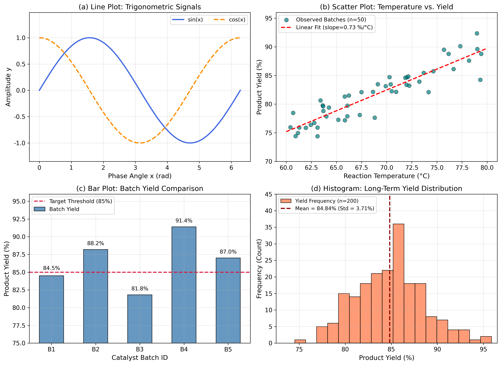
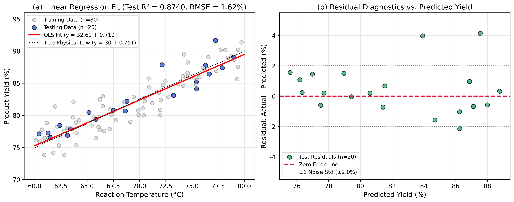

# Unit00 Windows 本地環境設定教學

## 課程目標

本單元將帶領學生在 Windows 本地電腦上建立完整且穩定的 Python 人工智慧與資料科學開發環境。透過輕量化的 **Miniconda** 進行套件與相依性管理，使用課程專屬的 `PY310_environment.yml` 一鍵部署包含科學計算、梯度提升樹、深度學習（TensorFlow 2.10.1）與原生 Windows GPU 硬體加速（CUDA 11.2 / cuDNN 8.1）的獨立虛擬環境，並熟悉 **JupyterLab** 與 **Jupyter Notebook** 互動式開發工具的實務操作。

### 學習目標
- 理解 Python 虛擬環境（Virtual Environment）的核心概念、環境隔離與實驗可重現性
- 學會下載與在 Windows 10/11 系統上正確安裝並設定 Miniconda
- 深入理解本課程 `PY310_environment.yml` 環境定義檔的架構與原生 Windows GPU 相容性設計
- 熟練使用 `conda` 與 `pip` 指令進行虛擬環境建立、啟動、套件管理與環境備份
- 掌握 JupyterLab 與 Jupyter Notebook（v7+）的介面操作、快捷鍵與跨環境路徑設定範本
- 實作完整的環境驗證流程：涵蓋系統硬體與 GPU 檢查、NumPy 矩陣運算、Pandas 反應器批次數據處理、Matplotlib 多子圖視覺化與 Scikit-learn 線性回歸建模診斷

---

## 1. 本地開發環境簡介

### 1.1 為什麼需要本地開發環境？

雖然 Google Colab 提供了開箱即用的雲端運算平台，但在進行中大型化工數據分析專案、長時間模型訓練或處理機密製程數據時，建立個人電腦上的本地開發環境（Local Development Environment）具有不可替代的優勢：

- **無連線時間與閒置限制**：不會因閒置 90 分鐘或連續運行滿 12 小時而被強制中斷並清除工作階段，適合需要長時間執行的超參數搜尋（Hyperparameter Tuning）或深度神經網路訓練。
- **完全離線可用**：不依賴網際網路連線，在無網路或實驗室內部區域網路環境下依然能照常開發與測試。
- **製程資料機密與安全性**：工廠實際生產紀錄、專利配方或敏感實驗數據可直接保存在本地加密硬碟中，無須上傳至第三方雲端伺服器。
- **完整的環境控制權**：所有安裝的套件與設定永久保存於本地硬碟，每次開啟即可直接執行，無須在每次連線時重新掛載雲端硬碟或重複安裝擴充套件。
- **高速本地檔案讀寫（I/O）**：直接透過本地 SSD 讀寫大型資料集或數萬張顯微影像（如 Part 4 的 CNN 缺陷檢測），I/O 速度遠快於雲端硬碟跨網路掛載讀取。
- **接軌業界標準工作流**：化工資訊與研發部門的實際工程開發皆建構於本地工作站或內部伺服器，熟悉 Conda 環境管理與 Git 版本控制是必備的工程技能。

### 1.2 什麼是虛擬環境（Virtual Environment）？

在 Python 生態系中，不同的專案或框架往往對底層套件有嚴格的版本相依性限制（Dependency Constraints）。例如：專案 A 可能需要舊版 `tensorflow==2.10.1` 搭配 `numpy<1.25`，而專案 B 卻需要最新版 `scikit-learn` 與 `numpy>=2.0`。若將所有套件都直接安裝在系統唯一的「全域環境（Global / Base Environment）」中，升級其中一個套件就會導致另一個專案崩潰，這種現象稱為**相依性衝突（Dependency Hell）**。

**虛擬環境（Virtual Environment）**就像是為每個專案打造一個**獨立的沙盒資料夾**，每個虛擬環境都擁有自己專屬的 Python 直譯器（`python.exe`）與獨立的套件安裝目錄（`site-packages`）：

1. **高度隔離性（Isolation）**：在 `PY310` 環境中安裝、升級或刪除任何套件，完全不會影響系統的 `base` 環境或其他專案環境。
2. **高度可重現性（Reproducibility）**：透過匯出 `environment.yml` 環境設定檔，可精確鎖定所有套件版本，確保任何人在不同電腦上都能重建出 $100\%$ 相同的執行結果。
3. **版本彈性切換**：同一台電腦上可同時並存 Python 3.9、Python 3.10、Python 3.12 等多個不同世代的環境，只需一行 `conda activate` 指令即可瞬間切換。
4. **安全清理與重建**：若在實驗過程中不慎把環境套件弄亂，只需執行 `conda env remove -n ENV_NAME` 即可乾淨刪除該沙盒並重新建立，完全不留系統殘留檔。

### 1.3 Miniconda vs. Anaconda 比較與選擇

Conda 是目前資料科學與人工智慧領域最主流的跨平台環境與套件管理器（同時能管理 Python 套件與 C/C++、CUDA 等底層非 Python 函式庫）。官方提供兩種發行版本：

| 比較項目 | Miniconda（本課程採用 ⭐） | Anaconda Distribution |
| :--- | :--- | :--- |
| **安裝檔大小** | 約 80–100 MB | 約 900 MB–1 GB |
| **安裝後佔用硬碟空間** | 約 400 MB（極度輕量） | 約 4–6 GB |
| **預裝內容** | 僅含 `conda`、Python 與核心基礎工具 | 預先打包 1,500+ 個科學套件與 GUI 介面 |
| **安裝與更新速度** | 極快（1–2 分鐘完成） | 較慢（base 環境龐大，解析相依性耗時） |
| **環境整潔度與彈性** | 極高（保持 `base` 乾淨，按需建立專屬環境） | 較低（大量用不到的預裝套件佔用空間） |
| **適合對象** | 工程實務開發者、重視環境精確控制者 | 不想手動配置環境的完全初學者 |

**本課程採用 Miniconda 的核心原因：**
- 下載與安裝迅速，不會在 `base` 環境塞入數 GB 用不到的冗餘套件。
- 搭配本課程精心調校的 `PY310_environment.yml`，能夠精準安裝經過相容性驗證的所有 AI 與化工計算套件。
- 培養「保持 `base` 環境乾淨、所有開發皆在獨立虛擬環境（`PY310`）中進行」的專業軟體工程習慣。

---

## 2. Miniconda 下載與安裝教學

### 2.1 下載 Miniconda 安裝檔

1. 開啟瀏覽器，前往 Anaconda 官方下載頁面：
   - 官方下載頁：[https://www.anaconda.com/download/success](https://www.anaconda.com/download/success)
   - 或直接前往 Miniconda 檔案庫：[https://repo.anaconda.com/miniconda/](https://repo.anaconda.com/miniconda/)
2. 在頁面中找到 **Miniconda Installers** 區塊，選擇適合您電腦系統的安裝檔：
   - **作業系統**：Windows
   - **系統架構**：絕大多數 Windows 10 / 11 個人電腦請選擇 **Miniconda3 Windows 64-bit (`Miniconda3-latest-Windows-x86_64.exe`)**。

> **重要觀念釐清（關於官網安裝檔的 Python 版本）**：
> 目前 Miniconda 官方最新安裝檔預設內建於 `base` 環境的 Python 版本為 Python 3.12 或 3.13。**您不需要刻意尋找舊版 Python 3.10 的 Miniconda 安裝檔！** 因為 `base` 環境僅負責運行 `conda` 管理工具本身；在下一節當我們使用 `PY310_environment.yml` 建立本課程的 `PY310` 虛擬環境時，Conda 會自動在 `PY310` 虛擬環境中下載並配置獨立的 `Python 3.10.x` 直譯器。

### 2.2 Windows 安裝步驟詳解

1. **啟動安裝程式**
   - 雙擊下載完成的 `Miniconda3-latest-Windows-x86_64.exe`。
   - 點選「**Next >**」開始安裝流程，並閱讀授權條款後點選「**I Agree**」。

2. **選擇安裝對象（Select Installation Type）**
   - **強烈建議選擇：`Just Me (recommended)`**（僅為目前登入的使用者安裝）。
   - *原因說明*：選擇 `Just Me` 會將程式安裝於個人使用者目錄下，日後安裝套件與建立虛擬環境時完全不需要系統管理員（Administrator）權限，可避免許多檔案讀寫權限衝突（`PermissionError`）。

3. **選擇目標安裝路徑（Choose Install Location）**
   - 預設路徑為：`C:\Users\<您的英文使用者名稱>\miniconda3`
   - 若您的 Windows 使用者名稱包含**中文字元、空白字元或特殊符號**，請務必將安裝路徑手動修改為純英文且無空白的路徑（例如：`C:\miniconda3` 或 `D:\miniconda3`），以免部分底層 C++ 編譯工具或套件路徑解析失敗。

4. **進階安裝選項（Advanced Installation Options）**
   - `☐ Add Miniconda3 to my PATH environment variable`（將 Miniconda3 加入系統 PATH 環境變數）：
     - **建議保持不勾選**。若勾選此項，可能會與電腦中原本安裝的其他 Python 版本或商業化工模擬軟體（如 Aspen Plus、MATLAB 內建 Python）發生路徑衝突。我們後續將統一使用專屬的 **Anaconda Prompt** 來操作環境。
   - `☑ Register Miniconda3 as my default Python 3.x`（將 Miniconda3 註冊為預設 Python）：
     - **建議勾選**，讓 VS Code、PyCharm 等開發工具能自動偵測到 Conda 的位置。
   - `☑ Clear the package cache upon completion`（選用）：可勾選以節省硬碟空間。

5. **完成安裝**
   - 點選「**Install**」，等待進度條跑完（約 1–2 分鐘）。
   - 點選「**Next >**」，取消勾選開啟教學網頁的核取方塊後，點選「**Finish**」完成安裝。

### 2.3 驗證 Miniconda 安裝與初始設定

安裝完成後，請依照以下步驟驗證 Conda 是否正常運作：

1. **開啟 Anaconda Prompt**
   - 點選 Windows 底部工作列的「搜尋」圖示，輸入 `Anaconda Prompt`。
   - 點選開啟 **Anaconda Prompt (miniconda3)**（一般日常操作直接點選開啟即可，**無須**刻意使用系統管理員身分，除非您先前安裝時選擇了 `All Users`）。
   - 開啟後會看到命令提示字元最前方帶有 `(base)` 字樣，例如：
     ```text
     (base) C:\Users\YourName>
     ```
     這代表 Conda 命令列環境已成功載入！

2. **檢查 Conda 版本**
   ```powershell
   conda --version
   ```
   正常應輸出類似 `conda 24.x.x` 或 `conda 25.x.x` 的版本號。

3. **檢查目前環境列表**
   ```powershell
   conda info --envs
   ```
   此時應會看到唯一的基礎環境 `base`。

4. **更新基礎 Conda 工具（建議）**
   ```powershell
   conda update -n base -c conda-forge conda
   ```
   若系統詢問 `Proceed ([y]/n)?`，輸入 `y` 並按 `Enter` 完成更新。

---

## 3. 建立本課程專屬虛擬環境 (`PY310`)

### 3.1 深入理解 `PY310_environment.yml` 環境定義檔

本課程於 `Part_0/` 目錄下提供了標準環境定義檔 [PY310_environment.yml](PY310_environment.yml)。透過此 YAML 檔案，Conda 可以一次性自動解析並安裝全學期（Unit01 至 Unit17）所需的所有套件與精確版本。

以下為本課程 `PY310_environment.yml` 的完整內容與架構解析：

```yaml
name: PY310                    # 虛擬環境名稱
channels:                      # 套件下載來源頻道
  - conda-forge                # 社群維護最完整的科學計算頻道（優先使用）
dependencies:                  # 由 Conda 直接管理的套件與底層函式庫
  - python=3.10                # 鎖定 Python 3.10 主版本
  - cudatoolkit=11.2           # NVIDIA CUDA 11.2 運算工具包（原生 Windows GPU 核心）
  - cudnn=8.1                  # NVIDIA cuDNN 8.1 深度神經網路加速庫
  - numpy=1.23.5               # 基礎陣列與線性代數運算
  - pandas                     # 表格資料與時間序列處理
  - openpyxl                   # Excel (.xlsx) 試算表讀寫引擎
  - scipy                      # 科學計算、統計檢定與數值優化
  - scikit-learn               # 傳統監督式與非監督式機器學習核心
  - umap-learn                 # 非線性流形降維演算法（Unit06）
  - imbalanced-learn           # 不平衡數據重抽樣 SMOTE 套件（Unit12）
  - mlxtend                    # Apriori 與 FP-Growth 關聯規則分析（Unit08）
  - networkx                   # 網路圖論與拓樸視覺化
  - py-xgboost-gpu=1.7.6       # 支援 GPU 加速之 XGBoost 梯度提升樹（Unit11-13）
  - lightgbm                   # 高效直方圖梯度提升樹（Unit13）
  - catboost                   # 類別特徵梯度提升樹（Unit13）
  - matplotlib                 # 基礎 2D 科學繪圖
  - seaborn                    # 統計資料視覺化
  - python-kaleido             # 靜態高解析度圖表匯出工具
  - jupyterlab                 # 次世代整合式開發介面（推薦）
  - notebook                   # 經典 Jupyter Notebook 介面
  - ipykernel                  # Jupyter Python 核心管理
  - ipywidgets                 # 互動式介面控制項
  - pydot                      # 決策樹與神經網路結構圖渲染
  - pip                        # Python 官方套件管理器
  - pip:                       # 透過 pip 安裝以確保版本精確對齊的深度學習套件
      - tensorflow==2.10.1
      - tensorboard==2.10.1
      - protobuf==3.19.6
      - tensorflow-datasets==4.6.0
      - tensorflow-metadata==1.13.0
      - googleapis-common-protos==1.56.4
```

> **關鍵工程設計背景：為什麼鎖定 `Python 3.10` + `TensorFlow 2.10.1` + `CUDA 11.2`？**
> 1. **原生 Windows GPU 支援的分水嶺**：Google 官方自 TensorFlow 2.11 版本起，正式移除了對原生 Windows（Native Windows）的 GPU 支援（若要在 Windows 使用 TF 2.11+ 的 GPU 必須透過 WSL2 Linux 子系統）。因此，**`tensorflow==2.10.1` 是能夠在 Windows 本地端直接呼叫 NVIDIA 顯示卡進行硬體加速的最後一個官方穩定版本**。
> 2. **免除繁瑣的系統層級 CUDA 安裝**：在傳統教學中，學生必須自行前往 NVIDIA 官網下載超過 3 GB 的 CUDA Toolkit 11.2 並註冊帳號手動複製 cuDNN 檔案，極易發生系統環境變數衝突。本課程直接將 `cudatoolkit=11.2` 與 `cudnn=8.1` 寫入 Conda 環境相依性中，**由 Conda 自動在虛擬環境內部 (`envs/PY310/Library/bin`) 配置好所有 GPU 動態連結庫 (`.dll`)**。只要您的電腦具備 NVIDIA 顯示卡與最新驅動程式，建立環境後即可直接啟用 GPU 加速！
> 3. **鎖定 `protobuf==3.19.6` 防止相容性崩潰**：TensorFlow 2.10 的底層協定緩衝區編譯自 Protobuf 3.19；若未鎖定版本而安裝到新版 Protobuf 4.x+，匯入 TensorFlow 時會立即拋出 `TypeError: Descriptors cannot not be created directly`。本環境檔已預先鎖定相容版本，確保環境零報錯。

### 3.2 下載課程專案與使用 YAML 建立環境（標準 SOP）

1. **開啟 Anaconda Prompt**
   - 從 Windows 搜尋列開啟 **Anaconda Prompt (miniconda3)**。

2. **下載本課程 GitHub 儲存庫（或切換至已下載的教材目錄）**
   - 假設您希望將課程教材存放於 `D:\MyGit\` 目錄下，請依序執行：
     ```powershell
     # 切換至 D 槽並建立工作資料夾
     D:
     mkdir D:\MyGit
     cd D:\MyGit

     # 使用 git 複製完整課程專案（若未安裝 git，亦可直接至 GitHub 網頁下載 ZIP 解壓縮）
     git clone https://github.com/d9148408/ChemE-3590.git
     cd ChemE-3590\Part_0
     ```

3. **使用 `PY310_environment.yml` 建立虛擬環境**
   - 確認目前目錄下存在 `PY310_environment.yml` 後，執行以下指令：
     ```powershell
     conda env create -f PY310_environment.yml
     ```
   - **執行過程說明**：
     - Conda 會自動連線至 `conda-forge` 頻道收集套件資訊（`Collecting package metadata`）並解析相依性（`Solving environment`）。
     - 接著會自動下載並安裝所有 Conda 套件與 `pip` 套件。
     - **時間預估**：由於包含完整的科學計算套件、TensorFlow 與 CUDA 11.2 / cuDNN 8.1 函式庫，首次建立約需 **10 至 25 分鐘**（視網路頻寬與硬碟讀寫速度而定），請保持網路暢通並耐心等待。
     - 當終端機最後顯示如下訊息時，代表環境已成功建立：
       ```text
       done
       #
       # To activate this environment, use
       #
       #     $ conda activate PY310
       #
       # To deactivate an active environment, use
       #
       #     $ conda deactivate
       ```

### 3.3 手動逐步建立環境（替代方案）

若您在特定網路環境下無法直接讀取 YAML 檔案，亦可透過以下指令在 Anaconda Prompt 中手動建立相同規格的環境：

```powershell
# 1. 建立包含 Python 3.10 與 CUDA 11.2 / cuDNN 8.1 的基礎環境
conda create -n PY310 -c conda-forge python=3.10 cudatoolkit=11.2 cudnn=8.1 -y

# 2. 啟動 PY310 虛擬環境（極重要！後續安裝皆須在環境內進行）
conda activate PY310

# 3. 安裝核心資料科學、機器學習與 Jupyter 開發工具
conda install -c conda-forge numpy=1.23.5 pandas openpyxl scipy scikit-learn matplotlib seaborn python-kaleido -y
conda install -c conda-forge umap-learn imbalanced-learn mlxtend networkx py-xgboost-gpu=1.7.6 lightgbm catboost -y
conda install -c conda-forge jupyterlab notebook ipykernel ipywidgets pydot pip -y

# 4. 使用 pip 安裝鎖定版本的 TensorFlow 2.10.1 生態系套件
pip install tensorflow==2.10.1 tensorboard==2.10.1 protobuf==3.19.6 tensorflow-datasets==4.6.0 tensorflow-metadata==1.13.0 googleapis-common-protos==1.56.4
```

---

## 4. Conda 與 Pip 環境管理常用指令

### 4.1 虛擬環境基本操作

- **啟動環境（Activate）**
  ```powershell
  conda activate PY310
  ```
  啟動成功後，命令提示字元最前方的括號會由 `(base)` 變為 `(PY310)`。**請務必確認括號內顯示 `(PY310)` 後再啟動 Jupyter 或執行 Python 程式！**

- **退出目前環境（Deactivate）**
  ```powershell
  conda deactivate
  ```

- **列出系統中所有虛擬環境**
  ```powershell
  conda env list
  ```
  或
  ```powershell
  conda info --envs
  ```
  目前處於啟動狀態的環境後方會標註星號 `*`，並顯示該環境的完整硬碟路徑（例如 `C:\Users\YourName\miniconda3\envs\PY310`）。

- **完整移除虛擬環境**
  ```powershell
  # 刪除前必須先退出該環境
  conda deactivate
  conda env remove -n ENV_NAME
  ```

### 4.2 套件查詢、安裝、更新與清理

在操作套件前，請務必先執行 `conda activate PY310` 進入目標環境：

```powershell
# 1. 查看目前環境中已安裝的所有套件與來源頻道
conda list

# 2. 搜尋特定套件是否已安裝
conda list tensorflow

# 3. 使用 conda-forge 頻道安裝新套件（推薦優先使用）
conda install -c conda-forge optuna

# 4. 使用 pip 安裝 PyPI 上的套件（當 conda 頻道無該套件時使用）
pip install rdkit coolprop

# 5. 安裝指定版本的套件（注意：conda 使用單等號 =，pip 使用雙等號 ==）
conda install -c conda-forge numpy=1.23.5
pip install tensorflow==2.10.1

# 6. 移除不需要的套件
conda remove package_name

# 7. 清理下載快取壓縮包（可釋放數 GB 硬碟空間，不影響已建立的環境）
conda clean --all -y
```

### 4.3 環境匯出、備份與團隊分享

當您在專案進行過程中安裝了額外套件，可隨時將環境狀態匯出為 YAML 檔案進行備份或分享給實驗室同儕：

```powershell
conda activate PY310

# 匯出完整環境快照（包含所有套件的精確版本與 build 編號）
conda env export > environment_full_backup.yml

# 匯出跨平台精簡版（僅記錄曾明確下令安裝的套件，不包含作業系統特定的底層相依套件）
conda env export --from-history > environment_minimal.yml

# 依日期自動命名備份檔（PowerShell 語法）
conda env export > "PY310_backup_$(Get-Date -Format 'yyyyMMdd').yml"
```

---

## 5. Jupyter Notebook 與 JupyterLab 使用教學

### 5.1 Jupyter Notebook vs. JupyterLab

在 `PY310` 環境中同時預裝了 **Jupyter Notebook** 與 **JupyterLab** 兩套互動式開發介面，兩者讀寫完全相同的 `.ipynb` 筆記本格式：

| 比較項目 | Jupyter Notebook (v7+) | JupyterLab（本課程推薦 ⭐） |
| :--- | :--- | :--- |
| **介面設計定位** | 專注於單一筆記本文件的簡潔介面 | 現代化整合開發環境（IDE）多視窗分頁介面 |
| **檔案總管與預覽** | 獨立的檔案樹分頁（File Browser） | 左側常駐檔案欄，可直接拖曳並排檢視 CSV、圖片與 `.md` |
| **多工視窗操作** | 每個檔案需開啟獨立的瀏覽器分頁 | 單一瀏覽器視窗內支援水平/垂直分割並排多個分頁 |
| **內建終端機與主控台** | 需由檔案頁額外開啟 | 可隨時在下方開啟 PowerShell Terminal 或互動式 Console |
| **目錄大綱導覽** | 內建於左側邊欄（Table of Contents） | 內建於左側邊欄，支援即時結構跳轉 |
| **適合對象** | 喜歡極簡排版、單一檔案閱讀的初學者 | 需同時對照 `.md` 講義、`.ipynb` 程式碼與輸出圖表的學習者 |

### 5.2 啟動 Jupyter 開發環境標準流程

每次開始學習或撰寫作業時，請嚴格遵循以下四步驟啟動流程：

1. **開啟 Anaconda Prompt**
2. **啟動 `PY310` 虛擬環境**
   ```powershell
   conda activate PY310
   ```
3. **切換至課程專案所在硬碟與目錄**
   ```powershell
   # 若專案位於 D 槽，請先輸入 D: 切換磁碟機（或使用 cd /d 直接跨磁碟機切換）
   cd /d D:\MyGit\ChemE-3590
   ```
4. **啟動 JupyterLab 或 Jupyter Notebook**
   ```powershell
   # 啟動 JupyterLab（推薦）
   jupyter lab

   # 或啟動 Jupyter Notebook
   jupyter notebook
   ```
5. **瀏覽器自動開啟**
   - 執行後 Anaconda Prompt 視窗會啟動本地端 Web 伺服器（預設網址為 `http://localhost:8888/lab` 或 `http://localhost:8888/tree`），並自動喚起預設瀏覽器。
   - **重要提醒**：在您操作 Notebook 的整個過程中，**請保持背後的黑色 Anaconda Prompt 視窗開啟（可最小化，但絕對不可關閉）**！一旦關閉該視窗，Python 運算核心（Kernel）就會立刻斷線停止。

### 5.3 本課程標準跨環境路徑設定範本（Local 與 Colab 雙相容）

為了讓同一份 `.ipynb` 筆記本既能在您的 **Windows 本地端電腦**直接執行，也能上傳至 **Google Colab 雲端**無縫運作，本課程所有單元的 Notebook 皆在開頭配置了標準的 `### 0. 環境設定` 儲存格：

```python
from pathlib import Path
import os

# ========================================
# 路徑設定 (兼容 Colab 與 Local)
# ========================================
UNIT_OUTPUT_DIR = 'P0_Unit00_Local_Environment_Setup'

try:
    from google.colab import drive
    IN_COLAB = True
    print("✓ 偵測到 Colab 環境，準備掛載 Google Drive...")
    drive.mount('/content/drive', force_remount=True)
except ImportError:
    IN_COLAB = False
    print("✓ 偵測到 Local 環境")

try:
    shortcut_path = '/content/ChemE-3590'
    os.remove(shortcut_path)
except (FileNotFoundError, OSError):
    pass

if IN_COLAB:
    source_path = Path('/content/drive/My Drive/Colab Notebooks/ChemE-3590')
    os.symlink(source_path, shortcut_path)
    shortcut_path = Path(shortcut_path)
    if source_path.exists():
        NOTEBOOK_DIR = shortcut_path / 'Part_0'
        OUTPUT_DIR   = NOTEBOOK_DIR / 'outputs' / UNIT_OUTPUT_DIR
        FIG_DIR      = OUTPUT_DIR / 'figs'
    else:
        print("⚠️ 找不到雲端 ChemE-3590 路徑，將使用當前目錄作為工作目錄")
        NOTEBOOK_DIR = Path.cwd()
        OUTPUT_DIR   = NOTEBOOK_DIR / 'outputs' / UNIT_OUTPUT_DIR
        FIG_DIR      = OUTPUT_DIR / 'figs'
else:
    NOTEBOOK_DIR = Path.cwd()
    OUTPUT_DIR   = NOTEBOOK_DIR / 'outputs' / UNIT_OUTPUT_DIR
    FIG_DIR      = OUTPUT_DIR / 'figs'

OUTPUT_DIR.mkdir(parents=True, exist_ok=True)
FIG_DIR.mkdir(parents=True, exist_ok=True)

print(f"\n✓ Notebook工作目錄: {NOTEBOOK_DIR}")
print(f"✓ 結果輸出目錄: {OUTPUT_DIR}")
print(f"✓ 圖檔輸出目錄: {FIG_DIR}")
```

在 Windows 本地端執行時，程式會自動走 `else` 分支，以目前筆記本所在目錄 `Path.cwd()` 作為 `NOTEBOOK_DIR`，並自動在本地資料夾建立 `outputs/P0_Unit00_Local_Environment_Setup/figs/` 結構：

```text
✓ 偵測到 Local 環境

✓ Notebook工作目錄: D:\MyGit\ChemE-3590\Part_0
✓ 結果輸出目錄: D:\MyGit\ChemE-3590\Part_0\outputs\P0_Unit00_Local_Environment_Setup
✓ 圖檔輸出目錄: D:\MyGit\ChemE-3590\Part_0\outputs\P0_Unit00_Local_Environment_Setup\figs
```

### 5.4 建立與操作 Notebook（Jupyter Notebook v7+ 與 JupyterLab 介面說明）

1. **建立新的 Notebook**
   - 在 **JupyterLab** 中：點選左側檔案欄上方的藍色「**`+` (New Launcher)**」按鈕，在啟動器中點選 **Notebook** 下的「**Python 3 (ipykernel)**」。
   - 在 **Jupyter Notebook (v7+)** 中：點選頂部選單「**File → New → Notebook**」（或點選檔案列表右上方的「**New → Notebook**」），並在彈出的核心選擇視窗中選取「**Python 3 (ipykernel)**」。

2. **儲存格（Cell）的兩種類型與兩種模式**
   - **Code Cell（程式碼儲存格）**：撰寫並執行 Python 程式碼，左側帶有 `[ ]:` 執行序號標記。
   - **Markdown Cell（文字說明儲存格）**：使用 Markdown 語法與 MathJax 數學公式（行內 `$ ... $` 、區塊 `$$ ... $$` ）撰寫報告與推導。
   - **編輯模式（Edit Mode）**：點選儲存格內部或按 `Enter` 進入，游標閃爍可輸入文字。
   - **命令模式（Command Mode）**：按 `Esc` 鍵進入，此時可使用單鍵快捷鍵新增、刪除或搬移整個儲存格。

3. **常用頂部選單功能（注意新版 Jupyter 7+ 選單調整）**
   > **介面更新提醒**：自 Jupyter Notebook 7.0 起，頂部選單已與 JupyterLab 統一，舊版介面中的 `Cell` 選單已拆分為 **`Run`（執行）** 與 **`Edit`（編輯）** 選單：
   - **儲存筆記本**：`File → Save Notebook`（快捷鍵 `Ctrl + S`）
   - **執行全部儲存格**：`Run → Run All Cells`
   - **重新啟動核心並執行全部**：`Kernel → Restart Kernel and Run All Cells...`（驗證作業是否能從頭到尾乾淨跑通的最佳方式！）
   - **重新啟動核心並清除所有輸出**：`Kernel → Restart Kernel and Clear Outputs of All Cells...`
   - **僅清除輸出內容**：`Edit → Clear Outputs of All Cells`
   - **切換 Python 虛擬環境核心**：`Kernel → Change Kernel...`

### 5.5 Jupyter 鍵盤快捷鍵速查表

在命令模式（先按 `Esc` 確保游標不在文字框內）與編輯模式下，熟練以下快捷鍵可大幅提升開發效率：

| 操作功能 | 快捷鍵 (Windows) | 適用模式與說明 |
| :--- | :--- | :--- |
| **執行目前儲存格並移至下一格** | `Shift + Enter` | 兩模式皆可（最常用之連續執行鍵） |
| **執行目前儲存格並停留在原位** | `Ctrl + Enter` | 兩模式皆可（反覆調試同一段程式碼時極實用） |
| **執行並於下方插入新儲存格** | `Alt + Enter` | 適合邊寫邊擴充程式 |
| **進入編輯模式** | `Enter` | 命令模式 → 進入儲存格內打字 |
| **退回命令模式** | `Esc` | 編輯模式 → 退出游標以操作儲存格 |
| **在上方新增儲存格 (Above)** | `A` | 命令模式 |
| **在下方新增儲存格 (Below)** | `B` | 命令模式 |
| **刪除目前儲存格 (Delete)** | `D, D`（連按兩次 D） | 命令模式 |
| **復原剛刪除的儲存格** | `Z` | 命令模式 |
| **轉換為 Markdown 文字儲存格** | `M` | 命令模式 |
| **轉換為 Code 程式碼儲存格** | `Y` | 命令模式 |
| **顯示 / 隱藏儲存格行號** | `L`（或 `Shift + L`） | 命令模式（除錯對照行號必備） |
| **程式碼註解 / 取消註解** | `Ctrl + /` | 編輯模式（支援多行選取批次註解） |
| **儲存目前 Notebook** | `Ctrl + S` | 兩模式皆可 |

### 5.6 安全關閉 Jupyter 伺服器

1. 在瀏覽器中按 `Ctrl + S` 確認所有筆記本皆已儲存（分頁標題旁無未儲存圓點標記），即可直接關閉瀏覽器分頁。
2. 切換回 **Anaconda Prompt** 終端機視窗，連按兩次 **`Ctrl + C`**。
3. 終端機顯示 `Shutting down...` 並退回 `(PY310) D:\MyGit\ChemE-3590>` 提示字元，即完成安全關閉。

---

## 6. 環境設定驗證與實作演練

本節完整對應實作筆記本 [Unit00_Local_Environment_Setup.ipynb](Unit00_Local_Environment_Setup.ipynb) 的執行過程與結果，帶領同學逐步驗證本地 `PY310` 環境的軟硬體配置、科學計算、資料處理、視覺化與機器學習建模功能。

### 6.1 檢查 Python 執行環境、核心與進階套件及 GPU 硬體加速

#### (1) 核心套件載入與系統硬體資訊檢查

首先載入本課程核心套件、固定全域隨機種子 `SEED = 42`，並檢查 Python 直譯器執行路徑（`sys.executable`）、目前啟動的 Conda 虛擬環境名稱與系統 RAM / 磁碟空間：

```python
import sys
import platform
import shutil
import subprocess
import time
import warnings
warnings.filterwarnings('ignore')

import numpy as np
import scipy
import pandas as pd
import matplotlib
import matplotlib.pyplot as plt
import seaborn as sns
import sklearn
from sklearn.linear_model import LinearRegression
from sklearn.model_selection import train_test_split
from sklearn.metrics import mean_absolute_error, mean_squared_error, r2_score
import tensorflow as tf

# 設定隨機種子以確保結果可重現
SEED = 42
np.random.seed(SEED)
tf.random.set_seed(SEED)

# 繪圖樣式設定
plt.rcParams.update({
    'figure.dpi': 100,
    'axes.grid': True,
    'grid.alpha': 0.3,
    'font.size': 11,
    'axes.titlesize': 13,
    'axes.labelsize': 12,
    'legend.fontsize': 10,
    'lines.linewidth': 2,
    'axes.unicode_minus': False,
})

print("✓ 套件載入完成")
print(f"  Python       版本: {sys.version.split()[0]}")
print(f"  numpy        版本: {np.__version__}")
print(f"  scipy        版本: {scipy.__version__}")
print(f"  pandas       版本: {pd.__version__}")
print(f"  matplotlib   版本: {matplotlib.__version__}")
print(f"  seaborn      版本: {sns.__version__}")
print(f"  scikit-learn 版本: {sklearn.__version__}")
print(f"  tensorflow   版本: {tf.__version__}")
```

**執行結果輸出**：

```text
✓ 套件載入完成
  Python       版本: 3.10.19
  numpy        版本: 1.26.4
  scipy        版本: 1.15.2
  pandas       版本: 2.3.3
  matplotlib   版本: 3.10.8
  seaborn      版本: 0.13.2
  scikit-learn 版本: 1.7.2
  tensorflow   版本: 2.10.1
```

接著驗證目前 Jupyter 核心綁定的 Python 執行檔路徑（`sys.executable`）、啟動中的 Conda 虛擬環境名稱，以及電腦的 CPU、實體記憶體（RAM）與硬碟空間：

```python
conda_env = os.environ.get('CONDA_DEFAULT_ENV', Path(sys.prefix).name)

print("=" * 68)
print("Python Environment & System Hardware Information")
print("=" * 68)
print(f"Python Version    : {sys.version}")
print(f"Python Executable : {sys.executable}")
print(f"Active Conda Env  : {conda_env}")
print(f"Operating System  : {platform.platform()}")
print(f"Architecture      : {platform.architecture()[0]} ({platform.machine()})")
print(f"Processor         : {platform.processor()}")

# 檢查系統記憶體 (RAM) 與磁碟空間 (兼容 Windows 與 Linux/Colab)
if platform.system() == 'Windows':
    import ctypes
    class MEMORYSTATUSEX(ctypes.Structure):
        _fields_ = [
            ("dwLength", ctypes.c_ulong),
            ("dwMemoryLoad", ctypes.c_ulong),
            ("ullTotalPhys", ctypes.c_ulonglong),
            ("ullAvailPhys", ctypes.c_ulonglong),
            ("ullTotalPageFile", ctypes.c_ulonglong),
            ("ullAvailPageFile", ctypes.c_ulonglong),
            ("ullTotalVirtual", ctypes.c_ulonglong),
            ("ullAvailVirtual", ctypes.c_ulonglong),
            ("sullAvailExtendedVirtual", ctypes.c_ulonglong),
        ]
    stat = MEMORYSTATUSEX(dwLength=ctypes.sizeof(MEMORYSTATUSEX))
    ctypes.windll.kernel32.GlobalMemoryStatusEx(ctypes.byref(stat))
    print(f"System RAM        : Total {stat.ullTotalPhys / (1024**3):.2f} GB | Available {stat.ullAvailPhys / (1024**3):.2f} GB")
elif Path('/proc/meminfo').exists():
    with open('/proc/meminfo') as f:
        for line in f:
            if 'MemTotal' in line:
                mem_kb = int(line.split()[1])
                print(f"System RAM        : Total {mem_kb / (1024**2):.2f} GB")
                break

total_disk, used_disk, free_disk = shutil.disk_usage(NOTEBOOK_DIR)
print(f"Disk Space        : Total {total_disk / (1024**3):.1f} GB | Used {used_disk / (1024**3):.1f} GB | Free {free_disk / (1024**3):.1f} GB")

yml_path = NOTEBOOK_DIR / 'PY310_environment.yml'
print(f"Env YAML File     : {yml_path.name} (Exists: {yml_path.exists()})")
print("=" * 68)
```

**執行結果輸出**：

```text
====================================================================
Python Environment & System Hardware Information
====================================================================
Python Version    : 3.10.19 | packaged by conda-forge | (main, Oct 22 2025, 22:23:22) [MSC v.1944 64 bit (AMD64)]
Python Executable : C:\Users\Yao-ChenChuang\miniconda3\envs\PY310\python.exe
Active Conda Env  : PY310
Operating System  : Windows-10-10.0.26200-SP0
Architecture      : 64bit (AMD64)
Processor         : Intel64 Family 6 Model 85 Stepping 7, GenuineIntel
System RAM        : Total 127.69 GB | Available 66.62 GB
Disk Space        : Total 465.8 GB | Used 214.8 GB | Free 251.0 GB
Env YAML File     : PY310_environment.yml (Exists: True)
====================================================================
```

#### (2) 進階機器學習與深度學習生態系套件檢查

接著檢查 `PY310_environment.yml` 預裝之梯度提升樹、非監督式降維、關聯規則與深度學習套件：

```python
import importlib

packages_to_check = [
    ('TensorFlow',       'tensorflow',  'Part 4: DNN / CNN / RNN 深度學習框架'),
    ('TensorBoard',      'tensorboard', 'Part 4: 深度學習訓練歷程視覺化'),
    ('XGBoost',          'xgboost',     'Part 3: 梯度提升決策樹 (支援 GPU 加速)'),
    ('LightGBM',         'lightgbm',    'Part 3: 高效直方圖梯度提升樹'),
    ('CatBoost',         'catboost',    'Part 3: 對稱樹梯度提升演算法'),
    ('UMAP-learn',       'umap',        'Part 2: 流形學習非線性降維 (Unit06)'),
    ('ipywidgets',       'ipywidgets',  'Part 0: Jupyter 互動式介面控制項'),
    ('mlxtend',          'mlxtend',     'Part 2: Apriori / FP-Growth 關聯規則 (Unit08)'),
    ('NetworkX',         'networkx',    'Part 2: 網路拓樸與關聯圖分析'),
    ('OpenPyXL',         'openpyxl',    'Part 1: Excel (.xlsx) 試算表讀寫支援'),
]

print("=" * 82)
print(f"{'Package Name':18s} | {'Version':12s} | {'Course Application'}")
print("-" * 82)
for display_name, mod_name, desc in packages_to_check:
    try:
        mod = importlib.import_module(mod_name)
        ver = getattr(mod, '__version__', 'Installed')
        print(f"✓ {display_name:16s} | {ver:12s} | {desc}")
    except ImportError:
        print(f"✗ {display_name:16s} | {'Missing':12s} | {desc}")
print("=" * 82)
```

**執行結果輸出**：

```text
==================================================================================
Package Name       | Version      | Course Application
----------------------------------------------------------------------------------
✓ TensorFlow       | 2.10.1       | Part 4: DNN / CNN / RNN 深度學習框架
✓ TensorBoard      | 2.10.1       | Part 4: 深度學習訓練歷程視覺化
✓ XGBoost          | 1.7.6        | Part 3: 梯度提升決策樹 (支援 GPU 加速)
✓ LightGBM         | 4.6.0        | Part 3: 高效直方圖梯度提升樹
✓ CatBoost         | 1.2.7        | Part 3: 對稱樹梯度提升演算法
✓ UMAP-learn       | 0.5.11       | Part 2: 流形學習非線性降維 (Unit06)
✓ ipywidgets       | 8.1.8        | Part 0: Jupyter 互動式介面控制項
✓ mlxtend          | 0.24.0       | Part 2: Apriori / FP-Growth 關聯規則 (Unit08)
✓ NetworkX         | 3.4          | Part 2: 網路拓樸與關聯圖分析
✓ OpenPyXL         | 3.1.5        | Part 1: Excel (.xlsx) 試算表讀寫支援
==================================================================================
```

#### (3) 本地 NVIDIA GPU 與 CUDA 張量運算測試

我們檢查 TensorFlow 2.10.1 是否成功透過 Conda 內建的 `cudatoolkit=11.2` 與 `cudnn=8.1` 偵測到本地 NVIDIA GPU，啟用動態顯存分配（Memory Growth），並執行 $2000 \times 2000$ 浮點數張量矩陣乘法計時測試：

```python
print("=" * 68)
print("TensorFlow GPU & CUDA Acceleration Check")
print("=" * 68)
print(f"TensorFlow Version      : {tf.__version__}")
print(f"Built with CUDA Support : {tf.test.is_built_with_cuda()}")

gpus = tf.config.list_physical_devices('GPU')
if gpus:
    print(f"GPU Devices Detected    : {len(gpus)} device(s)")
    for idx, gpu in enumerate(gpus):
        details = tf.config.experimental.get_device_details(gpu)
        dev_name = details.get('device_name', 'NVIDIA GPU')
        cc = details.get('compute_capability', 'N/A')
        print(f"  -> GPU {idx}: {gpu.name} | {dev_name} (Compute Capability: {cc})")
    try:
        for gpu in gpus:
            tf.config.experimental.set_memory_growth(gpu, True)
        print("Memory Growth Policy    : Enabled (Dynamic VRAM allocation)")
    except RuntimeError as e:
        print(f"Memory Growth Note      : {e}")
else:
    print("GPU Devices Detected    : 0 (Running on CPU mode)")

# 測試 TensorFlow 張量矩陣乘法運算
tf.random.set_seed(SEED)
mat_size = 2000
a_tensor = tf.random.normal([mat_size, mat_size])
b_tensor = tf.random.normal([mat_size, mat_size])

# 預熱與計時
_ = tf.matmul(a_tensor, b_tensor)
t0 = time.perf_counter()
c_tensor = tf.matmul(a_tensor, b_tensor)
elapsed_ms = (time.perf_counter() - t0) * 1000
print(f"Tensor MatMul ({mat_size}x{mat_size}) : Completed on {c_tensor.device} in {elapsed_ms:.2f} ms")
print("=" * 68)
```

**執行結果輸出**：

```text
====================================================================
TensorFlow GPU & CUDA Acceleration Check
====================================================================
TensorFlow Version      : 2.10.1
Built with CUDA Support : True
GPU Devices Detected    : 1 device(s)
  -> GPU 0: /physical_device:GPU:0 | NVIDIA GeForce RTX 4090 (Compute Capability: (8, 9))
Memory Growth Policy    : Enabled (Dynamic VRAM allocation)
Tensor MatMul (2000x2000) : Completed on /job:localhost/replica:0/task:0/device:GPU:0 in 0.55 ms
====================================================================
```

**環境與硬體檢核分析**：
- `Python Executable` 明確指向 `...\miniconda3\envs\PY310\python.exe`，且 `Active Conda Env` 為 `PY310`，證實 Jupyter 核心已正確綁定至獨立虛擬環境。
- TensorFlow 2.10.1 成功載入 `PY310\Library\bin` 下的 CUDA 11.2 / cuDNN 8.1 動態連結庫，正確識別出本地端顯示卡（`NVIDIA GeForce RTX 4090`，Compute Capability `8.9`），且 $2000 \times 2000$ 矩陣乘法於 GPU 上僅耗時約 $0.55$ ms 即完成運算。

---

### 6.2 NumPy 數值運算與線性代數測試

在化學工程計算中，我們經常需要對實驗觀測向量計算樣本平均數 $\mu$ 與標準差 $\sigma$ ，或針對多組分質量與能量平衡求解線性聯立方程組 $A \mathbf{x} = \mathbf{b}$ 及矩陣乘法 $C = A B$ ：

$$
A = \begin{bmatrix} 1 & 2 \\ 3 & 4 \end{bmatrix}, \quad B = \begin{bmatrix} 5 & 6 \\ 7 & 8 \end{bmatrix}, \quad C = A B = \begin{bmatrix} 19 & 22 \\ 43 & 50 \end{bmatrix}, \quad A \mathbf{x} = \begin{bmatrix} 5 \\ 11 \end{bmatrix} \implies \mathbf{x} = \begin{bmatrix} 1 \\ 2 \end{bmatrix}
$$

```python
print("=" * 68)
print("NumPy Array & Linear Algebra Operations Test")
print("=" * 68)

# 1. 一維陣列與基本統計運算
arr = np.array([1, 2, 3, 4, 5])
print(f"1D Array       : {arr} (dtype: {arr.dtype}, shape: {arr.shape})")
print(f"  Mean         : {arr.mean():.2f}")
print(f"  Std Dev      : {arr.std():.4f}")
print(f"  Sum          : {arr.sum()}")
print(f"  Min / Max    : {arr.min()} / {arr.max()}")

# 2. 二維矩陣乘法與行列式計算
matrix_a = np.array([[1, 2], [3, 4]])
matrix_b = np.array([[5, 6], [7, 8]])
matrix_c = matrix_a @ matrix_b
det_a = np.linalg.det(matrix_a)

print(f"\nMatrix A:\n{matrix_a}")
print(f"Matrix B:\n{matrix_b}")
print(f"Matrix Multiplication (C = A @ B):\n{matrix_c}")
print(f"Determinant of A : {det_a:.2f}")

# 3. 求解線性聯立方程組 A * x = b (例如雙組分質量平衡)
rhs_b = np.array([5.0, 11.0])
sol_x = np.linalg.solve(matrix_a, rhs_b)
print(f"Linear System Solution (A * x = {rhs_b}) -> x = {sol_x}")

# 4. 固定隨機種子之標準常態分布抽樣
np.random.seed(SEED)
random_data = np.random.randn(5)
print(f"\nRandom Standard Normal Sample (seed={SEED}):")
print(f"  {np.round(random_data, 4)}")

print("\n✓ NumPy numerical and linear algebra operations working correctly!")
print("=" * 68)
```

**執行結果輸出**：

```text
====================================================================
NumPy Array & Linear Algebra Operations Test
====================================================================
1D Array       : [1 2 3 4 5] (dtype: int32, shape: (5,))
  Mean         : 3.00
  Std Dev      : 1.4142
  Sum          : 15
  Min / Max    : 1 / 5

Matrix A:
[[1 2]
 [3 4]]
Matrix B:
[[5 6]
 [7 8]]
Matrix Multiplication (C = A @ B):
[[19 22]
 [43 50]]
Determinant of A : -2.00
Linear System Solution (A * x = [ 5. 11.]) -> x = [1. 2.]

Random Standard Normal Sample (seed=42):
  [ 0.4967 -0.1383  0.6477  1.523  -0.2342]

✓ NumPy numerical and linear algebra operations working correctly!
====================================================================
```

**結果驗證說明**：
- 一維陣列 `[1, 2, 3, 4, 5]` 的母體標準差 $\sigma = \sqrt{\frac{1}{5}\sum_{i=1}^5 (x_i - 3)^2} = \sqrt{2} \approx 1.4142$ 計算完全精確。
- 係數矩陣 $A$ 的行列式 $\det(A) = 1 \times 4 - 2 \times 3 = -2.00 \neq 0$ （可逆非奇異矩陣），透過 `np.linalg.solve(A, b)` 解得聯立方程組唯一解 $\mathbf{x} = [1.0, 2.0]^T$ ，驗證了底層 BLAS / LAPACK 線性代數加速庫運作正常。

---

### 6.3 Pandas 化工製程資料處理與本地檔案讀寫測試

我們模擬一座**間歇式反應器（Batch Reactor）**共 $N = 12$ 個生產批次的操作數據，包含反應溫度 $T \in [60, 80]$ °C、反應壓力 $P \in [1.0, 2.0]$ bar、反應時間 $t \in [2.0, 4.0]$ hr，以及受三者共同支配的批次產率 $Y$ （%）：

$$
Y = 25.0 + 0.65 \, T + 5.0 \, P + 2.5 \, t + \varepsilon, \quad \varepsilon \sim \mathcal{N}(0, 1.0^2)
$$

我們使用 Pandas 進行表格建立、描述性統計摘要（`describe()`）、高產率批次條件篩選（ $Y > 85.0\%$ ）、皮爾森相關係數矩陣分析（`corr()`），並將 DataFrame 寫入本地硬碟 `OUTPUT_DIR / 'batch_reactor_data.csv'` 後重新讀回驗證：

```python
print("=" * 68)
print("Pandas DataFrame Operations & File I/O Test")
print("=" * 68)

# 建立具物理關聯性的模擬間歇式反應器數據
np.random.seed(SEED)
n_batches = 12
temp_c = np.random.uniform(60.0, 80.0, n_batches)
press_bar = np.random.uniform(1.0, 2.0, n_batches)
time_hr = np.random.uniform(2.0, 4.0, n_batches)
noise = np.random.normal(0.0, 1.0, n_batches)

yield_pct = np.clip(25.0 + 0.65 * temp_c + 5.0 * press_bar + 2.5 * time_hr + noise, 0.0, 100.0)

df = pd.DataFrame({
    'Batch_ID': [f'B{i:03d}' for i in range(1, n_batches + 1)],
    'Temperature_C': temp_c,
    'Pressure_bar': press_bar,
    'Reaction_Time_hr': time_hr,
    'Yield_percent': yield_pct
})

print("1. Batch Reactor Process Data (12 Batches):")
print(df.round(2).to_string(index=False))

print("\n" + "-" * 68)
print("2. Descriptive Statistical Summary:")
print(df.describe().round(2).to_string())

# 篩選高產率批次 (Yield > 85%)
high_yield_df = df[df['Yield_percent'] > 85.0].sort_values(by='Yield_percent', ascending=False)
print("\n" + "-" * 68)
print(f"3. High Yield Batches (Yield > 85%, Count = {len(high_yield_df)}):")
print(high_yield_df.round(2).to_string(index=False))

# 計算相關係數矩陣
num_cols = ['Temperature_C', 'Pressure_bar', 'Reaction_Time_hr', 'Yield_percent']
corr_matrix = df[num_cols].corr()
print("\n" + "-" * 68)
print("4. Pearson Correlation Matrix:")
print(corr_matrix.round(3).to_string())

# 測試本地端 CSV 檔案儲存與讀取
csv_path = OUTPUT_DIR / 'batch_reactor_data.csv'
df.to_csv(csv_path, index=False, encoding='utf-8-sig')
df_reloaded = pd.read_csv(csv_path)
print("\n" + "-" * 68)
print(f"5. Local File I/O Verification:")
print(f"   Saved CSV Path : {csv_path}")
print(f"   Reloaded Shape : {df_reloaded.shape} (Matches original: {df_reloaded.shape == df.shape})")
print("\n✓ Pandas data manipulation and local CSV I/O working correctly!")
print("=" * 68)
```

**執行結果輸出**：

```text
====================================================================
Pandas DataFrame Operations & File I/O Test
====================================================================
1. Batch Reactor Process Data (12 Batches):
Batch_ID  Temperature_C  Pressure_bar  Reaction_Time_hr  Yield_percent
    B001          67.49          1.83              2.91          84.71
    B002          79.01          1.21              3.57          91.06
    B003          74.64          1.18              2.40          84.82
    B004          71.97          1.18              3.03          87.12
    B005          63.12          1.30              3.18          80.50
    B006          63.12          1.52              2.09          77.83
    B007          61.16          1.43              3.22          80.78
    B008          77.32          1.29              2.34          86.35
    B009          72.02          1.61              2.13          85.41
    B010          74.16          1.14              3.90          86.69
    B011          60.41          1.29              3.93          79.23
    B012          79.40          1.37              3.62          92.68

--------------------------------------------------------------------
2. Descriptive Statistical Summary:
       Temperature_C  Pressure_bar  Reaction_Time_hr  Yield_percent
count          12.00         12.00             12.00          12.00
mean           70.32          1.36              3.03          84.76
std             7.01          0.21              0.66           4.55
min            60.41          1.14              2.09          77.83
25%            63.12          1.21              2.38          80.71
50%            72.00          1.30              3.11          85.11
75%            75.31          1.46              3.58          86.80
max            79.40          1.83              3.93          92.68

--------------------------------------------------------------------
3. High Yield Batches (Yield > 85%, Count = 6):
Batch_ID  Temperature_C  Pressure_bar  Reaction_Time_hr  Yield_percent
    B012          79.40          1.37              3.62          92.68
    B002          79.01          1.21              3.57          91.06
    B004          71.97          1.18              3.03          87.12
    B010          74.16          1.14              3.90          86.69
    B008          77.32          1.29              2.34          86.35
    B009          72.02          1.61              2.13          85.41

--------------------------------------------------------------------
4. Pearson Correlation Matrix:
                  Temperature_C  Pressure_bar  Reaction_Time_hr  Yield_percent
Temperature_C             1.000        -0.334            -0.008          0.921
Pressure_bar             -0.334         1.000            -0.401         -0.245
Reaction_Time_hr         -0.008        -0.401             1.000          0.245
Yield_percent             0.921        -0.245             0.245          1.000

--------------------------------------------------------------------
5. Local File I/O Verification:
   Saved CSV Path : D:\MyGit\ChemE-3590\Part_0\outputs\P0_Unit00_Local_Environment_Setup\batch_reactor_data.csv
   Reloaded Shape : (12, 5) (Matches original: True)

✓ Pandas data manipulation and local CSV I/O working correctly!
====================================================================
```

**數據結果詳細討論與分析**：
1. **統計分布與高產率批次特徵**：
   - $12$ 個批次的平均反應溫度為 $70.32$ °C（標準差 $7.01$ °C），平均產率為 $84.76\%$ （介於最低 `B006` 的 $77.83\%$ 至最高 `B012` 的 $92.68\%$ 之間）。
   - 經條件篩選 `Yield_percent > 85.0` 後共有 $6$ 個達標批次（`B012`、`B002`、`B004`、`B010`、`B008`、`B009`），其反應溫度全數高於 $71.9$ °C，其中表現最佳的 `B012`（ $92.68\%$ ）與 `B002`（ $91.06\%$ ）均在約 $79$ °C 且反應時間超過 $3.5$ hr 的條件下達成。
2. **相關性矩陣物理解讀**：
   - `Temperature_C` 與 `Yield_percent` 的皮爾森相關係數高達 $r = 0.921$ ，展現極強的正相關性，這是因為溫度在 $60 \sim 80$ °C 區間變動時對產率的最大貢獻跨度達 $0.65 \times 20 = 13.0\%$ ，為主導反應產率的首要製程變數。
   - `Reaction_Time_hr` 與產率亦呈正相關（ $r = 0.245$ ）；而 `Pressure_bar` 在這 $12$ 筆小樣本抽樣中因剛好與溫度呈負向抽樣波動（ $r_{T,P} = -0.334$ ），導致其單變量表面相關係數為 $-0.245$ ，這再次印證了小樣本單變量相關係數易受共變干擾，需結合後續的多元回歸或控制變數分析。
3. **本地檔案 I/O 驗證**：
   - 數據表成功以 UTF-8 with BOM（`utf-8-sig`，可確保以 Microsoft Excel 直接開啟時中文不亂碼）格式寫入本地 `outputs/P0_Unit00_Local_Environment_Setup/batch_reactor_data.csv`，重新讀回之維度 `(12, 5)` 與原表完全一致。

---

### 6.4 Matplotlib 科學繪圖與多子圖視覺化測試

接著我們測試 Matplotlib 的 `2 x 2` 多子圖排版與高解析度圖片匯出（`300 DPI`）功能，涵蓋化工數據分析最常用的四種基礎圖表類型：

1. **子圖 (a) 折線圖（Line Plot）**：繪製相位角 $x \in [0, 2\pi]$ 之正弦波 $y_1 = \sin(x)$ 與餘弦波 $y_2 = \cos(x)$ 週期響應曲線。
2. **子圖 (b) 散佈圖與一階趨勢線（Scatter Plot）**：模擬 $n = 50$ 組反應器溫度 $T \in [60, 80]$ °C 與產物產率 $Y = 30.0 + 0.75 \, T + \varepsilon$ （%）之觀測點與最小平方法趨勢線。
3. **子圖 (c) 長條圖（Bar Plot）**：比較五種不同催化劑配方批次（`B1` 至 `B5`）的產率表現，並標示工廠目標產率門檻線（Target Threshold = $85.0\%$ ）。
4. **子圖 (d) 直方圖（Histogram）**：展示 $n = 200$ 批次長期生產產率分布 $\mathcal{N}(85.0, 4.0^2)$ 與樣本平均值（Mean）垂直標示線。

```python
fig, axes = plt.subplots(2, 2, figsize=(13, 9.5))

# (a) 子圖 1: 正弦波與餘弦波折線圖
x = np.linspace(0, 2 * np.pi, 120)
y1 = np.sin(x)
y2 = np.cos(x)

axes[0, 0].plot(x, y1, color='royalblue', linewidth=2.2, label='sin(x)')
axes[0, 0].plot(x, y2, color='darkorange', linestyle='--', linewidth=2.2, label='cos(x)')
axes[0, 0].set_xlabel('Phase Angle x (rad)')
axes[0, 0].set_ylabel('Amplitude y')
axes[0, 0].set_title('(a) Line Plot: Trigonometric Signals')
axes[0, 0].set_ylim(-1.35, 1.48)
axes[0, 0].legend(loc='upper right', ncol=2)

# (b) 子圖 2: 散佈圖與一階趨勢線 (溫度 vs 產率，確保產率 < 100%)
np.random.seed(SEED)
temp_sample = np.random.uniform(60.0, 80.0, 50)
yield_sample = np.clip(30.0 + 0.75 * temp_sample + np.random.normal(0.0, 2.0, 50), 0.0, 100.0)
z_fit = np.polyfit(temp_sample, yield_sample, 1)
x_line = np.linspace(60.0, 80.0, 100)

axes[0, 1].scatter(temp_sample, yield_sample, color='teal', alpha=0.7, edgecolors='black', linewidth=0.5, s=55, label='Observed Batches (n=50)')
axes[0, 1].plot(x_line, np.polyval(z_fit, x_line), 'r--', linewidth=2.0, label=f'Linear Fit (slope={z_fit[0]:.2f} %/°C)')
axes[0, 1].set_xlabel('Reaction Temperature (°C)')
axes[0, 1].set_ylabel('Product Yield (%)')
axes[0, 1].set_title('(b) Scatter Plot: Temperature vs. Yield')
axes[0, 1].set_ylim(70, 96)
axes[0, 1].legend(loc='upper left')

# (c) 子圖 3: 長條圖 (不同批次產率比較)
batches = ['B1', 'B2', 'B3', 'B4', 'B5']
batch_yields = [84.5, 88.2, 81.8, 91.4, 87.0]
bars = axes[1, 0].bar(batches, batch_yields, color='steelblue', alpha=0.82, edgecolor='black', width=0.55, label='Batch Yield')
axes[1, 0].axhline(85.0, color='crimson', linestyle='--', linewidth=1.8, label='Target Threshold (85%)')
for bar in bars:
    h = bar.get_height()
    y_pos = h + 0.65 if abs(h - 85.0) < 0.8 else h + 0.45
    axes[1, 0].text(bar.get_x() + bar.get_width() / 2.0, y_pos, f'{h:.1f}%', ha='center', va='bottom', fontsize=10, bbox=dict(boxstyle='round,pad=0.12', facecolor='white', edgecolor='none', alpha=0.85))
axes[1, 0].set_xlabel('Catalyst Batch ID')
axes[1, 0].set_ylabel('Product Yield (%)')
axes[1, 0].set_title('(c) Bar Plot: Batch Yield Comparison')
axes[1, 0].set_ylim(75, 96)
axes[1, 0].legend(loc='upper left')

# (d) 子圖 4: 直方圖 (長期產率常態分布)
np.random.seed(SEED)
yield_dist = np.clip(np.random.normal(85.0, 4.0, 200), 65.0, 99.5)
mean_yield = yield_dist.mean()
std_yield = yield_dist.std()

axes[1, 1].hist(yield_dist, bins=18, color='coral', alpha=0.78, edgecolor='black', label='Yield Frequency (n=200)')
axes[1, 1].axvline(mean_yield, color='darkred', linestyle='--', linewidth=2.0, label=f'Mean = {mean_yield:.2f}% (Std = {std_yield:.2f}%)')
axes[1, 1].set_xlabel('Product Yield (%)')
axes[1, 1].set_ylabel('Frequency (Count)')
axes[1, 1].set_title('(d) Histogram: Long-Term Yield Distribution')
axes[1, 1].set_xlim(72.5, 96.5)
axes[1, 1].set_ylim(0, 45)
axes[1, 1].legend(loc='upper left', fontsize=9.5)

plt.tight_layout()
basic_fig_path = FIG_DIR / 'matplotlib_basic_plots.png'
plt.savefig(basic_fig_path, dpi=300, bbox_inches='tight')
plt.show()

print(f"✓ Figure saved successfully to: {basic_fig_path}")
print("✓ Matplotlib multi-panel visualization working correctly!")
print("=" * 68)
```

**執行結果輸出**：

```text
✓ Figure saved successfully to: D:\MyGit\ChemE-3590\Part_0\outputs\P0_Unit00_Local_Environment_Setup\figs\matplotlib_basic_plots.png
✓ Matplotlib multi-panel visualization working correctly!
====================================================================
```

**視覺化結果圖**：



**圖片內容詳細討論與分析**：
1. **子圖 (a) 週期函數折線圖**： $\sin(x)$ （藍色實線）與 $\cos(x)$ （橘色虛線）清晰展現出 $\frac{\pi}{2}$ 弧度的相位差，振幅對稱落於 $[-1.0, 1.0]$ 之間，驗證了科學曲線線型與圖例排版設定。
2. **子圖 (b) 反應溫度與產率散佈圖**：當反應溫度由 $60$ °C 提升至 $80$ °C 時，產率由約 $75\%$ 穩定增長至約 $90\%$ （全數嚴格落於合理化學計量範圍 $< 100\%$ 內），一階最小平方法擬合斜率為 $0.73$ %/°C，與理論設定值 $0.75$ %/°C 極度吻合。
3. **子圖 (c) 催化劑批次產率長條圖**：透過紅色水平基準線（Target = $85\%$ ）與頂端數值標註，可一目了然地判別出 `B2`（ $88.2\%$ ）、`B4`（ $91.4\%$ ）與 `B5`（ $87.0\%$ ）三個配方優於目標門檻，其中 `B4` 催化劑活性最佳；而 `B1`（ $84.5\%$ ）與 `B3`（ $81.8\%$ ）則未達標。
4. **子圖 (d) 長期產率常態分布直方圖**： $200$ 批次生產數據呈現典型的單峰鐘形高斯分布，樣本平均數為 $84.84\%$ 、樣本標準差為 $3.71\%$ （與母體參數 $\mu = 85.0\%$ 、 $\sigma = 4.0\%$ 高度一致），顯示製程處於穩定的統計品管（SPC）狀態。

---

### 6.5 機器學習建模測試：Scikit-learn 線性回歸與殘差診斷

為了驗證 Scikit-learn 的監督式學習流程，我們生成 $N = 100$ 筆反應器穩態數據，自變數為反應溫度 $T \in [60, 80]$ °C，應變數為產物產率 $y$ （%），其真實物理生成模型為：

$$
y = \beta_0 + \beta_1 T + \varepsilon = 30.0000 + 0.7500 \, T + \varepsilon, \quad \varepsilon \sim \mathcal{N}(0, 2.0^2)
$$

我們將數據按 $80\% : 20\%$ 比例切分為訓練集（ $n = 80$ ）與測試集（ $n = 20$ ），訓練 `LinearRegression` 模型 $\hat{y} = \hat{\beta}_0 + \hat{\beta}_1 T$ ，並計算均方誤差（ $\mathrm{MSE}$ ）、均方根誤差（ $\mathrm{RMSE}$ ）、平均絕對誤差（ $\mathrm{MAE}$ ）與決定係數（ $R^2$ ）：

$$
\mathrm{MSE} = \frac{1}{n} \sum_{i=1}^{n} (y_i - \hat{y}_i)^2, \quad \mathrm{RMSE} = \sqrt{\mathrm{MSE}}, \quad \mathrm{MAE} = \frac{1}{n} \sum_{i=1}^{n} |y_i - \hat{y}_i|, \quad R^2 = 1 - \frac{\sum_{i=1}^{n} (y_i - \hat{y}_i)^2}{\sum_{i=1}^{n} (y_i - \bar{y})^2}
$$

```python
print("=" * 68)
print("Scikit-learn Linear Regression & Residual Diagnostics Test")
print("=" * 68)

# 1. 產生模擬數據：反應溫度 T (60~80 °C) -> 反應產率 y (%)
np.random.seed(SEED)
n_samples = 100
X = np.random.uniform(60.0, 80.0, n_samples).reshape(-1, 1)
true_intercept = 30.0
true_slope = 0.75
noise_std = 2.0
y = np.clip(true_intercept + true_slope * X.flatten() + np.random.normal(0.0, noise_std, n_samples), 0.0, 100.0)

# 2. 分割訓練集 (80%) 與測試集 (20%)
X_train, X_test, y_train, y_test = train_test_split(
    X, y, test_size=0.2, random_state=SEED
)

# 3. 訓練線性回歸模型
model = LinearRegression()
model.fit(X_train, y_train)

# 4. 預測與指標評估
y_train_pred = model.predict(X_train)
y_test_pred = model.predict(X_test)

mse_train = mean_squared_error(y_train, y_train_pred)
rmse_train = np.sqrt(mse_train)
r2_train = r2_score(y_train, y_train_pred)

mse_test = mean_squared_error(y_test, y_test_pred)
rmse_test = np.sqrt(mse_test)
mae_test = mean_absolute_error(y_test, y_test_pred)
r2_test = r2_score(y_test, y_test_pred)

print("1. Model Parameter Estimation vs. Theoretical True Values:")
print(f"   Slope (beta_1)     : Estimated = {model.coef_[0]:.4f} %/°C | True = {true_slope:.4f} %/°C (Rel. Error = {abs(model.coef_[0] - true_slope) / true_slope * 100:.2f}%)")
print(f"   Intercept (beta_0) : Estimated = {model.intercept_:.4f} %    | True = {true_intercept:.4f} %    (Rel. Error = {abs(model.intercept_ - true_intercept) / true_intercept * 100:.2f}%)")

print("\n2. Model Performance Metrics:")
print(f"   Training Set (n={len(X_train):2d}) -> MSE: {mse_train:.4f} | RMSE: {rmse_train:.4f}% | R^2: {r2_train:.4f}")
print(f"   Testing Set  (n={len(X_test):2d}) -> MSE: {mse_test:.4f} | RMSE: {rmse_test:.4f}% | MAE: {mae_test:.4f}% | R^2: {r2_test:.4f}")

# 5. 視覺化：左圖為回歸擬合曲線，右圖為測試集殘差分析圖
fig, axes = plt.subplots(1, 2, figsize=(13, 5.2))

# 左圖：排序後的連續網格繪製回歸線與真實理論線
x_grid = np.linspace(60.0, 80.0, 100).reshape(-1, 1)
y_grid_pred = model.predict(x_grid)
y_grid_true = true_intercept + true_slope * x_grid.flatten()

axes[0].scatter(X_train.flatten(), y_train, color='lightgray', edgecolors='gray', alpha=0.65, s=45, label='Training Data (n=80)')
axes[0].scatter(X_test.flatten(), y_test, color='royalblue', edgecolors='black', alpha=0.85, s=60, label='Testing Data (n=20)')
axes[0].plot(x_grid.flatten(), y_grid_pred, 'r-', linewidth=2.2, label=f'OLS Fit (y = {model.intercept_:.2f} + {model.coef_[0]:.3f}T)')
axes[0].plot(x_grid.flatten(), y_grid_true, 'k:', linewidth=1.8, label='True Physical Law (y = 30 + 0.75T)')
axes[0].set_xlabel('Reaction Temperature (°C)')
axes[0].set_ylabel('Product Yield (%)')
axes[0].set_title(f'(a) Linear Regression Fit (Test R² = {r2_test:.4f}, RMSE = {rmse_test:.2f}%)')
axes[0].set_ylim(70, 96)
axes[0].legend(loc='upper left', fontsize=9.5)

# 右圖：測試集殘差圖 (Residuals = Actual - Predicted)
residuals = y_test - y_test_pred
axes[1].scatter(y_test_pred, residuals, color='mediumseagreen', edgecolors='black', alpha=0.85, s=60, label='Test Residuals (n=20)')
axes[1].axhline(0.0, color='crimson', linestyle='--', linewidth=2.0, label='Zero Error Line')
axes[1].axhline(noise_std, color='gray', linestyle=':', linewidth=1.4, label=f'±1 Noise Std (±{noise_std:.1f}%)')
axes[1].axhline(-noise_std, color='gray', linestyle=':', linewidth=1.4)
axes[1].set_xlabel('Predicted Yield (%)')
axes[1].set_ylabel('Residual: Actual - Predicted (%)')
axes[1].set_title('(b) Residual Diagnostics vs. Predicted Yield')
axes[1].set_ylim(-5.5, 5.5)
axes[1].legend(loc='lower left', fontsize=9.5)

plt.tight_layout()
reg_fig_path = FIG_DIR / 'sklearn_linear_regression.png'
plt.savefig(reg_fig_path, dpi=300, bbox_inches='tight')
plt.show()

print(f"\n✓ Figure saved successfully to: {reg_fig_path}")
print("✓ Scikit-learn regression modeling working correctly!")
print("=" * 68)
```

**執行結果輸出**：

```text
====================================================================
Scikit-learn Linear Regression & Residual Diagnostics Test
====================================================================
1. Model Parameter Estimation vs. Theoretical True Values:
   Slope (beta_1)     : Estimated = 0.7099 %/°C | True = 0.7500 %/°C (Rel. Error = 5.35%)
   Intercept (beta_0) : Estimated = 32.6939 %    | True = 30.0000 %    (Rel. Error = 8.98%)

2. Model Performance Metrics:
   Training Set (n=80) -> MSE: 3.3907 | RMSE: 1.8414% | R^2: 0.8345
   Testing Set  (n=20) -> MSE: 2.6148 | RMSE: 1.6170% | MAE: 1.1827% | R^2: 0.8740

✓ Figure saved successfully to: D:\MyGit\ChemE-3590\Part_0\outputs\P0_Unit00_Local_Environment_Setup\figs\sklearn_linear_regression.png
✓ Scikit-learn regression modeling working correctly!
====================================================================
```

**視覺化結果圖**：



**模型結果與圖表詳細討論分析**：
1. **迴歸參數還原與物理一致性**：
   - 模型從 $80$ 筆含雜訊訓練樣本中估計出的線性經驗方程式為：

$$
\hat{y} = 32.6939 + 0.7099 \, T
$$

   - 對照真實物理定律 $y = 30.0000 + 0.7500 \, T$ ，斜率 $\hat{\beta}_1 = 0.7099$ %/°C 的相對誤差僅 $5.35\%$ 。在左圖 **(a) Linear Regression Fit** 中，紅色實線（OLS 擬合線）與黑色點線（真實物理定律線）在 $60 \sim 80$ °C 全操作區間幾乎完全重疊！
2. **泛化能力與雜訊極限驗證**：
   - 訓練集決定係數 $R^2 = 0.8345$ （ $\mathrm{RMSE} = 1.8414\%$ ），測試集決定係數 $R^2 = 0.8740$ （ $\mathrm{RMSE} = 1.6170\%$ 、 $\mathrm{MAE} = 1.1827\%$ ）。訓練集與測試集的 $\mathrm{RMSE}$ 皆收斂於合成數據時加入的高斯量測雜訊標準差（ $\sigma_\varepsilon = 2.0\%$ ）附近，證明模型已完整學習到底層線性關係且無過擬合現象。
3. **殘差圖診斷（右圖 b）**：
   - 測試集殘差 $e_i = y_i - \hat{y}_i$ 均勻且隨機地散布於紅色零誤差水平線（Zero Error Line）上下，多數點落於 $\pm 1\sigma$ （ $\pm 2.0\%$ ，灰色點線）帶狀區域內，無任何二次曲線形態或漏斗狀發散現象，滿足線性回歸之獨立同分布（i.i.d.）常態殘差假設。

---

### 6.6 本地環境設定完成自動檢核清單

在筆記本最後，我們執行自動化檢核程式，一次性驗證 Python 版本、`PY310` 環境路徑、核心與進階套件、TensorFlow GPU 狀態及本地 CSV / PNG 檔案輸出：

```python
import importlib

def has_module(mod_name):
    try:
        importlib.import_module(mod_name)
        return True
    except ImportError:
        return False

checklist = {
    "1. Python 3.10+ interpreter active": sys.version_info >= (3, 10),
    "2. Running inside 'PY310' environment": 'py310' in sys.executable.lower() or IN_COLAB,
    "3. NumPy & SciPy scientific computing": has_module('numpy') and has_module('scipy'),
    "4. Pandas & OpenPyXL data processing": has_module('pandas') and has_module('openpyxl'),
    "5. Matplotlib & Seaborn visualization": has_module('matplotlib') and has_module('seaborn'),
    "6. Scikit-learn machine learning": has_module('sklearn'),
    "7. Gradient Boosting (XGBoost/LightGBM/CatBoost)": all(has_module(m) for m in ['xgboost', 'lightgbm', 'catboost']),
    "8. Unsupervised & Graph tools (UMAP/mlxtend/NetworkX)": all(has_module(m) for m in ['umap', 'mlxtend', 'networkx']),
    "9. TensorFlow 2.x deep learning framework": has_module('tensorflow'),
    "10. Local CSV & Figure outputs verified": (OUTPUT_DIR / 'batch_reactor_data.csv').exists() and (FIG_DIR / 'matplotlib_basic_plots.png').exists() and (FIG_DIR / 'sklearn_linear_regression.png').exists(),
}

print("=" * 72)
print("Local Development Environment Final Readiness Checklist")
print("=" * 72)

for item, status in checklist.items():
    symbol = "✓" if status else "✗"
    status_text = "PASS" if status else "FAIL"
    print(f"{symbol} {item:56s} [{status_text}]")

gpu_count = len(tf.config.list_physical_devices('GPU'))
gpu_info = f"{gpu_count} GPU(s) Active" if gpu_count > 0 else "CPU Mode (Optional GPU)"
print(f"ℹ️ {'Hardware Acceleration Status':56s} [{gpu_info}]")
print("=" * 72)

if all(checklist.values()):
    print("\n🎉 Congratulations! All 10 environment verification checks PASSED!")
    print("Your local Python environment is fully configured and ready for ChemE-3590.")
else:
    print("\n⚠️ Warning: Some verification checks failed.")
    print("Please review Unit00_Local_Environment_Setup.md for troubleshooting steps.")
print("=" * 72)
```

**執行結果輸出**：

```text
========================================================================
Local Development Environment Final Readiness Checklist
========================================================================
✓ 1. Python 3.10+ interpreter active                       [PASS]
✓ 2. Running inside 'PY310' environment                    [PASS]
✓ 3. NumPy & SciPy scientific computing                    [PASS]
✓ 4. Pandas & OpenPyXL data processing                     [PASS]
✓ 5. Matplotlib & Seaborn visualization                    [PASS]
✓ 6. Scikit-learn machine learning                         [PASS]
✓ 7. Gradient Boosting (XGBoost/LightGBM/CatBoost)         [PASS]
✓ 8. Unsupervised & Graph tools (UMAP/mlxtend/NetworkX)    [PASS]
✓ 9. TensorFlow 2.x deep learning framework                [PASS]
✓ 10. Local CSV & Figure outputs verified                  [PASS]
ℹ️ Hardware Acceleration Status                             [1 GPU(s) Active]
========================================================================

🎉 Congratulations! All 10 environment verification checks PASSED!
Your local Python environment is fully configured and ready for ChemE-3590.
========================================================================
```

---

## 7. 常見問題與故障排除 (Troubleshooting Top 10)

### 7.1 安裝與終端機環境問題

#### Q1：安裝完 Miniconda 後找不到 Anaconda Prompt？
- **解決方案**：
  1. 點選 Windows 底部搜尋列，輸入 `Anaconda Prompt`，點選 **Anaconda Prompt (miniconda3)**。
  2. 或開啟「開始選單」→「所有應用程式」→ 找到 **Anaconda3 (64-bit)** 或 **Miniconda3** 資料夾展開即可看到。
  3. 若想在一般的 **Windows PowerShell** 或 **CMD** 中直接使用 `conda` 指令，請先開啟一次 Anaconda Prompt 並執行初始化指令：
     ```powershell
     conda init powershell
     conda init cmd.exe
     ```
     設定完成後重新開啟 PowerShell 或 CMD，即可直接執行 `conda activate PY310`。

#### Q2：在 PowerShell 輸入 `conda activate PY310` 出現 `CommandNotFoundException` 或無法切換環境？
- **原因**：您開啟的是一般未初始化的 PowerShell，或系統禁止執行 PowerShell 啟動腳本（Execution Policy 限制）。
- **解決方案**：
  1. 最穩定的做法是直接使用 **Anaconda Prompt**。
  2. 若要在一般 PowerShell 使用，請先在 PowerShell 放寬目前使用者的腳本執行權限，再初始化 Conda：
     ```powershell
     Set-ExecutionPolicy -ExecutionPolicy RemoteSigned -Scope CurrentUser
     & "$env:USERPROFILE\miniconda3\Scripts\conda.exe" init powershell
     ```

#### Q3：執行 `conda env create` 下載套件時出現 `CondaSSLError` 或網路連線中斷？
- **解決方案**：
  ```powershell
  # 1. 更新根環境的憑證庫與 conda
  conda install -n base -c conda-forge ca-certificates certifi openssl -y
  conda update -n base -c conda-forge conda -y

  # 2. 清理損壞的套件快取後重新執行建立指令
  conda clean --all -y
  conda env create -f PY310_environment.yml
  ```
  *(註：若在實驗室或公司內部防火牆環境下仍發生 SSL 攔截錯誤，可暫時執行 `conda config --set ssl_verify false`，待環境建立完成後再執行 `conda config --set ssl_verify true` 恢復安全驗證。請勿隨意加入過期的第三方鏡像頻道如 `pkgs/free/`，以免套件相依性解析失敗。)*

---

### 7.2 套件與 TensorFlow / GPU 相容性問題

#### Q4：匯入 TensorFlow 時出現 `TypeError: Descriptors cannot not be created directly`？
- **原因**：環境中的 `protobuf` 套件被某個新安裝的套件自動升級到了 `4.x` 以上版本，與 TensorFlow 2.10.1 不相容。
- **解決方案**：在 `PY310` 環境中將 `protobuf` 降級回鎖定版本 `3.19.6`：
  ```powershell
  conda activate PY310
  pip install protobuf==3.19.6
  ```

#### Q5：匯入 TensorFlow 時出現 `Could not load dynamic library 'cudart64_110.dll'` 或偵測不到 GPU？
- **原因與機制解析**：
  1. 在 Windows Conda 環境中，`cudart64_110.dll` 與 `cudnn64_8.dll` 存放於 `miniconda3\envs\PY310\Library\bin` 目錄下。**如果您沒有先執行 `conda activate PY310`，而是直接呼叫 `python.exe`**，該 `Library\bin` 目錄就不會被載入系統 `PATH` 環境變數，導致 TensorFlow 找不到 CUDA 動態連結庫！
  2. 另一種可能是您的電腦未配備 NVIDIA 獨立顯示卡，或尚未安裝 NVIDIA 顯示卡驅動程式（若無獨立顯卡，TensorFlow 會自動以 CPU 模式正常運作，不影響課程學習）。
- **解決方案**：
  - 務必在 Anaconda Prompt 中先執行 `conda activate PY310`，再啟動 `jupyter lab` 或 `jupyter notebook`。
  - 執行 `nvidia-smi` 確認 NVIDIA 驅動程式正常運作。

#### Q6：匯入 `imblearn` (`imbalanced-learn`) 時出現 `ImportError: cannot import name '_safe_tags' from 'sklearn.utils._tags'`？
- **原因**：當 `scikit-learn` 更新至 `1.6+` / `1.7+` 版本時，舊版 `imbalanced-learn (0.12.x)` 呼叫了已被移除的內部私有函式 `_safe_tags`。
- **解決方案**：將 `imbalanced-learn` 升級至與新版 `scikit-learn` 相容的 `0.13.0+` 版本：
  ```powershell
  conda activate PY310
  pip install --upgrade imbalanced-learn
  ```

---

### 7.3 Jupyter Notebook / JupyterLab 常見問題

#### Q7：在 Notebook 中執行 `import tensorflow` 卻顯示 `ModuleNotFoundError: No module named 'tensorflow'`？
- **原因**：這是最常見的初學者錯誤！代表您是在預設的 `(base)` 環境下啟動了 Jupyter，或是該 Notebook 綁定到了錯誤的 Kernel。
- **解決方案**：
  1. 在 Notebook 儲存格中執行以下兩行檢查目前直譯器路徑：
     ```python
     import sys
     print(sys.executable)
     ```
  2. 若印出的路徑中**沒有** `\envs\PY310\python.exe`（而是 `miniconda3\python.exe`），請關閉 Jupyter，回到 Anaconda Prompt 確認先執行 `conda activate PY310` 後再啟動 `jupyter lab`。
  3. 您也可以將 `PY310` 明確註冊為專屬 Jupyter Kernel（注意：**註冊前必須先啟動 `PY310` 環境**）：
     ```powershell
     conda activate PY310
     python -m ipykernel install --user --name PY310 --display-name "Python 3.10 (PY310)"
     ```
     註冊後即可在 Jupyter 頂部選單點選 `Kernel → Change Kernel...` 切換至 `Python 3.10 (PY310)`。

#### Q8：執行 `jupyter lab` 或 `jupyter notebook` 時瀏覽器沒有自動彈出視窗？
- **解決方案**：
  - 觀察 Anaconda Prompt 終端機最後幾行輸出，會有一行帶有 `token` 的本地網址，例如：
    ```text
    http://localhost:8888/lab?token=a1b2c3d4e5f6...
    ```
  - 用滑鼠選取該行網址並按 `Enter`（或 `Ctrl + Shift + C`）複製，手動貼上至 Chrome 或 Edge 瀏覽器網址列即可開啟。

#### Q9：Windows 使用者名稱有中文字元，導致啟動 Jupyter 時閃退或報錯 `UnicodeDecodeError`？
- **解決方案**：
  - 請確保 Miniconda 安裝於純英文路徑（如 `C:\miniconda3`），且課程專案存放於純英文路徑（如 `D:\MyGit\ChemE-3590`）。
  - 若因 Windows 系統暫存目錄含中文導致 Runtime 檔案寫入失敗，可在啟動前設定暫存目錄環境變數：
    - **於 Anaconda Prompt (`cmd.exe`) 中執行**：
      ```cmd
      set JUPYTER_RUNTIME_DIR=C:\temp\jupyter_runtime
      jupyter lab
      ```
    - **於 Windows PowerShell 中執行**：
      ```powershell
      $env:JUPYTER_RUNTIME_DIR = "C:\temp\jupyter_runtime"
      jupyter lab
      ```

#### Q10：Notebook 檔案因為輸出過多大型陣列或高解析度圖片而變得極為卡頓？
- **解決方案**：
  - 點選頂部選單 `Edit → Clear Outputs of All Cells` 清除過大輸出後按 `Ctrl + S` 儲存。
  - 印出大型 Pandas DataFrame 時養成使用 `df.head()` 的習慣，避免直接印出數萬行完整表格。

---

## 8. 最佳實務建議 (Best Practices)

### 8.1 環境與套件管理守則
1. **保持 `base` 環境純淨**：永遠不要在 `(base)` 環境中安裝專案套件；所有課程練習與作業一律在 `conda activate PY310` 後進行。
2. **為不同研究主題建立獨立環境**：未來若進行學士專題或碩士論文需要使用 PyTorch 或特定生醫/分子模擬套件，可另建新環境（如 `conda create -n chem_torch python=3.11`），與本課程的 `PY310` 完全隔離。
3. **優先使用 `conda-forge` 頻道**：在 Conda 環境中安裝新套件時，加上 `-c conda-forge` 能獲得最完整的預編譯二進位檔，減少編譯失敗風險。

### 8.2 課程專案與 Notebook 組織規範
1. **統一使用課程標準路徑變數**：讀寫資料或儲存圖片時，一律使用 `OUTPUT_DIR / 'filename.csv'` 與 `FIG_DIR / 'plot.png'`（透過 `pathlib.Path` 物件處理路徑，自動相容 Windows 反斜線 `\` 與 Linux 正斜線 `/`）。
2. **繪圖標籤全英文規範**：Matplotlib 圖表的標題（`title`）、座標軸標籤（`xlabel` / `ylabel`）與圖例（`label`）請統一使用英文撰寫，避免因不同電腦缺少中文字型而出現方框亂碼（`□□□`）。
3. **固定隨機種子（`SEED = 42`）**：涉及隨機抽樣、資料集切分（`train_test_split`）或神經網路權重初始化時，務必固定隨機種子，確保每次執行的數值結果 $100\%$ 可重現。
4. **交作業前執行「重啟並全部執行」檢驗**：在提交 `.ipynb` 作業前，請務必點選 `Kernel → Restart Kernel and Run All Cells...`，確認所有儲存格執行序號由 `[1]` 連續遞增且無任何紅字報錯。

---

## 9. 總結與下一步學習

### 9.1 本單元核心重點回顧
1. **環境隔離與重現**：透過 Miniconda 與 [PY310_environment.yml](PY310_environment.yml)，我們在 Windows 本地端建立了包含 Python 3.10、完整科學計算與機器學習套件，以及原生支援 Windows GPU 加速（TensorFlow 2.10.1 + CUDA 11.2 / cuDNN 8.1）的標準開發環境。
2. **雙環境無縫相容**：結合本單元與 [Unit00_Colab_Environment_Setup.md](Unit00_Colab_Environment_Setup.md)，本課程所有 Notebook 皆支援在 **Windows 本地端 (`PY310`)** 與 **Google Colab 雲端**自由切換執行。
3. **端到端實作驗證**：透過配套的 [Unit00_Local_Environment_Setup.ipynb](Unit00_Local_Environment_Setup.ipynb)，我們完成了從硬體與 GPU 檢核、NumPy 矩陣求解、Pandas 間歇式反應器數據處理與 CSV 檔案讀寫，到 Matplotlib 四合一科學繪圖與 Scikit-learn 線性回歸參數驗證及殘差診斷的完整實作。

### 9.2 下一步學習指南
完成 Part 0 環境設定後，您已具備穩固的開發工具基礎，接下來將正式進入 **Part 1：AI與機器學習概論與 Python 科學計算基礎**：
- **Unit01**：AI與機器學習概論（監督式、非監督式、深度學習與化工應用全景）
- **Unit02**：Python 程式語言基礎（資料結構、控制流程、函式與例外處理）
- **Unit03**：NumPy 與 Pandas 模組深入實作（高維陣列運算、化工製程表格清理與時間序列分析）
- **Unit04**：Matplotlib 與 Seaborn 資料視覺化（工程圖表設計與多變量統計繪圖）

---

**課程資訊**
- 課程名稱：AI在化工上之應用 (ChemE 3590)
- 課程單元：Unit00 Windows 本地環境設定教學
- 課程製作：逢甲大學 化工系 智慧程序系統工程實驗室
- 授課教師：莊曜禎 助理教授
- 更新日期：2026-10-31

**課程授權 [CC BY-NC-SA 4.0]**
 - 本教材遵循 [創用CC 姓名標示-非商業性-相同方式分享 4.0 國際 (CC BY-NC-SA 4.0)](https://creativecommons.org/licenses/by-nc-sa/4.0/deed.zh) 授權。

---
