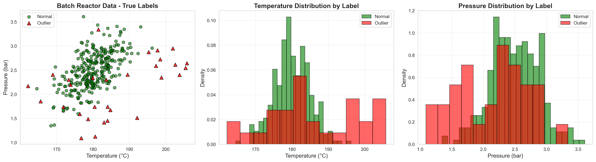
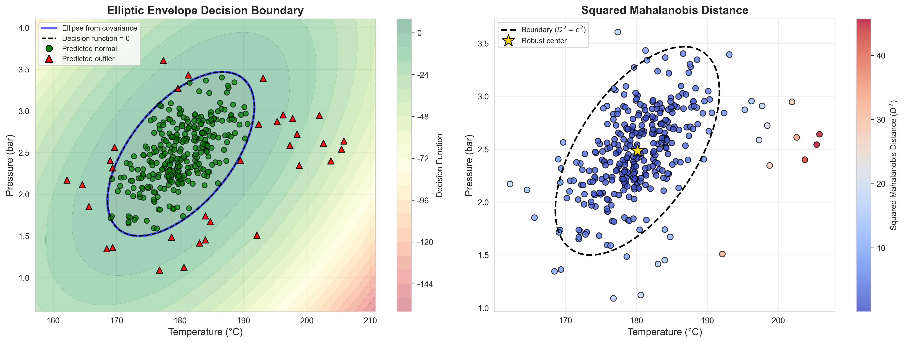
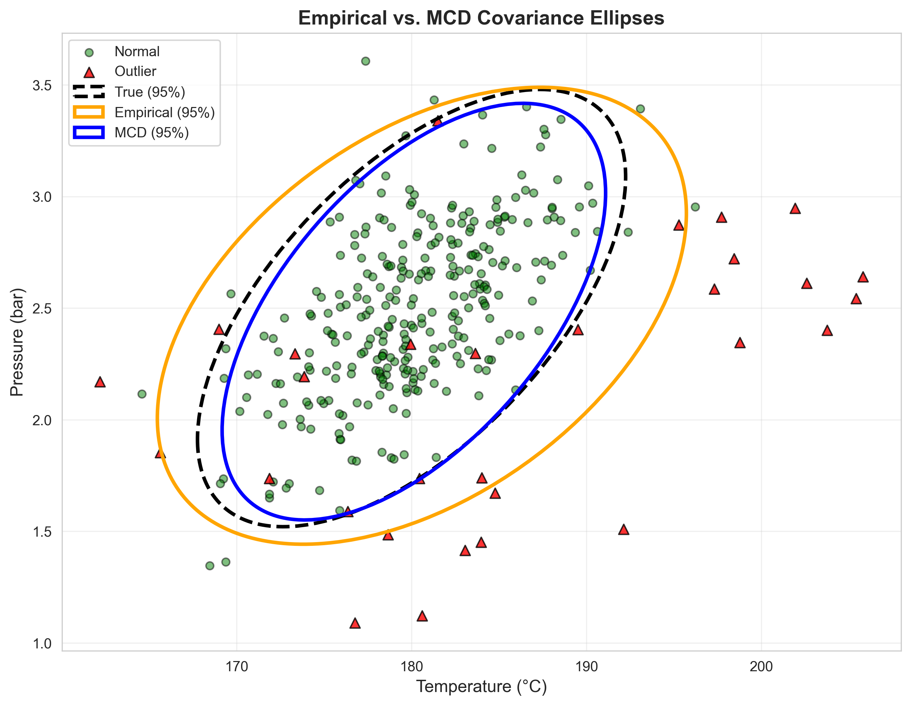
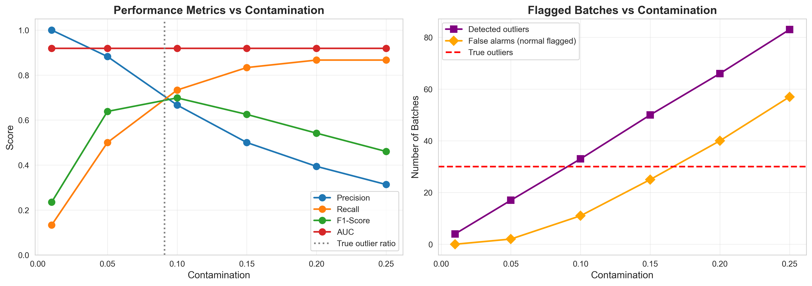
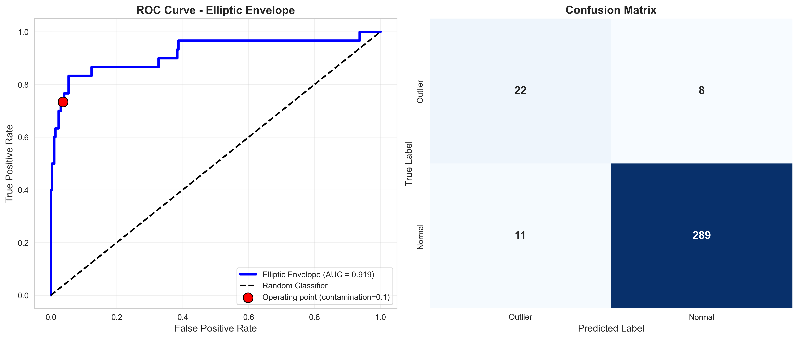
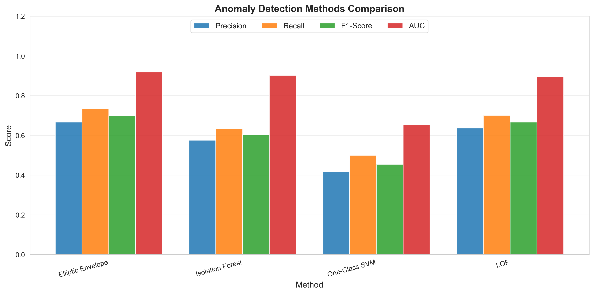
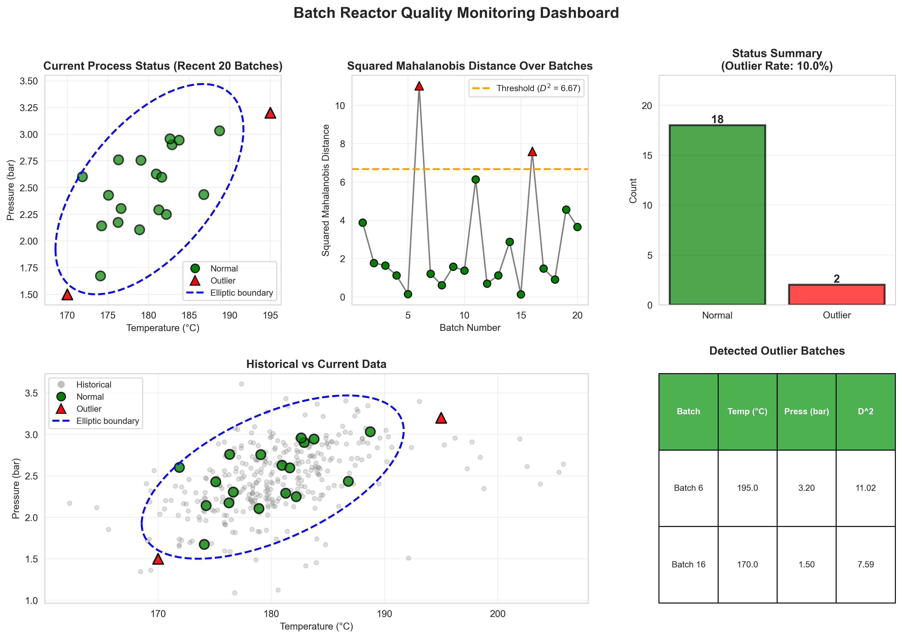

# Unit07 橢圓包絡 (Elliptic Envelope)

## 課程目標

本單元將深入介紹橢圓包絡 (Elliptic Envelope) 異常檢測演算法，這是一種基於高斯分布假設的異常檢測方法，特別適合處理服從或接近多變量常態分布的數據。透過本單元的學習，您將能夠：

- 理解橢圓包絡演算法的核心原理與數學基礎
- 掌握馬氏距離 (Mahalanobis Distance) 與共變異數矩陣的概念
- 學會使用 scikit-learn 實作橢圓包絡模型
- 了解如何設定關鍵超參數 (contamination, support_fraction)
- 學會評估異常檢測模型的效能
- 認識橢圓包絡的優缺點與適用場景
- 應用橢圓包絡於化工領域的品質控制與製程監控

> **💡 執行結果說明**：
>
> 本講義整合了 `Unit07_Elliptic_Envelope.ipynb` 的實際執行結果，集中於 **第 6 節**，內容包含：
> - 批次反應器數據生成、模型訓練、穩健估計結果與決策閾值
> - 效能評估（Precision、Recall、F1、AUC、混淆矩陣）與訓練/測試切分驗證
> - MCD 與經驗共變異數的比較、`contamination` 超參數掃描、ROC 曲線
> - 與 Isolation Forest、One-Class SVM、LOF 的方法比較
> - 製程監控儀表板與模型儲存
> - **7 張圖表** (300 DPI)，存放於 `outputs/P2_Unit07_Elliptic_Envelope/figs/`
>
> 理論章節（第 2 至 5 節）與實作結果（第 6 節）可對照閱讀。

---

## 1. 橢圓包絡演算法簡介

### 1.1 什麼是橢圓包絡？

橢圓包絡 (Elliptic Envelope) 是一種基於高斯分布假設的異常檢測演算法。其核心理念是：**假設正常數據服從多變量高斯分布，異常點則是遠離分布中心的離群值**。

演算法透過估計數據的共變異數矩陣，構建一個包含大多數正常數據的橢圓邊界，落在橢圓外部的點則被視為異常。

### 1.2 核心理念：為什麼使用高斯分布？

在許多化工製程中，正常操作條件下的數據往往服從或接近多變量常態分布：

- **製程穩定性**：良好控制的製程變數圍繞設定點波動
- **測量誤差**：感測器誤差通常服從常態分布
- **自然變異**：原物料特性、環境條件等因素的隨機變異
- **中央極限定理**：多個獨立因素共同作用的結果趨向常態分布

**橢圓包絡的核心假設**：
1. 正常數據服從或接近多變量高斯分布
2. 異常點的馬氏距離明顯大於正常點
3. 可以透過穩健估計方法處理少量污染數據
4. 橢圓邊界能有效區分正常與異常區域

### 1.3 化工領域應用案例

橢圓包絡在化工領域特別適合以下場景：

1. **產品品質控制**：
   - 多個品質指標的聯合監控（如純度、色度、黏度）
   - 識別品質指標異常組合
   - 建立多維品質規格界限
   - 減少假陽性警報

2. **穩態製程監控**：
   - 連續製程的正常操作區域定義
   - 多個製程變數的協同監控
   - 考慮變數間相關性的異常檢測
   - 早期異常趨勢識別

3. **感測器故障診斷**：
   - 識別感測器讀數異常偏移
   - 多個感測器的聯合驗證
   - 區分真實製程異常與感測器故障
   - 提高監控系統可靠性

4. **批次一致性檢驗**：
   - 檢驗新批次是否符合歷史正常範圍
   - 多個批次特性的聯合評估
   - 識別批次間異常變異
   - 確保產品批次一致性

5. **實驗設計與數據驗證**：
   - 識別實驗數據中的異常點
   - 驗證數據是否符合預期分布
   - 支援統計分析前的數據清理
   - 提高實驗結果可靠性

---

## 2. 橢圓包絡演算法原理

### 2.1 核心概念一：馬氏距離 (Mahalanobis Distance)

**定義**：對於數據點 $\mathbf{x}$ ，其馬氏距離定義為：

$$
D_M(\mathbf{x}) = \sqrt{(\mathbf{x} - \boldsymbol{\mu})^T \mathbf{\Sigma}^{-1} (\mathbf{x} - \boldsymbol{\mu})}
$$

其中：
- $\mathbf{x}$ ：數據點的特徵向量
- $\boldsymbol{\mu}$ ：數據的均值向量
- $\mathbf{\Sigma}$ ：數據的共變異數矩陣
- $\mathbf{\Sigma}^{-1}$ ：共變異數矩陣的逆矩陣

**意義**：
- 馬氏距離衡量點 $\mathbf{x}$ 與分布中心的距離
- 考慮了變數間的相關性與各變數的變異程度
- 對於多變量高斯分布，馬氏距離平方服從卡方分布
- 相較於歐氏距離，馬氏距離更適合處理相關變數

**範例：化工反應器監控**

假設我們監控反應器的溫度 $T$ 和壓力 $P$ ：

- **歐氏距離問題**：如果溫度和壓力的量綱與變異程度不同，歐氏距離會被較大變異的變數主導
- **馬氏距離優勢**：自動標準化各變數，並考慮溫度與壓力的相關性
- **實際應用**：當溫度升高時壓力通常也升高，馬氏距離能識別「溫度正常但壓力異常低」這類異常模式

### 2.2 核心概念二：共變異數矩陣 (Covariance Matrix)

**定義**：對於 $d$ 維數據，共變異數矩陣 $\mathbf{\Sigma}$ 是 $d \times d$ 對稱矩陣：

$$
\mathbf{\Sigma} = \begin{bmatrix}
\sigma_1^2 & \sigma_{12} & \cdots & \sigma_{1d} \\
\sigma_{21} & \sigma_2^2 & \cdots & \sigma_{2d} \\
\vdots & \vdots & \ddots & \vdots \\
\sigma_{d1} & \sigma_{d2} & \cdots & \sigma_d^2
\end{bmatrix}
$$

其中：
- $\sigma_i^2$ ：第 $i$ 個變數的變異數
- $\sigma_{ij}$ ：第 $i$ 和第 $j$ 個變數的共變異數

**傳統估計方法（經驗共變異數）**：

$$
\mathbf{\Sigma} = \frac{1}{n-1} \sum_{i=1}^{n} (\mathbf{x}_i - \boldsymbol{\mu})(\mathbf{x}_i - \boldsymbol{\mu})^T
$$

$$
\boldsymbol{\mu} = \frac{1}{n} \sum_{i=1}^{n} \mathbf{x}_i
$$

**問題**：對離群值敏感，少量異常點會嚴重影響估計結果。

### 2.3 核心概念三：最小共變異數行列式 (Minimum Covariance Determinant, MCD)

由於傳統共變異數估計對離群值敏感，橢圓包絡使用**最小共變異數行列式 (MCD)** 方法進行穩健估計。

**MCD 核心思想**：

找到一個包含 $h$ 個數據點的子集 $\mathcal{H}$ ，使得這個子集的共變異數矩陣行列式最小：

$$
\min_{\mathcal{H}, |\mathcal{H}|=h} \det(\mathbf{\Sigma}_{\mathcal{H}})
$$

其中：
- $h \approx n \times \text{support\_fraction}$ ：子集大小（預設為 $\lceil (n + d + 1) / 2 \rceil$ ，見 2.4 節）
- $\mathbf{\Sigma}_{\mathcal{H}}$ ：子集 $\mathcal{H}$ 的共變異數矩陣
- $\det(\cdot)$ ：行列式

**步驟**：
1. 從 $n$ 個數據點中選取 $h$ 個點的子集
2. 計算子集的均值 $\boldsymbol{\mu}_{\mathcal{H}}$ 和共變異數矩陣 $\mathbf{\Sigma}_{\mathcal{H}}$
3. 尋找使行列式 $\det(\mathbf{\Sigma}_{\mathcal{H}})$ 最小的子集
4. 使用該子集的統計量作為穩健估計

**意義**：
- 自動識別並排除離群值
- 基於"最緊密"的數據子集估計分布
- 提高對污染數據的抵抗能力
- 適合含少量污染數據的異常檢測場景（訓練時不需要標籤）

### 2.4 演算法流程

**輸入**：
- 訓練數據 $\mathbf{X} = \{\mathbf{x}_1, \mathbf{x}_2, \ldots, \mathbf{x}_n\}$
- 預期污染比例 `contamination`
- 支援子集比例 `support_fraction` （預設為 None，自動計算）

**訓練階段**：

1. **決定子集大小**：
   - `support_fraction=None` 時，使用 $h = \lceil (n + d + 1) / 2 \rceil$ 個點（例如 $n = 330$ 、 $d = 2$ 時為 167），對應 MCD 最大的崩潰點，可容忍約 50% 的污染
   - 指定 `support_fraction` 時，則 $h \approx n \times \text{support\_fraction}$
   - `contamination` **不參與**這個步驟，也不影響 MCD 的估計結果

2. **MCD 估計**：
   - 使用 FastMCD 演算法尋找行列式最小的 $h$ 點子集（原始支援集 `raw_support_`）
   - 計算穩健均值與共變異數

3. **校正與重加權**：
   - 套用校正因子，使共變異數在高斯分布下為一致估計
   - 以原始估計計算所有訓練點的 $D^2$ ，保留 $D^2$ 不超過 $\chi^2_{d, 0.975}$ 的點（最終支援集 `support_`），重新計算均值 $\hat{\boldsymbol{\mu}}$ 與共變異數 $\hat{\mathbf{\Sigma}}$

4. **決定閾值（經驗百分位數）**：
   - 以最終估計計算所有訓練點的馬氏距離平方 $D^2$
   - 閾值 $c^2 = -\mathrm{offset\_}$ 取訓練數據 $D^2$ 的第 $100 \times (1 - \text{contamination})$ 個百分位數
   - 因此 `contamination` 只決定閾值，不改變均值、共變異數與各點的 $D^2$ 排序

**預測階段**：

1. **計算馬氏距離平方**：

$$
D^2(\mathbf{x}) = (\mathbf{x} - \hat{\boldsymbol{\mu}})^T \hat{\mathbf{\Sigma}}^{-1} (\mathbf{x} - \hat{\boldsymbol{\mu}})
$$

2. **異常判定**：

$$
\text{label}(\mathbf{x}) = \begin{cases}
+1 & \text{if } D^2(\mathbf{x}) \leq c^2 \text{ (正常)} \\
-1 & \text{if } D^2(\mathbf{x}) > c^2 \text{ (異常)}
\end{cases}
$$

scikit-learn 的 `decision_function(x)` 等於 $c^2 - D^2(\mathbf{x})$ ，大於或等於 0 為正常，小於 0 為異常。

---

## 3. 數學理論深入

### 3.1 多變量高斯分布

**機率密度函數**：

$$
f(\mathbf{x}) = \frac{1}{(2\pi)^{d/2}|\mathbf{\Sigma}|^{1/2}} \exp\left(-\frac{1}{2}(\mathbf{x}-\boldsymbol{\mu})^T\mathbf{\Sigma}^{-1}(\mathbf{x}-\boldsymbol{\mu})\right)
$$

其中：
- $d$ ：維度
- $|\mathbf{\Sigma}|$ ：共變異數矩陣的行列式
- 指數項中的二次型即為馬氏距離平方

**等密度曲線**：

對於固定的機率密度 $c$ ，等密度曲線定義為：

$$
(\mathbf{x}-\boldsymbol{\mu})^T\mathbf{\Sigma}^{-1}(\mathbf{x}-\boldsymbol{\mu}) = k^2
$$

這是一個橢圓（或高維橢球），橢圓包絡即是基於此構建邊界。

### 3.2 馬氏距離平方的分布

對於多變量高斯分布 $\mathbf{x} \sim \mathcal{N}(\boldsymbol{\mu}, \mathbf{\Sigma})$ ，馬氏距離平方服從卡方分布：

$$
D_M^2(\mathbf{x}) \sim \chi^2_d
$$

其中 $d$ 是自由度（維度）。

**異常閾值設定**：

若數據純為高斯分布且參數已知，可以用卡方分位數得到理論閾值，使正常數據的覆蓋率為 $(1-\alpha)$ ：

$$
c^2_{\mathrm{theory}} = \chi^2_{d, 1-\alpha}
$$

其中 $\alpha$ 是預期的異常比例。例如 $d = 2$ 、 $\alpha = 0.1$ 時， $c^2_{\mathrm{theory}} = 4.605$ 。

**scikit-learn 的實際做法**：`EllipticEnvelope` 並不使用卡方閾值，而是取訓練數據 $D^2$ 的第 $100 \times (1 - \text{contamination})$ 個百分位數（即 $c^2 = -\mathrm{offset\_}$ ）。因為訓練數據含有異常點，且均值與共變異數來自 MCD 估計，這個經驗閾值通常比卡方理論值大；本單元的範例中為 6.667，卡方理論值為 4.605（見第 6.2 節）。

### 3.3 橢圓的幾何特性

**橢圓方程**：

$$
(\mathbf{x}-\boldsymbol{\mu})^T\mathbf{\Sigma}^{-1}(\mathbf{x}-\boldsymbol{\mu}) = c^2
$$

**主軸方向**：由 $\mathbf{\Sigma}$ 的特徵向量決定

**主軸長度**：與 $\mathbf{\Sigma}$ 的特徵值平方根成正比

$$
\text{半軸長度}_i = c \cdot \sqrt{\lambda_i}
$$

其中 $\lambda_i$ 是 $\mathbf{\Sigma}$ 的第 $i$ 個特徵值。

**化工意義**：
- 橢圓主軸反映製程變數的主要變異方向
- 主軸長度反映各方向的允許變異範圍
- 橢圓傾斜角度反映變數間的相關性

---

## 4. 橢圓包絡的優缺點

### 4.1 優點

1. **數學基礎紮實**：
   - 基於多變量高斯分布理論
   - 有明確的統計推論基礎
   - 可解釋性強

2. **考慮變數相關性**：
   - 馬氏距離自然考慮變數間相關性
   - 適合多個相關製程變數的聯合監控
   - 避免獨立監控的誤報

3. **穩健性**：
   - MCD 方法對少量離群值有抵抗力
   - 能在含污染數據中準確估計分布
   - 訓練時不需要標籤，適合含少量污染數據的異常檢測

4. **計算效率高**：
   - FastMCD 演算法計算複雜度低
   - 適合中等規模數據
   - 預測階段僅需計算馬氏距離

5. **可視化友善**：
   - 橢圓邊界易於二維/三維可視化
   - 便於向領域專家解釋
   - 支援製程操作視窗的可視化定義

### 4.2 缺點

1. **高斯分布假設**：
   - 要求數據服從或接近多變量常態分布
   - 對嚴重偏態或多峰分布效果不佳
   - 無法處理任意形狀的分布

2. **對高維數據敏感**：
   - 維度詛咒：高維度下共變異數矩陣估計困難
   - 需要足夠的樣本數（ $n \gg d$ ）
   - 高維度下橢圓邊界可能不準確

3. **僅適合單峰分布**：
   - 無法處理多模態數據
   - 多操作模式的製程需要分別建模
   - 不適合複雜的非線性邊界

4. **參數敏感性**：
   - `contamination` 參數需要預先設定
   - `support_fraction` 的選擇影響穩健性
   - 參數設定不當會影響效能

5. **對極端離群值的敏感性**：
   - 雖然 MCD 提供穩健性，但極端離群值仍可能影響估計
   - 需要適當的數據預處理
   - 異常比例過高時效果下降

### 4.3 與其他方法的比較

| 特性 | 橢圓包絡 | Isolation Forest | One-Class SVM | LOF |
|------|----------|------------------|---------------|-----|
| **分布假設** | 高斯分布 | 無 | 無 | 無 |
| **適合高維** | ❌ | ✅ | ⚠️ | ❌ |
| **多模態** | ❌ | ✅ | ⚠️ | ✅ |
| **計算複雜度** | 低 | 低 | 高 | 中 |
| **可解釋性** | ✅ | ⚠️ | ❌ | ⚠️ |
| **穩健性** | ✅ | ✅ | ⚠️ | ⚠️ |
| **參數敏感性** | 中 | 低 | 高 | 高 |

---

## 5. Python 實作：橢圓包絡

### 5.1 基本使用

```python
from sklearn.covariance import EllipticEnvelope
import numpy as np

# 生成訓練數據（正常數據）
np.random.seed(42)
X_train = np.random.randn(200, 2) * [2, 1] + [5, 3]

# 建立橢圓包絡模型
model = EllipticEnvelope(
    contamination=0.1,      # 預期異常比例 10%
    support_fraction=None,  # 自動計算（推薦）
    random_state=42
)

# 訓練模型
model.fit(X_train)

# 預測新數據
X_test = np.array([[5, 3], [10, 10]])  # [正常點, 異常點]
predictions = model.predict(X_test)
# 輸出：[1, -1]，1 代表正常，-1 代表異常

# 決策函數值：decision_function = c^2 - D^2，小於 0 判為異常
scores = model.decision_function(X_test)
# 值越負，離橢圓中心越遠，越可能是異常

# 馬氏距離平方 D^2（注意：mahalanobis() 回傳的是平方值）
d2 = model.mahalanobis(X_test)
```

### 5.2 關鍵參數說明

#### 5.2.1 `contamination`（污染比例）

**定義**：預期訓練數據中異常點的比例。

**範圍**： $(0, 0.5]$ ，預設值為 $0.1$

**影響**：
- 決定判定閾值 $c^2$ （訓練數據 $D^2$ 的第 $100 \times (1 - \text{contamination})$ 個百分位數），**不影響** MCD 估計的均值與共變異數
- 值越大，橢圓邊界越小（越緊），更多點被判為異常（Recall 上升、Precision 下降）
- 值越小，橢圓邊界越大（越寬鬆），較少點被判為異常
- AUC 等只依賴排序的指標不受影響

**設定建議**：
```python
# 預期異常很少、誤報成本高
model = EllipticEnvelope(contamination=0.05)  # 約 5% 的訓練點被標記

# 一般製程監控
model = EllipticEnvelope(contamination=0.1)   # 約 10% 的訓練點被標記

# 漏報成本高，可接受較多誤報
model = EllipticEnvelope(contamination=0.2)   # 約 20% 的訓練點被標記
```

#### 5.2.2 `support_fraction`（支援子集比例）

**定義**：MCD 演算法使用的子集比例。

**範圍**： $(0, 1)$ ，預設值為 `None`（自動計算）

**自動計算公式**：

$$
\text{support\_fraction} = \frac{n + d + 1}{2n}
$$

其中 $n$ 是樣本數， $d$ 是維度。

**影響**：
- 預設值對應 MCD 最大的崩潰點，可容忍約 50% 的污染數據，通常不需要調整
- 調高（如 0.9）：使用更多數據，估計較有效率，但可容忍的污染比例下降，只適合很乾淨的數據
- 不建議低於預設值：不會提高穩健性，反而因使用的點較少而使估計不穩定

**設定建議**：
```python
# 一般情況（使用預設值）
model = EllipticEnvelope(support_fraction=None)

# 非常乾淨的數據（可使用較大子集）
model = EllipticEnvelope(support_fraction=0.9)
```

#### 5.2.3 `random_state`（隨機種子）

**定義**：MCD 演算法的隨機種子。

**影響**：確保結果可重現性。

**建議**：實驗階段設定固定值，生產環境可考慮不設定。

### 5.3 模型屬性

訓練後的模型提供以下屬性：

```python
# 穩健估計的均值
mu = model.location_
print(f"均值向量: {mu}")

# 穩健估計的共變異數矩陣
Sigma = model.covariance_
print(f"共變異數矩陣:\n{Sigma}")

# 精度矩陣（共變異數矩陣的逆）
precision = model.precision_
print(f"精度矩陣:\n{precision}")

# 重加權後的最終支援集（布林遮罩，長度等於訓練樣本數）
print(f"支援點數量: {model.support_.sum()} / {len(model.support_)}")

# 原始 MCD 支援集（布林遮罩）
print(f"原始支援點數量: {model.raw_support_.sum()}")

# 馬氏距離平方的決策閾值 c^2（EllipticEnvelope 沒有 threshold_ 屬性）
c2 = -model.offset_
print(f"D^2 閾值: {c2:.4f}")
```

**屬性說明**：
- `support_` 與 `raw_support_` 是**布林遮罩**，不是索引清單，數量要用 `.sum()` 計算，`len()` 只會得到樣本數
- `offset_` 是決策函數的偏移量；`decision_function(X) = -D^2 - offset_` ，因此邊界位於 $D^2 = -\mathrm{offset\_}$
- `mahalanobis(X)` 回傳**馬氏距離平方** $D^2$ ，不是 $D_M$

### 5.4 完整工作流程

```python
import numpy as np
import matplotlib.pyplot as plt
from sklearn.covariance import EllipticEnvelope
from sklearn.metrics import classification_report, confusion_matrix

# ========================================
# 1. 數據生成
# ========================================
np.random.seed(42)

# 正常數據（多變量高斯分布）
n_normal = 300
mean = [5, 3]
cov = [[4, 2], [2, 2]]  # 有相關性的共變異數矩陣
X_normal = np.random.multivariate_normal(mean, cov, n_normal)

# 異常數據（遠離正常分布）
n_outliers = 30
X_outliers = np.random.uniform(low=-5, high=15, size=(n_outliers, 2))

# 合併數據
X = np.vstack([X_normal, X_outliers])
y_true = np.array([1] * n_normal + [-1] * n_outliers)

# ========================================
# 2. 模型訓練
# ========================================
model = EllipticEnvelope(
    contamination=0.1,
    support_fraction=None,
    random_state=42
)
model.fit(X)

# ========================================
# 3. 預測與評估
# ========================================
y_pred = model.predict(X)

print("分類報告:")
print(classification_report(y_true, y_pred, 
                          target_names=['異常', '正常']))

print("\n混淆矩陣:")
print(confusion_matrix(y_true, y_pred))

# ========================================
# 4. 可視化
# ========================================
# 計算馬氏距離平方 D^2
mahal_dist = model.mahalanobis(X)

# 建立網格用於繪製決策邊界
xx, yy = np.meshgrid(
    np.linspace(X[:, 0].min()-2, X[:, 0].max()+2, 100),
    np.linspace(X[:, 1].min()-2, X[:, 1].max()+2, 100)
)
Z = model.decision_function(np.c_[xx.ravel(), yy.ravel()])
Z = Z.reshape(xx.shape)

# 繪圖
fig, axes = plt.subplots(1, 2, figsize=(14, 6))

# 左圖：決策邊界與分類結果
ax1 = axes[0]
ax1.contourf(xx, yy, Z, levels=[-10, 0, 10], 
             colors=['#ffcccc', '#ccffcc'], alpha=0.3)
ax1.contour(xx, yy, Z, levels=[0], colors='black', linewidths=2)
scatter1 = ax1.scatter(X[:, 0], X[:, 1], c=y_pred, 
                       cmap='RdYlGn', edgecolors='k', s=50)
ax1.set_xlabel('Feature 1')
ax1.set_ylabel('Feature 2')
ax1.set_title('Elliptic Envelope Decision Boundary')
plt.colorbar(scatter1, ax=ax1, label='Prediction (-1: Outlier, 1: Normal)')

# 右圖：馬氏距離分布
ax2 = axes[1]
scatter2 = ax2.scatter(X[:, 0], X[:, 1], c=mahal_dist, 
                       cmap='coolwarm', edgecolors='k', s=50)
ax2.set_xlabel('Feature 1')
ax2.set_ylabel('Feature 2')
ax2.set_title('Squared Mahalanobis Distance')
plt.colorbar(scatter2, ax=ax2, label='Squared Mahalanobis Distance')

plt.tight_layout()
plt.show()
```

### 5.5 化工應用：反應器品質監控

**場景**：監控批次反應器的溫度和壓力，識別異常批次。

```python
import numpy as np
from sklearn.covariance import EllipticEnvelope
import pandas as pd

# ========================================
# 模擬批次反應器數據
# ========================================
np.random.seed(42)

# 正常批次（溫度和壓力正相關）
n_batches = 200
temp_normal = np.random.normal(180, 5, n_batches)  # 溫度 (°C)
pressure_normal = 2.0 + 0.01 * temp_normal + np.random.normal(0, 0.3, n_batches)  # 壓力 (bar)

# 異常批次
n_outliers = 20
temp_outliers = np.random.uniform(150, 210, n_outliers)
pressure_outliers = np.random.uniform(1.0, 4.0, n_outliers)

# 合併數據
temperature = np.concatenate([temp_normal, temp_outliers])
pressure = np.concatenate([pressure_normal, pressure_outliers])
batch_id = np.arange(1, n_batches + n_outliers + 1)

# 建立 DataFrame
df = pd.DataFrame({
    'Batch_ID': batch_id,
    'Temperature': temperature,
    'Pressure': pressure
})

# ========================================
# 橢圓包絡異常檢測
# ========================================
X = df[['Temperature', 'Pressure']].values

model = EllipticEnvelope(
    contamination=0.1,  # 預期 10% 異常批次
    random_state=42
)
model.fit(X)

# 預測
df['Prediction'] = model.predict(X)
df['Mahalanobis_D2'] = model.mahalanobis(X)  # 馬氏距離平方
df['Is_Outlier'] = df['Prediction'] == -1

# ========================================
# 結果分析
# ========================================
print("檢測到的異常批次:")
outlier_batches = df[df['Is_Outlier']]
print(outlier_batches[['Batch_ID', 'Temperature', 'Pressure', 'Mahalanobis_D2']])

print(f"\n總批次數: {len(df)}")
print(f"異常批次數: {outlier_batches.shape[0]}")
print(f"異常比例: {outlier_batches.shape[0] / len(df):.2%}")

# 統計分析
print("\n正常批次統計:")
normal_df = df[~df['Is_Outlier']]
print(normal_df[['Temperature', 'Pressure']].describe())

print("\n異常批次統計:")
print(outlier_batches[['Temperature', 'Pressure']].describe())
```

### 5.6 進階技巧：多組橢圓包絡

對於多模態數據（如多個操作模式），可以為每個模式單獨建立橢圓包絡：

```python
from sklearn.cluster import KMeans

# ========================================
# 1. 先用聚類識別操作模式
# ========================================
kmeans = KMeans(n_clusters=3, random_state=42)
modes = kmeans.fit_predict(X)

# ========================================
# 2. 為每個模式建立橢圓包絡
# ========================================
models = {}
for mode in range(3):
    X_mode = X[modes == mode]
    models[mode] = EllipticEnvelope(contamination=0.1, random_state=42)
    models[mode].fit(X_mode)

# ========================================
# 3. 預測：使用最近模式的模型
# ========================================
def predict_multimode(X_test):
    # 找到最近的操作模式
    mode_pred = kmeans.predict(X_test)
    
    # 使用對應模式的模型預測
    predictions = np.zeros(len(X_test))
    for mode in range(3):
        mask = mode_pred == mode
        if mask.any():
            predictions[mask] = models[mode].predict(X_test[mask])
    
    return predictions

# 測試
y_pred_multimode = predict_multimode(X)
```

---

## 6. 範例演練：批次反應器品質監控（Notebook 執行結果）

本節整理 `Unit07_Elliptic_Envelope.ipynb` 的實際執行結果（scikit-learn 1.7.2，隨機種子 `SEED = 42`），並逐項解讀。所有圖檔存放於 `outputs/P2_Unit07_Elliptic_Envelope/figs/`。

**案例設定**：監控批次反應器的溫度 $T$ (°C) 與壓力 $P$ (bar)，共 330 個批次，其中 300 個正常、30 個異常。橢圓包絡為**無監督**方法，訓練時不使用標籤；真實標籤僅用於事後評估。

### 6.1 數據生成與探索

**正常批次**：溫度 $T \sim N(180, 5^2)$ ，壓力 $P \sim N(2.5, 0.4^2)$ ，兩者相關係數 $\rho = 0.6$ ，因此共變異數為：

$$
\sigma_{TP} = \rho \sigma_T \sigma_P = 0.6 \times 5 \times 0.4 = 1.2
$$

**異常批次**（共 30 筆）：高溫異常、低壓異常、隨機異常各 10 筆；部分異常刻意落在正常分布邊緣，增加偵測難度。

> **⚠️ 共變異數矩陣必須是合法的（正定）**：共變異數需滿足 $|\rho| \le 1$ 。例如若誤把 $\sigma_{TP}$ 設為 4 ，則 $\rho = 4 / (5 \times 0.4) = 2.0$ ，矩陣不是半正定，數據不是合法的多變量高斯分布，後續所有分析都失去意義。Notebook 以 `np.linalg.eigvalsh` 檢查特徵值皆為正，作為建立數據前的保護。

```python
cov_normal = [[std_T**2, rho * std_T * std_P],
              [rho * std_T * std_P, std_P**2]]
assert np.all(np.linalg.eigvalsh(cov_normal) > 0), "共變異數矩陣必須為正定"
X_normal = np.random.multivariate_normal(mean_normal, cov_normal, n_normal)
```

**執行結果**：

```text
✓ 數據生成完成
  - 總批次數: 330
  - 正常批次: 300
  - 異常批次: 30
  - 異常比例: 9.09%
  - 正常批次溫度-壓力相關係數: 0.598 (設定值 0.6)

各類型批次統計:
             Temperature       Pressure      
                    mean   std     mean   std
Batch_Type                                   
High Temp         200.70  3.67     2.66  0.21
Low Pressure      180.05  4.17     1.50  0.24
Normal            180.05  4.90     2.50  0.39
Random            177.07  9.97     2.28  0.47
```

**結果分析**：

- 正常批次的樣本相關係數 0.598 與設定值 0.6 吻合，表示數據生成正確
- 高溫異常的平均溫度為 200.70 °C（約高出正常平均 4σ），但壓力 2.66 bar 與正常批次相近，屬於「單一變數偏離」
- 低壓異常的平均壓力為 1.50 bar（約低於正常平均 2.5σ），溫度 180.05 °C 與正常批次相同
- 隨機異常的標準差最大（溫度 9.97），散佈在整個區域，其中部分會落入正常分布內部，是最難偵測的一類



**圖 6-1 分析**：

- **左圖（散佈圖）**：綠點為正常批次，呈明顯的右上傾斜橢圓雲（溫度越高壓力越高）；紅色三角形為異常批次，包含右側高溫群（約 195 至 206 °C）、下方低壓群（壓力 1.0 至 1.8 bar），以及零星散佈的隨機異常
- **中圖（溫度分布）**：高溫異常在 195 至 206 °C 形成獨立的第二個群，與正常分布分離；但其他異常的溫度與正常批次大幅重疊
- **右圖（壓力分布）**：低壓異常集中在 1.0 至 1.8 bar，但仍有部分異常的壓力落在正常範圍內
- **重點**：多數異常在單一變數的邊際分布上並不極端，需要同時考慮溫度與壓力的**聯合分布**（相關結構）才容易被識別，這正是馬氏距離的優勢

### 6.2 模型建立與訓練

```python
CONTAMINATION = 0.1

model = EllipticEnvelope(
    contamination=CONTAMINATION,
    support_fraction=None,  # None: 使用 (n + d + 1) / 2 個點作為 MCD 原始支援集
    random_state=SEED
)
model.fit(X)

# sklearn 的 decision_function = -D^2 - offset_ ，邊界在 D^2 = -offset_
d2_threshold = -model.offset_
```

`contamination = 0.1` 接近本案例的實際異常比例 9.09%。

**執行結果**：

```text
✓ 橢圓包絡模型訓練完成

模型參數:
  - Contamination: 0.1
  - Support Fraction: None

穩健估計結果:
  - 穩健均值 (Location): [180.13156893   2.48403934]
  - 穩健共變異數矩陣 (Covariance):
[[20.05708153  0.97209021]
 [ 0.97209021  0.1452739 ]]
  - 溫度-壓力相關係數 (MCD): 0.569 (設定值 0.6)

支援集與閾值:
  - 原始 MCD 支援點數 (raw_support_): 167/330
  - 重加權後支援點數 (support_): 301/330
  - 決策閾值 D^2 = -offset_: 6.6669
  - 卡方理論閾值 chi2(0.90, df=2): 4.6052 (僅在數據純為高斯且無污染時適用)
```

**結果分析**：

1. **穩健均值**：[180.13, 2.484] 非常接近正常批次的設定值 [180, 2.5]，雖然訓練數據混有 9.09% 的異常，估計中心幾乎沒有被拉偏
2. **穩健共變異數**：溫度變異數 20.06、壓力變異數 0.145、相關係數 0.569，大致反映正常批次的結構（設定值 25、0.16、0.6）；MCD 以「最緊密的子集」為基礎，估計值略小於真值是常見現象，單一隨機樣本不宜過度解讀
3. **兩層支援集**：
   - `raw_support_` 為 167 個點，約為 $(330 + 2 + 1) / 2$ ，即 FastMCD 最小行列式子集的大小
   - `support_` 為 301 個點，是 MCD 重加權 (reweighting) 後的最終支援集（保留馬氏距離未超過截斷值的點）。它是長度為 330 的**布林遮罩**，不是索引清單
4. **決策閾值**： $c^2 = -\mathrm{offset\_} = 6.667$ ，是訓練數據馬氏距離平方的第 90 個百分位數；比卡方理論值 $\chi^2_{2, 0.90} = 4.605$ 大，原因是訓練數據含有遠離中心的異常批次，使距離分布的上尾變長；sklearn 使用的是**經驗百分位數**，並不是卡方閾值

### 6.3 模型預測與效能評估

以「異常」為正類 (positive class)。`confusion_matrix(y_true, y_pred, labels=[-1, 1])` 的排列為：

| | 預測異常 (-1) | 預測正常 (1) |
|---|---|---|
| **實際異常 (-1)** | TP | FN (漏報) |
| **實際正常 (1)** | FP (誤報) | TN |

```python
y_pred = model.predict(X)
mahal_d2 = model.mahalanobis(X)  # 回傳馬氏距離「平方」 D^2

# AUC: 以 -decision_function 作為異常分數（越大越異常）
decision_scores = -model.decision_function(X)
auc = roc_auc_score(y_binary, decision_scores)
cm = confusion_matrix(y_true, y_pred, labels=[-1, 1])
```

**執行結果**：

```text
性能指標 (針對異常檢測):
  - Precision: 0.667
  - Recall: 0.733
  - F1-Score: 0.698
  - AUC-ROC: 0.919

分類報告:
              precision    recall  f1-score   support

     Outlier       0.67      0.73      0.70        30
      Normal       0.97      0.96      0.97       300

    accuracy                           0.94       330
   macro avg       0.82      0.85      0.83       330
weighted avg       0.95      0.94      0.94       330

混淆矩陣 (列: 實際 [異常, 正常]；欄: 預測 [異常, 正常]):
[[ 22   8]
 [ 11 289]]
  - TP: 22 (異常批次被正確識別)
  - FN: 8 (漏報：異常批次被誤判為正常)
  - FP: 11 (誤報：正常批次被誤判為異常)
  - TN: 289 (正常批次被正確識別)
  - 誤報率 (FP / 實際正常)：3.7%（11/300）
  - 漏報率 (FN / 實際異常)：26.7%（8/30）
```

**結果分析**：

- 模型共標記 33 個批次為異常（22 個真異常 + 11 個誤報）
- **Precision 0.667**：發出警報時，有 66.7% 是真正的異常
- **Recall 0.733**：找到 30 個真異常中的 22 個，漏掉 8 個
- **整體準確率 0.94 容易誤導**：若全部預測為正常，準確率就有 $300 / 330 = 90.9\%$ ，因此異常檢測應看異常類別的 Precision、Recall 與 F1
- **AUC 0.919**：與閾值無關的排序能力，表示隨機抽一個異常與一個正常批次，異常批次的馬氏距離較大的機率約為 91.9%
- **各類異常的偵測情形**：高溫異常 10 個全部偵測到；低壓異常偵測 7 個、漏報 3 個；隨機異常偵測 5 個、漏報 5 個
- **漏報的 8 個異常**：3 個低壓異常的 $D^2$ 為 4.63 至 5.91，接近但低於閾值 6.67；5 個隨機異常中有 4 個 $D^2 \le 2.5$ （最低僅 0.19），位於正常分布中心附近，從聯合分布來看與正常批次沒有差異，任何基於分布的方法都難以辨識
- **誤報的 11 個正常批次**：全部位於正常分布的外緣， $D^2$ 介於 6.71 至 16.45 ；正常批次的馬氏距離本身就有上尾，只要閾值不是無限大，就一定有少數正常批次被判為異常（本例為 3.7%）

### 6.4 訓練/測試切分驗證

上面的評估是「訓練即評估」(in-sample)。以下以分層抽樣切出 30% 測試集：訓練集（含未標記的異常）訓練模型，再於未見過的測試批次上評估。

```python
X_train, X_test, y_train, y_test = train_test_split(
    X, y_true, test_size=0.3, stratify=y_true, random_state=SEED
)
model_cv = EllipticEnvelope(contamination=CONTAMINATION, random_state=SEED).fit(X_train)
```

**執行結果**：

```text
          Dataset   N  Outliers  Precision  Recall  F1-Score   AUC
Train (in-sample) 231        21      0.739   0.810     0.773 0.958
  Test (hold-out)  99         9      0.800   0.444     0.571 0.826

20 次不同切分的測試集表現 (mean ± std):
  - Precision: 0.670 ± 0.123  (min 0.467, max 0.875)
  - Recall: 0.722 ± 0.122  (min 0.444, max 1.000)
  - F1-Score: 0.686 ± 0.093  (min 0.526, max 0.842)
  - AUC: 0.910 ± 0.058  (min 0.784, max 0.991)
```

**結果分析**：

- 單次切分的測試集只有 9 個異常，Recall 0.444 代表只找到 4 個，表面上比 in-sample 差很多
- 重複 20 次不同切分後，測試集平均 Recall 為 0.722 ± 0.122、F1 為 0.686 ± 0.093、AUC 為 0.910 ± 0.058，與 in-sample 的 0.733、0.698、0.919 相近，表示模型沒有明顯過擬合
- Recall 的範圍從 0.444 到 1.000，說明**異常樣本很少時，單次切分的指標隨機性很大**，不應僅憑一次切分下結論
- 橢圓包絡只估計均值與共變異數（共 5 個參數），模型很簡單，因此訓練與測試表現接近

### 6.5 橢圓決策邊界與馬氏距離

決策邊界為 $D_M^2(\mathbf{x}) = c^2$ 的橢圓，其中 $c^2 = -\mathrm{offset\_}$ 。橢圓的主軸方向為共變異數矩陣 $\hat{\mathbf{\Sigma}}$ 的特徵向量，半軸長度為 $c\sqrt{\lambda_i}$ 。

```python
def cov_ellipse(location, cov, c2, **kwargs):
    """回傳滿足 (x - mu)^T cov^-1 (x - mu) = c2 的橢圓 patch"""
    vals, vecs = np.linalg.eigh(cov)
    angle = np.degrees(np.arctan2(vecs[1, 0], vecs[0, 0]))
    width, height = 2 * np.sqrt(c2 * vals)
    return Ellipse(location, width, height, angle=angle, fill=False, **kwargs)
```

**執行結果**：

```text
✓ 決策邊界與馬氏距離可視化完成
  - 橢圓半軸長度 c*sqrt(lambda): [ 0.80801267 11.57731426]
  - 被判定為異常的批次數: 33
```



**圖 6-2 分析**：

- **左圖**：藍色實線是由 $\hat{\mathbf{\Sigma}}$ 、 $\hat{\boldsymbol{\mu}}$ 與 $c^2 = 6.667$ 手動畫出的橢圓，黑色虛線是 `decision_function = 0` 的等高線，兩者完全重合，驗證了決策邊界就是 $D^2 = -\mathrm{offset\_}$ 的橢圓
- 橢圓長軸往右上方傾斜（半軸長 11.58 與 0.81，分別對應溫度為主的方向與較小的變異方向），反映溫度與壓力的正相關
- 色階（Decision Function）離橢圓中心越遠越負，右下角（高溫低壓）已降至約 -150，表示與正常批次的聯合模式差異極大
- 橢圓**內部**仍有少數紅色三角形（漏報），橢圓**外緣**也有少數綠色圓點被劃為異常（誤報）；這就是第 6.3 節混淆矩陣中的 FN 與 FP
- **右圖**：以馬氏距離平方 $D^2$ 著色。正常批次幾乎都是藍色（ $D^2$ 小）；右側高溫異常批次的顏色由淺藍到紅，最大 $D^2$ 約 45.7；下方的低壓異常多呈較淺的藍色，距離值介於正常批次與高溫異常之間
- 圖中金色星號為穩健中心 [180.13, 2.484]，位於正常批次密度最高處

### 6.6 MCD 穩健估計 vs. 經驗共變異數

為了驗證穩健性，在同一份含 9.09% 異常的數據上比較 `EmpiricalCovariance`（一般共變異數）與 `MinCovDet`（MCD），並以建立數據時的理論參數作為基準。

```python
emp = EmpiricalCovariance().fit(X)
mcd = MinCovDet(random_state=SEED).fit(X)
```

**執行結果**：

```text
✓ 共變異數估計比較
            Estimator  Mean_T  Mean_P  Var_T  Var_P  Corr
True (normal batches) 180.000   2.500 25.000  0.160 0.600
            Empirical 180.589   2.466 38.173  0.175 0.448
         MCD (robust) 180.132   2.484 20.057  0.145 0.569

橢圓面積 (true / empirical / MCD): 30.12 / 43.46 / 26.41
```



**圖 6-3 分析**（95% 等密度橢圓， $c^2 = \chi^2_{2, 0.95} = 5.991$ ）：

| 估計方法 | 溫度變異數 | 相關係數 | 橢圓面積 | 與理論值的偏差 |
|---|---|---|---|---|
| 理論值 | 25.00 | 0.600 | 30.12 | 基準 |
| 經驗共變異數 | 38.17 | 0.448 | 43.46 | 面積偏大 44% |
| MCD | 20.06 | 0.569 | 26.41 | 面積偏小 12% |

- **經驗共變異數被污染**：30 個異常批次（尤其是高溫群）把溫度變異數從 25 拉高到 38.17，並因異常偏離相關結構，使相關係數由 0.6 降到 0.448。橙色橢圓明顯向高溫異常方向膨脹，傾斜程度也較不明顯
- **MCD 與理論橢圓接近**：藍色橢圓與黑色虛線橢圓的方向與形狀相近，面積略小；MCD 只用最緊密的子集估計，不被異常拉動
- 橢圓若被污染撐大，離群的點會被納入「正常範圍」，造成漏報。這是橢圓包絡使用 MCD 而不是一般共變異數的原因
- 本例的異常比例僅 9.09%，若異常比例更高或更極端，經驗估計的失真會更嚴重

### 6.7 超參數調整：`contamination` 的影響

`contamination` 只改變判定閾值（訓練數據 $D^2$ 的百分位數），**不改變** MCD 估計的均值與共變異數，因此馬氏距離排序與 AUC 不會隨之改變；提高 `contamination` 會讓橢圓邊界收縮，更多批次被判為異常。

```python
for cont in [0.01, 0.05, 0.1, 0.15, 0.2, 0.25]:
    m = EllipticEnvelope(contamination=cont, random_state=SEED).fit(X)
    yp = m.predict(X)
    d2_threshold = -m.offset_
```

**執行結果**：

```text
 Contamination  Precision  Recall  F1-Score   AUC  Detected_Outliers  False_Alarms  D2_Threshold
          0.01      1.000   0.133     0.235 0.919                  4             0        33.756
          0.05      0.882   0.500     0.638 0.919                 17             2        13.736
          0.10      0.667   0.733     0.698 0.919                 33            11         6.667
          0.15      0.500   0.833     0.625 0.919                 50            25         5.272
          0.20      0.394   0.867     0.542 0.919                 66            40         4.428
          0.25      0.313   0.867     0.460 0.919                 83            57         3.598

F1-Score 最高的 Contamination: 0.1 (F1 = 0.698)
```



**圖 6-4 分析**：

- **閾值 $D^2$ 隨 `contamination` 單調下降**：由 33.756 降到 3.598，橢圓逐步收縮
- **Recall 上升、Precision 下降**：`contamination` 從 0.01 增加到 0.25，Recall 由 0.133 升至 0.867，Precision 由 1.000 降至 0.313
- **AUC 恆為 0.919**：排序能力與閾值無關，`contamination` 只是選擇工作點
- **F1 在 `contamination = 0.1` 最高**（0.698），與實際異常比例 9.09% 相近
- **右圖**：偵測到的異常數與誤報數都隨之上升，但 `contamination` 超過 0.1 後，誤報（11 → 25 → 40 → 57）的增加速度遠快於真正找到的異常，再提高只會增加無謂的警報；從 0.20 到 0.25，Recall 同為 0.867，Precision 卻從 0.394 降到 0.313
- **實務提醒**：以上利用真實標籤選擇 F1 最高的設定僅供教學。實務上通常沒有標籤，應依歷史異常率，以及誤報與漏報的成本來設定

### 6.8 ROC 曲線與混淆矩陣

```python
fpr, tpr, _ = roc_curve(y_binary, -model.decision_function(X))
```

**執行結果**：

```text
✓ ROC 曲線與混淆矩陣可視化完成
  - AUC = 0.919
  - 工作點: FPR = 0.037, TPR = 0.733
```



**圖 6-5 分析**：

- **ROC 曲線**：曲線快速往左上角攀升，TPR 達 0.5 時 FPR 僅約 0.003、TPR 達 0.8 時 FPR 約 0.053，表示最明顯的異常（高溫群與極端低壓）的距離遠大於正常批次
- 紅點為 `contamination = 0.1` 的工作點（FPR = 0.037、TPR = 0.733），位於曲線的「轉折點」附近，是合理的選擇
- 曲線後段變得平緩：TPR 從 0.87 提高到 0.9 需要 FPR 約 0.33，要抓到最後 1 個異常（TPR = 1.0）則需 FPR 約 0.94，因為這些異常位於正常分布內部，要抓到它們就會把大量正常批次也判為異常
- **混淆矩陣**：左上 22（TP）、右上 8（FN）、左下 11（FP）、右下 289（TN），與第 6.3 節的數字一致

### 6.9 與其他方法的比較

橢圓包絡對特徵的線性轉換（平移、縮放、旋轉）具有不變性；One-Class SVM 與 LOF 基於距離或核函數，必須先標準化，否則溫度（約 180）會主導壓力（約 2.5）。Isolation Forest 對單一特徵的縮放不敏感，直接使用原始數據。

```python
X_scaled = StandardScaler().fit_transform(X)

methods = {
    'Elliptic Envelope': (EllipticEnvelope(contamination=0.1, random_state=SEED), X),
    'Isolation Forest': (IsolationForest(contamination=0.1, random_state=SEED), X),
    'One-Class SVM': (OneClassSVM(nu=0.1, kernel='rbf', gamma='scale'), X_scaled),
    'LOF': (LocalOutlierFactor(n_neighbors=20, contamination=0.1), X_scaled),
}
```

**執行結果**：

```text
           Method  Precision  Recall  F1-Score   AUC  Detected
Elliptic Envelope      0.667   0.733     0.698 0.919        33
 Isolation Forest      0.576   0.633     0.603 0.902        33
    One-Class SVM      0.417   0.500     0.455 0.653        36
              LOF      0.636   0.700     0.667 0.895        33

F1-Score 最高的方法: Elliptic Envelope (F1 = 0.698)
```



**圖 6-6 分析**：

- **橢圓包絡最佳**：F1 = 0.698、AUC = 0.919 皆為最高；LOF（F1 = 0.667、AUC = 0.895）與 Isolation Forest（F1 = 0.603、AUC = 0.902）次之
- **One-Class SVM 最差**（F1 = 0.455、AUC = 0.653），使用預設的 `gamma='scale'` 而未調校，排序能力明顯較差
- **為何橢圓包絡領先**：本案例的正常批次完全由多變量高斯分布生成，符合橢圓包絡的模型假設，所以它佔有優勢。若真實數據偏態、多峰或維度很高，結論可能相反
- 這是單一數據集、單一隨機種子的比較，且四個方法都固定 `contamination = 0.1`，沒有逐一調參；結果不宜推廣為「橢圓包絡永遠最好」

### 6.10 製程監控儀表板

模擬最近 20 個新批次，其中人工植入 2 個異常批次（第 6 批：195 °C、3.20 bar；第 16 批：170 °C、1.50 bar），使用已訓練的模型即時判定。

```python
y_pred_recent = model.predict(X_recent)
d2_recent = model.mahalanobis(X_recent)
```

**執行結果**：

```text
監控摘要:
  - 最近批次數: 20
  - 異常批次數: 2
  - 異常批次編號: [ 6 16]
  - 異常比例: 10.0%
  - 植入異常批次 (6, 16) 的 D^2: 11.02, 7.59 (閾值 6.67)
```



**圖 6-7 分析**：

- **左上（目前狀態）**：18 個綠色批次都在橢圓內；第 6 批（高溫）位於橢圓右上方外側，第 16 批（低壓）位於橢圓左下角外緣
- **中上（ $D^2$ 管制圖）**：第 6 批 $D^2 = 11.02$ 、第 16 批 $D^2 = 7.59$ ，皆超過閾值 6.67。第 11 批 $D^2 = 6.13$ ，接近但未超過，可視為需要留意的「預警」批次
- 第 16 批的溫度（170 °C）與壓力（1.50 bar）相對於各自的平均值約為 -2σ 與 -2.5σ ，單變數 $\pm 3\sigma$ 管制圖不會報警；但「溫度偏低且壓力更低」與溫度-壓力的正相關結構不符，馬氏距離才能抓出，這是多變量監控的優勢
- **右上（統計）**：18 個正常、2 個異常，異常比例 10.0%
- **左下（歷史對照）**：灰點為歷史數據，新批次中的正常點都落在歷史分布的核心區，異常點則在外緣
- **右下（異常清單）**：列出被判定為異常的批次、溫度、壓力與 $D^2$ ，可直接作為根因分析的待辦清單
- 異常批次應立即進行根因分析，確認是否為設備或製程問題；若為新的正常操作模式，則需重新訓練模型

### 6.11 模型儲存與重新載入

```python
joblib.dump(model, MODEL_DIR / 'elliptic_envelope_model.pkl')
loaded = joblib.load(MODEL_DIR / 'elliptic_envelope_model.pkl')
assert np.array_equal(loaded.predict(X), model.predict(X))
```

```text
✓ 模型已儲存並驗證可重新載入: ...\outputs\P2_Unit07_Elliptic_Envelope\models\elliptic_envelope_model.pkl
```

重新載入後的預測與原模型完全一致，可直接用於線上監控。

### 6.12 本節結果總結

| 項目 | 結果 |
|---|---|
| 數據 | 330 批次（300 正常 / 30 異常，異常比例 9.09%） |
| 穩健估計 | 均值 [180.13, 2.484]，相關係數 0.569 |
| 決策閾值 | $D^2 = 6.667$ （卡方理論值 4.605） |
| in-sample 效能 | Precision 0.667 / Recall 0.733 / F1 0.698 / AUC 0.919 |
| 20 次切分測試集 | F1 0.686 ± 0.093、AUC 0.910 ± 0.058 |
| MCD vs 經驗共變異數 | 溫度變異數 20.06 vs 38.17（理論 25），MCD 較穩健 |
| 最佳 contamination | 0.10（F1 最高；AUC 不變） |
| 方法比較（F1） | 橢圓包絡 0.698 > LOF 0.667 > Isolation Forest 0.603 > One-Class SVM 0.455 |

**限制**：

- 數據為模擬，正常批次服從高斯分布，對橢圓包絡有利
- 使用標籤計算指標與挑選 `contamination` 僅供教學，實務上通常沒有異常標籤
- 異常批次數量很少（30 個），指標的不確定性大

---

## 7. 實務應用指南

### 7.1 何時選擇橢圓包絡？

**適合場景**：

✅ 數據接近多變量高斯分布  
✅ 變數間有明顯相關性  
✅ 需要考慮變數聯合分布  
✅ 需要可解釋的異常邊界  
✅ 數據維度中等（ $d < 20$ ）  
✅ 樣本數充足（ $n > 10d$ ）  
✅ 製程穩態監控  
✅ 產品品質控制

**不適合場景**：

❌ 數據明顯非高斯分布（偏態、多峰）  
❌ 高維數據（ $d > 50$ ）  
❌ 複雜非線性邊界  
❌ 多操作模式且未分開建模  
❌ 樣本數不足（ $n < 5d$ ）  
❌ 需要處理任意形狀異常區域

### 7.2 參數調整策略

#### 7.2.1 `contamination` 調整

**策略 1：基於歷史數據**
```python
# 如果有部分標籤數據，估計實際異常比例
historical_outlier_rate = 0.08
model = EllipticEnvelope(contamination=historical_outlier_rate)
```

**策略 2：交叉驗證**
```python
from sklearn.model_selection import GridSearchCV

param_grid = {'contamination': [0.05, 0.1, 0.15, 0.2]}
# 注意：GridSearchCV 需要標籤 y 才能評分；實務上通常沒有標籤，
# 可改用第 6.7 節的 contamination 掃描，並搭配領域知識判斷
```

**策略 3：視覺化調整**
```python
for cont in [0.05, 0.1, 0.15, 0.2]:
    model = EllipticEnvelope(contamination=cont, random_state=42)
    model.fit(X)
    y_pred = model.predict(X)
    
    plt.figure(figsize=(6, 6))
    plt.scatter(X[:, 0], X[:, 1], c=y_pred, cmap='RdYlGn')
    plt.title(f'Contamination = {cont}')
    plt.show()
```

#### 7.2.2 `support_fraction` 調整

**一般建議**：使用預設值（ `None` ），其對應 MCD 最大的崩潰點，可容忍約 50% 的污染。

- 污染比例很高（ $>20\%$ ）時，應調整 `contamination` ，而不是降低 `support_fraction`
- 數據非常乾淨：可適度提高 `support_fraction` （如 0.9）以提高估計效率，但可容忍的污染比例會下降
- 不建議低於預設值

```python
# 高污染場景：提高 contamination，support_fraction 保留預設值
model = EllipticEnvelope(
    contamination=0.3,
    support_fraction=None,
    random_state=42
)

# 非常乾淨的數據
model = EllipticEnvelope(
    contamination=0.05,
    support_fraction=0.9,
    random_state=42
)
```

### 7.3 常見問題與解決方案

#### 問題 1：數據不符合高斯分布

**診斷**：
```python
from scipy import stats

# 單變量常態性檢驗（Shapiro-Wilk Test）
for i in range(X.shape[1]):
    statistic, pvalue = stats.shapiro(X[:, i])
    print(f"Feature {i}: p-value = {pvalue:.4f}")
    if pvalue < 0.05:
        print("  ⚠️ 不符合常態分布")

# 多變量常態性檢驗（Mardia's Test 或視覺化）
```

**解決方案**：
```python
# 方案 1：數據轉換
from sklearn.preprocessing import PowerTransformer

transformer = PowerTransformer(method='yeo-johnson')
X_transformed = transformer.fit_transform(X)

model = EllipticEnvelope(contamination=0.1)
model.fit(X_transformed)

# 方案 2：改用其他方法
from sklearn.ensemble import IsolationForest
model = IsolationForest(contamination=0.1, random_state=42)
```

#### 問題 2：高維度效果不佳

**診斷**：
```python
n_samples, n_features = X.shape
print(f"樣本數 / 維度比 = {n_samples / n_features:.2f}")

if n_samples / n_features < 10:
    print("⚠️ 樣本數相對維度過少，可能影響估計準確性")
```

**解決方案**：
```python
# 方案 1：降維
from sklearn.decomposition import PCA

pca = PCA(n_components=0.95)  # 保留 95% 變異
X_reduced = pca.fit_transform(X)

model = EllipticEnvelope(contamination=0.1)
model.fit(X_reduced)

# 方案 2：特徵選擇
from sklearn.feature_selection import VarianceThreshold

selector = VarianceThreshold(threshold=0.1)
X_selected = selector.fit_transform(X)

model = EllipticEnvelope(contamination=0.1)
model.fit(X_selected)
```

#### 問題 3：多模態數據

**診斷**：
```python
import matplotlib.pyplot as plt
from sklearn.decomposition import PCA

# 降維至 2D 可視化
pca = PCA(n_components=2)
X_2d = pca.fit_transform(X)

plt.scatter(X_2d[:, 0], X_2d[:, 1])
plt.title('Data Distribution (2D PCA)')
plt.show()
# 如果看到明顯多個聚類，則為多模態
```

**解決方案**：
```python
# 方案 1：分模式建模（見 5.6 節）

# 方案 2：使用適合多模態的方法
from sklearn.neighbors import LocalOutlierFactor
model = LocalOutlierFactor(n_neighbors=20, contamination=0.1)
```

### 7.4 效能評估

對於有部分標籤的數據：

```python
from sklearn.metrics import (
    precision_score, recall_score, f1_score,
    roc_auc_score, roc_curve, confusion_matrix
)

# 預測
y_pred = model.predict(X_test)
y_scores = model.decision_function(X_test)

# 分類指標
precision = precision_score(y_true, y_pred, pos_label=-1)
recall = recall_score(y_true, y_pred, pos_label=-1)
f1 = f1_score(y_true, y_pred, pos_label=-1)

print(f"Precision: {precision:.3f}")
print(f"Recall: {recall:.3f}")
print(f"F1-Score: {f1:.3f}")

# ROC 曲線
# 注意：decision_function 的值需要取負號，因為異常點的值更負
fpr, tpr, thresholds = roc_curve(y_true, -y_scores, pos_label=-1)
auc = roc_auc_score(y_true, -y_scores)

plt.figure(figsize=(8, 6))
plt.plot(fpr, tpr, label=f'AUC = {auc:.3f}')
plt.plot([0, 1], [0, 1], 'k--', label='Random')
plt.xlabel('False Positive Rate')
plt.ylabel('True Positive Rate')
plt.title('ROC Curve - Elliptic Envelope')
plt.legend()
plt.grid(True, alpha=0.3)
plt.show()

# 混淆矩陣
cm = confusion_matrix(y_true, y_pred, labels=[-1, 1])  # 順序：[異常, 正常]
print("混淆矩陣 (列: 實際, 欄: 預測；順序 [異常, 正常]):")
print(cm)
```

### 7.5 化工製程實務建議

#### 建議 1：製程穩定後再建模

```python
# 確保使用穩態數據建模
# 排除啟動、關機、過渡階段的數據

import pandas as pd

df = pd.read_csv('process_data.csv')

# 識別穩態操作
df['is_steady_state'] = (
    (df['temperature'].rolling(10).std() < 2) &  # 溫度變異小
    (df['pressure'].rolling(10).std() < 0.1) &   # 壓力變異小
    (df['flowrate'].rolling(10).std() < 5)       # 流量變異小
)

# 僅使用穩態數據訓練
X_steady = df[df['is_steady_state']][['temperature', 'pressure', 'flowrate']].values
model.fit(X_steady)
```

#### 建議 2：定期重新訓練

製程特性可能隨時間變化（設備老化、原料變更等），建議定期更新模型：

```python
# 滾動視窗訓練
window_size = 1000  # 使用最近 1000 個正常樣本

def update_model(X_historical, X_new):
    # 合併歷史與新數據
    X_combined = np.vstack([X_historical, X_new])
    
    # 僅保留最近視窗內的數據
    if len(X_combined) > window_size:
        X_combined = X_combined[-window_size:]
    
    # 重新訓練
    model = EllipticEnvelope(contamination=0.1, random_state=42)
    model.fit(X_combined)
    
    return model, X_combined

# 定期（如每週）更新
model, X_historical = update_model(X_historical, X_new_week)
```

#### 建議 3：結合領域知識

```python
# 物理約束：溫度與壓力的合理範圍
def apply_domain_knowledge(predictions, X, temp_range=(150, 200), press_range=(1.5, 3.5)):
    """結合領域知識的異常判定"""
    
    # 橢圓包絡預測
    elliptic_outliers = predictions == -1
    
    # 物理約束檢查
    temp_outliers = (X[:, 0] < temp_range[0]) | (X[:, 0] > temp_range[1])
    press_outliers = (X[:, 1] < press_range[0]) | (X[:, 1] > press_range[1])
    
    # 組合判定：橢圓包絡 OR 物理約束
    combined_outliers = elliptic_outliers | temp_outliers | press_outliers
    
    return combined_outliers

# 應用
y_pred = model.predict(X)
final_outliers = apply_domain_knowledge(y_pred, X)
```

#### 建議 4：多層次監控

```python
# 第一層：快速篩選（橢圓包絡）
model_fast = EllipticEnvelope(contamination=0.15, random_state=42)
model_fast.fit(X_train)

# 第二層：精細檢測（嚴格參數）
model_strict = EllipticEnvelope(contamination=0.05, random_state=42)
model_strict.fit(X_train)

# 分級警報
def classify_alert_level(X_test):
    pred_fast = model_fast.predict(X_test)
    pred_strict = model_strict.predict(X_test)
    
    alert_levels = []
    for i in range(len(X_test)):
        if pred_strict[i] == -1:
            alert_levels.append('HIGH')      # 兩個模型都檢測到
        elif pred_fast[i] == -1:
            alert_levels.append('MEDIUM')    # 僅快速模型檢測到
        else:
            alert_levels.append('NORMAL')    # 均未檢測到
    
    return alert_levels

# 應用
alerts = classify_alert_level(X_test)
```

> **注意**：兩個模型使用相同的訓練數據與 `random_state` ，因此 MCD 估計的均值與共變異數相同， `contamination` 只改變 $D^2$ 閾值，兩個模型的異常區域是互相巢狀的（HIGH 一定也是 MEDIUM）。這等同於「一個模型搭配兩個 $D^2$ 閾值」：
>
> ```python
> d2 = model_fast.mahalanobis(X_test)
> c2_medium = -model_fast.offset_    # contamination = 0.15 的閾值
> c2_high = -model_strict.offset_    # contamination = 0.05 的閾值
> alert = np.where(d2 > c2_high, 'HIGH', np.where(d2 > c2_medium, 'MEDIUM', 'NORMAL'))
> ```

#### 建議 5：可視化監控儀表板

```python
import matplotlib.pyplot as plt
from matplotlib.patches import Ellipse

def plot_monitoring_dashboard(model, X_current, X_historical):
    """製程監控儀表板"""
    
    fig, axes = plt.subplots(2, 2, figsize=(14, 12))
    
    # 1. 實時監控圖
    ax1 = axes[0, 0]
    c2 = -model.offset_  # 馬氏距離平方的閾值
    mahal_dist = model.mahalanobis(X_current)  # 馬氏距離平方 D^2
    colors = ['red' if d > c2 else 'green' for d in mahal_dist]
    ax1.scatter(X_current[:, 0], X_current[:, 1], c=colors, s=50, alpha=0.6)
    ax1.set_xlabel('Temperature (°C)')
    ax1.set_ylabel('Pressure (bar)')
    ax1.set_title('Current Process Status')
    
    # 繪製橢圓邊界
    eigenvalues, eigenvectors = np.linalg.eigh(model.covariance_)
    angle = np.degrees(np.arctan2(eigenvectors[1, 0], eigenvectors[0, 0]))
    width, height = 2 * np.sqrt(c2 * eigenvalues)
    ellipse = Ellipse(model.location_, width, height, angle=angle,
                     fill=False, edgecolor='blue', linewidth=2)
    ax1.add_patch(ellipse)
    
    # 2. 馬氏距離時間序列
    ax2 = axes[0, 1]
    time_steps = np.arange(len(mahal_dist))
    ax2.plot(time_steps, mahal_dist, marker='o', linestyle='-', color='blue')
    ax2.axhline(y=c2, color='red', linestyle='--', label='Threshold')
    ax2.set_xlabel('Time Step')
    ax2.set_ylabel('Squared Mahalanobis Distance')
    ax2.set_title('Squared Mahalanobis Distance Over Time')
    ax2.legend()
    ax2.grid(True, alpha=0.3)
    
    # 3. 異常統計
    ax3 = axes[1, 0]
    n_outliers = np.sum(mahal_dist > c2)
    n_normal = len(mahal_dist) - n_outliers
    ax3.bar(['Normal', 'Outlier'], [n_normal, n_outliers], color=['green', 'red'])
    ax3.set_ylabel('Count')
    ax3.set_title(f'Status Summary (Outlier Rate: {n_outliers/len(mahal_dist):.1%})')
    
    # 4. 歷史趨勢
    ax4 = axes[1, 1]
    ax4.scatter(X_historical[:, 0], X_historical[:, 1], 
               c='gray', s=10, alpha=0.3, label='Historical')
    ax4.scatter(X_current[:, 0], X_current[:, 1], 
               c=colors, s=50, alpha=0.8, label='Current')
    ax4.set_xlabel('Temperature (°C)')
    ax4.set_ylabel('Pressure (bar)')
    ax4.set_title('Historical vs Current Data')
    ax4.legend()
    
    plt.tight_layout()
    plt.show()

# 使用範例
plot_monitoring_dashboard(model, X_current, X_historical)
```

---

## 8. 總結

### 8.1 核心要點

1. **橢圓包絡基於高斯分布假設**，透過馬氏距離識別異常點
2. **MCD 方法提供穩健估計**，能抵抗少量污染數據
3. **考慮變數相關性**，適合多變量聯合監控
4. **可解釋性強**，橢圓邊界易於可視化與理解
5. **適合中等維度、接近高斯分布的數據**
6. **`contamination` 只移動閾值**，不改變 MCD 估計與排序（AUC），應依誤報與漏報的成本設定

### 8.2 使用決策樹

```
開始
│
├─ 數據是否接近高斯分布？
│  ├─ 是 → 繼續
│  └─ 否 → 考慮數據轉換或使用 Isolation Forest / LOF
│
├─ 變數間是否有相關性？
│  ├─ 是 → 橢圓包絡是好選擇
│  └─ 否 → 可考慮簡單的統計方法
│
├─ 維度是否中等 (d < 20)？
│  ├─ 是 → 繼續
│  └─ 否 → 先降維或使用 Isolation Forest
│
├─ 樣本數是否充足 (n > 10d)？
│  ├─ 是 → 使用橢圓包絡
│  └─ 否 → 收集更多數據或使用其他方法
│
└─ 決定：使用橢圓包絡
   └─ 設定 contamination 與 support_fraction
```

### 8.3 與其他方法的選擇

| 場景 | 推薦方法 | 原因 |
|------|----------|------|
| **高斯分布數據** | 橢圓包絡 | 符合假設，效果最佳 |
| **非高斯分布數據** | Isolation Forest | 無分布假設 |
| **多模態數據** | LOF | 基於局部密度 |
| **高維數據** | Isolation Forest | 對維度不敏感 |
| **小樣本且邊界複雜** | One-Class SVM（需標準化與調參） | 核方法可建立彈性邊界，但對 $\gamma$ 、 $\nu$ 敏感 |
| **需要高度可解釋性** | 橢圓包絡 | 橢圓邊界直觀 |
| **複雜非線性邊界** | One-Class SVM + RBF Kernel | 靈活性高 |

### 8.4 延伸學習

1. **穩健統計學**：深入學習 MCD、MVE 等穩健估計方法
2. **多變量統計**：Hotelling's T² 控制圖、MEWMA 控制圖
3. **非參數方法**：Kernel Density Estimation (KDE)
4. **深度學習方法**：Autoencoder 用於異常檢測
5. **時間序列異常檢測**：動態製程的異常檢測方法

### 8.5 實務檢查清單

在實際應用橢圓包絡時，請確認：

- [ ] 已檢查各變數的單位與異常值（橢圓包絡對線性縮放具不變性，不必標準化；One-Class SVM、LOF 則需要）
- [ ] 驗證數據接近高斯分布（或已轉換）
- [ ] 樣本數充足（ $n > 10d$ ）
- [ ] 合理設定 `contamination` 參數
- [ ] 考慮定期重新訓練模型
- [ ] 結合領域知識進行驗證
- [ ] 建立可視化監控機制
- [ ] 評估誤報與漏報的成本
- [ ] 記錄並分析誤判案例
- [ ] 以重複切分或 AUC 評估，避免單次切分的隨機性
- [ ] 與製程工程師保持溝通

---

## 9. 參考資源

### 9.1 理論參考

1. **Rousseeuw, P. J., & Driessen, K. V. (1999)**. "A fast algorithm for the minimum covariance determinant estimator." *Technometrics*, 41(3), 212-223.
   - MCD 演算法的原始論文

2. **Hardin, J., & Rocke, D. M. (2005)**. "The distribution of robust distances." *Journal of Computational and Graphical Statistics*, 14(4), 928-946.
   - 馬氏距離在穩健估計中的分布理論

3. **Hubert, M., Debruyne, M., & Rousseeuw, P. J. (2018)**. "Minimum covariance determinant and extensions." *Wiley Interdisciplinary Reviews: Computational Statistics*, 10(3), e1421.
   - MCD 方法的綜述文章

### 9.2 scikit-learn 文檔

- [EllipticEnvelope API 文檔](https://scikit-learn.org/stable/modules/generated/sklearn.covariance.EllipticEnvelope.html)
- [Novelty and Outlier Detection 用戶指南](https://scikit-learn.org/stable/modules/outlier_detection.html)
- [Covariance Estimation 模組](https://scikit-learn.org/stable/modules/covariance.html)

### 9.3 化工應用案例

1. **Kourti, T., & MacGregor, J. F. (1995)**. "Process analysis, monitoring and diagnosis, using multivariate projection methods." *Chemometrics and Intelligent Laboratory Systems*, 28(1), 3-21.
   - 多變量統計製程監控經典文獻

2. **Chiang, L. H., Russell, E. L., & Braatz, R. D. (2000)**. *Fault Detection and Diagnosis in Industrial Systems*. Springer.
   - 化工製程故障檢測專書

3. **Qin, S. J. (2012)**. "Survey on data-driven industrial process monitoring and diagnosis." *Annual Reviews in Control*, 36(2), 220-234.
   - 數據驅動製程監控綜述

### 9.4 線上資源

- [scikit-learn 異常檢測教學](https://scikit-learn.org/stable/auto_examples/applications/plot_outlier_detection_wine.html)
- [Robust Covariance Estimation Tutorial](https://scikit-learn.org/stable/auto_examples/covariance/plot_robust_vs_empirical_covariance.html)
- [Mahalanobis Distance Explained](https://www.machinelearningplus.com/statistics/mahalanobis-distance/)

---

## 附錄 A：數學推導補充

### A.1 馬氏距離與歐氏距離的關係

當共變異數矩陣為單位矩陣 $\mathbf{\Sigma} = \mathbf{I}$ 時，馬氏距離退化為歐氏距離：

$$
D_M(\mathbf{x}) = \sqrt{(\mathbf{x} - \boldsymbol{\mu})^T \mathbf{I}^{-1} (\mathbf{x} - \boldsymbol{\mu})} = \|\mathbf{x} - \boldsymbol{\mu}\|_2
$$

### A.2 橢圓方程的標準形式

透過特徵值分解，共變異數矩陣可表示為：

$$
\mathbf{\Sigma} = \mathbf{V} \mathbf{\Lambda} \mathbf{V}^T
$$

其中 $\mathbf{V}$ 是特徵向量矩陣， $\mathbf{\Lambda} = \text{diag}(\lambda_1, \lambda_2, \ldots, \lambda_d)$ 是特徵值矩陣。

將數據轉換至主軸座標系：

$$
\mathbf{y} = \mathbf{V}^T (\mathbf{x} - \boldsymbol{\mu})
$$

橢圓方程簡化為：

$$
\sum_{i=1}^{d} \frac{y_i^2}{\lambda_i} = c^2
$$

這是標準橢圓方程，各軸半徑為 $c\sqrt{\lambda_i}$ 。

### A.3 卡方分布的百分位數

對於顯著性水準 $\alpha$ ，卡方分布的 $(1-\alpha)$ 百分位數為 $\chi^2_{d, 1-\alpha}$ 。

常用值（自由度 $d=2$ ）：
- 95% 信賴區間： $\chi^2_{2, 0.95} = 5.991$
- 99% 信賴區間： $\chi^2_{2, 0.99} = 9.210$

對應的馬氏距離閾值：
- 95%： $D_M = \sqrt{5.991} \approx 2.448$
- 99%： $D_M = \sqrt{9.210} \approx 3.035$

> 以上為理論上的卡方閾值；scikit-learn 的 `EllipticEnvelope` 以 `contamination` 對應的經驗百分位數決定閾值（見第 3.2 節）。

---

## 附錄 B：完整程式碼範例

完整的化工應用範例程式碼請參考配套的 Jupyter Notebook：
**`Unit07_Elliptic_Envelope.ipynb`**

範例內容包含：
- 批次反應器數據生成（含共變異數合法性檢查）
- 橢圓包絡模型訓練、效能評估與訓練/測試切分驗證
- MCD 與經驗共變異數的比較
- `contamination` 超參數掃描與 ROC 曲線
- 與 Isolation Forest、One-Class SVM、LOF 的方法比較
- 製程監控儀表板與模型儲存

上述結果的完整討論見本講義第 6 節。

---

**課程結束**

恭喜您完成橢圓包絡 (Elliptic Envelope) 異常檢測的學習！現在您已具備：

✅ 橢圓包絡的理論基礎與數學原理  
✅ Python 實作與參數調整技巧  
✅ 化工製程應用的實務經驗  
✅ 與其他方法的比較與選擇能力

建議接下來：
1. 完成配套的 Jupyter Notebook 練習
2. 嘗試將橢圓包絡應用於您的實際數據
3. 學習 Unit07 的其他異常檢測方法（Isolation Forest、One-Class SVM、LOF）
4. 探索多方法集成的異常檢測策略

**下一單元預告**：Unit08 關聯規則學習 (Association Rule Learning)

---

**課程資訊**
- 課程名稱：AI在化工上之應用 (ChemE 3590)
- 課程單元：Unit07 Elliptic Envelope 橢圓包絡異常檢測
- 課程製作：逢甲大學 化工系 智慧程序系統工程實驗室
- 授課教師：莊曜禎 助理教授
- 更新日期：2026-11-04

**課程授權 [CC BY-NC-SA 4.0]**
 - 本教材遵循 [創用CC 姓名標示-非商業性-相同方式分享 4.0 國際 (CC BY-NC-SA 4.0)](https://creativecommons.org/licenses/by-nc-sa/4.0/deed.zh) 授權。

---