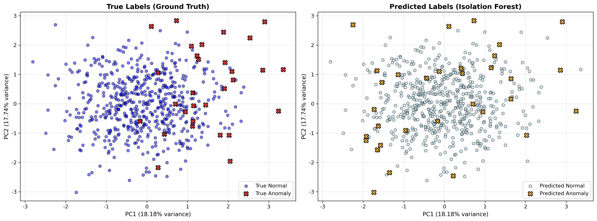
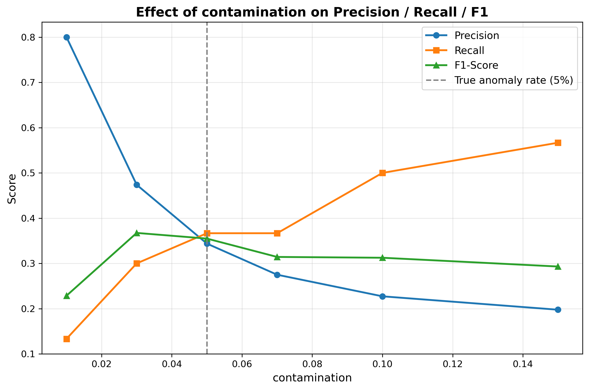
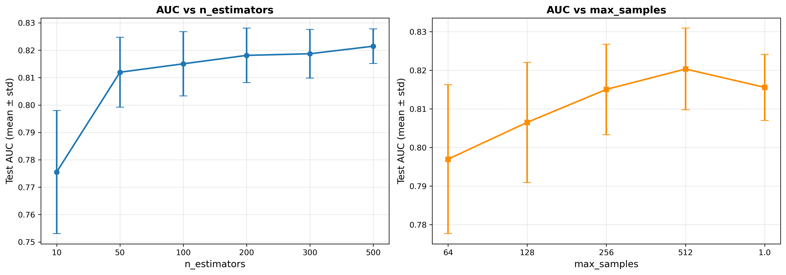
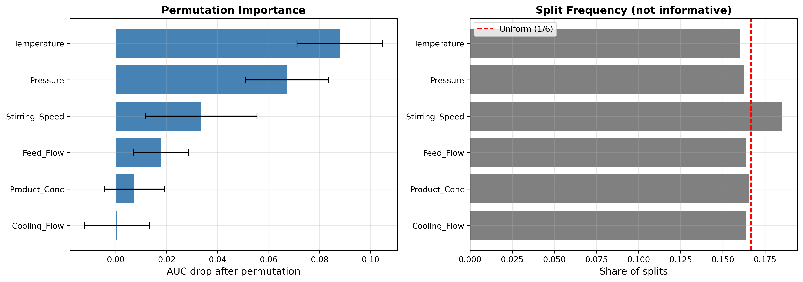

# Unit07 孤立森林 (Isolation Forest)

## 課程目標

本單元將深入介紹孤立森林 (Isolation Forest) 異常檢測演算法，這是工業界常被採用的非監督式異常檢測方法之一。透過本單元的學習，您將能夠：

- 理解孤立森林演算法的核心原理與數學基礎
- 掌握孤立森林的演算法步驟與實作細節
- 學會使用 scikit-learn 實作 Isolation Forest 模型
- 了解如何設定關鍵超參數 (contamination, n_estimators, max_samples)
- 學會評估異常檢測模型的效能
- 認識孤立森林的優缺點與適用場景
- 應用孤立森林於化工領域的製程安全監控

---

## 1. 孤立森林演算法簡介

### 1.1 什麼是孤立森林？

孤立森林 (Isolation Forest) 是由 Fei Tony Liu 等人於 2008 年提出的一種基於決策樹的異常檢測演算法。其核心理念非常直觀：**異常數據點更容易被「孤立」**。

與傳統異常檢測方法不同，孤立森林不需要先建立正常數據的分布模型，而是直接尋找容易被孤立的樣本。由於每棵樹只使用小規模子樣本，且不需計算距離或密度，其計算成本在大規模數據集上相對較低。

### 1.2 核心理念：為什麼異常點容易被孤立？

想像一個反應器的溫度-壓力散布圖：

- **正常數據點**：聚集在特定區域，需要多次切分才能將其分離
- **異常數據點**：遠離正常數據群，只需少數幾次切分就能將其孤立

**孤立森林的假設**：
1. 異常點在特徵空間中是稀少的 (Rare)
2. 異常點的特徵值與正常點有顯著差異 (Different)
3. 異常點更容易被隨機分割孤立 (Easier to isolate)

### 1.3 化工領域應用案例

孤立森林在化工領域有廣泛的應用：

1. **反應器異常監控**：
   - 即時監控反應器溫度、壓力、流量等多維度操作參數
   - 檢測異常操作條件（如溫度驟升、壓力異常波動）
   - 早期預警潛在的反應失控風險
   - 適合處理高維感測器數據（>50 個變數）

2. **產品品質異常檢測**：
   - 監控批次產品的多個品質指標
   - 識別異常批次（純度異常、雜質超標）
   - 快速定位品質問題的根本原因
   - 減少不良品流入後續製程

3. **設備健康監控**：
   - 監控泵浦、壓縮機、換熱器等設備的運行狀態
   - 檢測異常振動、溫度、電流等信號
   - 預測設備故障，實現預防性維護
   - 降低非計劃性停機損失

4. **製程安全監控**：
   - 建立多變數統計製程控制 (MSPC) 系統
   - 即時監控製程偏離正常操作範圍
   - 整合多個感測器數據進行綜合判斷
   - 降低誤報率，提高告警可靠性

5. **感測器故障診斷**：
   - 識別感測器漂移、卡死、雜訊異常
   - 區分製程異常與感測器故障
   - 確保數據品質，提升控制系統可靠性

---

## 2. 孤立森林演算法原理

### 2.1 核心概念：孤立樹 (Isolation Tree)

孤立森林由多棵孤立樹 (Isolation Tree, iTree) 組成。每棵孤立樹是一種二元決策樹，建構方式如下：

**步驟 1：隨機選擇特徵**
- 從所有特徵中隨機選擇一個特徵 $q$

**步驟 2：隨機選擇分割點**
- 在該特徵的最小值與最大值之間隨機選擇一個分割點 $p$
- 分割點公式： $p \sim \text{Uniform}(x_{\min}^q, x_{\max}^q)$

**步驟 3：遞迴分割**
- 將數據分為兩個子集： $x^q < p$ 和 $x^q \geq p$
- 對每個子集遞迴執行步驟 1-2

**停止條件**：
- 子節點只包含一個樣本（完全孤立）
- 樹達到指定的最大深度（scikit-learn 預設為 $\lceil \log_2 \psi \rceil$ ， $\psi$ 為子樣本大小）
- 所有樣本具有相同的特徵值（無法再分割）

### 2.2 路徑長度 (Path Length)

**定義**：從根節點到葉節點所經過的邊數，記為 $h(x)$

- **異常點**：路徑長度較短（容易被孤立）
- **正常點**：路徑長度較長（需要多次分割）

**平均路徑長度 (Average Path Length)**：

對於包含 $n$ 個樣本的孤立樹，平均路徑長度的期望值為：

$$
c(n) = 2H(n-1) - \frac{2(n-1)}{n}
$$

其中 $H(i)$ 是調和數 (Harmonic Number)： $H(i) = \ln(i) + \gamma$ （ $\gamma \approx 0.5772$ 為歐拉常數）。

對於大樣本量： $c(n) \approx 2\ln(n-1) + 2\gamma - 2 \approx 2\ln n - 0.85$ 。例如子樣本大小 $\psi = 256$ 時， $c(256) \approx 10.24$ 。

**注意**：若樹因達到最大深度而在葉節點仍殘留 $m$ 個樣本，該樣本的路徑長度需再加上 $c(m)$ 作為修正（約定 $c(1)=0$ ， $c(2)=1$ ）。

### 2.3 異常分數 (Anomaly Score)

對於樣本 $x$ ，其在單棵孤立樹中的路徑長度為 $h(x)$ 。在孤立森林中（包含 $t$ 棵樹），平均路徑長度為：

$$
E[h(x)] = \frac{1}{t} \sum_{i=1}^{t} h_i(x)
$$

**異常分數 (Anomaly Score)** 定義為：

$$
s(x, \psi) = 2^{-\frac{E[h(x)]}{c(\psi)}}
$$

其中：
- $\psi$ 是建構每棵樹所用的子樣本大小（scikit-learn 中即 `max_samples` 所決定的樣本數）
- $c(\psi)$ 是歸一化常數（以 $\psi$ 個樣本建構的樹，其平均路徑長度的期望值）

**異常分數的解釋**：

- $s \approx 1$ ：明顯異常 (Highly anomalous)
  - $E[h(x)] \ll c(\psi)$ ：路徑長度遠小於平均值
  
- $s \approx 0.5$ ：正常樣本 (Normal)
  - $E[h(x)] \approx c(\psi)$ ：路徑長度接近平均值
  
- $s < 0.5$ ：明顯正常 (Highly normal)
  - $E[h(x)] > c(\psi)$ ：路徑長度大於平均值

**決策規則**：
- 原論文以固定閾值判斷：若 $s(x) > \text{threshold}$ （例如 0.6-0.7），則判定為異常
- scikit-learn 的 `score_samples` 回傳的是 $-s(x, \psi)$ ，範圍為 $[-1, 0]$ ，值越小越異常；閾值 `offset_` 則由 `contamination` 參數決定（`contamination='auto'` 時固定為 $-0.5$ ，對應 $s = 0.5$ ）

### 2.4 演算法流程

**訓練階段 (Training Phase)**：

```
輸入：數據集 X = {x₁, x₂, ..., xₙ}, 樹的數量 t, 子樣本大小 ψ

1. 初始化孤立森林 Forest = []
2. For i = 1 to t:
     a. 從 X 中隨機抽樣 ψ 個樣本，得到子樣本 X'
     b. 建構孤立樹 iTree(X')
     c. 將 iTree 加入 Forest
3. 回傳 Forest
```

**預測階段 (Prediction Phase)**：

```
輸入：孤立森林 Forest, 測試樣本 x

1. 初始化路徑長度總和 path_sum = 0
2. For each iTree in Forest:
     a. 計算 x 在該 iTree 中的路徑長度 h(x)
     b. path_sum += h(x)
3. 計算平均路徑長度 E[h(x)] = path_sum / t
4. 計算異常分數 s(x) = 2^(-E[h(x)] / c(ψ))
5. 回傳 s(x)
```

---

## 3. 孤立森林的優缺點

### 3.1 優點

1. **計算效率高**：
   - 訓練時間複雜度： $O(t \cdot \psi \cdot \log \psi)$ （ $t$ 為樹數量， $\psi$ 為子樣本大小）
   - 預測時間複雜度： $O(t \cdot \log \psi)$ （每個樣本）
   - 因訓練只使用子樣本，成本與總樣本數無關，適合大規模數據集（百萬級樣本）

2. **適合高維數據**：
   - 不需要計算距離或密度，計算成本隨維度線性增加
   - 相較於距離型方法，受維度災難 (Curse of Dimensionality) 影響較小
   - 但若大量特徵與異常無關，隨機切分會被稀釋而降低偵測力（見 6.3 節步驟 8 特徵重要性）

3. **無需標籤數據**：
   - 純非監督式學習，不需要異常樣本標籤
   - 適合異常樣本稀少或難以標記的場景

4. **魯棒性強**：
   - 對特徵尺度不敏感（切分點在各特徵的範圍內均勻抽取，無需標準化；6.3 節步驟 7 實測標準化前後結果完全一致）
   - 對雜訊數據具有一定的容忍度
   - 注意：切分方向與座標軸平行，若異常是「特徵間關係」被破壞（例如斜向的相關結構），效果會下降

5. **易於解釋**：
   - 基於決策樹，具有一定的可解釋性
   - 可以追蹤異常樣本的分割路徑
   - 模型本身不直接提供特徵貢獻度，需搭配 permutation importance 或 SHAP 等方法（見 6.3 節步驟 8）

### 3.2 缺點

1. **難以處理低維聚集異常**：
   - 假設異常點是孤立的
   - 若異常點自成群集，可能無法有效檢測
   - 例如：系統性的感測器偏差

2. **超參數敏感性**：
   - `contamination` 參數需要預先設定異常比例
   - 它只決定判定閾值，不改變樣本的異常分數排序（AUC 不變），但會直接影響精確率與召回率（見 6.3 節步驟 6）
   - 需要領域知識或歷史數據輔助設定

3. **無法檢測局部異常**：
   - 基於全局結構進行異常檢測
   - 無法檢測局部密度異常（如 LOF 方法）
   - 對於非均勻分布的數據效果較差

4. **結果隨機性**：
   - 隨機選擇特徵與分割點
   - 不同運行可能產生不同結果
   - 需要設定隨機種子以確保可重現性

5. **閾值設定問題**：
   - 異常分數連續分布， $s \in (0, 1)$ （scikit-learn 的 `score_samples` 為 $-s$ ）
   - 需要設定閾值將分數轉換為二元標籤
   - 閾值選擇會影響精確率與召回率的權衡

### 3.3 適用場景

**適合使用孤立森林的情境**：

- ✅ 數據量大（可達百萬級樣本），或需要快速訓練與預測
- ✅ 特徵維度中高，且多個特徵與異常有關
- ✅ 異常點是孤立的、稀少的
- ✅ 無異常樣本標籤（僅需少量標籤用於驗證與調整閾值）

> 本單元教學案例僅有 2000 筆、6 維，主要為了展示完整流程；孤立森林在小數據集上亦可運作，但結果的隨機波動較大（見 6.3 節步驟 7）。

**不適合使用孤立森林的情境**：

- ❌ 異常點自成群集（建議使用 DBSCAN）
- ❌ 數據量極小（例如 < 200 樣本），子樣本無法代表整體分布
- ❌ 需要檢測局部密度異常（建議使用 LOF）
- ❌ 異常僅表現為特徵間關係改變（建議使用 Elliptic Envelope 或 PCA 重建誤差）
- ❌ 需要精確的概率估計（建議使用 Gaussian Mixture Models）

---

## 4. 使用 scikit-learn 實作孤立森林

### 4.1 IsolationForest 類別介紹

scikit-learn 提供了 `IsolationForest` 類別，位於 `sklearn.ensemble` 模組中。

**匯入方式**：

```python
from sklearn.ensemble import IsolationForest
```

**主要參數**：

| 參數 | 說明 | 預設值 | 建議設定 |
|------|------|--------|----------|
| `n_estimators` | 孤立樹的數量 | 100 | 100-300（樹越多結果越穩定，約 200 棵後收益遞減） |
| `max_samples` | 建構每棵樹的樣本數量 | 'auto' | 'auto' (自動設為 min(256, n_samples)) |
| `contamination` | 異常比例（僅用於設定決策閾值，不影響異常分數） | 'auto' | 0.01-0.1（根據領域知識設定） |
| `max_features` | 建構每棵樹時隨機選擇的特徵數量 | 1.0 | 1.0（使用所有特徵） |
| `bootstrap` | 是否使用 bootstrap 抽樣 | False | False（避免重複樣本） |
| `random_state` | 隨機種子 | None | 固定值（確保可重現性） |
| `n_jobs` | 並行運算的 CPU 核心數 | None | -1（使用所有核心） |

### 4.2 基本使用流程

**步驟 1：準備數據**

```python
import numpy as np
from sklearn.ensemble import IsolationForest

# 假設 X_train 是訓練數據 (n_samples, n_features)
X_train = np.random.randn(1000, 5)  # 1000 個樣本，5 個特徵
```

**步驟 2：建立模型**

```python
# 建立孤立森林模型
iso_forest = IsolationForest(
    n_estimators=100,           # 使用 100 棵樹
    max_samples='auto',         # 每棵樹使用 min(256, n_samples) 個樣本
    contamination=0.05,         # 假設 5% 的數據是異常
    random_state=42,            # 設定隨機種子
    n_jobs=-1                   # 使用所有 CPU 核心
)
```

**步驟 3：訓練模型**

```python
# 擬合模型（僅使用訓練數據）
iso_forest.fit(X_train)
```

**步驟 4：預測異常**

```python
# 預測標籤 (1: 正常, -1: 異常)
y_pred = iso_forest.predict(X_train)

# 計算異常分數 (值越小越異常)
anomaly_scores = iso_forest.score_samples(X_train)

# 識別異常樣本
anomalies = X_train[y_pred == -1]
normal = X_train[y_pred == 1]

print(f"檢測到 {len(anomalies)} 個異常樣本")
```

**步驟 5：決策函數**

```python
# decision_function = score_samples - offset_
# 值 < 0 判為異常，值 > 0 判為正常；值越小越異常
decision_scores = iso_forest.decision_function(X_train)

# 其中 offset_ 是根據 contamination 計算的閾值
# （訓練集異常分數的 contamination 百分位數；contamination='auto' 時為 -0.5）
```

### 4.3 超參數調整建議

#### 4.3.1 contamination（異常比例）

**定義**：預期數據中異常樣本的比例，**僅用於設定決策閾值** (`offset_`)，不會改變模型結構與每個樣本的異常分數排序，因此 AUC 與 contamination 無關。

**設定建議**：

- **已知異常比例**：根據歷史數據設定（如 0.02 表示 2% 異常）
- **未知異常比例**：
  - 較小值（0.01-0.05）：告警較少，精確率較高，但會漏掉較多異常
  - 較大值（0.05-0.10）：告警較多，召回率提高，但誤報增加
- **漏報代價高（如安全關鍵製程）**：設定較大值，並搭配人工複核過濾誤報
- **誤報代價高（如告警疲勞）**：設定較小值
- **探索性分析**：設定 'auto'（閾值固定為 $-0.5$ ），再依分數分布與領域知識調整

**化工應用範例**：

```python
# 安全關鍵製程：容忍較多誤報，降低漏報風險
iso_forest_safety = IsolationForest(contamination=0.10)

# 品質控制：適度設定
iso_forest_quality = IsolationForest(contamination=0.05)

# 告警疲勞嚴重的產線：只保留最可疑的樣本
iso_forest_conservative = IsolationForest(contamination=0.01)

# 探索性數據分析：使用 auto
iso_forest_explore = IsolationForest(contamination='auto')
```

> 本單元實測（2000 筆模擬反應器數據，測試集 30 筆真實異常）：contamination 由 0.01 增至 0.15 時，Recall 由 0.133 升至 0.567，Precision 由 0.800 降至 0.198，AUC 維持 0.8026 不變（詳見 6.3 節步驟 6）。

#### 4.3.2 n_estimators（樹的數量）

**定義**：孤立森林包含的孤立樹數量。

**物理意義與真實情境類比**

想像一個製程診斷的場景：工廠發生一起製程異常，主管同時派出多位獨立的工程師，讓每位工程師隨機選取部分歷史數據、獨立地對製程進行分析排查。每位工程師給出自己的「異常判斷」，最後統計所有工程師的共識結果。

- **每一棵孤立樹** ＝ 一位獨立的工程師，隨機取樣並從不同角度分析數據
- **樹的數量 (`n_estimators`)** ＝ 派出的工程師人數
- **最終異常分數** ＝ 所有工程師對路徑長度的**平均判斷結果** $E[h(x)]$

樹的數量多的好處在於：

| 少（如 10 棵） | 多（如 200 棵） |
|---|---|
| 分析角度少，容易受單棵樹的偶然分割影響 | 分析角度多，偶然誤判被平均抵消 |
| 結果隨機性高，每次執行結果差異大 | 結果穩定，可重現性高 |
| 計算速度快 | 計算時間線性增加 |

> **關鍵直觀**：當樹的數量足夠多，每個異常點的平均路徑長度會趨於收斂至穩定值。就像越多工程師獨立投票，最終共識越接近「真實答案」。實務上 100 棵樹通常已足夠收斂，繼續增加到 300 棵僅帶來邊際改善。

**設定建議**：

- **起點**：100 棵樹（預設值）
- **追求穩定**：200-300 棵，可降低不同隨機種子之間的結果波動
- **不建議過少**：10 棵樹結果波動大
- **權衡**：樹數量增加會提高穩定性，但訓練時間也會線性增加

> 本單元實測（10 個隨機種子，測試集 AUC 平均值 ± 標準差）：10 棵 0.7755 ± 0.0225；50 棵 0.8120 ± 0.0127；100 棵 0.8151 ± 0.0117；200 棵 0.8181 ± 0.0099；300 棵 0.8187 ± 0.0089；500 棵 0.8215 ± 0.0063。增加樹數主要降低波動，平均 AUC 的提升有限（詳見 6.3 節步驟 7）。

**實驗設定**：

```python
# 測試不同樹數量的影響
n_estimators_list = [50, 100, 200, 300]
for n in n_estimators_list:
    model = IsolationForest(n_estimators=n, random_state=42)
    model.fit(X_train)
    # 評估性能...
```

#### 4.3.3 max_samples（子樣本大小）

**定義**：建構**每棵**孤立樹時，從訓練集中隨機抽取的樣本數量。

**物理意義與真實情境類比**

延續上面「多位工程師」的類比：每位工程師不會翻遍工廠全部數萬筆歷史紀錄，而是**隨機抽取一疊數據（如 256 筆）當作分析素材**，在這份「縮小版數據集」上建構決策樹。

- **`max_samples` 越大**（接近全部數據）：每棵樹看到的資訊越完整，但每棵樹之間的差異越小（大家讀到的資料幾乎相同），模型多樣性降低；同時耗費更多記憶體與運算時間
- **`max_samples` 越小**（如 64）：每棵樹只看到數據的一小角，樹與樹之間差異很大（多樣性高），但單棵樹的視野有限，可能遺漏某些正常數據的結構

**孤立森林原論文的重要發現**：原始論文（Liu et al., 2008）實驗指出，子樣本大小 **256** 對大多數數據集已足夠，繼續增大子樣本對效果提升有限。直覺上：

> 要「孤立」一個異常點，只需讓分割點落在它與正常群之間——這件事在 256 個樣本中就能充分體現，不需要完整的數萬筆數據。

**化工情境舉例**：

假設工廠有 50,000 筆感測器歷史紀錄，使用 `max_samples=256`：
- 每棵樹隨機抽取 256 筆，數量約相當於每分鐘一筆紀錄下 **4 小時多**的資料量（實際上是隨機抽取，並非連續時段）
- 在這 256 筆中，若溫度驟升的異常點僅需 3 次切分就能被孤立，而正常點平均需要 8 次，模型就能學到此異常的特徵
- 100 棵樹 × 256 筆 = 從全部數據的不同時段各自獨立採樣，最終涵蓋豐富的操作情境

**設定建議**：

- **預設值 `'auto'`**：自動設為 `min(256, n_samples)`，適用大多數場景
- **小數據集**（< 500 樣本）：使用 `'auto'` 或 `1.0`（全部使用），避免資訊不足
- **大數據集**（> 50,000 樣本）：使用 256-512，充分利用孤立森林的高效優勢
- **權衡**：較小的子樣本增加樹的多樣性，但可能讓個別樹對稀疏分布的估計不穩定

> 本單元實測（訓練集 1400 筆，10 個隨機種子，測試集 AUC 平均值）：`max_samples` = 64 → 0.7970；128 → 0.8065；256 → 0.8151；512 → 0.8203；1.0（全部 1400 筆）→ 0.8156。子樣本太小（64）略差，256 以上差異不大（詳見 6.3 節步驟 7）。

| `max_samples` | 樹的多樣性 | 單棵樹精度 | 記憶體 / 速度 | 適用場景 |
|:---:|:---:|:---:|:---:|:---|
| 64 | 高 | 低 | 最低 / 最快 | 超大數據集、資源受限 |
| **256（預設）** | **中** | **中** | **低 / 快** | **大多數場景（推薦）** |
| 1024 | 低 | 高 | 中 / 中 | 中型數據集、需要穩定邊界 |
| 全部數據 | 最低 | 最高 | 最高 / 最慢 | 小數據集（< 1,000 樣本） |

**範例**：

```python
# 大數據集：使用預設 256（auto）
iso_forest_large = IsolationForest(max_samples='auto')   # min(256, n)

# 超大數據集：手動限制，節省記憶體
iso_forest_xlarge = IsolationForest(max_samples=256)

# 小數據集：使用全部樣本，確保每棵樹資訊充足
iso_forest_small = IsolationForest(max_samples=1.0)      # 100% 樣本
```

#### 4.3.4 max_features（每棵樹的特徵數量）

**定義**：建構每棵孤立樹時，**隨機抽取**多少個特徵（數量或比例）供該棵樹使用。

**物理意義與真實情境類比**

延續「多位工程師各自分析資料」的比喻：`max_features` 決定每位工程師**被允許查閱幾個感測器的數據**。

- `max_features=1.0`（預設，所有特徵）：每位工程師可同時查閱所有感測器——每棵樹每次分割時，隨機從全部特徵中挑一個維度做切割
- `max_features=0.5`（50% 特徵）：每位工程師只看一半的感測器（該棵樹的特徵子集固定）——增加樹之間的多樣性，但單棵樹的資訊不完整

> **孤立森林的重要特性**：每次節點分割仍只用**一個**隨機特徵（這是孤立樹的基本原理），`max_features` 控制的是「每棵樹可使用的特徵子集大小」。預設 `1.0` 表示每棵樹都可使用全部特徵，已具備足夠的隨機性，因此幾乎不需要調整此參數。

**設定建議**：

- **一般情況：維持預設值 `1.0`**，孤立森林本身的隨機分割機制已提供充分多樣性
- **特徵數極高**（> 500 維）：可嘗試 `0.5` 等比例值，降低計算開銷並增加樹的多樣性
- **注意**：`max_features` 只接受整數（特徵個數）或 $(0, 1]$ 的浮點數（比例），不接受 `'sqrt'` 等字串；與隨機森林 (Random Forest) 不同，孤立森林對此參數較不敏感

**範例**：

```python
# 標準設定：預設使用全部特徵（推薦）
iso_forest = IsolationForest(max_features=1.0)

# 超高維數據：減少每棵樹的特徵範圍
iso_forest_highdim = IsolationForest(max_features=0.5)
```

#### 4.3.5 bootstrap（是否使用 Bootstrap 抽樣）

**定義**：建構每棵孤立樹時，子樣本抽取方式的設定。

- `bootstrap=False`（預設）：**不放回抽樣** (sampling without replacement)——每筆數據在同一棵樹中最多出現一次
- `bootstrap=True`：**放回抽樣** (sampling with replacement)——同一筆數據可能被多次抽入同一棵樹

**物理意義與真實情境類比**

這個參數決定工程師「抽取分析資料的方式」：

- **不放回（預設）**：好比工程師從一疊班報中「抽走後不放回」，確保抽到的 256 筆紀錄各不相同——每筆紀錄只被分析一次，數據集的真實結構被完整呈現
- **放回**：好比工程師「複印後放回」，同一筆異常紀錄可能被抽到 2-3 次——會增加數據變異性，但也可能讓稀少的異常點被「放大」

| | `bootstrap=False`（預設） | `bootstrap=True` |
|---|---|---|
| 抽樣方式 | 不放回，每筆唯一 | 放回，可重複 |
| 子樣本多樣性 | 較高（每筆不重複） | 較低（可能重複） |
| 異常點處理 | 異常點最多出現一次 | 異常點可能被重複採樣 |
| 適用場景 | **幾乎所有場景（推薦）** | 極少數情況下嘗試 |

**設定建議**：

- **維持預設 `False`（強烈建議）**：不放回抽樣能保持子樣本的多樣性，是孤立森林原論文的設計初衷
- `bootstrap=True` 在孤立森林中幾乎不帶來改善，且可能讓稀少的異常點被重複採樣而影響路徑長度估計，一般不建議使用

**範例**：

```python
# 標準設定：不放回抽樣（預設，推薦）
iso_forest = IsolationForest(bootstrap=False)

# 實驗對比（通常不建議）
iso_forest_boot = IsolationForest(bootstrap=True)
```

### 4.4 模型屬性

訓練完成後，模型具有以下屬性：

```python
# 每棵樹的決策樹估計器
estimators_ = iso_forest.estimators_

# 每棵樹使用的特徵索引
estimators_features_ = iso_forest.estimators_features_

# 決策閾值的偏移量
offset_ = iso_forest.offset_

# 訓練特徵數量
n_features_in_ = iso_forest.n_features_in_
```

---

## 5. 模型評估方法

### 5.1 評估指標概述

異常檢測的評估方式取決於是否有標籤數據：

**情境 1：有部分標籤（半監督）**
- 可以計算精確率、召回率、F1 分數、AUC-ROC 等

**情境 2：完全無標籤（純非監督）**
- 依賴視覺化、統計量、領域知識驗證

### 5.2 有標籤數據的評估

假設我們有真實標籤 `y_true` (0: 正常, 1: 異常)：

#### 5.2.1 混淆矩陣與分類指標

```python
from sklearn.metrics import confusion_matrix, classification_report
from sklearn.metrics import precision_score, recall_score, f1_score

# 將預測標籤轉換為 0/1 格式
y_pred_binary = (y_pred == -1).astype(int)

# 混淆矩陣
cm = confusion_matrix(y_true, y_pred_binary)
print("混淆矩陣:")
print(cm)

# 分類報告
print("\n分類報告:")
print(classification_report(y_true, y_pred_binary, 
                          target_names=['Normal', 'Anomaly']))

# 計算精確率、召回率、F1 分數
precision = precision_score(y_true, y_pred_binary)
recall = recall_score(y_true, y_pred_binary)
f1 = f1_score(y_true, y_pred_binary)

print(f"Precision: {precision:.4f}")
print(f"Recall: {recall:.4f}")
print(f"F1-Score: {f1:.4f}")
```

**化工應用解釋**：

- **精確率 (Precision)**：告警中有多少是真正的異常
  - 高精確率 → 減少誤報，避免無效處置
  
- **召回率 (Recall)**：實際異常中有多少被檢測到
  - 高召回率 → 減少漏報，避免安全風險
  
- **F1 分數**：精確率與召回率的調和平均
  - 平衡誤報與漏報

#### 5.2.2 ROC 曲線與 AUC

```python
from sklearn.metrics import roc_curve, auc
import matplotlib.pyplot as plt

# 計算異常分數（取負值，使異常點分數更高）
anomaly_scores = -iso_forest.score_samples(X_test)

# 計算 ROC 曲線
fpr, tpr, thresholds = roc_curve(y_true, anomaly_scores)
roc_auc = auc(fpr, tpr)

# 繪製 ROC 曲線
plt.figure(figsize=(8, 6))
plt.plot(fpr, tpr, color='darkorange', lw=2, 
         label=f'ROC curve (AUC = {roc_auc:.3f})')
plt.plot([0, 1], [0, 1], color='navy', lw=2, linestyle='--', 
         label='Random Classifier')
plt.xlim([0.0, 1.0])
plt.ylim([0.0, 1.05])
plt.xlabel('False Positive Rate (FPR)')
plt.ylabel('True Positive Rate (TPR)')
plt.title('Receiver Operating Characteristic (ROC) Curve')
plt.legend(loc="lower right")
plt.grid(alpha=0.3)
plt.show()

print(f"AUC-ROC: {roc_auc:.4f}")
```

**ROC 曲線是什麼？**

> **直覺解釋**：ROC 曲線描述「我們調整警報靈敏度時，正確警報 vs 誤報 的比例如何變化」。

想像一個化工廠的異常警報系統：
- 橫軸 **FPR（假陽性率）**＝ 誤報率：正常樣本中被誤標為異常的比例
- 縱軸 **TPR（真陽性率）**＝ 召回率：真實異常中被正確偵測的比例

調整警報閾值（等同於調整 `contamination`）時，會描繪出一條曲線：
- 靈敏度**低**（嚴格）→ 左下角（少誤報、也少偵測）
- 靈敏度**高**（寬鬆）→ 右上角（多偵測、也多誤報）
- 理想模型 → 曲線緊貼**左上角**（高偵測率、低誤報率）

**AUC（曲線下面積）的直覺意義**：

> **AUC = P（隨機抽 1 筆異常 的分數 > 隨機抽 1 筆正常 的分數）**

換句話說：
- 隨機從所有異常樣本中抽一筆，再從所有正常樣本中抽一筆
- AUC 就是「異常樣本分數 **比較高**」的機率
- AUC = 0.9 → 90% 的機率，異常樣本會比正常樣本得到更高的異常分數
- AUC = 0.5 → 只有 50% 機率（與隨機猜測沒有差別）

**AUC 評分標準**：

| AUC 值 | 評級 | 化工應用解讀 |
|--------|------|-------------|
| **1.0** | 完美 | 存在某個閾值可完全區分正常與異常（理想情況） |
| **> 0.9** | 優秀 | 模型排序能力很強 |
| **0.8 – 0.9** | 良好 | 可作為輔助告警，部署前仍需以歷史數據驗證 |
| **0.7 – 0.8** | 尚可 | 排序能力有限，需改進特徵或方法 |
| **< 0.7** | 較差 | 排序能力弱，需重新設計 |
| **0.5** | 隨機 | 等同於隨機猜測 |

> **注意**：AUC 與 contamination 設定**無關**（它評估所有閾值的整體排序能力）。
> 改變 contamination 只會改變最終標籤的決策點，不影響 AUC。

#### 5.2.3 Precision-Recall 曲線

```python
from sklearn.metrics import precision_recall_curve, average_precision_score

# 計算 Precision-Recall 曲線
precision_curve, recall_curve, pr_thresholds = precision_recall_curve(
    y_true, anomaly_scores
)
avg_precision = average_precision_score(y_true, anomaly_scores)

# 繪製 PR 曲線
plt.figure(figsize=(8, 6))
plt.plot(recall_curve, precision_curve, color='blue', lw=2,
         label=f'PR curve (AP = {avg_precision:.3f})')
plt.xlabel('Recall')
plt.ylabel('Precision')
plt.title('Precision-Recall Curve')
plt.legend(loc="lower left")
plt.grid(alpha=0.3)
plt.show()

print(f"Average Precision: {avg_precision:.4f}")
```

**何時使用 PR 曲線**：
- 異常類別極度不平衡時（如異常率 < 1%）
- PR 曲線比 ROC 曲線更能反映模型在少數類別上的性能

### 5.3 無標籤數據的評估

#### 5.3.1 異常分數分布視覺化

```python
import matplotlib.pyplot as plt

# 獲取異常分數
scores = iso_forest.score_samples(X_train)

# 繪製分數分布直方圖
plt.figure(figsize=(10, 6))
plt.hist(scores, bins=50, edgecolor='black', alpha=0.7)
plt.xlabel('Anomaly Score')
plt.ylabel('Frequency')
plt.title('Distribution of Anomaly Scores')
plt.axvline(x=iso_forest.offset_, color='red', linestyle='--', 
            label=f'Threshold (contamination={iso_forest.contamination})')
plt.legend()
plt.grid(alpha=0.3)
plt.show()

# 顯示統計資訊
print(f"Mean score: {scores.mean():.4f}")
print(f"Std score: {scores.std():.4f}")
print(f"Min score: {scores.min():.4f}")
print(f"Max score: {scores.max():.4f}")
print(f"Threshold: {iso_forest.offset_:.4f}")
```

#### 5.3.2 領域知識驗證

```python
# 提取最異常的前 N 個樣本
n_top_anomalies = 10
anomaly_indices = np.argsort(scores)[:n_top_anomalies]
top_anomalies = X_train[anomaly_indices]

# 檢視異常樣本的特徵值
anomalies_df = pd.DataFrame(top_anomalies, 
                            columns=feature_names)
print("Top 10 Most Anomalous Samples:")
print(anomalies_df)

# 與正常樣本比較
normal_indices = np.argsort(scores)[-100:]
normal_samples = X_train[normal_indices]
normal_df = pd.DataFrame(normal_samples, 
                        columns=feature_names)

print("\nNormal Samples Statistics:")
print(normal_df.describe())
```

**驗證問題**：
1. 異常樣本的特徵值是否超出合理範圍？
2. 異常樣本是否對應已知的故障模式？
3. 異常樣本是否在歷史記錄中有對應的事件？

#### 5.3.3 視覺化檢驗（2D 散布圖）

```python
from sklearn.decomposition import PCA

# 使用 PCA 降維至 2D（PCA 對尺度敏感，先標準化；孤立森林本身仍使用原始數據）
from sklearn.preprocessing import StandardScaler

X_train_scaled = StandardScaler().fit_transform(X_train)
pca = PCA(n_components=2, random_state=42)
X_pca = pca.fit_transform(X_train_scaled)

# 繪製散布圖
plt.figure(figsize=(10, 8))
plt.scatter(X_pca[y_pred == 1, 0], X_pca[y_pred == 1, 1], 
           c='blue', label='Normal', alpha=0.5, s=20)
plt.scatter(X_pca[y_pred == -1, 0], X_pca[y_pred == -1, 1], 
           c='red', label='Anomaly', alpha=0.8, s=50, edgecolors='black')
plt.xlabel(f'PC1 ({pca.explained_variance_ratio_[0]:.2%} variance)')
plt.ylabel(f'PC2 ({pca.explained_variance_ratio_[1]:.2%} variance)')
plt.title('Anomaly Detection Results (PCA Projection)')
plt.legend()
plt.grid(alpha=0.3)
plt.show()
```

### 5.4 化工應用的實務評估

#### 5.4.1 誤報成本 vs 漏報成本

在化工製程中，需要根據應用場景權衡誤報與漏報的成本：

| 應用場景 | 優先考量 | 調整策略 |
|----------|----------|----------|
| 製程安全監控 | 避免漏報（高召回率） | 提高 `contamination`，容忍較多誤報 |
| 品質控制 | 平衡誤報與漏報 | 適中的 `contamination`（0.05） |
| 設備維護規劃 | 避免誤報（高精確率） | 降低 `contamination`，僅關注最明顯的異常 |

> `contamination` 越大，被標為異常的樣本越多，召回率上升、精確率下降（實測結果見 6.3 節步驟 6）。

#### 5.4.2 告警抑制策略

```python
# 連續 N 點異常才觸發告警（降低雜訊影響）
# 注意：predictions 必須按時間順序排列（時間序列數據），對被打亂順序的測試集無意義
def consecutive_anomaly_detection(predictions, window_size=3):
    """
    連續 window_size 個異常點才視為真正異常
    """
    n = len(predictions)
    filtered_predictions = np.ones(n)  # 預設為正常
    
    for i in range(n - window_size + 1):
        if np.all(predictions[i:i+window_size] == -1):
            filtered_predictions[i:i+window_size] = -1
    
    return filtered_predictions

# 應用告警抑制
y_pred_filtered = consecutive_anomaly_detection(y_pred, window_size=3)
```

#### 5.4.3 A/B Testing 上線驗證

```python
# 模擬上線前後的異常檢測結果比較（以下數字僅為示意，非本單元實驗結果）
# 假設 baseline_alerts 是舊方法的告警數
# new_alerts 是新方法的告警數

baseline_alerts = 150  # 舊方法每月告警數
new_alerts = 85        # 新方法每月告警數
true_anomalies = 20    # 實際異常事件數

print("=== A/B Testing Results ===")
print(f"Baseline Method: {baseline_alerts} alerts/month")
print(f"New Method (Isolation Forest): {new_alerts} alerts/month")
print(f"Reduction: {(1 - new_alerts/baseline_alerts)*100:.1f}%")
print(f"True Anomalies Detected: {true_anomalies}")
# 實務上還需比較兩種方法的召回率（告警減少不代表模型更好）
```

---

## 6. 化工應用案例：反應器異常監控

### 6.1 案例背景

某化工廠的連續攪拌槽反應器 (CSTR) 需要即時監控以確保製程安全與產品品質。監控系統包含以下感測器：

**製程變數**：
- 反應器溫度 (Temperature, °C)
- 反應器壓力 (Pressure, bar)
- 進料流量 (Feed Flow, m³/h)
- 冷卻水流量 (Cooling Flow, m³/h)
- 攪拌速度 (Stirring Speed, rpm)
- 產物濃度 (Product Concentration, mol/L)

**挑戰**：
1. 實際製程的感測器數據常高度相關（多重共線性）；本教學案例為簡化而模擬為各變數獨立（見 6.2.2）
2. 異常事件稀少（實務上通常 < 5%；本案例模擬為 5%，以便在測試集中有足夠的異常樣本）
3. 需要即時檢測（< 1 秒響應時間）
4. 需要降低誤報率（避免虛驚一場）

**目標**：
- 建立孤立森林模型進行異常檢測
- 識別異常操作條件（溫度失控、壓力異常等）
- 評估模型性能（精確率、召回率）
- 視覺化異常檢測結果

### 6.2 數據生成（模擬）

我們在 Jupyter Notebook 中生成了模擬數據，包含：
- **正常操作數據**（95%）：基於穩態操作條件，各變數彼此獨立
- **異常操作數據**（5%）：5 種異常類型各 20 筆（溫度失控、壓力異常、冷卻流量異常、攪拌故障、產物濃度異常），每種異常只讓 2-4 個變數偏離正常值（軟異常）

#### 6.2.1 數據集基本資訊

**執行結果**：
```
=== 數據集資訊 ===
總樣本數: 2000
正常樣本數: 1900 (95.0%)
異常樣本數: 100 (5.0%)

特徵數量: 6
特徵名稱: ['Temperature', 'Pressure', 'Feed_Flow', 'Cooling_Flow', 'Stirring_Speed', 'Product_Conc']
```

**數據統計比較（正常 vs 異常）**：

| 特徵 | 正常平均值 | 正常標準差 | 異常平均值 | 異常標準差 | 平均差異 |
|------|-----------|-----------|-----------|-----------|---------|
| Temperature (°C) | 350.34 | 7.88 | 358.05 | 12.44 | 7.71 |
| Pressure (bar) | 8.00 | 0.50 | 8.37 | 0.81 | 0.36 |
| Feed_Flow (m³/h) | 34.88 | 2.97 | 35.17 | 3.40 | 0.29 |
| Cooling_Flow (m³/h) | 19.93 | 2.08 | 19.76 | 3.26 | 0.17 |
| Stirring_Speed (rpm) | 300.41 | 20.02 | 280.85 | 38.76 | 19.56 |
| Product_Conc (mol/L) | 0.748 | 0.078 | 0.705 | 0.105 | 0.043 |

**分析與討論**：

1. **數據規模合理**：
   - 總樣本數 2000，符合化工製程數據的典型規模
   - 異常比例 5%，反映真實製程中異常事件的稀少性

2. **異常特徵差異明顯但不極端**：
   - **Temperature**：異常樣本平均高出 7.71°C（約 2.2%），標準差增加 58%
   - **Stirring_Speed**：異常樣本平均降低 19.56 rpm（約 6.5%），標準差增加 94%
   - **Pressure**：異常樣本平均高出 0.36 bar（約 4.6%），標準差增加 60%

3. **挑戰性設計**：
   - 正常與異常數據有重疊區域，不是完全分離
   - 這符合實際化工製程中的「軟異常」特性
   - 為模型提供適當的挑戰難度，避免完美分類

4. **多變量異常模式**：
   - 溫度失控：溫度↑、壓力↑、冷卻流量↑、產物濃度略降
   - 攪拌故障：攪拌速度↓、產物濃度↓
   - 不同異常類型具有不同的特徵模式，且每種只有 2-4 個變數偏離，這也是整體偏離程度不大的原因

#### 6.2.2 特徵相關性分析

**相關性矩陣熱圖**：


**分析與討論**：

1. **特徵獨立性高**：
   - 所有特徵間的相關係數 |r| < 0.05（最大約 0.04）
   - 沒有明顯的多重共線性問題
   - 這是模擬數據的設計結果（各變數獨立生成），實際製程數據通常會有顯著相關性

2. **孤立森林與相關性**：
   - 孤立森林不計算距離，因此不像基於距離的方法那樣受共線性影響
   - 但切分軸與特徵軸平行，若異常是「相關結構被破壞」，對單一特徵而言卻落在正常範圍內，孤立森林較難捕捉

3. **實務意義**：
   - 每個感測器提供獨立的資訊
   - 異常檢測可以利用所有特徵的資訊

#### 6.2.3 特徵分布視覺化

**特徵分布圖（正常 vs 異常）**：


**分析與討論**：

1. **Temperature（溫度）**：
   - 正常：集中在 350°C 附近，呈現正態分布
   - 異常：分布較寬且帶有右側尾端（溫度失控、冷卻異常等類型），與正常範圍重疊區很大
   - 在本案例中特徵重要性最高（見 6.3 節步驟 8）

2. **Pressure（壓力）**：
   - 正常：穩定在 8.0 bar
   - 異常：略微升高至 8.4 bar
   - 重疊區域較大，單變量檢測困難

3. **Feed_Flow（進料流量）**：
   - 正常與異常分布高度重疊
   - 說明進料流量本身不是主要異常指標
   - 需要結合其他變量判斷

4. **Cooling_Flow（冷卻流量）**：
   - 分布模式相似，異常樣本變異性較大（標準差 3.26 vs 2.08）
   - 異常樣本在兩端都有尾端：冷卻流量異常向下，溫度失控則向上，平均值因互相抵銷而幾乎不變
   - 單變量區分能力有限

5. **Stirring_Speed（攪拌速度）**：
   - 只有攪拌故障類型（20 筆）明顯偏低（平均約 220 rpm），其餘異常類型的攪拌速度仍在正常範圍
   - 異常群整體平均 280.85 rpm，標準差 38.76 rpm（正常為 300.41 ± 20.02）
   - 低攪拌速度會影響反應均勻性

6. **Product_Conc（產物濃度）**：
   - 異常樣本平均濃度 0.705 mol/L，略低於正常的 0.748 mol/L（約 0.5 個標準差）
   - 僅產物濃度異常類型的平均明顯較低（約 0.60 mol/L）
   - 單一指標的區分能力有限

**關鍵洞察**：

- 單一特徵難以完全區分正常與異常
- 需要多變量聯合分析（孤立森林的優勢）
- 異常檢測需考慮特徵間的交互作用
- 設計的數據難度適中，適合教學演示

### 6.3 完整實作流程與執行結果

完整的程式碼演練已在配套的 Jupyter Notebook 中實作完成，以下是各步驟的執行結果與深入分析。

#### 步驟 1：數據生成與視覺化

✅ **已完成**（參見 6.2 節詳細結果）
- 生成 2000 樣本（1900 正常 + 100 異常）
- 6 個製程特徵：Temperature, Pressure, Feed_Flow, Cooling_Flow, Stirring_Speed, Product_Conc
- 5 種異常類型：溫度失控、壓力異常、冷卻流量異常、攪拌故障、產物濃度異常

#### 步驟 2：數據前處理

**訓練集與測試集分割**：

```
=== 數據分割 ===
訓練集大小: 1400 樣本
  正常: 1330 (95.0%)
  異常: 70 (5.0%)

測試集大小: 600 樣本
  正常: 570 (95.0%)
  異常: 30 (5.0%)

=== 特徵標準化（僅供 PCA 視覺化使用） ===
孤立森林模型使用原始數據訓練與預測（步驟 7 將驗證標準化不影響結果）
```

**分析與討論**：

1. **分層抽樣確保比例一致**：
   - 訓練集和測試集的異常比例都維持在 5.0%
   - 避免數據分割導致的類別不平衡問題
   - 確保模型評估的公平性

2. **標準化的必要性**：
   - 孤立森林使用隨機分割，不基於歐式距離
   - 對特徵尺度不敏感，無需強制標準化
   - 本單元將標準化只用於 PCA 視覺化（PCA 對尺度敏感）；若與 LOF、One-Class SVM 等距離/核函數方法比較，則需對該些方法標準化

3. **訓練集規模**：
   - 1400 樣本已可訓練出可用的孤立森林
   - 每棵樹使用 256 個子樣本（max_samples='auto'）
   - 訓練集中含有 70 筆（5%）未標記的異常樣本，反映實務上訓練資料無法保證純淨（孤立森林對此有一定容忍度）

#### 步驟 3：模型建立與訓練

**模型超參數設定**：

```python
IsolationForest(
    n_estimators=100,           # 100 棵孤立樹
    max_samples='auto',         # 每棵樹 256 個樣本
    contamination=0.05,         # 預期 5% 異常
    random_state=42,            # 隨機種子（可重現）
    n_jobs=-1                   # 使用所有 CPU 核心
)
```

**訓練結果**：

```
=== 開始訓練孤立森林模型 ===
✓ 訓練完成！訓練時間: 0.2541 秒

=== 訓練後模型屬性 ===
決策閾值偏移量 (offset_): -0.5185
訓練特徵數量 (n_features_in_): 6
孤立樹數量: 100
```

**分析與討論**：

1. **訓練效率高**：
   - 訓練時間僅 0.2541 秒（視硬體與執行環境而異）
   - 訓練只使用子樣本，理論成本為 $O(t \cdot \psi \log \psi)$ ，與訓練集總筆數無關
   - 預測 600 筆測試樣本約 10 毫秒（單筆呼叫約 5 毫秒，實測值視硬體而異），滿足即時異常檢測的需求（< 1 秒）

2. **決策閾值 (offset_)**：
   - 值為 -0.5185
   - 由 `contamination=0.05` 參數自動計算（訓練集異常分數的第 5 百分位數）
   - 異常分數 < -0.5185 → 判定為異常
   - 異常分數 ≥ -0.5185 → 判定為正常

3. **模型規模**：
   - 100 棵樹提供足夠的集成效果
   - 每棵樹獨立訓練，可並行化
   - 模型大小適中，易於部署

#### 步驟 4：異常檢測與評估

**混淆矩陣與分類報告**：

```
=== 混淆矩陣 ===
[[549  21]
 [ 19  11]]

True Negatives (TN): 549 - 正確識別為正常
False Positives (FP): 21 - 誤報為異常
False Negatives (FN): 19 - 漏報異常
True Positives (TP): 11 - 正確識別為異常

=== 分類報告 ===
              precision    recall  f1-score   support

      Normal     0.9665    0.9632    0.9649       570
     Anomaly     0.3438    0.3667    0.3548        30

    accuracy                         0.9333       600
   macro avg     0.6551    0.6649    0.6598       600
weighted avg     0.9354    0.9333    0.9344       600

=== 關鍵指標摘要 ===
Precision (精確率): 0.3438 - 告警中有多少是真正的異常
Recall (召回率): 0.3667 - 實際異常中有多少被檢測到
F1-Score: 0.3548 - 精確率與召回率的調和平均
```


**深入分析與討論**：

1. **整體準確率 93.33%**：
   - 看似很高，但需注意類別不平衡（正常:異常 = 19:1）
   - 「全部預測為正常」的基準模型準確率就有 95%，反而高於本模型的 93.33%
   - 準確率不是異常檢測的最佳指標，應該關注精確率和召回率

2. **正常類別性能優秀**：
   - Precision = 96.65%：被判定為正常的樣本中，96.65% 確實是正常
   - Recall = 96.32%：實際正常樣本中，96.32% 被正確識別
   - F1-Score = 96.49%：正常類別的綜合表現優秀

3. **異常類別性能中等**：
   - **Precision = 34.38%**：32 個告警中，只有 11 個是真正異常（21 個誤報）
   - **Recall = 36.67%**：30 個真實異常中，只檢測到 11 個（19 個漏報）
   - **F1-Score = 35.48%**：異常類別的綜合表現較弱

4. **誤報分析 (FP = 21)**：
   - 21 個正常樣本被誤判為異常
   - 誤報率 = 21/570 = 3.68%
   - 誤報率看似不高，但因為正常樣本遠多於異常，告警中仍有近 2/3 是誤報（Precision = 34.38%）
   - 誤報會導致無效的人工檢查，增加操作負擔

5. **漏報分析 (FN = 19)**：
   - 19 個異常樣本被漏報
   - 漏報率 = 19/30 = 63.33%
   - 漏報在安全監控中是嚴重問題
   - 可能導致異常狀況未被及時處理

6. **性能權衡考量**：
   - 當前 `contamination=0.05` 與真實異常比例相符，但因分數重疊大，Precision 與 Recall 仍約為 35%
   - 若要提高召回率（減少漏報）：**提高** `contamination`（如 0.10 時 Recall = 50.0%，Precision = 22.7%）
   - 若要提高精確率（減少誤報）：**降低** `contamination`（如 0.03 時 Precision = 47.4%，Recall = 30.0%）
   - 實務上需根據誤報與漏報的相對成本調整（完整掃描見步驟 6）

7. **化工應用啟示**：
   - **製程安全監控**：優先保證召回率（避免漏報），可容忍較多誤報
   - **品質控制**：平衡精確率與召回率
   - **設備維護規劃**：優先保證精確率（避免誤報浪費資源）

**ROC 曲線與 AUC 評估**：

```
=== ROC-AUC 評估 ===
AUC-ROC: 0.8026
評價：良好 (Good)
```


**深入分析與討論**：

1. **AUC = 0.8026 直觀解讀**：

   > **白話翻譯**：從所有 30 個異常樣本中隨機抽 1 個、再從 570 個正常樣本中隨機抽 1 個，
   > 孤立森林有 **80.26%** 的機率讓異常樣本的分數排得比正常樣本更高。
   > 換句話說，如果把所有測試樣本依異常分數從高排到低，異常樣本通常會出現在清單的前面。

   - 位於「良好」(Good) 區間的下緣（0.8–0.9）
   - 高於隨機猜測（AUC=0.5）約 0.30
   - 模型確實學到了部分異常模式，但排序能力仍有限
   - 單一隨機種子 (42) 的 AUC 約為 0.80；改變種子時，100 棵樹的 AUC 平均為 0.8151（標準差 0.0117，見步驟 7）

2. **ROC 曲線各區域對應的操作含義**：

   | 曲線上的點 | FPR | TPR | 對應的操作策略 |
   |-----------|-----|-----|--------------|
   | 左下角 (0, 0) | 0% | 0% | 不標記任何異常 |
   | 曲線上的點 | 0.2% | 13.3% | contamination = 0.01 |
   | 曲線上的點 | 1.8% | 30.0% | contamination = 0.03 |
   | 本案例工作點 | 3.7% | 36.7% | contamination = 0.05 |
   | 曲線上的點 | 8.9% | 50.0% | contamination = 0.10 |
   | 曲線上的點 | 12.1% | 56.7% | contamination = 0.15 |
   | 曲線右端 | 約 75% | 100% | 要抓到全部 30 筆異常，將約 75% 的正常樣本也標為異常 |
   | 右上角 (1, 1) | 100% | 100% | 全部標為異常 |

   - **曲線愈靠近左上角**，代表同樣的召回率下誤報更少，模型更強
   - AUC 就是衡量「曲線整體有多靠近左上角」的數字

3. **AUC 與 contamination 的關係（重要！）**：
   - AUC 是**排序指標**，評估的是模型給所有樣本打分時「異常分數的相對高低」
   - **改變 contamination 不會改變 AUC**，只會移動 ROC 曲線上的工作點
   - 要提升 AUC，需改善模型本身（特徵工程、超參數調整）

4. **性能提升方向**：
   - 當前 AUC = 0.80，距離完美分類（AUC=1.0）還有明顯差距
   - 可能的改進方向：
     - 增加樹的數量（`n_estimators`）：主要降低結果波動，平均 AUC 提升有限（見步驟 7）
     - 添加更多具有區分能力的特徵，或移除無資訊的特徵（見步驟 8）
     - 進行特徵工程（如差分、滾動統計）

5. **實務應用考量**：
   - AUC 約 0.80 屬中等偏上水準，但在 contamination=0.05 時 Precision 與 Recall 僅約 35%，單獨使用不足以作為安全告警
   - 真實製程數據往往更複雜，需以歷史數據驗證，並結合領域規則
   - 需要與其他方法（LOF、One-Class SVM）比較選擇最佳方法

#### 步驟 5：結果視覺化

**異常分數分布**：


```
=== 異常分數統計（按真實標籤） ===
正常樣本異常分數: Mean = -0.4342, Std = 0.0386
異常樣本異常分數: Mean = -0.4962, Std = 0.0590
分數差異: 0.0620
```

**深入分析與討論**：

1. **分數分布特性**：
   - **正常樣本**（藍色）：25%–75% 分位落在 -0.458 至 -0.405，中位數約 -0.427；左側（分數較低）有一條長尾，部分極端正常樣本分數低至約 -0.54
   - **異常樣本**（紅色）：分布較廣（約 -0.607 至 -0.405），中位數約 -0.494，平均向左偏移至 -0.4962，但與正常樣本大幅重疊
   - **決策閾值**（綠色虛線）：-0.5185，位於兩分布的左側尾端，僅捕捉到最極端的少數樣本

2. **分離度分析**：
   - 平均分數差異僅 0.0620（約為正常樣本分數 Std 0.0386 的 1.6 倍）
   - 兩分布有大面積重疊區域
   - 這解釋了為什麼 Precision 和 Recall 都不高

3. **重疊區域的意義**：
   - 重疊區域的樣本是「邊界樣本」
   - 可能是：
     - 輕微異常（接近正常）
     - 接近異常邊界的正常樣本
     - 模型難以區分的樣本

4. **閾值選擇影響**：
   - 當前閾值 -0.5185 由 `contamination=0.05` 自動決定（訓練集分數的第 5 百分位）
   - 閾值右移（如 -0.50，分數低於閾值者為異常）：
     - 更多樣本被判定為異常
     - 召回率↑，精確率↓
   - 閾值左移（如 -0.54）：
     - 更少樣本被判定為異常
     - 召回率↓，精確率↑
   - 不同 `contamination` 對應的閾值見步驟 6 的 `offset_` 欄位

5. **實務調整建議**（閾值僅為示意，需依實際數據的分數分布決定）：
   - 根據業務需求動態調整閾值
   - 製程安全：閾值 = -0.50（優先召回率）
   - 品質控制：閾值 = -0.52（平衡）
   - 維護規劃：閾值 = -0.54（優先精確率）

**PCA 投影視覺化**：



```
=== PCA 解釋變異數（標準化後） ===
PC1: 18.18%
PC2: 17.74%
累積解釋變異數: 35.92%

=== PCA 主成分負荷量 (loadings) ===
                  PC1    PC2
Temperature     0.509  0.356
Pressure        0.538  0.206
Feed_Flow      -0.178  0.701
Cooling_Flow    0.082  0.419
Stirring_Speed -0.404 -0.002
Product_Conc   -0.500  0.405
```

**深入分析與討論**：

1. **降維效果**：
   - 前兩個主成分僅保留 35.92% 的變異數，2D 投影損失約 64% 的資訊
   - 6 個變數彼此獨立（見 6.2.2），無法用兩個主成分有效濃縮（完全獨立的標準化變數，每個主成分約只佔 1/6 ≈ 16.7%）
   - 因此 2D 圖只能作為示意，不能據此判斷模型在 6D 空間的表現
   - 註：PCA 對特徵尺度敏感，本例先以 `StandardScaler` 標準化後再做 PCA；若直接使用原始數據，PC1 會被數值尺度最大的變數（Temperature、Stirring_Speed）主導
   - 負荷量顯示 PC1 主要對應 Temperature、Pressure（正向）與 Product_Conc、Stirring_Speed（負向），PC2 主要對應 Feed_Flow、Cooling_Flow、Product_Conc

2. **左圖：真實標籤 (Ground Truth)**：
   - **藍色點（正常）**：廣泛分布在整個平面
   - **紅色叉（異常）**：偏向右側（PC1 較大，即溫度、壓力偏高、濃度偏低的方向），但與正常樣本大量重疊，並未形成獨立的群集
   - 這與模擬設計相符：異常是各變數的軟偏移，而非另成一群

3. **右圖：預測結果 (Isolation Forest)**：
   - **淺藍色點（預測正常）**：與真實正常樣本高度重疊
   - **橙色叉（預測異常）**：除了右側的真實異常，也出現在左側邊緣的極端正常樣本（誤報）
   - 部分紅色叉位於密集的藍色區域，未被標記為橙色（漏報）

4. **預測準確性觀察**：
   - 孤立森林抓的是「極端值」，而非「偏向特定方向」，故任一方向的離群正常樣本都會被標為異常
   - 中心密集區域的異常樣本較難識別（與正常樣本混雜）
   - PCA 降維後的可視化與實際 6D 空間的模型性能不完全一致

5. **孤立森林的視覺化挑戰**：
   - 孤立森林在 6D 空間中運作，不是在 2D PCA 空間
   - 某些在 2D 看起來「不孤立」的點，在 6D 可能很孤立
   - 視覺化僅供參考，不能完全反映模型的真實邏輯

6. **化工應用啟示**：
   - 異常樣本在多維空間中是分散的（不同故障模式）
   - 單一視角難以完全理解異常檢測結果
   - 需要結合多種視覺化與統計分析
   - 領域知識對解釋結果至關重要

#### 步驟 6：contamination 敏感度分析

`contamination` 只改變「判定閾值」（`offset_`），不改變模型的分數排序，因此 AUC 不變，變化的是 Precision 與 Recall 的取捨。



```
=== contamination 敏感度（測試集 600 筆，其中 30 筆真實異常） ===
 contamination  offset_  flagged  precision  recall     f1    auc
          0.01  -0.5731        5     0.8000  0.1333 0.2286 0.8026
          0.03  -0.5358       19     0.4737  0.3000 0.3673 0.8026
          0.05  -0.5185       32     0.3438  0.3667 0.3548 0.8026
          0.07  -0.5073       40     0.2750  0.3667 0.3143 0.8026
          0.10  -0.4939       66     0.2273  0.5000 0.3125 0.8026
          0.15  -0.4801       86     0.1977  0.5667 0.2931 0.8026
```

**深入分析與討論**：

1. **方向性**：提高 `contamination` → 閾值右移（`offset_` 變大）→ 標記的樣本數增加（flagged 5 → 86）→ Recall 上升、Precision 下降。
2. **AUC 不變**：各設定的 AUC 均為 0.8026，證實 `contamination` 不影響排序能力，只是決定工作點。
3. **F1 最高點**：`contamination=0.03` 時 F1 = 0.3673，略高於 0.05 的 0.3548，但差異很小，且單一測試集只有 30 筆異常，統計不確定性很大。
4. **高精確率的代價**：`contamination=0.01` 時 Precision = 80%，但只抓到 4/30 筆異常（Recall = 13.3%）。
5. **高召回率的代價**：`contamination=0.15` 時 Recall = 56.7%，但 86 筆告警中只有 17 筆是真異常（Precision = 19.8%）。
6. **實務選擇**：對於分數重疊這麼大的資料，無法同時達到高 Precision 與高 Recall，應依誤報/漏報的相對成本選擇工作點。

#### 步驟 7：穩定性與超參數驗證

以 10 個不同隨機種子重複訓練，評估 AUC 的平均與波動，並確認標準化對孤立森林的影響。



```
=== n_estimators 與 AUC（10 個隨機種子） ===
n_estimators =  10: AUC = 0.7755 ± 0.0225
n_estimators =  50: AUC = 0.8120 ± 0.0127
n_estimators = 100: AUC = 0.8151 ± 0.0117
n_estimators = 200: AUC = 0.8181 ± 0.0099
n_estimators = 300: AUC = 0.8187 ± 0.0089
n_estimators = 500: AUC = 0.8215 ± 0.0063

=== max_samples 與 AUC（10 個隨機種子） ===
max_samples =    64: AUC = 0.7970 ± 0.0193
max_samples =   128: AUC = 0.8065 ± 0.0156
max_samples =   256: AUC = 0.8151 ± 0.0117
max_samples =   512: AUC = 0.8203 ± 0.0106
max_samples =   1.0: AUC = 0.8156 ± 0.0086

=== 標準化前後比較（random_state=42） ===
原始數據 AUC: 0.8026
標準化數據 AUC: 0.8026
預測標籤一致率: 100.00%
```

**深入分析與討論**：

1. **單一種子結果的波動**：`random_state=42` 的 AUC = 0.8026，低於 10 個種子平均 0.8151；種子間的標準差約 0.012，因此小於約 0.01 的 AUC 差異不宜解讀為模型優劣。
2. **n_estimators**：10 棵樹的 AUC 明顯較低且波動大；從 100 增加到 300 棵只提升約 0.004（大致在種子波動範圍內），主要效益是 Std 縮小（0.0117 → 0.0089）。約 100–200 棵即有足夠的性價比。
3. **max_samples**：子樣本太小（64）AUC 較低；增加到 256–512 後趨於平穩，與論文建議的 256 一致。全樣本（1.0）並未更好，且訓練成本更高。
4. **標準化不影響結果**：標準化前後 AUC 相同，且預測標籤 100% 一致。原因是孤立樹的分割點在「特徵範圍」中均勻抽取，線性縮放不改變樣本間的大小順序。

#### 步驟 8：特徵重要性分析

使用排列重要性（Permutation Importance）：對測試集逐一打亂某個特徵，觀察 AUC 下降幅度（重複 20 次）。同時計算樹中各特徵被選為分割特徵的頻率供對照。



```
=== 特徵重要性（基準 AUC = 0.8026，重複 20 次） ===
       Feature  AUC_drop_mean  AUC_drop_std  Split_ratio
   Temperature         0.0878        0.0167       0.1603
      Pressure         0.0672        0.0162       0.1623
Stirring_Speed         0.0335        0.0219       0.1849
     Feed_Flow         0.0178        0.0108       0.1635
  Product_Conc         0.0073        0.0118       0.1654
  Cooling_Flow         0.0006        0.0128       0.1637
```

**深入分析與討論**：

1. **Temperature 與 Pressure 最重要**：打亂它們後 AUC 分別下降 0.0878 與 0.0672，與資料生成時對這兩個變數設定的異常偏移相符。
2. **Cooling_Flow 貢獻最低**：下降量約 0.0006（小於其標準差 0.0128），打亂該變數幾乎不影響 AUC。雖然異常樣本的 Cooling_Flow 變異較大（Std 3.26 vs 2.08），但其方向有上有下（見 6.2.3），且相關異常類型的樣本已主要由其他變數貢獻分數，因此此變數的邊際貢獻極小。
3. **分割頻率無法反映重要性**：各特徵的 Split_ratio 皆在 0.16–0.185 之間，幾乎均勻。原因是孤立樹每次分割都「隨機」選特徵，不考慮特徵是否有區分能力。因此不應用分割頻率評估重要性，應使用排列重要性。
4. **使用限制**：排列重要性依賴真實標籤（評估 AUC），實務上若沒有標籤則需以領域知識或少量標記樣本驗證。

#### 步驟 9：模型儲存與總結

**模型儲存**：

```
=== 模型儲存 ===
✓ 模型已儲存至: d:\MyGit\ChemE-3590\Part_2\Unit07\outputs\P2_Unit07_Isolation_Forest\models\isolation_forest_model.pkl

=== 模型性能摘要 ===
Precision: 0.3438
Recall: 0.3667
F1-Score: 0.3548
AUC-ROC: 0.8026
訓練時間: 0.2541 秒

=== 所有圖檔已儲存至 ===
📁 d:\MyGit\ChemE-3590\Part_2\Unit07\outputs\P2_Unit07_Isolation_Forest\figs
  - correlation_matrix.png
  - feature_distributions.png
  - confusion_matrix.png
  - roc_curve.png
  - anomaly_score_distribution.png
  - pca_visualization.png
  - contamination_sensitivity.png
  - stability_check.png
  - feature_importance.png
```

**最終分析與總結**：

1. **模型已存檔**：
   - 模型已序列化為 `.pkl` 檔案，可再次載入進行推論
   - 正式上線前仍需以真實製程數據驗證、設定告警策略與監控模型漂移
   - 所有視覺化圖檔已備份，供報告使用

2. **性能評估總結**：
   - **訓練效率**：0.2541 秒，快速 ✅
   - **整體準確率**：93.33%，但低於「全部預測正常」的 95% 基準 ⚠️
   - **異常召回率**：36.67%，較低（漏報多）❌
   - **異常精確率**：34.38%，較低（誤報多）❌
   - **AUC-ROC**：0.8026，中等偏上 ⚠️

3. **適用性評估**：
   - ✅ **訓練與預測成本低**：預測 600 筆約 10 毫秒，適合即時監控
   - ✅ **適合孤立異常檢測**：本案例異常為各變數的軟偏移，並非獨立群集
   - ⚠️ **需要調整閾值**：`contamination=0.05` 與真實異常比例相符，但工作點需依誤報/漏報成本決定
   - ❌ **召回率需改進**：對於安全監控，63% 的漏報率不可接受

4. **改進建議**（數字皆為本單元實測結果，見步驟 6、7）：

   | 目標 | 策略 | 實測效果 |
   |------|------|----------|
   | 提高召回率 | 提高 `contamination` 從 0.05 至 0.10 | Recall 36.7% → 50.0%，Precision 34.4% → 22.7% |
   | 提高精確率 | 降低 `contamination` 從 0.05 至 0.03 | Precision 34.4% → 47.4%，Recall 36.7% → 30.0% |
   | 提高 AUC | 增加 `n_estimators` 從 100 至 300 | 10 種子平均 AUC 0.8151 → 0.8187，提升有限，主要降低波動 |
   | 減少計算時間 | 降低 `n_estimators` 從 100 至 50 | 10 種子平均 AUC 0.8151 → 0.8120，訓練時間隨樹數成比例縮短 |
   | 超越目前 AUC | 調整特徵而非超參數 | 超參數調整的空間有限，可嘗試特徵工程或移除 Cooling_Flow 等貢獻低的特徵（未在本單元驗證） |

5. **下一步工作**：
   - 與其他方法比較（LOF、One-Class SVM、Elliptic Envelope）
   - 嘗試特徵工程（如溫度變化率、壓力波動）
   - 使用時間窗口特徵捕捉動態異常
   - 整合多個異常檢測器（Ensemble）

### 6.4 案例學習成果

通過本案例的完整實作與深入分析，學生將能夠：

1. **理解完整的異常檢測工作流程**：
   - ✅ 從數據生成（模擬 CSTR 反應器）到模型部署
   - ✅ 理解每個步驟的目的與實作細節
   - ✅ 掌握數據探索、模型訓練、性能評估的完整流程
   - ✅ 認識異常檢測中的挑戰（類別不平衡、重疊分布）

2. **掌握孤立森林的實作技巧**：
   - ✅ 超參數設定策略（`contamination`, `n_estimators`, `max_samples`）
   - ✅ 理解 `contamination` 對精確率與召回率的影響
   - ✅ 學會使用異常分數進行連續評估（而非僅依賴二元標籤）
   - ✅ 掌握決策閾值的調整方法
   - ✅ 理解孤立森林的訓練效率優勢（本案例訓練約 0.25 秒，訓練成本只與子樣本大小與樹數有關）

3. **應用於實際化工問題**：
   - ✅ **反應器異常監控**：
     - 溫度失控檢測（7.71°C 平均差異）
     - 攪拌故障識別（19.56 rpm 下降）
     - 多變量聯合判斷（6 個製程變數）
   
   - ✅ **製程安全預警**：
     - 理解誤報與漏報的相對成本
     - 根據安全要求調整模型靈敏度
     - 實施連續異常點告警策略（降低雜訊）
   
   - ✅ **品質控制應用**：
     - 產物濃度異常檢測（0.043 mol/L 差異）
     - 批次間品質監控
     - 早期預警品質劣化

4. **批判性思考與分析能力**：
   - ✅ **孤立森林的適用性**：
     - 優勢：高效、可擴展、適合高維數據、對特徵尺度不敏感
     - 劣勢：對群集異常檢測能力弱、超參數敏感、難以檢測局部異常
     - 適用場景：大規模、孤立異常、即時檢測
   
   - ✅ **與其他方法的比較**：
     - vs LOF：LOF 需要 k 近鄰搜尋，大資料量時成本較高，孤立森林訓練僅使用子樣本；但 LOF 對局部密度異常的檢測能力較強
     - vs One-Class SVM：One-Class SVM 對特徵尺度與核函數參數敏感，需要標準化；本單元第 7.4 節的實測中其 AUC 低於孤立森林
     - vs Elliptic Envelope：不需要高斯分布假設，適用性更廣
   
   - ✅ **實務部署的考量**：
     - 模型更新頻率（每月 vs 每季）
     - 告警抑制策略（連續 N 點異常才告警）
     - 人機協作（操作員反饋整合）
     - A/B Testing 驗證（新方法 vs 傳統方法）

5. **數據分析與視覺化能力**：
   - ✅ 特徵相關性分析（熱圖）
   - ✅ 特徵分布比較（直方圖）
   - ✅ 混淆矩陣解讀（TP, TN, FP, FN）
   - ✅ ROC 曲線與 AUC 解釋
   - ✅ 異常分數分布分析
   - ✅ PCA 降維視覺化（理解局限性）

6. **實際化工案例的關鍵洞察**：

   **關鍵發現 1：異常檢測的難度設計**
   - 異常與正常數據大幅重疊（分數差異僅 0.0620）
   - 這反映真實製程中的「軟異常」特性
   - 完全分離的數據不具教學價值

   **關鍵發現 2：性能指標的權衡**
   - 整體準確率 93.33% 具有誤導性（類別不平衡）
   - 異常類別的 F1-Score 僅 35.48%，顯示真實挑戰
   - AUC = 0.8026 與閾值無關，是比單一工作點更客觀的指標
   - 但單一種子結果有波動：10 個種子平均 AUC 為 0.8151（Std 0.0117）

   **關鍵發現 3：閾值調整的重要性**
   - 當前設定：召回率 36.67%，精確率 34.38%
   - 提高 `contamination`（閾值右移）：召回率↑（減少漏報），適合安全監控
   - 降低 `contamination`（閾值左移）：精確率↑（減少誤報），適合維護規劃

   **關鍵發現 4：多變量監控的價值**
   - 單一特徵無法有效區分異常（分布重疊）
   - 孤立森林利用 6 個特徵的聯合資訊
   - 多維空間中的「孤立」比 2D 視覺化更複雜

   **關鍵發現 5：計算效率的實務意義**
   - 訓練時間約 0.25 秒，預測 600 筆約 10 毫秒，滿足即時檢測需求（< 1 秒）
   - 運算量小，適合資源受限的環境（需在目標硬體上實測）
   - 適合連續製程的在線監控

7. **延伸思考問題**（引導學生深入探索）：

   **問題 1**：若異常比例從 5% 增加至 15%，模型性能會如何變化？
   - 提示：`contamination` 參數需同步調整
   - 思考：異常比例增加是否意味著「異常」的定義改變？

   **問題 2**：若增加時間序列特徵（如溫度變化率），性能會提升嗎？
   - 提示：異常往往伴隨劇烈變化
   - 思考：時間窗口大小如何選擇？

   **問題 3**：若將 6 個特徵減少至 3 個（僅保留 Temperature, Pressure, Stirring_Speed），AUC 會下降多少？
   - 提示：進行特徵消融實驗
   - 思考：哪些特徵對異常檢測最重要？

   **問題 4**：若異常樣本自成群集（如系統性感測器偏差），孤立森林還適用嗎？
   - 提示：孤立森林假設異常是「孤立的」
   - 思考：何時應該選擇 LOF 或 DBSCAN？

   **問題 5**：若需要每小時更新模型（在線學習），應該如何實作？
   - 提示：滑動窗口 + 定期重訓練
   - 思考：新數據與舊數據的權重如何平衡？

**實作練習建議**：

1. **初級練習**：調整 `contamination` 參數（0.01, 0.03, 0.05, 0.08, 0.1），觀察 Precision-Recall 的變化，繪製 PR 曲線。

2. **中級練習**：參考步驟 8 的做法，對不同特徵進行排列重要性分析，並比較「分割頻率」與「排列重要性」的差異，討論為何分割頻率幾乎均勻。

3. **高級練習**：整合 Isolation Forest、LOF、One-Class SVM 三種方法，使用投票機制（Voting Ensemble）提升檢測性能。

4. **專題研究**：使用真實的 Tennessee Eastman Process (TEP) 數據集，應用孤立森林進行多故障模式檢測。

---

## 7. 進階主題

### 7.1 特徵重要性分析

孤立森林本身沒有內建的特徵重要性。常見的兩種做法：

1. **分割頻率**：統計各特徵在孤立樹中被選為分割特徵的次數。孤立樹每次分割都「隨機」選特徵，因此各特徵的頻率會接近 $1/d$ ，無法反映特徵對異常檢測的貢獻（本案例實測 0.16–0.185，見 6.3 節步驟 8）。
2. **排列重要性 (Permutation Importance)**：在評估資料上打亂單一特徵，觀察 AUC 下降多少，下降越多代表該特徵越重要。此方法需要真實標籤（或少量已標記樣本）。

```python
import numpy as np
import pandas as pd
from sklearn.metrics import roc_auc_score

def permutation_importance_if(model, X, y, feature_names, n_repeats=20, seed=42):
    """
    以 AUC 下降量評估孤立森林的特徵重要性
    X: 評估資料 (numpy array)，y: 真實標籤 (1 = 異常, 0 = 正常)
    """
    rng = np.random.RandomState(seed)
    base_auc = roc_auc_score(y, -model.score_samples(X))
    rows = []
    for j, name in enumerate(feature_names):
        drops = []
        for _ in range(n_repeats):
            X_perm = X.copy()
            X_perm[:, j] = rng.permutation(X_perm[:, j])
            drops.append(base_auc - roc_auc_score(y, -model.score_samples(X_perm)))
        rows.append({'Feature': name,
                     'AUC_drop_mean': np.mean(drops),
                     'AUC_drop_std': np.std(drops)})
    return pd.DataFrame(rows).sort_values('AUC_drop_mean', ascending=False)

# 使用範例
feature_names = ['Temperature', 'Pressure', 'Feed_Flow',
                 'Cooling_Flow', 'Stirring_Speed', 'Product_Conc']
importance_df = permutation_importance_if(iso_forest, X_test, y_test, feature_names)
print(importance_df.round(4).to_string(index=False))
```

本案例結果：Temperature（AUC 下降 0.0878）與 Pressure（0.0672）最重要，Cooling_Flow（0.0006）幾乎沒有貢獻。

### 7.2 異常貢獻圖 (Contribution Plot)

識別哪些特徵導致樣本被判定為異常：

```python
def plot_anomaly_contribution(model, X, sample_idx, feature_names):
    """
    繪製單個樣本的異常貢獻圖
    顯示每個特徵對異常分數的貢獻
    """
    sample = X[sample_idx].reshape(1, -1)
    
    # 計算移除每個特徵後的分數變化
    base_score = model.score_samples(sample)[0]
    contributions = []
    
    for i in range(X.shape[1]):
        # 創建副本並將該特徵設為中位數（正常值）
        modified_sample = sample.copy()
        modified_sample[0, i] = np.median(X[:, i])
        new_score = model.score_samples(modified_sample)[0]
        contribution = abs(new_score - base_score)
        contributions.append(contribution)
    
    # 繪圖
    plt.figure(figsize=(10, 6))
    colors = ['red' if c > np.mean(contributions) else 'blue' 
              for c in contributions]
    plt.barh(feature_names, contributions, color=colors)
    plt.xlabel('Contribution to Anomaly Score')
    plt.title(f'Anomaly Contribution Plot for Sample {sample_idx}')
    plt.gca().invert_yaxis()
    plt.grid(alpha=0.3)
    plt.show()
    
    return contributions

# 使用範例：分析最異常的樣本
most_anomalous_idx = np.argmin(iso_forest.score_samples(X_train))
contributions = plot_anomaly_contribution(
    iso_forest, X_train, most_anomalous_idx, feature_names
)
```

### 7.3 在線學習與模型更新

孤立森林是批次學習方法，但可以透過以下策略實現在線更新：

**策略 1：滑動窗口重訓練**

```python
from collections import deque

class OnlineIsolationForest:
    """
    使用滑動窗口的在線孤立森林
    """
    def __init__(self, window_size=1000, **kwargs):
        self.window_size = window_size
        self.data_buffer = deque(maxlen=window_size)
        self.model = IsolationForest(**kwargs)
        self.is_fitted = False
    
    def partial_fit(self, X):
        """
        添加新數據並重訓練模型
        """
        # 添加新數據到緩衝區
        for row in X:
            self.data_buffer.append(row)
        
        # 當緩衝區足夠大時，重訓練模型
        if len(self.data_buffer) >= self.window_size:
            X_train = np.array(list(self.data_buffer))
            self.model.fit(X_train)
            self.is_fitted = True
    
    def predict(self, X):
        """
        預測異常
        """
        if not self.is_fitted:
            raise ValueError("Model not fitted yet")
        return self.model.predict(X)
    
    def score_samples(self, X):
        """
        計算異常分數
        """
        if not self.is_fitted:
            raise ValueError("Model not fitted yet")
        return self.model.score_samples(X)

# 使用範例
online_model = OnlineIsolationForest(
    window_size=1000,
    n_estimators=100,
    contamination=0.05,
    random_state=42
)

# 模擬在線學習
for batch in data_batches:
    online_model.partial_fit(batch)
    if online_model.is_fitted:
        predictions = online_model.predict(new_data)
```

**策略 2：增量式追加新樹 (warm_start)**

scikit-learn 的 `warm_start=True` 可保留既有的樹，只針對新增的樹用傳入的資料訓練：

```python
from sklearn.ensemble import IsolationForest

model = IsolationForest(
    n_estimators=100,
    contamination=0.05,
    warm_start=True,
    random_state=42
)
model.fit(X_old)                      # 先以舊數據訓練 100 棵樹

model.set_params(n_estimators=110)    # 追加 10 棵樹
model.fit(X_new)                      # 舊的 100 棵樹保留，只用 X_new 訓練新增的 10 棵
```

**注意事項**：
- 追加樹後，`offset_`（判定閾值）會依本次傳入的 `X_new` 重新計算，需確認 `X_new` 具代表性。
- 舊樹不會被淘汰，製程特性漂移時仍需搭配滑動窗口或定期完整重訓練。
- 若 `n_estimators` 未增加就再次 `fit`，不會有新樹被訓練（scikit-learn 會發出警告）。

### 7.4 與其他異常檢測方法的整合

**整合策略：投票機制 (Voting Ensemble)**

三種方法的原始分數尺度完全不同（本案例以未標準化資料實測：Isolation Forest 的 score_samples 約 -0.61 至 -0.37，One-Class SVM 約 64 至 68，LOF 約 -1.83 至 -0.95），直接平均會讓尺度最大的模型主導結果。因此軟投票前必須先將分數轉換到共同尺度（以下以訓練集分數的百分位排名正規化）。One-Class SVM 與 LOF 為核函數/距離方法，需先標準化。

```python
import numpy as np
from sklearn.ensemble import IsolationForest
from sklearn.neighbors import LocalOutlierFactor
from sklearn.pipeline import make_pipeline
from sklearn.preprocessing import StandardScaler
from sklearn.svm import OneClassSVM

class EnsembleAnomalyDetector:
    """
    整合多種異常檢測方法的集成檢測器
    """
    def __init__(self, contamination=0.05):
        self.contamination = contamination
        self.models = {
            'IsolationForest': IsolationForest(
                contamination=contamination, random_state=42
            ),
            'OneClassSVM': make_pipeline(
                StandardScaler(), OneClassSVM(nu=contamination, gamma='scale')
            ),
            'LOF': make_pipeline(
                StandardScaler(),
                LocalOutlierFactor(contamination=contamination, novelty=True)
            ),
        }

    def _anomaly_score(self, model, X):
        """統一方向：分數越大越異常"""
        return -model.score_samples(X)

    def fit(self, X):
        """
        訓練所有模型，並記錄各模型在訓練集上的分數分布（供分數正規化）
        """
        self.train_scores_ = {}
        for name, model in self.models.items():
            model.fit(X)
            self.train_scores_[name] = np.sort(self._anomaly_score(model, X))
        # 軟投票的閾值：訓練集平均百分位排名的 (1 - contamination) 分位數
        train_soft = self._soft_score(X)
        self.soft_threshold_ = np.quantile(train_soft, 1 - self.contamination)
        return self

    def _soft_score(self, X):
        """將各模型分數轉為訓練集上的百分位排名 (0~1) 後取平均"""
        ranks = []
        for name, model in self.models.items():
            s = self._anomaly_score(model, X)
            ref = self.train_scores_[name]
            ranks.append(np.searchsorted(ref, s) / len(ref))
        return np.mean(ranks, axis=0)

    def predict(self, X, voting='hard'):
        """
        預測異常（-1 = 異常, 1 = 正常）
        voting: 'hard' (多數投票) 或 'soft' (平均百分位排名)
        """
        if voting == 'hard':
            votes = np.array([model.predict(X) for model in self.models.values()])
            # 至少 2/3 的模型認為是異常
            return np.where(np.sum(votes == -1, axis=0) >= 2, -1, 1)
        return np.where(self._soft_score(X) > self.soft_threshold_, -1, 1)

    def get_individual_predictions(self, X):
        """獲取每個模型的預測結果"""
        return {name: model.predict(X) for name, model in self.models.items()}

# 使用範例
ensemble = EnsembleAnomalyDetector(contamination=0.05)
ensemble.fit(X_train)

# 集成預測
y_pred_hard = ensemble.predict(X_test, voting='hard')
y_pred_soft = ensemble.predict(X_test, voting='soft')

# 查看各模型的預測
for name, pred in ensemble.get_individual_predictions(X_test).items():
    print(f"{name}: {np.sum(pred == -1)} anomalies detected")
```

**本案例實測**（測試集 600 筆，30 筆異常）：

| 方法 | AUC | Precision | Recall |
|------|-----|-----------|--------|
| Isolation Forest（原始數據） | 0.8026 | 0.344 | 0.367 |
| One-Class SVM（未標準化） | 0.643 | - | - |
| One-Class SVM（標準化後） | 0.802 | - | - |
| LOF（未標準化） | 0.803 | - | - |
| LOF（標準化後） | 0.835 | - | - |
| 集成：硬投票（標準化流程） | - | 0.324 | 0.400 |
| 集成：軟投票（標準化流程） | - | 0.308 | 0.400 |

**注意**：
- One-Class SVM 若未標準化，AUC 僅 0.643，標準化後與孤立森林相當，顯示距離/核函數方法對尺度非常敏感。
- 本案例 LOF 標準化後的 AUC 略高（0.835），但單一測試集僅 30 筆異常，差異需以多次切分或交叉驗證確認。
- 集成後 Recall 略升（0.367 到 0.400）而 Precision 略降，並未明顯優於單一模型；集成是否有益必須以驗證資料實測。

---

## 8. 常見問題與解答

### 8.1 孤立森林 vs LOF：何時使用哪個？

| 特性 | Isolation Forest | LOF |
|------|------------------|-----|
| **演算法類型** | 基於決策樹 | 基於密度 |
| **計算複雜度** | 訓練 $O(t \cdot \psi \log \psi)$ ，只與子樣本大小 $\psi$ 與樹數 $t$ 有關 | 暴力搜尋約 $O(n^2)$ （可用樹狀索引降低） |
| **適合數據規模**（經驗法則） | 大規模（> 100,000 樣本） | 中小規模（< 10,000 樣本） |
| **高維數據** | ✅ 相對適合 | ❌ 受維度災難影響 |
| **局部異常檢測** | ❌ 較弱 | ✅ 優秀 |
| **全局異常檢測** | ✅ 優秀 | ⚠️ 尚可 |
| **訓練速度** | 快 | 資料量大時較慢 |
| **記憶體需求** | 低（只儲存樹結構） | 較高（需保留訓練資料與近鄰資訊） |
| **參數敏感性** | 相對較低 | 較高（需調整 k，且需標準化） |

**選擇建議**：

- **使用 Isolation Forest**：大規模、高維、全局異常、需要快速檢測
- **使用 LOF**：中小規模、低維、局部異常、數據分布不均勻

### 8.2 是否需要對數據進行標準化？

**答案**：孤立森林對特徵尺度不敏感，不需要標準化。

**原因**：
- 孤立森林使用隨機分割，不基於距離計算
- 每個特徵在其自身的範圍內被隨機分割（分割點在該特徵的 min 至 max 之間均勻抽取）
- 線性縮放（標準化、歸一化）不改變樣本間的相對順序，因此樹的分割結果等價
- 本單元實測（見 6.3 節步驟 7）：標準化前後預測標籤 100% 一致、AUC 相同

**仍需注意的情況**：
- 若特徵分布高度偏斜（如跨數量級的濃度），均勻切分會集中浪費在極端值附近，可考慮對數轉換（這是分布形狀問題，不是尺度問題）
- 若需要與 One-Class SVM、LOF 等距離/核函數方法比較，該些方法必須標準化（見 7.4 節實測）

**實驗驗證**：

```python
from sklearn.preprocessing import StandardScaler

# 不標準化
iso_forest_raw = IsolationForest(random_state=42)
iso_forest_raw.fit(X_train)
y_pred_raw = iso_forest_raw.predict(X_test)

# 標準化
scaler = StandardScaler()
X_train_scaled = scaler.fit_transform(X_train)
X_test_scaled = scaler.transform(X_test)

iso_forest_scaled = IsolationForest(random_state=42)
iso_forest_scaled.fit(X_train_scaled)
y_pred_scaled = iso_forest_scaled.predict(X_test_scaled)

# 比較結果
agreement = np.mean(y_pred_raw == y_pred_scaled)
print(f"Prediction agreement: {agreement:.2%}")
```

### 8.3 如何處理類別型特徵？

孤立森林僅接受數值型特徵，需要對類別型特徵進行編碼：

**方法 1：Ordinal Encoding（有序類別）**

```python
from sklearn.preprocessing import OrdinalEncoder

# 假設有序類別：'Low' < 'Medium' < 'High'
# 必須明確指定 categories 順序
# （LabelEncoder 會依字母順序編碼為 High=0, Low=1, Medium=2，會破壞大小關係）
enc = OrdinalEncoder(categories=[['Low', 'Medium', 'High']])
X['Quality_Level'] = enc.fit_transform(X[['Quality_Level']])
```

**方法 2：One-Hot Encoding（無序類別）**

```python
from sklearn.preprocessing import OneHotEncoder

# 假設無序類別：'TypeA', 'TypeB', 'TypeC'
ohe = OneHotEncoder(sparse_output=False)  # scikit-learn >= 1.2 使用 sparse_output
type_encoded = ohe.fit_transform(X[['Product_Type']])

# 合併回原數據
X_encoded = np.hstack([X.drop('Product_Type', axis=1), type_encoded])
```

**方法 3：Target Encoding（有監督標籤時）**

```python
# 根據目標變數的平均值編碼類別
# 注意：需只用訓練資料計算平均，避免資料洩漏
category_means = X.groupby('Supplier')['Defect_Rate'].mean()
X['Supplier_Encoded'] = X['Supplier'].map(category_means)
```

### 8.4 如何設定 contamination 參數？

**策略 1：基於歷史數據**

```python
# 假設歷史數據中有標籤
historical_anomaly_rate = np.mean(y_historical == 1)
contamination = historical_anomaly_rate

print(f"Historical anomaly rate: {contamination:.2%}")
```

**策略 2：使用帶標籤的驗證集**

`contamination` 不改變 AUC（見 6.3 節步驟 6），因此不能用 AUC 選擇，應改用依成本定義的指標（如 F1 或加權成本）：

```python
from sklearn.ensemble import IsolationForest
from sklearn.metrics import f1_score

contamination_values = [0.01, 0.02, 0.05, 0.1, 0.15]
best_contamination, best_f1 = None, -1

for c in contamination_values:
    model = IsolationForest(contamination=c, random_state=42)
    model.fit(X_train)
    y_pred = (model.predict(X_val) == -1).astype(int)   # 1 = 異常
    f1 = f1_score(y_val, y_pred)
    if f1 > best_f1:
        best_f1, best_contamination = f1, c

print(f"Best contamination: {best_contamination} (F1 = {best_f1:.3f})")
```

**策略 3：業務規則**

```python
# 根據業務容忍度設定
# 例如：每月只能處理 50 個告警，樣本數為 10,000
max_alerts = 50
total_samples = 10000
contamination = max_alerts / total_samples  # 0.005

print(f"Business-driven contamination: {contamination:.3f}")
```

### 8.5 孤立森林能否用於時間序列數據？

**答案**：可以，但需要適當的特徵工程。

**方法 1：滑動窗口特徵**

```python
def create_time_series_features(data, window_size=10):
    """
    將時間序列轉換為特徵矩陣
    """
    features = []
    for i in range(window_size, len(data)):
        window = data[i-window_size:i]
        feature_vector = [
            np.mean(window),      # 平均值
            np.std(window),       # 標準差
            np.max(window),       # 最大值
            np.min(window),       # 最小值
            window[-1] - window[0], # 變化量
            np.percentile(window, 75) - np.percentile(window, 25)  # IQR
        ]
        features.append(feature_vector)
    return np.array(features)

# 應用
X_ts = create_time_series_features(time_series_data, window_size=10)
iso_forest.fit(X_ts)
```

**方法 2：使用多變量時間序列**

```python
# 假設有多個感測器的時間序列數據
# X.shape = (n_timesteps, n_sensors)

# 可以直接使用每個時間點的所有感測器值作為特徵（忽略時間順序，只能抓到「數值極端」的異常）
iso_forest.fit(X)
anomaly_scores = iso_forest.score_samples(X)
threshold = iso_forest.offset_

# 繪製時間序列異常檢測圖
plt.figure(figsize=(14, 6))
plt.plot(timestamps, anomaly_scores, label='Anomaly Score')
plt.axhline(y=threshold, color='r', linestyle='--', label='Threshold')
plt.xlabel('Time')
plt.ylabel('Anomaly Score')
plt.title('Time Series Anomaly Detection')
plt.legend()
plt.show()
```

---

## 9. 總結與學習重點

### 9.1 核心概念回顧

通過本單元的學習，您應該已經掌握：

1. **孤立森林的核心理念**：
   - 異常點更容易被孤立
   - 基於路徑長度而非距離或密度
   - 適合高維大規模數據

2. **演算法原理**：
   - 孤立樹的建構過程（隨機特徵 + 隨機分割）
   - 路徑長度與異常分數的關係
   - 異常分數的數學定義與解釋

3. **實作技巧**：
   - 使用 scikit-learn 的 `IsolationForest` 類別
   - 關鍵超參數設定（`contamination`, `n_estimators`, `max_samples`）
   - 模型訓練、預測與評估

4. **評估方法**：
   - 有標籤數據：精確率、召回率、F1、AUC-ROC、PR 曲線
   - 無標籤數據：視覺化、領域知識驗證、統計量檢驗

5. **化工應用**：
   - 反應器異常監控
   - 產品品質檢測
   - 設備健康監控
   - 製程安全預警

### 9.2 與其他異常檢測方法的比較

| 方法 | 適用場景 | 優勢 | 劣勢 |
|------|----------|------|------|
| **Isolation Forest** | 大規模、高維、全局異常 | 快速、可擴展、無需標籤 | 難以檢測局部異常、群集異常 |
| **One-Class SVM** | 小規模、精確邊界 | 理論基礎強、效果穩定 | 計算慢、參數敏感、不適合高維 |
| **LOF** | 中小規模、局部異常 | 檢測局部密度異常 | 計算慢、記憶體需求高 |
| **Elliptic Envelope** | 高斯分布數據 | 統計理論完善 | 假設數據服從高斯分布 |

### 9.3 實務部署建議

**階段 1：離線訓練與驗證**
1. 收集足夠的正常操作數據（至少 1,000 樣本）
2. 進行探索性數據分析，理解數據分布
3. 訓練孤立森林模型，調整超參數
4. 使用歷史異常事件驗證模型性能
5. 設定合理的告警閾值

**階段 2：在線部署**
1. 將模型部署到邊緣設備或雲端伺服器
2. 建立即時數據流處理管道
3. 實現告警系統（Email、SMS、SCADA 整合）
4. 記錄所有告警事件與處置結果

**階段 3：持續優化**
1. 定期收集新數據，更新模型（每月或每季）
2. 分析誤報與漏報案例，調整參數
3. 整合操作員反饋，優化告警策略
4. 與製程工程師協作，提升可解釋性

### 9.4 延伸閱讀

**經典論文**：
- Liu, F. T., Ting, K. M., & Zhou, Z. H. (2008). "Isolation Forest". IEEE International Conference on Data Mining (ICDM).
- Liu, F. T., Ting, K. M., & Zhou, Z. H. (2012). "Isolation-Based Anomaly Detection". ACM Transactions on Knowledge Discovery from Data.

**相關技術**：
- Extended Isolation Forest (EIF)：改進分割策略，提升檢測性能
- Deep Isolation Forest：結合深度學習的孤立森林
- Streaming Isolation Forest：適用於數據流的在線版本

**應用案例**：
- 信用卡欺詐檢測
- 網路入侵檢測
- 工業設備預測性維護
- 醫療影像異常檢測

### 9.5 下一步學習

完成本單元後，建議繼續學習：

1. **Unit07_OneClass_SVM**：
   - 基於支持向量機的異常檢測
   - 適合小樣本、精確邊界場景

2. **Unit07_LOF**：
   - 基於局部密度的異常檢測
   - 適合檢測局部異常

3. **Unit07_Elliptic_Envelope**：
   - 基於高斯分布假設的異常檢測
   - 適合統計製程控制

4. **Unit07_Anomaly_Detection_Homework**：
   - 綜合練習，比較所有異常檢測方法
   - 應用於化工領域實際案例

---

## 參考資料

1. Liu, F. T., Ting, K. M., & Zhou, Z. H. (2008). "Isolation Forest". *IEEE International Conference on Data Mining (ICDM)*, 413-422.

2. Liu, F. T., Ting, K. M., & Zhou, Z. H. (2012). "Isolation-Based Anomaly Detection". *ACM Transactions on Knowledge Discovery from Data*, 6(1), 1-39.

3. scikit-learn Documentation: Isolation Forest. https://scikit-learn.org/stable/modules/generated/sklearn.ensemble.IsolationForest.html

4. Chandola, V., Banerjee, A., & Kumar, V. (2009). "Anomaly Detection: A Survey". *ACM Computing Surveys*, 41(3), 1-58.

5. Aggarwal, C. C. (2017). *Outlier Analysis* (2nd ed.). Springer.

6. Hodge, V., & Austin, J. (2004). "A Survey of Outlier Detection Methodologies". *Artificial Intelligence Review*, 22(2), 85-126.

---

## 附錄：化工領域常見異常類型

### A.1 反應器異常

| 異常類型 | 典型特徵 | 檢測策略 |
|----------|----------|----------|
| 溫度失控 | 溫度急劇上升 | 監控溫度變化率 |
| 壓力異常 | 壓力突然升高或降低 | 多變數聯合檢測 |
| 攪拌故障 | 溫度分布不均 | 溫度標準差異常 |
| 原料異常 | 多個參數同時偏離 | 特徵相關性分析 |

### A.2 感測器異常

| 異常類型 | 典型特徵 | 檢測策略 |
|----------|----------|----------|
| 感測器漂移 | 緩慢偏離正常範圍 | 長期趨勢監控 |
| 感測器卡死 | 讀數長時間不變 | 變異數檢測 |
| 隨機雜訊 | 高頻波動 | 頻域分析 |
| 間歇性故障 | 偶爾出現異常讀數 | 連續異常檢測 |

### A.3 產品品質異常

| 異常類型 | 典型特徵 | 檢測策略 |
|----------|----------|----------|
| 純度下降 | 產物濃度降低 | 直接閾值檢測 |
| 雜質增加 | 副產物濃度升高 | 多變數監控 |
| 批次間差異 | 不同批次品質波動 | 批次比較分析 |
| 漸進性劣化 | 品質逐漸下降 | 趨勢預測 |

---

**單元完成！** 🎉

現在請前往配套的 **Unit07_Isolation_Forest.ipynb** 進行完整的程式碼演練，將理論知識應用於實際的化工反應器異常檢測案例。

---

**課程資訊**
- 課程名稱：AI在化工上之應用 (ChemE 3590)
- 課程單元：Unit07 Isolation Forest 孤立森林異常檢測
- 課程製作：逢甲大學 化工系 智慧程序系統工程實驗室
- 授課教師：莊曜禎 助理教授
- 更新日期：2026-11-03

**課程授權 [CC BY-NC-SA 4.0]**
 - 本教材遵循 [創用CC 姓名標示-非商業性-相同方式分享 4.0 國際 (CC BY-NC-SA 4.0)](https://creativecommons.org/licenses/by-nc-sa/4.0/deed.zh) 授權。

---