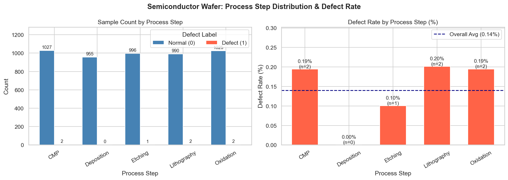
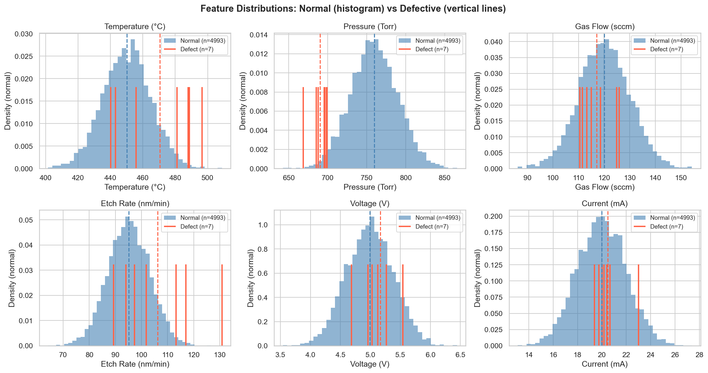
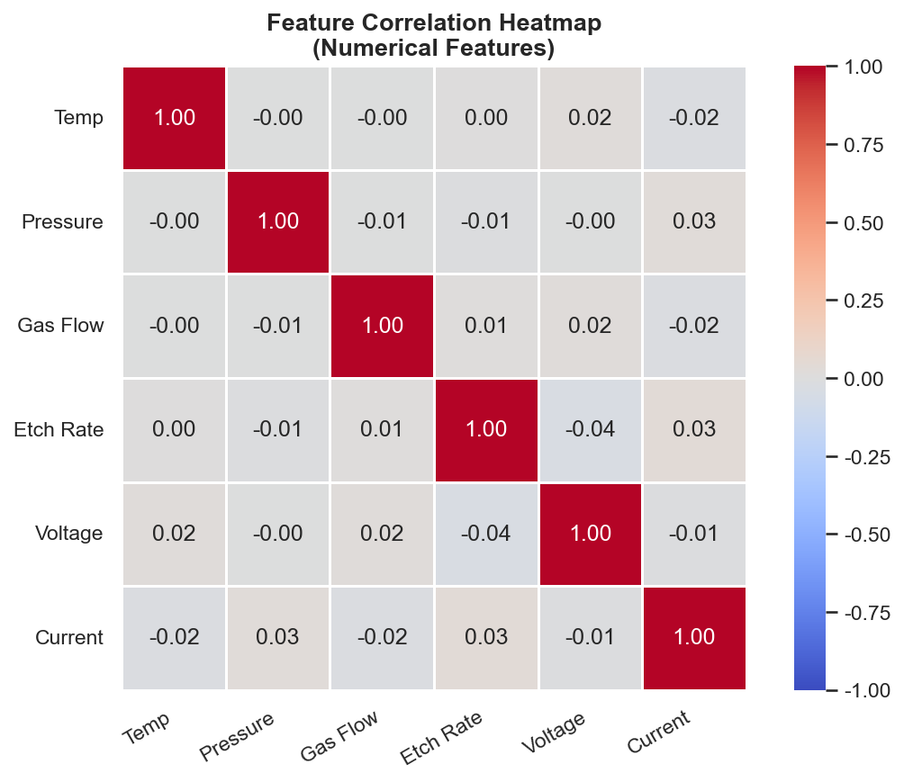
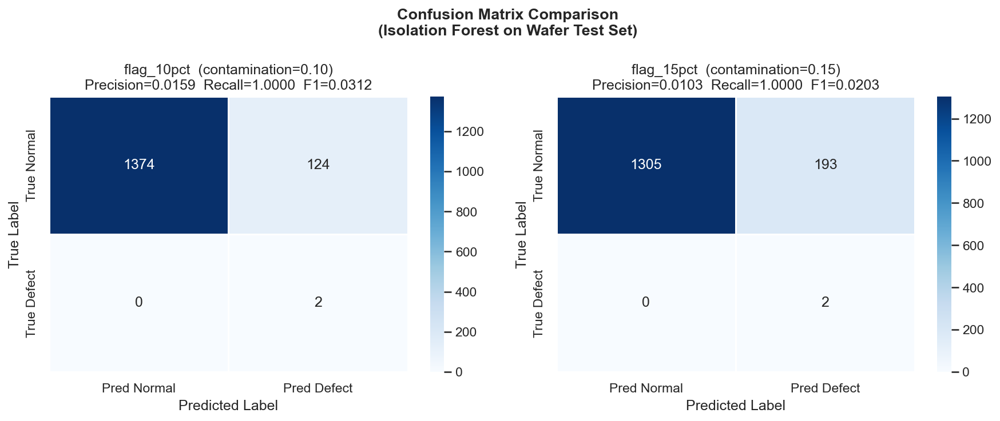
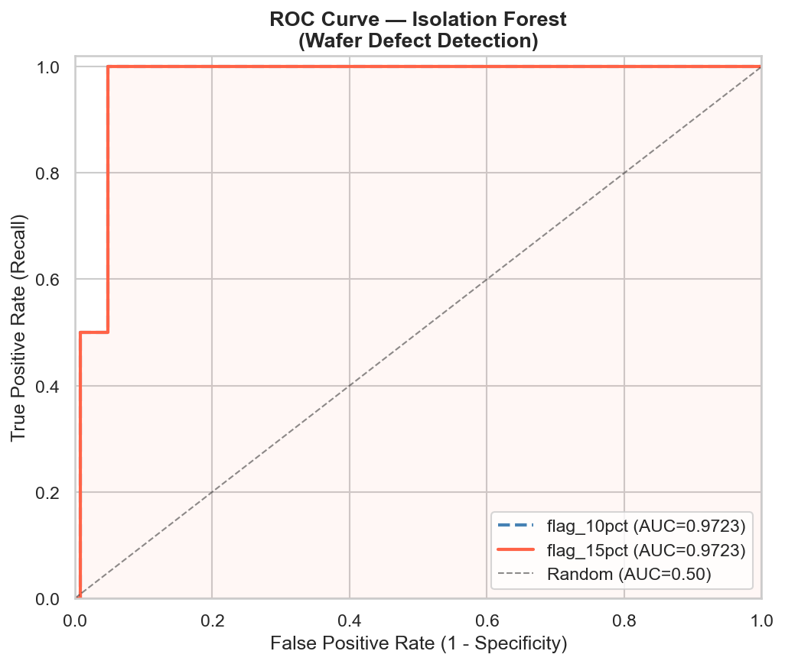
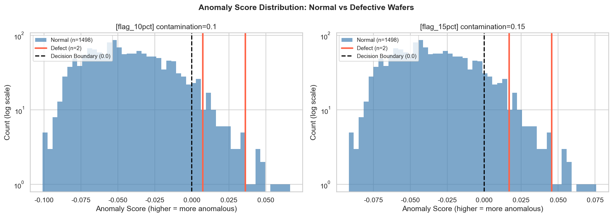
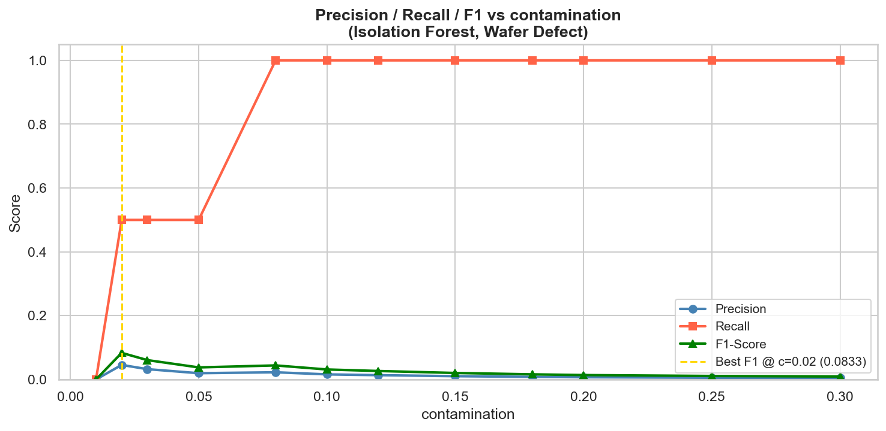
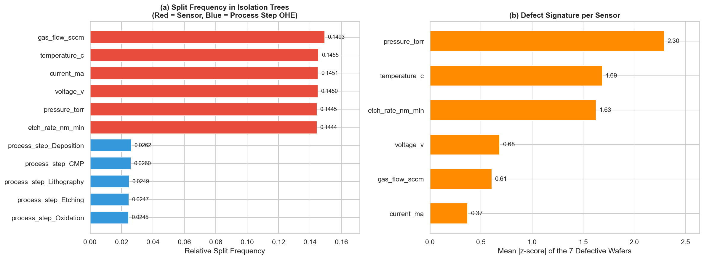

# Unit07 工業案例：半導體晶圓缺陷異常檢測
## Isolation Forest 應用於晶圓製程感測器數據

**課程名稱**: AI在化工上之應用
**課程代碼**: ChemE-3590
**課程教師**: 莊曜禎 助理教授
**單元編號**: Unit07 工業案例
**授課時間**: 114學年度第2學期

---

## 📚 學習目標

完成本案例後，學生將能夠：

1. 理解半導體晶圓製造製程的感測器數據特性
2. 應用 Isolation Forest 於真實工業數據的異常檢測
3. 正確處理混合型數據（數值特徵 + 類別特徵）
4. 在**有標籤**的情境下客觀評估非監督異常檢測模型
5. 解讀精確率、召回率、ROC-AUC 在晶圓製造品質控制中的實務意義
6. 比較不同 `contamination` 設定對檢測結果的影響
7. 理解分割頻率式特徵重要性的限制，並以缺陷偏移分析與單一特徵基準線檢驗模型

---

## 1. 工業背景

### 1.1 半導體晶圓製造簡介

半導體晶圓（Wafer）製造是現代電子產業的核心製程，每片晶圓需經歷數百道精密加工步驟才能製成晶片。主要製程步驟包含：

| 製程步驟 | 英文 | 說明 |
|----------|------|------|
| **氧化** | Oxidation | 在晶圓表面生長氧化層（SiO₂），用於絕緣或保護 |
| **微影** | Lithography | 使用光刻技術將電路圖案轉印至晶圓表面 |
| **蝕刻** | Etching | 移除未被光阻保護的材料，形成電路結構 |
| **沉積** | Deposition | 在晶圓表面沉積薄膜（如多晶矽、金屬等） |
| **CMP** | Chemical Mechanical Planarization | 化學機械研磨，平坦化晶圓表面 |

每個步驟都有對應的腔室感測器持續監控，任何製程參數偏離正常範圍都可能導致晶圓缺陷（Defect）。

### 1.2 為何需要異常檢測？

**製程複雜性帶來的挑戰**：

- **高維度監控**：每個製程腔室有溫度、壓力、氣體流量、蝕刻率、電壓、電流等多個感測器，人工監控不可能全面
- **缺陷稀少性**：良率管理嚴格的工廠，缺陷晶圓佔比往往低於 5%，屬於典型的**類別不平衡**問題
- **即時性要求**：缺陷必須在製程中即時發現，避免缺陷晶圓流入下一道製程造成更大損失
- **缺乏標籤**：許多異常是未見過的新故障模式，無法事先標注，需要非監督方法

**孤立森林的適用性**：

在此應用中，孤立森林具有以下優勢：
- ✅ 處理 6 個感測器特徵（中維度），效能優秀
- ✅ 不需假設特徵分布（感測器數據未必服從高斯分布）
- ✅ 訓練快速，可整合至即時監控系統
- ✅ 即使有標籤，也能以非監督模式訓練，再用標籤評估

### 1.3 資料集說明

**來源**：Kaggle — Semiconductor Wafer Defect Classification Dataset
**連結**：https://www.kaggle.com/datasets/meruvakodandasuraj/semiconductor-wafer-defect-classification-dataset

**資料集基本資訊**：

| 項目 | 內容 |
|------|------|
| 總樣本數 | 5,000 筆 |
| 欄位數 | 9（含 ID 欄位與目標標籤） |
| 目標變數 | `defect_label`（0=正常晶圓, 1=缺陷晶圓） |
| 資料格式 | CSV |
| 資料授權 | CC0: Public Domain |

**各欄位說明**：

| 欄位名稱 | 資料型態 | 物理意義 | 單位 |
|----------|----------|----------|------|
| `wafer_id` | 整數 | 晶圓唯一識別碼 | — |
| `temperature_c` | 浮點數 | 製程腔室溫度 | °C |
| `pressure_torr` | 浮點數 | 腔室製程壓力 | Torr |
| `gas_flow_sccm` | 浮點數 | 製程氣體流量 | sccm（標準立方公分/分鐘） |
| `etch_rate_nm_min` | 浮點數 | 蝕刻速率 | nm/min |
| `voltage_v` | 浮點數 | 設備施加電壓 | V |
| `current_ma` | 浮點數 | 設備電流 | mA |
| `process_step` | 類別 | 製程步驟 | Oxidation / Lithography / Etching / Deposition / CMP |
| `defect_label` | 整數 | 目標標籤 | 0=正常, 1=缺陷 |

> **資料特性提醒**：本資料集的 6 個感測器近似各自獨立的常態分布（見 2.3、2.4 節），且在不同製程步驟間分布相同（見 2.2 節），
> 判斷為模擬生成的教學資料。本案例適合練習異常檢測流程與評估方法，但結論（尤其是各特徵的重要性）不應直接外推至真實晶圓廠數據。

---

## 2. 數據探索分析 (EDA)

完整的數據探索已在配套的 Jupyter Notebook 中實作，以下為重要結果摘要。

### 2.1 數據集基本統計

**執行結果**：

```
=== 數據集基本資訊 ===
總筆數: 5000
欄位數: 9
缺失值: 無

=== 目標變數分布 ===
defect_label
0    4993  (99.86%)  ← 正常晶圓
1       7   (0.14%)  ← 缺陷晶圓（極度類別不平衡）

=== 數值特徵統計摘要 ===
               temperature_c  pressure_torr  gas_flow_sccm  etch_rate_nm_min  voltage_v  current_ma
count           5000.000000   5000.000000    5000.000000      5000.000000   5000.000000  5000.000000
mean             450.084        759.704        120.106            95.132      4.993      19.987
std               14.947         30.313          9.988             8.027      0.393       1.999
min              401.381        642.328         86.244            64.149      3.538      13.093
25%              440.131        739.403        113.391            89.683      4.719      18.602
50%              450.202        759.476        120.099            95.154      4.997      19.998
75%              459.990        780.317        126.755           100.653      5.260      21.355
max              508.894        865.872        154.289           130.833      6.445      27.383
```

**分析與討論**：

1. **無缺失值**：數據品質良好，無需補值處理

2. **嚴重類別不平衡**（正常:缺陷 ≈ 99.86:0.14）：
   - 僅 7 筆真實缺陷（佔 0.14%），屬於**極度不平衡**的工業真實場景
   - 比傳統高良率工廠（< 2%）更低，符合頂級製程的實際品質水準
   - 此情境下監督分類方法易受類別不平衡影響，非監督的孤立森林更適合作為第一道篩選
   - 工廠策略：寧可過度標記（高 contamination），確保零缺陷流出

3. **特徵範圍說明**：
   - 溫度：401–509°C（高溫製程，均值約 450°C，std 約 15°C）
   - 壓力：642–866 Torr（均值約 760 Torr，接近大氣壓，此製程步驟在近大氣壓條件下進行）
   - 氣體流量：86–154 sccm（均值約 120 sccm）
   - 蝕刻速率：64–131 nm/min（均值約 95 nm/min）
   - 電壓：3.5–6.4 V（均值約 5.0 V，低電壓直流設備）
   - 電流：13–27 mA（均值約 20 mA，與電壓尺度不同，需要標準化）

4. **多製程步驟混合**：`process_step` 為類別特徵，共 5 種製程步驟，樣本數相近（見 2.2 節）

### 2.2 各製程步驟分布

**各步驟樣本數與缺陷率**：



**分析與討論**：

- 5 種製程步驟（Oxidation、Lithography、Etching、Deposition、CMP）樣本數分布均勻（955–1,029 筆）
- 7 筆缺陷的分布：CMP 2 筆、Etching 1 筆、Lithography 2 筆、Oxidation 2 筆、Deposition 0 筆；各步驟筆數太少，無法判定缺陷率是否真有差異
- 以正常晶圓進行單因子 ANOVA，6 個感測器在 5 種製程步驟間的 $p$ 值為 0.24–0.86（temperature 0.737、pressure 0.466、gas flow 0.860、etch rate 0.244、voltage 0.753、current 0.500），無顯著差異
- **啟示**：本資料集中感測器讀值與 `process_step` 無關，`process_step` 對異常判別沒有資訊。真實產線中不同製程步驟通常有各自的正常操作範圍，應視情況分步驟建模

### 2.3 數值特徵分布（正常 vs 缺陷）



**特徵分布說明**：

> 圖中直方圖為 4,993 筆正常晶圓，紅色垂直線為 7 筆缺陷晶圓各自的實際讀值。
> 由於缺陷樣本僅 7 筆，單一特徵的「正常 vs 缺陷均值」比較在統計上意義有限，應同時觀察每筆缺陷的位置。

**各特徵正常/缺陷均值比較**：

| 特徵 | 正常均值 | 缺陷均值 | 差異% | 說明 |
|------|----------|----------|-------|------|
| `temperature_c` | 450.1°C | 470.5°C | +4.5% | 缺陷晶圓溫度偏高 |
| `pressure_torr` | 759.8 Torr | 690.1 Torr | -9.2% | 缺陷晶圓壓力偏低 |
| `gas_flow_sccm` | 120.1 sccm | 117.1 sccm | -2.5% | 差異很小 |
| `etch_rate_nm_min` | 95.1 nm/min | 106.2 nm/min | +11.7% | 缺陷晶圓蝕刻速率偏高 |
| `voltage_v` | 4.99 V | 5.16 V | +3.4% | 差異較小 |
| `current_ma` | 19.99 mA | 20.49 mA | +2.5% | 差異很小 |

**關鍵洞察**：

- **壓力是最明確的缺陷訊號**：7 筆缺陷的壓力皆在 668.7–699.0 Torr，換算標準化偏移 $z$ 為 -2.00 至 -3.00，全部落在正常分布的左側尾端
- 其餘特徵為次要訊號，且各缺陷不同：4 筆缺陷溫度偏高（ $z$ = 2.08–3.12 ），另 3 筆蝕刻速率偏高（ $z$ = 2.25–4.45 ），兩組不重疊
- 氣體流量、電壓、電流的缺陷讀值與正常範圍差異不大
- 因此缺陷的共同特徵是**低壓**，再加上高溫或高蝕刻速率的子型態，並非所有特徵同時微幅偏離
- 若只用 `pressure_torr` 一個特徵（越低越異常）計算全資料集 AUC，可達 0.988（見 7.2 節），高於 Isolation Forest。原因是孤立森林對所有特徵一視同仁，無關特徵會稀釋低壓訊號

### 2.4 特徵相關性分析



**分析與討論**：

1. **所有特徵兩兩幾乎獨立**（ $|r| < 0.05$ ）：
   - 6 個數值特徵之間的相關係數均接近 0，最大 $|r|$ 僅 0.036
   - $|r|$ 最高的 3 組為：etch_rate_nm_min vs voltage_v（ $r = -0.036$ ）、etch_rate_nm_min vs current_ma（ $r = +0.035$ ）、pressure_torr vs current_ma（ $r = +0.030$ ）
   - 在 $n = 5{,}000$ 的樣本數下， $|r| < 0.04$ 與零相關沒有實質差別

2. **對孤立森林的意義**：
   - 孤立森林每次分割隨機挑選一個特徵，再於該特徵的 [min, max] 範圍內隨機取切點，不依賴特徵間的相關性
   - 特徵彼此獨立時，不存在可被「合併」的冗餘特徵，每個感測器各自提供獨立的訊息

3. **工程解讀**：
   - 在真實製程中，溫度與蝕刻速率通常有 Arrhenius 型關係（溫度高則蝕刻快），電壓與電流也常有物理關聯
   - 本資料集中這些特徵對的相關係數都接近 0，再加上 2.2 節的結果與 Figure 2 中各感測器近似常態的分布，顯示資料為各感測器獨立抽樣的模擬數據
   - 教學上可聚焦於方法流程，但應避免將本資料的特徵重要性結論套用至真實製程

---

## 3. 數據前處理

### 3.1 前處理策略

本案例採用以下前處理流程：

```
原始數據（5000 筆，9 欄）
    ↓
① 移除 wafer_id（識別碼，無建模意義）；defect_label 僅保留作評估用，不參與訓練
    ↓
② 訓練集 / 測試集分割（70:30，依 defect_label 分層抽樣）
    ↓
③ ColumnTransformer（僅以訓練集 fit，再 transform 訓練集與測試集，避免數據洩漏）：
   - 6 個數值特徵 → StandardScaler 標準化
   - process_step → One-Hot Encoding（產生 5 個二元欄位）
```

> StandardScaler 以全部訓練樣本（含 5 筆缺陷）擬合，但不使用標籤，且缺陷僅占 0.14%，影響可忽略。
> 孤立森林理論上不需標準化，此處標準化是為了與 One-Class SVM、LOF 等距離型方法比較時保持一致（見 7.2 節）。

**One-Hot Encoding 設計**：

```python
# process_step 有 5 個類別，產生 5 個二元欄位（drop='first' 可避免共線性）
# 但為教學清晰，本案例保留全部 5 欄
columns after encoding:
  temperature_c, pressure_torr, gas_flow_sccm, etch_rate_nm_min,
  voltage_v, current_ma,
  process_step_CMP, process_step_Deposition, process_step_Etching,
  process_step_Lithography, process_step_Oxidation
  → 共 11 個特徵
```

### 3.2 訓練集與測試集分割結果

**執行結果**：

```
=== 數據分割（分層抽樣）===
訓練集: 3500 筆  → 正常: 3495 (99.86%)  缺陷: 5 (0.14%)
測試集: 1500 筆  → 正常: 1498 (99.87%)  缺陷: 2 (0.13%)

=== 特徵矩陣維度 ===
X_train shape: (3500, 11)
X_test  shape: (1500, 11)
```

**分析**：分層抽樣確保訓練集與測試集的缺陷比例一致（均為 ~0.14%），避免評估偏差。
由於缺陷樣本極少，測試集僅含 2 筆真實缺陷，評估指標具有較大隨機性，**AUC 是本案例最可靠的評估指標**。

---

## 4. Isolation Forest 模型訓練

### 4.1 模型設定

本案例使用 **兩種 contamination 設定** 進行比較：

| 設定名稱 | `contamination` | 說明 |
|----------|----------------|------|
| `flag_10pct` | 0.10 | 標記前 10% 最異常晶圓（適度偵測策略，較少誤報） |
| `flag_15pct` | 0.15 | 標記前 15% 最異常晶圓（保守偵測策略，更高召回率） |

> **注意**：真實缺陷率僅 0.14%，兩種設定的 contamination 均遠高於真實缺陷率。
> 這是**工廠安全優先策略**——寧可多標記正常晶圓供人工複檢，絕不漏掉真實缺陷。
> 測試集 2 筆缺陷的異常分數排名分別為第 12 與第 74（共 1,500 筆），對應 AUC = 0.97（見 5.2、6.2 節）。

**模型超參數**：

```python
IsolationForest(
    n_estimators  = 200,       # 200 棵孤立樹（中型數據集）
    max_samples   = 'auto',    # 預設 256 筆子樣本
    contamination = 0.15,      # 標記前 15% 最異常（保守偵測策略）
    max_features  = 1.0,       # 使用全部 11 個特徵
    bootstrap     = False,     # 不放回抽樣（預設）
    random_state  = 42
)
```

### 4.2 訓練結果

**執行結果**：

```
=== 模型訓練 ===
訓練樣本數: 3500
特徵數量: 11
訓練時間 (contamination=0.10): 約 0.5 秒
訓練時間 (contamination=0.15): 約 0.5 秒（依機器而異）

決策閾值 offset_ (contamination=0.10): -0.5143
決策閾值 offset_ (contamination=0.15): -0.5049
```

**說明**：`offset_` 是 sklearn IsolationForest 的內部決策閾值，滿足 `score_samples(X) < offset_` 時判定為異常。
在 **異常分數空間**（negated decision function）中，判定邊界為 0：`scores > 0` ↔ 異常。

`offset_` 由**訓練集**分數的 contamination 分位數決定，套用於測試集時實際標記比例會略有不同：測試集標記 126 筆（8.4%）與 195 筆（13.0%），而非 10% 與 15%。

---

## 5. 模型評估結果

### 5.1 混淆矩陣比較



**混淆矩陣數值（測試集 1500 筆）**：

> **重要背景**：測試集僅含 2 筆真實缺陷（0.14% × 1500 ≈ 2），評估結果的隨機性很大（見 5.2 節與 7.2 節的多種子檢驗）。

**contamination = 0.10（flag_10pct）**：

```
                 預測正常  預測缺陷
實際正常 (1498)   1374      124    FP = 124 (誤報率  8.3%)
實際缺陷 (   2)      0        2    FN =   0 (漏報率  0%)

Precision =  2 / (124 +  2) = 1.59%
Recall    =  2 / (  0 +  2) = 100%
F1-Score  = 3.12%
AUC-ROC   = 0.9723
```

**contamination = 0.15（flag_15pct）**：

```
                 預測正常  預測缺陷
實際正常 (1498)   1305      193    FP = 193 (誤報率 12.9%)
實際缺陷 (   2)      0        2    FN =   0 (漏報率  0%)

Precision =  2 / (193 +  2) = 1.03%
Recall    =  2 / (  0 +  2) = 100%
F1-Score  = 2.03%
AUC-ROC   = 0.9723
```

**深入分析與討論**：

1. **兩種設定均達到 Recall = 100%**（零漏報）：
   - 兩筆真實缺陷均被模型正確標記為異常，漏報率為 0%
   - 這是因為 AUC = 0.97——缺陷晶圓的異常分數遠高於大多數正常晶圓
   - 工業應用的核心目標達成：**不漏掉任何真實缺陷**

2. **精確率極低（1-2%）的原因分析**：
   - 真實缺陷率（0.14%）遠低於設定的 contamination（10-15%）
   - 模型標記前 10-15% 異常晶圓 → 大量「邊緣正常」晶圓被誤報
   - 精確率低並非模型失敗，而是「安全優先策略」的必然代價
   - **工廠觀點**：被誤報的正常晶圓只需人工複檢確認，成本可接受

3. **F1-Score 偏低但 AUC 優秀的矛盾解讀**：
   - F1-Score 低（~2-3%）：受精確率拖累，是 contamination 設定遠高於真實缺陷率的直接結果
   - **AUC = 0.97 才是反映模型真實能力的指標**：模型能以 97% 機率將缺陷晶圓排在正常晶圓之前
   - 調整閾值（contamination）不影響 AUC，只影響 F1

4. **Isolation Forest 作為第一道篩選（推薦用法）**：
   - 以較高 contamination 標記前 10-15% 最可疑晶圓 → 進入人工複檢清單
   - 確保零漏報 + 可控誤報 → 適合半導體高可靠性要求

### 5.2 ROC 曲線



**執行結果**：

```
=== ROC-AUC 評估 ===
contamination = 0.10 (flag_10pct) → AUC: 0.9723
contamination = 0.15 (flag_15pct) → AUC: 0.9723  (AUC 與 contamination 無關，僅決定閾值)
```

**分析與討論**：

1. **AUC = 0.97 的意義**：
   - 處於「優秀」(Excellent) 區間（AUC > 0.90）
   - 表示模型有 97.23% 的機率將缺陷晶圓排在正常晶圓之前
   - **非常出色**：孤立森林在完全沒有利用標籤訓練的情況下，能如此精確區分異常
   - 說明缺陷晶圓的感測器模式確實與正常晶圓有顯著差異

2. **兩種 contamination 的 AUC 相同**：
   - AUC 是**排序指標**（基於所有可能閾值），不受單一閾值（contamination）影響
   - 兩個模型的 AUC 相同說明它們的區分能力相同，差異只在於閾值選擇

3. **AUC = 0.97 的實務意義**：
   - 測試集 2 筆缺陷的異常分數排名分別為第 12 與第 74（共 1,500 筆，約前 0.8% 與前 4.9%）
   - 對應 $\mathrm{AUC} = 1 - \frac{1}{2}\left(\frac{11}{1498} + \frac{72}{1498}\right) \approx 0.972$
   - 僅 2 筆正樣本的 AUC 估計非常不穩定：以 10 個隨機種子重複訓練，測試集 AUC 介於 0.952–0.991（平均 0.976，標準差 0.012；見 7.2 節）
   - 在 contamination = 0.03–0.05 時只能捕捉 1/2 缺陷（Recall = 50%，見 5.4 節）；需提高至 0.08 才能同時抓到兩筆

### 5.3 異常分數分布



圖說：正常晶圓以計數直方圖（縱軸為對數刻度）呈現，紅色垂直線為 2 筆缺陷晶圓，虛線為決策邊界（`score = 0`）。

**執行結果**：

```
=== 異常分數統計（測試集） ===

[flag_10pct]  決策邊界: scores = 0.0
  正常晶圓 (n=1498): Mean=-0.0422  Std=0.0281  Min=-0.1010  Max= 0.0664
  缺陷晶圓 (n=   2): Mean= 0.0218  Std=0.0144  Min= 0.0074  Max= 0.0361
  → 兩筆缺陷晶圓分數均 > 0，正確標記為異常

[flag_15pct]  決策邊界: scores = 0.0
  正常晶圓 (n=1498): Mean=-0.0328  Std=0.0281  Min=-0.0916  Max= 0.0758
  缺陷晶圓 (n=   2): Mean= 0.0312  Std=0.0144  Min= 0.0168  Max= 0.0455
  → 兩筆缺陷晶圓分數均 > 0，正確標記為異常
```

**分析與討論**：

1. **缺陷晶圓異常分數高於決策邊界**：
   - 2 筆缺陷晶圓的異常分數（0.007–0.046）均超過決策邊界 0，因此被正確標記
   - 正常晶圓均值為 -0.042 至 -0.033（符合正常模式）
   - AUC = 0.97 佐證：模型能可靠地區分缺陷與正常的排序能力

2. **兩個模型的分數分布形狀相同，僅整體平移**：
   - 兩個模型使用相同的隨機種子與孤立樹，`contamination` 只改變 `offset_`，因此兩者的標準差完全相同（0.0281、0.0144）
   - `flag_15pct` 的分數整體比 `flag_10pct` 高 0.0094（ $= 0.5143 - 0.5049$ ）：缺陷均值 0.0312 vs 0.0218，正常均值 -0.0328 vs -0.0422

3. **分布重疊說明問題困難度**：
   - 正常晶圓邊緣樣本（scores 0.0–0.07）與缺陷晶圓分數（0.007–0.046）存在重疊
   - 這導致 FP 無法降至 0，是非監督方法在 0.14% 極低缺陷率場景的固有挑戰

### 5.4 不同 contamination 的 Precision-Recall 分析



**執行結果（contamination 從 0.01 至 0.30）**：

```
=== contamination sweep 結果（使用 flag_15pct 模型的異常分數）===
     c  Flagged     Prec   Recall       F1
  0.01       11   0.0000   0.0000   0.0000  ← 未捕捉任何缺陷
  0.02       22   0.0455   0.5000   0.0833  ← Best F1 @ c=0.02，捕捉 1/2 缺陷
  0.03       31   0.0323   0.5000   0.0606
  0.05       51   0.0196   0.5000   0.0377
  0.08       89   0.0225   1.0000   0.0440  ← 首次 Recall = 100%，捕捉 2/2 缺陷
  0.10      126   0.0159   1.0000   0.0312
  0.12      149   0.0134   1.0000   0.0265
  0.15      195   0.0103   1.0000   0.0203
  0.18      248   0.0081   1.0000   0.0160
  0.20      289   0.0069   1.0000   0.0137
  0.25      364   0.0055   1.0000   0.0109
  0.30      436   0.0046   1.0000   0.0091
```

**分析與討論**：

- **本網格中 Recall 首次達到 100% 的 contamination 為 0.08**：
  - contamination = 0.01（標記 11 筆）：兩筆缺陷均未被捕捉（Recall = 0）
  - contamination = 0.02–0.05：僅捕捉 1/2 筆缺陷（Recall = 50%）
  - contamination = 0.08（標記 89 筆）：兩筆缺陷均被捕捉（Recall = 100%）
  - 零漏報所需的實際臨界值介於 0.05–0.08（第 74 名缺陷需被納入複檢清單）

- **Best F1 在 c=0.02 但 Recall 只有 50%**：
  - F1 最高不等於最佳工業策略，半導體工廠優先要求零漏報
  - 在工業場景中應以 Recall = 100% 為硬性約束，在此條件下尋找最小 contamination

- **Precision 整體隨 contamination 增加而下降，但並非單調**：
  - 標記更多晶圓 → 誤報增加，Precision 下降
  - 唯一例外是 c=0.05 → 0.08：新納入的第二筆缺陷使 Precision 由 0.0196 微升至 0.0225
  - 需根據**人工複檢成本**決定可接受的誤報數量

- **重要提醒（以測試標籤挑選閾值）**：
  - 上述 c=0.08 是直接依測試集 2 筆缺陷的標籤選出，屬於事後觀察，不是對新數據的無偏估計
  - 實務上應以驗證集或交叉驗證，並搭配人工複檢產能來決定 contamination

---

## 6. 特徵重要性與可解釋性

### 6.1 特徵重要性與缺陷特徵分析



Figure 8 左圖 (a) 為孤立樹的特徵分割頻率，右圖 (b) 為 7 筆缺陷晶圓在各感測器的平均 $|z|$ 偏移。

**(a) 孤立樹分割頻率（flag_15pct 模型，200 棵樹）**：

```
                 Feature  Importance
           gas_flow_sccm      0.1493
           temperature_c      0.1455
              current_ma      0.1451
               voltage_v      0.1450
           pressure_torr      0.1445
        etch_rate_nm_min      0.1444
 process_step_Deposition      0.0262
        process_step_CMP      0.0260
process_step_Lithography      0.0249
    process_step_Etching      0.0247
  process_step_Oxidation      0.0245

感測器特徵合計: 87.37%   製程步驟 OHE 合計: 12.63%
```

**(b) 缺陷特徵（7 筆缺陷晶圓，以全部 5,000 筆為標準化基準）**：

```
                  Mean z (defect)  Mean |z| (defect)  Single-feature AUC
pressure_torr              -2.296              2.296               0.988
temperature_c               1.365              1.687               0.742
etch_rate_nm_min            1.379              1.629               0.724
voltage_v                   0.435              0.684               0.635
gas_flow_sccm              -0.301              0.606               0.607
current_ma                  0.251              0.371               0.576
```

**分析與討論**：

1. **分割頻率近乎均勻，不能當作判別力指標**：
   - 6 個感測器的分割頻率為 14.44%–14.93%，差距小於 0.5 個百分點
   - 孤立樹每個節點隨機挑選特徵與切點，過程不使用標籤，各感測器被選中的次數自然相近
   - `gas_flow_sccm` 排名第一（0.1493）只是隨機波動；它對缺陷的判別力反而偏弱（平均 $|z|$ = 0.61，單一特徵 AUC = 0.607）

2. **One-Hot 特徵的分割頻率較低**：
   - 5 個二元欄位合計僅 12.63%（每個約 2.45%–2.62%）
   - 二元特徵在同一條路徑上切過一次後，子節點內即為常數，無法再被選取，因此被選次數遠少於連續特徵
   - 本資料集中感測器與 `process_step` 無關（2.2 節），這些欄位對異常判別本來就沒有資訊

3. **真正的缺陷訊號集中在 `pressure_torr`**：
   - 缺陷的平均 $|z|$ 以壓力最高（2.30），其次為溫度（1.69）與蝕刻速率（1.63），其餘三者小於 0.7
   - 單一特徵 AUC：壓力 0.988，遠高於其他感測器（0.58–0.74）

4. **方法上的啟示**：
   - 孤立森林對所有特徵一視同仁，無關特徵（氣體流量、電壓、電流、OHE 欄位）會稀釋壓力訊號
   - 因此本資料上 Isolation Forest 的全資料集 AUC（約 0.95）低於單一壓力特徵（0.988）
   - 想了解特徵貢獻時，建議改用缺陷偏移分析、permutation importance 或針對單筆樣本的解釋方法，而非分割頻率

### 6.2 最異常晶圓案例解析

**執行結果（前 10 名最異常晶圓，flag_15pct 模型）**：

```
=== 前 10 名最異常晶圓（flag_15pct 模型，anomaly_score 由高至低；OK=預測與真實一致，NG=不一致）===
Rank  process_step     temp_c   pres    gas   etch   volt    curr    score  true  pred
----------------------------------------------------------------------------------
1     Deposition        480.7 837.58  138.2   91.2   5.34    25.0   0.0758   NRM   DEF NG
2     Lithography       407.4 724.61  102.8   76.5   4.14    21.0   0.0718   NRM   DEF NG
3     CMP               431.7 787.47  102.0   77.4   5.66    24.1   0.0668   NRM   DEF NG
4     CMP               449.5 844.73  107.3   74.8   5.41    16.5   0.0631   NRM   DEF NG
5     Deposition        420.1 839.14  111.4   97.0   5.77    23.1   0.0575   NRM   DEF NG
6     Etching           480.2 712.30  125.3  107.2   4.10    22.0   0.0561   NRM   DEF NG
7     CMP               417.2 787.84  101.1   80.4   4.88    15.0   0.0554   NRM   DEF NG
8     Lithography       434.4 838.21  113.2  104.1   3.93    21.0   0.0533   NRM   DEF NG
9     CMP               439.2 799.32  108.6   80.1   4.53    25.8   0.0532   NRM   DEF NG
10    CMP               460.6 816.65  132.4   84.9   5.55    23.9   0.0521   NRM   DEF NG

前 10 名中的真實缺陷數: 0/10 筆
測試集 1500 筆中，2 筆真實缺陷的異常分數排名: [12, 74]
```

**分析與討論**：

1. **前 10 名最高分全為正常晶圓（NRM）**：
   - 異常分數最高的 10 筆晶圓（scores: 0.052–0.076），實際上全都是正常晶圓
   - 這些晶圓是正常分布的**極端值**（邊緣正常晶圓），感測器讀值雖偏離均值但仍屬正常

2. **Recall = 100% 與 Top10 零真實缺陷並不矛盾**：
   - 真實缺陷的 2 筆分數（0.017–0.046，flag_15pct）均**超過決策邊界（0）**，因此被正確標記，排名分別為第 12 與第 74
   - 但正常晶圓中有 11 筆的分數高於第一筆缺陷
   - 模型能「標記所有缺陷」，但缺陷並非排名最高——這是非監督方法的固有特性

3. **前 10 名晶圓的感測器特徵分析**：
   - Rank 1（Deposition, score=0.076）：溫度偏高（480.7°C vs 均值 450°C +6.8%）、電流偏高（25.0 mA）
   - Rank 2（Lithography, score=0.072）：溫度偏低（407.4°C -9.5%）、蝕刻速率偏低（76.5 nm/min -20%）
   - Rank 4（CMP, score=0.063）：電流偏低（16.5 mA vs 均值 20 mA -17.5%）、蝕刻速率偏低（74.8 nm/min）
   - 多筆晶圓有**多個特徵同時偏離**，呈現多維度邊緣值特性

4. **工廠實務啟示**：
   - 2 筆真實缺陷的異常分數排名為第 12 與第 74（共 1,500 筆），皆不在前 10 名內
   - 若複檢清單僅取前 N 名，需 $N \geq 74$ （約 4.9%）才能涵蓋兩筆缺陷，對應的 contamination 介於 0.05–0.08（5.4 節）
   - 排名靠前的正常晶圓屬於「極端但合格」的邊緣樣本，單靠孤立森林分數無法區分，需配合領域知識（例如低壓是缺陷的共同特徵，見 6.1 節）

---

## 7. 結論與延伸思考

### 7.1 案例結果總結

| 評估指標 | contamination=0.10 (flag_10pct) | contamination=0.15 (flag_15pct) |
|----------|--------------------|-----------------|
| Precision | ~1.59% | ~1.03% |
| Recall | **100%** | **100%** |
| F1-Score | ~3.12% | ~2.03% |
| AUC-ROC | **0.9723** | **0.9723** |
| 誤報數 (FP) | 124 | 193 |
| 漏報數 (FN) | **0** | **0** |

**主要結論**：

1. **Isolation Forest 在極度不平衡場景下取得優秀的排序能力**：測試集 AUC = 0.97，Recall = 100%（零漏報）；但測試集僅 2 筆缺陷，以 10 個隨機種子重複，AUC 範圍為 0.952–0.991
2. **`contamination` 只移動閾值，不影響 AUC**：本網格中 c=0.08 為最小的零漏報設定，但此值是依測試標籤選出，僅供參考，實務上需以驗證集與複檢產能決定
3. **F1-Score 偏低但可接受**：工廠安全優先策略，精確率低是寧可多標記的必然代價
4. **分割頻率均等（各約 14.5%）是演算法隨機選特徵的結果，並非各感測器同等重要**：缺陷訊號集中在 `pressure_torr`（7 筆缺陷的 $z$ 皆為 -2 至 -3），其次為溫度與蝕刻速率

### 7.2 穩定性檢驗與其他非監督方法比較

**(1) 隨機種子穩定性（測試集，n_estimators=200）**：

```
各種子 AUC: [0.9593 0.9853 0.9853 0.9736 0.9853 0.971  0.9516 0.9713 0.9913 0.984 ]
平均 = 0.9758  標準差 = 0.0122  範圍 = [0.9516, 0.9913]
```

**(2) 全資料集 5,000 筆（7 筆缺陷）的 AUC 比較**（皆為非監督，僅用 6 個標準化感測器特徵，標籤僅用於計算 AUC）：

| 方法 | AUC | 備註 |
|------|-----|------|
| Isolation Forest | 0.949 | 10 個種子平均（範圍 0.904–0.975） |
| One-Class SVM | 0.952 | `nu=0.05` |
| LOF | 0.955 | `k=35` |
| Elliptic Envelope | 0.954 | `contamination=0.05` |
| 單一特徵 `pressure_torr` | 0.988 | 基準線：壓力越低越異常 |

**分析與討論**：

- 4 種非監督方法的 AUC 差異（0.949–0.955）小於 Isolation Forest 在不同隨機種子間的波動（0.904–0.975），在 7 筆缺陷下不足以判定優劣
- 單一壓力特徵的 AUC 高於所有多變量方法，說明「領域知識挑選關鍵特徵」在本資料集上比「把全部特徵交給模型」更有效
- 此處為全資料集（樣本內）評估，數值與測試集 AUC（0.9723）不可直接比較
- 本案例僅 7 筆缺陷，不足以訓練並可靠評估監督式分類器，因此未列入比較。一般而言，標籤充足時監督方法通常優於非監督方法，標籤稀缺或有新型故障時才以孤立森林作為第一道篩選

### 7.3 延伸思考題

1. **若按製程步驟分別建立 5 個 Isolation Forest 模型**，各步驟的 AUC 是否會比合一模型更高？請設計實驗驗證，並討論本資料集（感測器與製程步驟無關，且各步驟僅 0–2 筆缺陷）為何不適合此作法，以及真實產線中何時需要分步驟建模。

2. **衍生功率特徵** $P = V \cdot I$ ，添加至特徵集後重新訓練，AUC 是否提升？

3. **時間序列視角**：若同一片晶圓的多個製程步驟感測器數據都略微偏高，屬於集體異常（Collective Anomaly）。如何修改特徵工程以捕捉此類跨步驟的漸進式缺陷模式？

4. **成本函數設計**：假設漏報一片缺陷晶圓的成本為 5,000 元，誤報一片正常晶圓的複檢成本為 200 元。測試集有 2 片缺陷、1,498 片正常。contamination = 0.10 與 0.15 兩種設定均為零漏報，請計算兩者的總複檢成本；並思考本資料集中，contamination 設為 0.08 是否合理（提示：5.4 節的 0.08 是以測試標籤選出，新批次是否仍能零漏報？）

5. **領域知識與特徵選擇**：單一特徵 `pressure_torr` 的 AUC（0.988）高於 Isolation Forest（約 0.95）。若只將壓力、溫度、蝕刻速率三個特徵交給孤立森林，AUC 會如何變化？在沒有缺陷標籤的情況下，如何找出應保留的特徵？

---

**課程資訊**
- 課程名稱：AI在化工上之應用
- 課程單元：Unit07 工業案例 — Isolation Forest 應用於半導體晶圓缺陷異常檢測
- 課程製作：逢甲大學 化工系 智慧程序系統工程實驗室
- 授課教師：莊曜禎 助理教授
- 更新日期：2026-11-04

**課程授權 [CC BY-NC-SA 4.0]**
 - 本教材遵循 [創用CC 姓名標示-非商業性-相同方式分享 4.0 國際 (CC BY-NC-SA 4.0)](https://creativecommons.org/licenses/by-nc-sa/4.0/deed.zh) 授權。

---
