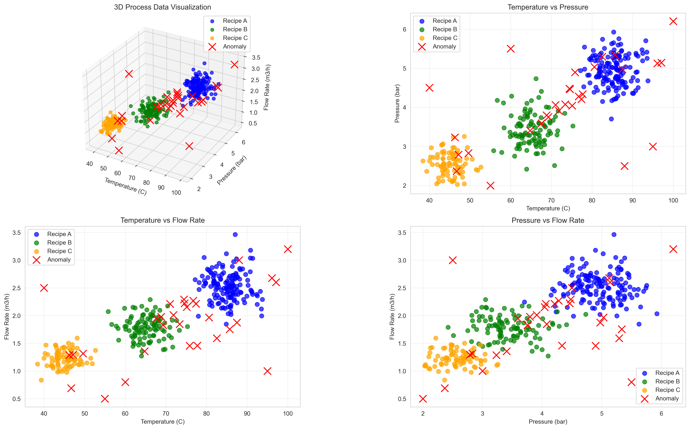
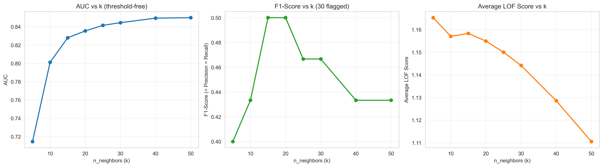
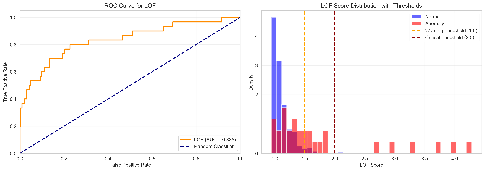
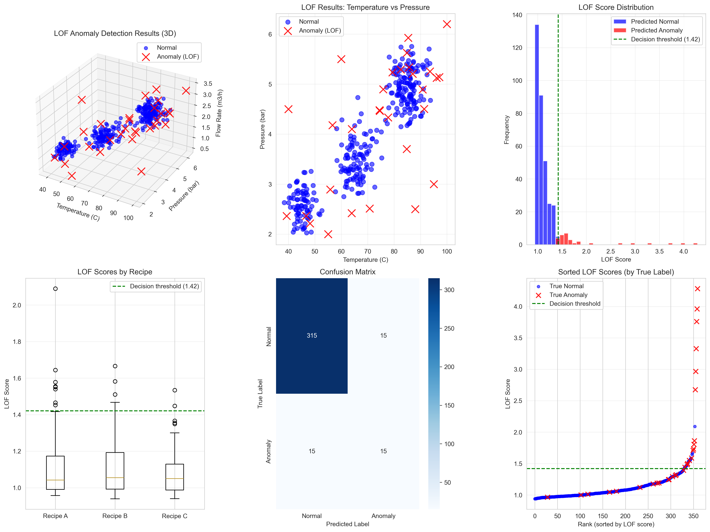
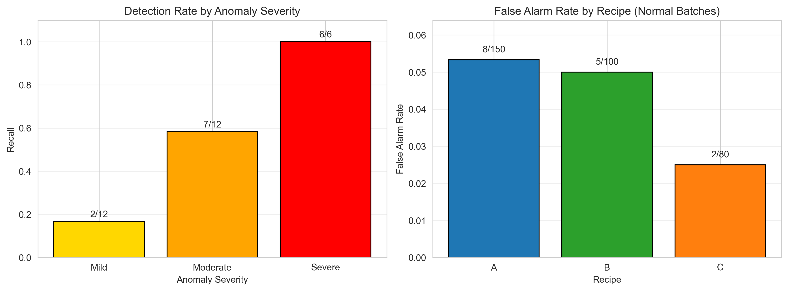
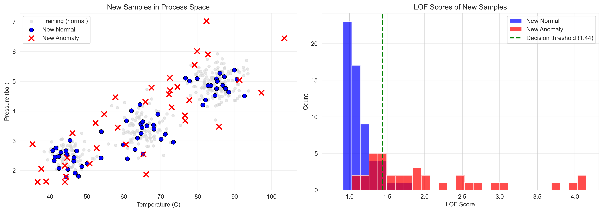
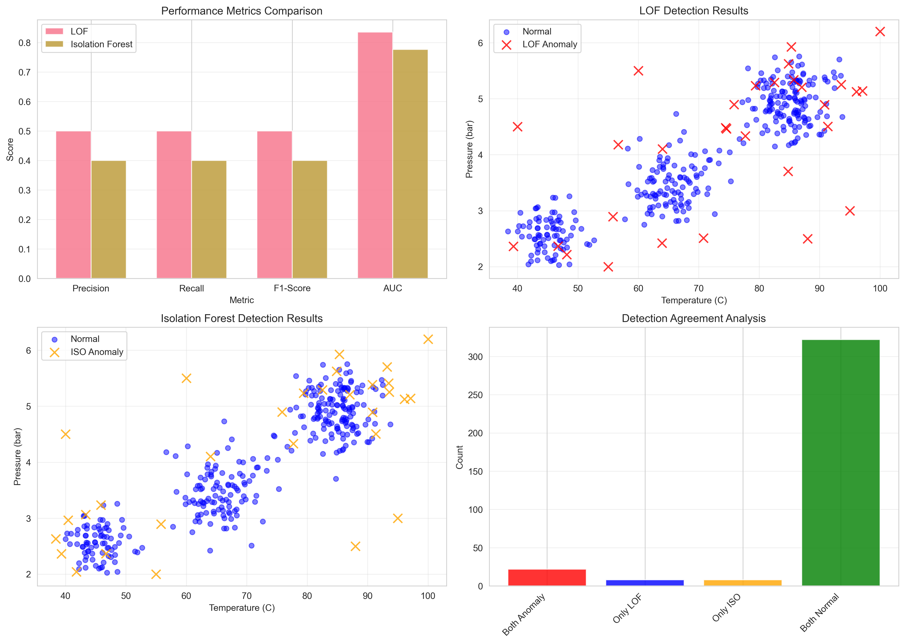
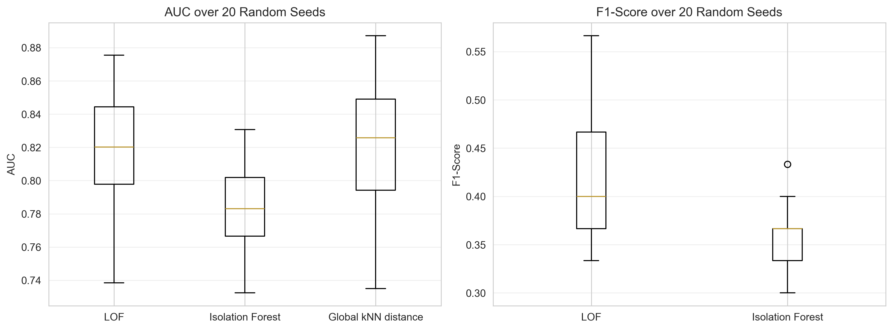
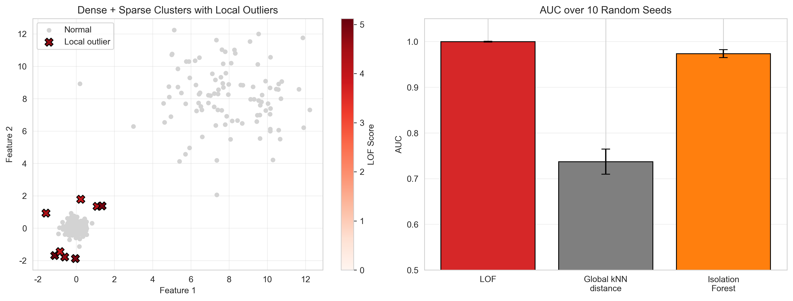

# Unit07 區域性離群因子 (Local Outlier Factor, LOF)

## 課程目標

本單元介紹區域性離群因子 (Local Outlier Factor, LOF) 異常檢測演算法。LOF 是一種基於密度的方法，特別適合處理不同區域密度不一致的數據。完成本單元後，您將能夠：

- 理解 LOF 演算法的核心原理與數學基礎
- 掌握 $k$-距離、可達距離、局部可達密度等關鍵概念，並能手算小範例
- 使用 scikit-learn 實作 LOF 模型（`novelty=False` 與 `novelty=True` 兩種模式）
- 設定關鍵超參數 `n_neighbors` 與 `contamination` ，並理解其影響
- 以 Precision、Recall、F1 與 AUC 評估異常檢測模型
- 客觀比較 LOF 與 Isolation Forest 的優缺點，認識 LOF 的適用場景
- 應用 LOF 於化工多模式（多配方）批次製程的異常監控

> **執行結果說明**
>
> 本講義的 Section 5.6、6.4、6.5 與 7 引用 `Unit07_LOF.ipynb` 的實際執行結果（模擬數據，隨機種子 `SEED = 42`）：
>
> - **內部異常檢測**（ $k = 20$ ）：Precision = Recall = F1 = 0.500，AUC = 0.835
> - **新穎性檢測**：Precision = 0.793，Recall = 0.639，F1 = 0.708，AUC = 0.924（測試集為人為設定的 36 筆異常，難度與上一項不同，兩者不可直接比較）
> - **LOF vs Isolation Forest**：單一數據集 AUC 為 0.835 對 0.777；20 組隨機種子平均 AUC 為 0.817 對 0.784，差距不大，且全域 kNN 距離（0.819）與 LOF 相當
> - **多密度玩具範例**：LOF 的 AUC 為 1.000，全域 kNN 距離為 0.737，Isolation Forest 為 0.973，局部密度的優勢在此才明顯
> - **10 張圖表**（300 DPI）存於 `outputs/P2_Unit07_LOF/figs/`
>
> 重新執行 Notebook 時，數字會與本講義一致（隨機種子固定）。

---

## 1. LOF 演算法簡介

### 1.1 什麼是 LOF？

區域性離群因子 (Local Outlier Factor, LOF) 是由 Markus M. Breunig 等人於 2000 年提出的一種基於密度的異常檢測演算法。其核心理念是：**異常點的局部密度明顯低於其鄰近點的局部密度**。

與全域異常檢測方法不同，LOF 能夠識別局部異常 (Local Outliers)，即使這些點在全域視角下可能看起來正常。這使得 LOF 特別適合處理具有不同密度區域的複雜數據分布。

### 1.2 核心理念：為什麼使用局部密度？

想像一個化工廠的製程數據：

- **正常操作區域 A**：高產量、高能耗，數據點密集
- **正常操作區域 B**：低產量、低能耗，數據點稀疏
- **異常點**：偏離任一區域的正常密度模式

傳統的全域異常檢測方法（如基於歐氏距離）可能會將區域 B 的正常點誤判為異常，因為它們遠離密集的區域 A。LOF 透過比較局部密度，能夠正確識別兩個區域內的正常點與異常點。

**LOF 的核心假設**：
1. 正常點周圍的鄰近點密度與自身密度相近
2. 異常點周圍的鄰近點密度明顯高於自身密度
3. 局部密度比全域密度更能反映數據的異常程度

### 1.3 化工領域應用案例

LOF 在化工領域特別適合以下場景：

1. **多模式操作製程監控**：
   - 反應器在不同負載下有不同的正常操作區域
   - 批次製程在不同階段具有不同的正常密度分布
   - 識別偏離當前操作模式的異常狀態
   - 避免跨模式的誤報問題

2. **非均勻密度的感測器數據**：
   - 某些操作條件下數據密集（常見狀態）
   - 某些操作條件下數據稀疏（罕見但正常）
   - 準確識別各區域內的真實異常
   - 適應製程的動態變化

3. **局部異常檢測**：
   - 某些感測器的局部異常（如溫度感測器局部過熱）
   - 特定時間段的製程偏移（如夜班操作異常）
   - 單一產品線的品質異常（在多產品工廠中）
   - 精準定位異常的空間與時間範圍

4. **設備群組健康監控**：
   - 不同設備有不同的正常運行模式
   - 新舊設備的性能差異
   - 識別單一設備的異常而非整體偏移
   - 實現個別化的設備監控策略

5. **品質控制中的局部缺陷檢測**：
   - 產品品質在不同批次間有正常變異
   - 識別單一批次內的局部異常樣本
   - 區分系統性偏移與隨機缺陷
   - 提高缺陷檢測的準確率

---

## 2. LOF 演算法原理

### 2.1 核心概念一：k-距離 (k-distance)

**定義**：對於數據點 $x_i$ ，其 $k$-距離 $d_k(x_i)$ 是 $x_i$ 到其第 $k$ 個最近鄰點的距離。

$$
d_k(x_i) = \text{distance}(x_i, x_i^{(k)})
$$

其中 $x_i^{(k)}$ 是 $x_i$ 的第 $k$ 個最近鄰點。

**意義**：
- $k$-距離衡量了點 $x_i$ 周圍的局部範圍
- $k$-距離越小，表示點 $x_i$ 越接近其鄰近點（密度較高）
- $k$-距離越大，表示點 $x_i$ 越遠離其鄰近點（密度較低）

**k-鄰域 (k-neighborhood)**：
點 $x_i$ 的 $k$-鄰域 $N_k(x_i)$ 包含所有與 $x_i$ 距離不大於 $d_k(x_i)$ 的點：

$$
N_k(x_i) = \{x_j \in D \mid \text{distance}(x_i, x_j) \leq d_k(x_i)\}
$$

注意： $|N_k(x_i)| \geq k$ （等號成立於無重複距離時）

### 2.2 核心概念二：可達距離 (Reachability Distance)

**定義**：點 $x_i$ 相對於點 $x_j$ 的可達距離定義為：

$$
\text{reach-dist}_k(x_i, x_j) = \max\{d_k(x_j), \text{distance}(x_i, x_j)\}
$$

**直觀解釋**：
- 如果 $x_i$ 在 $x_j$ 的 $k$-鄰域內，則可達距離為 $d_k(x_j)$ （固定值）
- 如果 $x_i$ 在 $x_j$ 的 $k$-鄰域外，則可達距離為實際距離

**引入可達距離的目的**：
1. **穩定性**：減少統計波動，使密度估計更穩定
2. **一致性**：同一個密集區域內的點，彼此的可達距離趨於一致
3. **避免密度高估**：鄰居的 $k$-距離成為可達距離的下限，不會因為偶然靠得特別近的鄰居而高估密度

**範例說明**：
- 點 $A$ 在點 $B$ 的 5-鄰域內，實際距離為 3 ， $d_5(B) = 4$
  - $\text{reach-dist}_5(A, B) = \max\{4, 3\} = 4$
- 點 $C$ 在點 $B$ 的 5-鄰域外，實際距離為 6 ， $d_5(B) = 4$
  - $\text{reach-dist}_5(C, B) = \max\{4, 6\} = 6$

### 2.3 核心概念三：局部可達密度 (Local Reachability Density)

**定義**：點 $x_i$ 的局部可達密度 (LRD) 定義為：

$$
\text{LRD}_k(x_i) = \frac{1}{\frac{\sum_{x_j \in N_k(x_i)} \text{reach-dist}_k(x_i, x_j)}{|N_k(x_i)|}}
$$

簡化為：

$$
\text{LRD}_k(x_i) = \frac{|N_k(x_i)|}{\sum_{x_j \in N_k(x_i)} \text{reach-dist}_k(x_i, x_j)}
$$

**直觀解釋**：
- 第一個式子的分母，是點 $x_i$ 到其所有 $k$-鄰近點的平均可達距離
- LRD 是這個平均可達距離的倒數，也就是局部密度（平均可達距離越小，密度越大）
- 化簡後，分子為鄰近點的數量，分母為可達距離的總和

**意義**：
- **高 LRD**：點 $x_i$ 位於高密度區域（鄰近點很近）
- **低 LRD**：點 $x_i$ 位於低密度區域（鄰近點很遠）
- **相對值**：LRD 本身的絕對值意義不大，重要的是與鄰近點的比較

### 2.4 核心概念四：局部離群因子 (Local Outlier Factor)

**定義**：點 $x_i$ 的局部離群因子 (LOF) 定義為：

$$
\text{LOF}_k(x_i) = \frac{\sum_{x_j \in N_k(x_i)} \frac{\text{LRD}_k(x_j)}{\text{LRD}_k(x_i)}}{|N_k(x_i)|}
$$

簡化為：

$$
\text{LOF}_k(x_i) = \frac{\frac{1}{|N_k(x_i)|} \sum_{x_j \in N_k(x_i)} \text{LRD}_k(x_j)}{\text{LRD}_k(x_i)}
$$

**直觀解釋**：
- 分子：鄰近點的平均局部可達密度
- 分母：點 $x_i$ 自身的局部可達密度
- LOF：點 $x_i$ 與其鄰近點的密度比值

**LOF 值的解釋**：

$$
\text{LOF}_k(x_i) \approx 
\begin{cases}
1 & \text{正常點（密度與鄰近點相近）} \\
> 1 & \text{異常點（密度低於鄰近點）} \\
< 1 & \text{密度高於鄰近點（常見，視為正常）}
\end{cases}
$$

**異常判定準則**：
- **LOF ≈ 1**：與周圍密度一致，視為正常
- **LOF < 1**：比鄰居更密集（位於群集核心），也視為正常，而且很常見
- **LOF 明顯大於 1**：密度明顯低於周圍，越大越可疑
- 1.5、2.0 是常用的經驗門檻，不是理論值。門檻應依數據與誤報、漏報成本校準；本單元的模擬數據中，正常批次的 LOF 約 95% 低於 1.39（見 5.6.5），部分正常批次仍會超過 1.5

---

## 3. LOF 演算法步驟

### 3.1 完整演算法流程

**輸入**：
- 數據集 $D = \{x_1, x_2, \ldots, x_n\}$
- 鄰近點數量 $k$

**輸出**：
- 每個數據點的 LOF 值

**步驟 1：計算 k-距離與 k-鄰域**

對於每個點 $x_i \in D$ ：

1. 計算 $x_i$ 到所有其他點的距離
2. 找出第 $k$ 個最近鄰點，記錄 $d_k(x_i)$
3. 確定 $k$-鄰域 $N_k(x_i)$

**步驟 2：計算可達距離**

對於每個點對 $(x_i, x_j)$ ，其中 $x_j \in N_k(x_i)$ ：

$$
\text{reach-dist}_k(x_i, x_j) = \max\{d_k(x_j), \text{distance}(x_i, x_j)\}
$$

**步驟 3：計算局部可達密度**

對於每個點 $x_i \in D$ ：

$$
\text{LRD}_k(x_i) = \frac{|N_k(x_i)|}{\sum_{x_j \in N_k(x_i)} \text{reach-dist}_k(x_i, x_j)}
$$

**步驟 4：計算局部離群因子**

對於每個點 $x_i \in D$ ：

$$
\text{LOF}_k(x_i) = \frac{\sum_{x_j \in N_k(x_i)} \text{LRD}_k(x_j)}{|N_k(x_i)| \cdot \text{LRD}_k(x_i)}
$$

**步驟 5：識別異常點**

根據 LOF 值排序，或設定閾值（如經驗值 $\text{LOF} > 1.5$ ）識別異常點。

### 3.2 計算範例

假設有 4 個數據點 A、B、C、D，兩兩之間的距離如下表，使用 $k=2$ ：

| 距離 | A   | B   | C   | D   |
|------|-----|-----|-----|-----|
| A    | 0   | 1.0 | 1.2 | 4.0 |
| B    | 1.0 | 0   | 1.5 | 4.5 |
| C    | 1.2 | 1.5 | 0   | 4.8 |
| D    | 4.0 | 4.5 | 4.8 | 0   |

**步驟 1：求 $k$-距離與 $k$-鄰域**

| 點 | 最近的兩個鄰居（距離） | $d_2(x_i)$ | 2-鄰域 |
|----|------------------------|------------|--------|
| A  | B (1.0), C (1.2)       | 1.2        | {B, C} |
| B  | A (1.0), C (1.5)       | 1.5        | {A, C} |
| C  | A (1.2), B (1.5)       | 1.5        | {A, B} |
| D  | A (4.0), B (4.5)       | 4.5        | {A, B} |

**步驟 2：計算可達距離與局部可達密度**

以點 D 為例，其 2-鄰域為 {A, B}：

- $\text{reach-dist}_2(D, A) = \max\{d_2(A), \text{dist}(D, A)\} = \max\{1.2, 4.0\} = 4.0$
- $\text{reach-dist}_2(D, B) = \max\{d_2(B), \text{dist}(D, B)\} = \max\{1.5, 4.5\} = 4.5$

$$
\text{LRD}_2(D) = \frac{2}{4.0 + 4.5} = \frac{2}{8.5} \approx 0.235
$$

其他三點的計算方式相同：

| 點 | 可達距離 | $\text{LRD}_2$ |
|----|----------|----------------|
| A  | $\text{reach-dist}_2(A,B)=\max\{1.5, 1.0\}=1.5$ ， $\text{reach-dist}_2(A,C)=\max\{1.5, 1.2\}=1.5$ | $2/3.0 \approx 0.667$ |
| B  | $\text{reach-dist}_2(B,A)=\max\{1.2, 1.0\}=1.2$ ， $\text{reach-dist}_2(B,C)=\max\{1.5, 1.5\}=1.5$ | $2/2.7 \approx 0.741$ |
| C  | $\text{reach-dist}_2(C,A)=\max\{1.2, 1.2\}=1.2$ ， $\text{reach-dist}_2(C,B)=\max\{1.5, 1.5\}=1.5$ | $2/2.7 \approx 0.741$ |
| D  | 4.0 與 4.5 | $2/8.5 \approx 0.235$ |

**步驟 3：計算局部離群因子**

$$
\text{LOF}_2(D) = \frac{\text{LRD}_2(A) + \text{LRD}_2(B)}{2 \cdot \text{LRD}_2(D)} = \frac{0.667 + 0.741}{2 \times 0.235} \approx 2.99
$$

同理可得 $\text{LOF}_2(A) \approx 1.11$ ， $\text{LOF}_2(B) = \text{LOF}_2(C) \approx 0.95$ 。

**結論**：點 D 的 $\text{LOF}_2 \approx 2.99$ ，遠大於 1，是異常點；A、B、C 的 LOF 在 1 上下。B 與 C 的 LOF 略小於 1，表示它們位於比鄰居更密集的位置，這在正常數據中很常見，不代表異常。

**用 scikit-learn 驗證**（ `metric='precomputed'` 可直接輸入距離矩陣）：

```python
import numpy as np
from sklearn.neighbors import LocalOutlierFactor

D = np.array([[0, 1.0, 1.2, 4.0],
              [1.0, 0, 1.5, 4.5],
              [1.2, 1.5, 0, 4.8],
              [4.0, 4.5, 4.8, 0]])

lof = LocalOutlierFactor(n_neighbors=2, metric='precomputed')
lof.fit_predict(D)
print(dict(zip('ABCD', np.round(-lof.negative_outlier_factor_, 3))))
# {'A': 1.111, 'B': 0.95, 'C': 0.95, 'D': 2.991}
```

### 3.3 視覺化範例

考慮以下場景：

```
密集區域 A: ●●●●●●●●●●    (10 個點，密度高)
稀疏區域 B:     ○   ○   ○  (3 個點，密度低但正常)
異常點:              ✗       (1 個點，偏離所有區域)
```

**LOF 的判斷**：
- 區域 A 內的點： $\text{LOF} \approx 1.0$ （密度與鄰近點一致）
- 區域 B 內的點： $\text{LOF} \approx 1.0$ （密度與鄰近點一致）
- 異常點： $\text{LOF} > 2.0$ （密度遠低於鄰近點）

---

## 4. LOF 的優缺點

### 4.1 優點

1. **局部異常檢測能力**：
   - 能夠識別局部異常，適合處理多密度數據
   - 不需要假設數據的全域分布
   - 避免將低密度區域的正常點誤判為異常

2. **可先排序再決定門檻**（不一定要預設異常比例）：
   - 直接計算 LOF 值，提供異常程度的量化指標
   - 可以根據 LOF 值排序，選擇最異常的樣本
   - 適合探索性數據分析

3. **適應不同密度區域**：
   - 透過局部密度比較，自動適應不同區域的密度差異
   - 對於多模式操作的製程特別有效
   - 前提是每個區域的樣本數都大於 $k$ ，否則不同區域的點會互相當作鄰居

4. **提供異常程度量化**：
   - LOF 值直接反映異常程度（不僅是二元分類）
   - 可以設定不同的閾值進行分級告警
   - 支援異常排序與優先級管理

5. **可達距離增加穩定性**：
   - 可達距離的設計平滑了鄰居過近造成的密度高估
   - 在合理範圍內（如本單元的 $k = 20$ 到 $50$ ），結果變化不大（見 5.6.2）
   - 但 $k$ 過小時仍不穩定，詳見 4.2

### 4.2 缺點

1. **計算複雜度較高**：
   - 時間複雜度： $O(n^2)$ （需要計算所有點對的距離）
   - 空間複雜度： $O(n \cdot k)$ （需要儲存鄰域信息）
   - 大規模數據集（例如 $n$ 達數十萬）時計算與記憶體負擔明顯
   - 以 `novelty=True` 預測新樣本時，需在訓練集中搜尋鄰居，訓練集越大延遲越高

2. **對 k 值的選擇敏感**：
   - $k$ 值過小：對噪音敏感，穩定性差
   - $k$ 值過大：可能掩蓋局部異常，降低檢測靈敏度
   - 最佳 $k$ 值取決於數據特性，需要實驗調整
   - 不同區域的最佳 $k$ 值可能不同

3. **對高維數據效果較差**：
   - 高維空間中的距離度量失效（維度災難）
   - 所有點的距離趨於相近，密度差異縮小
   - 建議先進行降維（如 PCA）再應用 LOF
   - 或使用專門的高維異常檢測方法

4. **不支援增量更新**：
   - 需要將所有訓練數據保存在記憶體中
   - 新數據加入後需重新擬合，不能線上增量更新
   - 數據規模很大時，建議使用抽樣、近似最近鄰或分布式計算

5. **對距離度量的選擇敏感**：
   - 不同的距離度量（歐氏、曼哈頓、馬氏距離）可能產生不同結果
   - 特徵尺度不一致會影響距離計算
   - 需要適當的數據標準化
   - 類別特徵需要特殊處理

### 4.3 適用場景

**LOF 特別適合**：
- 數據具有多個不同密度的區域
- 需要識別局部異常而非全域異常
- 數據規模中等（ $n < 10,000$ ）
- 有充足的計算資源與時間
- 需要異常程度的量化評估

**LOF 不適合**：
- 大規模數據集（ $n > 50,000$ ）
- 即時監控應用（需要毫秒級響應）
- 高維數據（維度 $> 50$ ）
- 數據密度均勻分布（可使用更簡單的方法）
- 計算資源受限的邊緣設備

---

## 5. Python 實作：使用 scikit-learn

### 5.1 基本使用

```python
from sklearn.neighbors import LocalOutlierFactor
import numpy as np

# 建立數據集：4 個緊密排列的點 + 1 個遠離的點
X = np.array([[1, 1], [1, 2], [2, 1], [2, 2], [10, 10]])

# 建立 LOF 模型
lof = LocalOutlierFactor(
    n_neighbors=2,      # 鄰近點數量
    contamination=0.2,  # 預期異常比例
    novelty=False       # 內部異常檢測（對訓練數據本身打分）
)

# 訓練並預測
y_pred = lof.fit_predict(X)                  # 1: 正常, -1: 異常
lof_scores = -lof.negative_outlier_factor_   # 轉為正值，越大越異常

print("預測標籤:", y_pred)
print("LOF 分數:", np.round(lof_scores, 3))
```

**執行結果**：

```
預測標籤: [ 1  1  1  1 -1]
LOF 分數: [ 1.     1.     1.     1.    11.678]
```

scikit-learn 的 `negative_outlier_factor_` 是 LOF 取負號後的值（越負越異常），因此程式中以 `-lof.negative_outlier_factor_` 還原為一般慣用的 LOF 分數。

### 5.2 關鍵參數說明

**n_neighbors**：鄰近點數量 $k$

- **預設值**：20
- **選擇建議**：
  - 原論文建議 $k$ 至少為 10，以降低統計波動；常見的搜尋範圍是 10 到 50
  - $k$ 應大於「可能成群出現的異常點數」，否則一小群異常點會互相當作鄰居而被視為正常
  - $k$ 不可超過樣本數；各配方的批次數差異大時，也不宜大於最小配方的樣本數太多
- **影響**：
  - $k$ 太小：對噪音敏感，AUC 偏低且不穩定（見 5.6.2 的實驗： $k=5$ 時 AUC 僅 0.715）
  - $k$ 太大：局部性降低，結果趨近全域比較，可能掩蓋局部異常
  - 本單元的實驗中， $k$ 從 20 增加到 50，AUC 只由 0.835 緩升到 0.850，顯示在合理範圍內結果相對穩定

**contamination**：預期異常比例

- **預設值**：`'auto'`（ `predict` 的門檻固定為 LOF > 1.5）
- **設為小數時**：以訓練數據 LOF 分數的百分位數決定門檻，被標為異常的樣本數約為 $\text{contamination} \times n$
- **重要觀念**： `contamination` 只決定「在哪裡切一刀」，不會改變 LOF 分數本身，也不會改變 AUC
- **選擇建議**：已知歷史異常比例時可直接設定；未知時用 `'auto'` ，或以 LOF 分數的分布與誤報、漏報成本自行決定門檻

**novelty**：是否用於新數據檢測

- **False**（預設）：只能使用 `fit_predict` 對訓練數據本身打分（內部異常檢測）
- **True**：先以 `fit` 學習「正常數據」，再用 `predict` 、 `decision_function` 、 `score_samples` 對新數據打分（新穎性檢測）。此時不可對訓練數據呼叫 `fit_predict`

**metric**：距離度量方式

- **預設值**：`'minkowski'` （ $p=2$ 時為歐氏距離）
- **選項**： `'euclidean'` 、 `'manhattan'` 、 `'cosine'` 、 `'mahalanobis'` 等；使用 `'mahalanobis'` 時需以 `metric_params` 提供協方差矩陣
- **注意**：只要是以距離為基礎的方法，特徵都必須先標準化

**algorithm**：最近鄰搜索演算法

- **預設值**：`'auto'` （依數據自動選擇）
- **選項**： `'ball_tree'` 、 `'kd_tree'` 、 `'brute'`
- **影響**：只影響計算速度，不影響結果；低維數據使用樹狀結構可顯著加快，高維時效益下降

### 5.3 完整範例：製程監控異常檢測

```python
from sklearn.neighbors import LocalOutlierFactor
from sklearn.preprocessing import StandardScaler
import numpy as np
import matplotlib.pyplot as plt

# ========== 1. 數據準備 ==========
# 模擬化工製程數據：溫度 vs 壓力
np.random.seed(42)

# 正常操作區域 A（高負載，數據點較多）
cluster_A = np.random.normal(loc=[80, 5.0], scale=[5, 0.3], size=(100, 2))

# 正常操作區域 B（低負載，數據點較少）
cluster_B = np.random.normal(loc=[50, 3.0], scale=[3, 0.2], size=(50, 2))

X_normal = np.vstack([cluster_A, cluster_B])

# 異常數據
X_anomaly = np.array([
    [90, 6.5],  # 溫度與壓力同時偏高
    [45, 4.0],  # 壓力與溫度不匹配
    [65, 2.0],  # 壓力過低
])

X = np.vstack([X_normal, X_anomaly])
y_true = np.r_[np.ones(len(X_normal)), -np.ones(len(X_anomaly))].astype(int)
n_samples = X.shape[0]

# ========== 2. 數據標準化 ==========
scaler = StandardScaler()
X_scaled = scaler.fit_transform(X)

# ========== 3. 建立並訓練 LOF 模型 ==========
lof = LocalOutlierFactor(
    n_neighbors=20,
    contamination=0.02,  # 預期異常比例 2%
    novelty=False
)

y_pred = lof.fit_predict(X_scaled)
lof_scores = -lof.negative_outlier_factor_
lof_threshold = -lof.offset_   # contamination 對應的 LOF 判定門檻

# ========== 4. 結果分析 ==========
print("異常檢測結果：")
print(f"總樣本數：{n_samples}")
print(f"檢測到的異常點數：{np.sum(y_pred == -1)}")
print(f"LOF 分數範圍：{lof_scores.min():.3f} ~ {lof_scores.max():.3f}")
print(f"判定門檻：LOF > {lof_threshold:.3f}")

anomaly_indices = np.where(y_pred == -1)[0]
print("\n異常點詳細資訊：")
for idx in anomaly_indices:
    print(f"樣本 {idx}: 溫度={X[idx, 0]:.2f} °C, "
          f"壓力={X[idx, 1]:.2f} bar, LOF={lof_scores[idx]:.3f}")

# ========== 5. 視覺化 ==========
plt.figure(figsize=(12, 5))

# 左圖：散點圖 + 異常標示
plt.subplot(1, 2, 1)
plt.scatter(X[y_pred == 1, 0], X[y_pred == 1, 1],
            c='blue', label='Normal', alpha=0.6, s=50)
plt.scatter(X[y_pred == -1, 0], X[y_pred == -1, 1],
            c='red', label='Anomaly', alpha=0.9, s=100, marker='x')
plt.xlabel('Temperature (C)')
plt.ylabel('Pressure (bar)')
plt.title('LOF Anomaly Detection Results')
plt.legend()
plt.grid(True, alpha=0.3)

# 右圖：LOF 分數分布（兩組使用相同的分箱）
plt.subplot(1, 2, 2)
hist_bins = np.linspace(lof_scores.min(), lof_scores.max(), 30)
plt.hist(lof_scores[y_pred == 1], bins=hist_bins, alpha=0.7,
         label='Predicted Normal', color='blue')
plt.hist(lof_scores[y_pred == -1], bins=hist_bins, alpha=0.7,
         label='Predicted Anomaly', color='red')
plt.axvline(x=lof_threshold, color='green', linestyle='--',
            label=f'Threshold ({lof_threshold:.2f})')
plt.xlabel('LOF Score')
plt.ylabel('Frequency')
plt.title('LOF Score Distribution')
plt.legend()
plt.grid(True, alpha=0.3)

plt.tight_layout()
plt.show()
```

**執行結果**：

```
異常檢測結果：
總樣本數：153
檢測到的異常點數：4
LOF 分數範圍：0.939 ~ 3.689
判定門檻：LOF > 2.274

異常點詳細資訊：
樣本 104: 溫度=51.55 °C, 壓力=3.77 bar, LOF=2.281
樣本 150: 溫度=90.00 °C, 壓力=6.50 bar, LOF=3.569
樣本 151: 溫度=45.00 °C, 壓力=4.00 bar, LOF=3.332
樣本 152: 溫度=65.00 °C, 壓力=2.00 bar, LOF=3.689
```

**結果說明**：

- 3 筆人為植入的異常（樣本 150 到 152）的 LOF 都在 3.3 以上，全部被檢出
- `contamination=0.02` 對 153 筆數據約為 3 筆，但百分位數的門檻會多標出 1 筆，因此共標示 4 筆；多出來的樣本 104 是配方 B 區邊緣的正常點（LOF = 2.281，剛好超過門檻 2.274），屬於 1 筆誤報
- 這個範例的異常很明顯，所以結果很乾淨；真實數據通常沒有這麼清楚的分離，詳見 5.6

### 5.4 超參數調整

```python
# 延續 5.3 的 X_scaled 與 y_true
from sklearn.metrics import f1_score

k_values = [5, 10, 15, 20, 25, 30]
results = []

for k in k_values:
    lof_k = LocalOutlierFactor(n_neighbors=k, contamination=0.02)
    y_pred_k = lof_k.fit_predict(X_scaled)
    n_anomalies = int(np.sum(y_pred_k == -1))
    avg_lof_score = float((-lof_k.negative_outlier_factor_).mean())
    f1_k = f1_score(y_true, y_pred_k, pos_label=-1)

    results.append({'k': k, 'n_anomalies': n_anomalies,
                    'avg_lof_score': avg_lof_score, 'f1': f1_k})
    print(f"k={k:2d} | 異常數：{n_anomalies:3d} | 平均 LOF：{avg_lof_score:.3f} | F1：{f1_k:.3f}")

plt.figure(figsize=(10, 4))

plt.subplot(1, 2, 1)
plt.plot([r['k'] for r in results], [r['avg_lof_score'] for r in results],
         marker='o', linewidth=2, color='orange')
plt.xlabel('n_neighbors (k)')
plt.ylabel('Average LOF Score')
plt.title('Impact of k on Average LOF Score')
plt.grid(True, alpha=0.3)

plt.subplot(1, 2, 2)
plt.plot([r['k'] for r in results], [r['f1'] for r in results],
         marker='o', linewidth=2)
plt.xlabel('n_neighbors (k)')
plt.ylabel('F1-Score')
plt.title('Impact of k on F1-Score')
plt.grid(True, alpha=0.3)

plt.tight_layout()
plt.show()
```

**執行結果**：

```
k= 5 | 異常數：  4 | 平均 LOF：1.208 | F1：0.857
k=10 | 異常數：  4 | 平均 LOF：1.187 | F1：0.857
k=15 | 異常數：  4 | 平均 LOF：1.164 | F1：0.857
k=20 | 異常數：  4 | 平均 LOF：1.152 | F1：0.857
k=25 | 異常數：  4 | 平均 LOF：1.143 | F1：0.857
k=30 | 異常數：  4 | 平均 LOF：1.131 | F1：0.857
```

**結果說明**：

- 平均 LOF 隨 $k$ 增加而下降：使用更多鄰居計算密度會平滑掉局部起伏，所以整體分數變小。平均 LOF 較低並不代表檢測效果較好
- 本例的異常與正常群集距離很遠，各 $k$ 的 F1 都相同（0.857），表示 $k$ 在 5 到 30 之間不敏感。當異常與正常有重疊時（5.6.2）， $k$ 的影響會明顯許多
- 這裡以真實標籤計算 F1 僅供教學示範。實務上異常標籤很少，應以獨立驗證集，或檢查相鄰 $k$ 值的結果是否穩定來選擇 $k$

### 5.5 模型評估（有標籤數據）

當有標籤數據時，可以計算評估指標：

```python
# 延續 5.3 的 y_true 與 y_pred（k=20, contamination=0.02）
from sklearn.metrics import confusion_matrix, classification_report
from sklearn.metrics import precision_score, recall_score, f1_score

# 以 pos_label=-1 表示「異常」為關注的正類
cm = confusion_matrix(y_true, y_pred, labels=[1, -1])
precision = precision_score(y_true, y_pred, pos_label=-1)
recall = recall_score(y_true, y_pred, pos_label=-1)
f1 = f1_score(y_true, y_pred, pos_label=-1)

print("混淆矩陣（列：實際 [正常, 異常]；欄：預測 [正常, 異常]）：")
print(cm)
print(f"\nPrecision (精確率): {precision:.3f}")
print(f"Recall (召回率): {recall:.3f}")
print(f"F1-Score: {f1:.3f}")

# labels 與 target_names 的順序必須一致
print("\n分類報告：")
print(classification_report(y_true, y_pred, labels=[1, -1],
                            target_names=['Normal', 'Anomaly']))
```

**執行結果**：

```
混淆矩陣（列：實際 [正常, 異常]；欄：預測 [正常, 異常]）：
[[149   1]
 [  0   3]]

Precision (精確率): 0.750
Recall (召回率): 1.000
F1-Score: 0.857

分類報告：
              precision    recall  f1-score   support

      Normal       1.00      0.99      1.00       150
     Anomaly       0.75      1.00      0.86         3

    accuracy                           0.99       153
   macro avg       0.88      1.00      0.93       153
weighted avg       1.00      0.99      0.99       153
```

**注意**： `classification_report` 預設依標籤由小到大排序（-1 在前、1 在後）。若只寫 `target_names=['Normal', 'Anomaly']` 而不指定 `labels=[1, -1]` ，名稱會與類別對調，報表中的「Normal」其實是異常類別。

---

### 5.6 實際執行結果與分析

本節整理 `Unit07_LOF.ipynb` 以模擬批次反應器數據執行的實際結果（ `SEED = 42` ）。

#### 5.6.1 數據生成結果

模擬一個批次反應器在三種配方下的操作數據（溫度、壓力、流量），並另外加入 30 筆異常批次。數據由 `generate_batch_reactor_data(seed)` 函式生成，不需要外部資料檔。

**執行輸出**：

```
總批次數: 360
正常批次: 330 (91.7%)
異常批次: 30 (8.3%)

各配方批次數:
A          150
B          100
C           80
Anomaly     30

異常嚴重程度分布:
Normal      330
Mild         12
Moderate     12
Severe        6
```

各配方正常批次的平均操作條件：

| 配方 | 批次數 | 溫度 (°C) | 壓力 (bar) | 流量 (m³/h) |
|------|--------|-----------|------------|-------------|
| A（高溫高壓） | 150 | 85.3 | 4.95 | 2.52 |
| B（中溫中壓） | 100 | 65.2 | 3.43 | 1.79 |
| C（低溫低壓） | 80  | 45.1 | 2.56 | 1.23 |

**數據設計說明**：

1. **多密度區域**：三個配方的批次數與標準差不同。配方 A 的批次數最多，配方 C 的最少，用來模擬各操作模式出現頻率不同的情況
2. **分層異常**（共 30 筆）：
   - **輕微異常**（12 筆）：從各配方邊界或配方之間的過渡區取樣，只比正常範圍略為偏離，與正常數據明顯重疊
   - **中度異常**（12 筆）：溫度偏高、壓力偏高、流量偏低，或溫度、壓力與流量不匹配
   - **嚴重異常**（6 筆）：人工指定的極端操作點（例如 100 °C、6.2 bar、3.2 m³/h）
3. **非完美分離**：正常數據含合理的操作波動，輕微異常與正常批次的 LOF 分數必然重疊，因此 F1 與 AUC 都不會接近 1.0；這比較貼近真實的製程數據



**圖表解讀**：

- **左上圖（3D 散點圖）**：三個配方形成三個不同大小的群集，紅色 × 為異常批次，分布在群集之間或遠離群集
- **右上圖（溫度與壓力）**：三個群集沿對角線排列，配方 C 的群集最小；部分異常批次落在群集之間的空白區
- **左下圖（溫度與流量）、右下圖（壓力與流量）**：部分異常在單一二維投影中與正常群集重疊，要在三維空間（或結合多個變數）才能分辨，這是需要多變量方法的原因

#### 5.6.2 LOF 模型訓練與超參數調整

特徵經 `StandardScaler` 標準化後，以 `contamination = 0.083` （30/360）訓練 LOF。 `contamination` 使判定為異常的批次數固定為 30，所以 Precision、Recall 與 F1 三者必然相等（標為異常的批次數等於真實異常數）。

**超參數調整結果**（ `Unit07_LOF.ipynb` 3.2 節）：

```
k= 5 | 異常數: 30 | 平均LOF: 1.165 | AUC: 0.715 | F1(=P=R): 0.400
k=10 | 異常數: 30 | 平均LOF: 1.157 | AUC: 0.801 | F1(=P=R): 0.433
k=15 | 異常數: 30 | 平均LOF: 1.158 | AUC: 0.828 | F1(=P=R): 0.500
k=20 | 異常數: 30 | 平均LOF: 1.155 | AUC: 0.835 | F1(=P=R): 0.500
k=25 | 異常數: 30 | 平均LOF: 1.150 | AUC: 0.842 | F1(=P=R): 0.467
k=30 | 異常數: 30 | 平均LOF: 1.144 | AUC: 0.844 | F1(=P=R): 0.467
k=40 | 異常數: 30 | 平均LOF: 1.129 | AUC: 0.849 | F1(=P=R): 0.433
k=50 | 異常數: 30 | 平均LOF: 1.111 | AUC: 0.850 | F1(=P=R): 0.433
```



**關鍵發現**：

1. **AUC 隨 $k$ 增加而上升，約在 $k \geq 20$ 後趨於平緩**：
   - $k = 5$ 時 AUC 只有 0.715，因為只看 5 個鄰居，密度估計受噪音影響大
   - $k = 20$ 到 50，AUC 由 0.835 緩升到 0.850，變化很小
2. **F1 的差異只有 1 到 3 筆異常之別**：
   - F1 最高為 0.500（ $k = 15$ 與 $k = 20$ ），最低為 0.400（ $k = 5$ ）
   - 由於 P = R = F1，F1 每差 0.033 就等於多或少檢出 1 筆異常（ $1/30$ ）。 $k = 15$ 到 $k = 50$ 的 F1 差異（0.500 對 0.433）僅相當於 2 筆，不足以說明某個 $k$ 顯著較佳
   - AUC 不需要設定門檻，作為選 $k$ 的依據比單一門檻下的 F1 穩定
3. **平均 LOF 分數隨 $k$ 增加大致遞減**（1.165 到 1.111）：更大的 $k$ 平滑了局部起伏；平均 LOF 較低不代表檢測較好
4. **本 Notebook 後續統一使用 $k = 20$** （ `sklearn` 的預設值，落在 AUC 與 F1 都穩定的區間）

> **提醒**：上述以真實標籤選擇 $k$ 只適合教學示範。實務上異常標籤稀少，應使用獨立驗證集，或確認相鄰 $k$ 值的結果是否穩定，並避免針對少數幾筆異常去調整參數。

#### 5.6.3 混淆矩陣與分類效能

**模型（ $k = 20$ ）的評估結果**：

```
混淆矩陣:
                    Predicted Normal    Predicted Anomaly
    True Normal                  315                   15
    True Anomaly                  15                   15

評估指標:
  Precision (精確率): 0.500
  Recall (召回率):    0.500
  F1-Score:           0.500

分類報告:
              precision    recall  f1-score   support

      Normal       0.95      0.95      0.95       330
     Anomaly       0.50      0.50      0.50        30

    accuracy                           0.92       360
   macro avg       0.73      0.73      0.73       360
weighted avg       0.92      0.92      0.92       360
```


**性能指標解讀**：

1. **Precision = 0.500**：被標為異常的 30 批中，只有 15 批是真異常。若作為告警系統，一半的告警是誤報
2. **Recall = 0.500**：30 筆真實異常中檢出 15 筆，另一半未被發現（5.6.5 會說明漏掉的主要是輕微異常）
3. **F1-Score = 0.500**：Precision 與 Recall 的調和平均。 $P = R$ 是因為判為異常的批次數（30）剛好等於真實異常數（30），並非巧合
4. **Accuracy = 0.92**：誤導性很高。全部猜「正常」的 Accuracy 也有 $330/360 = 0.917$ ，模型僅比它高 0.5 個百分點，因此異常檢測不應只看 Accuracy
5. **對照基準**：若隨機標示 30 批為異常，期望的 Precision 與 Recall 約為 $30/360 \approx 0.083$ ，F1 約 0.083。0.500 明顯優於隨機，但離可直接自動化的水準仍有距離

#### 5.6.4 ROC 曲線與閾值分析



**ROC 分析結果**：

```
AUC (Area Under Curve): 0.835

【閾值分析】contamination=0.083 對應的內部門檻為 LOF > 1.421
 Threshold  Flagged   TP   FP  Precision   Recall
       1.2       83   21   62      0.253    0.700
       1.3       53   18   35      0.340    0.600
       1.5       23   13   10      0.565    0.433
       1.7       11   10    1      0.909    0.333
       2.0        7    6    1      0.857    0.200
       2.5        6    6    0      1.000    0.200

【分級告警示例】
  LOF < 1.5          → 正常操作（337 個樣本）
  1.5 ≤ LOF < 2.0    → 警告層級（16 個樣本）
  LOF ≥ 2.0          → 嚴重異常（7 個樣本）
```

**解讀**：

1. **AUC = 0.835**：隨機抽取一筆異常與一筆正常批次，異常批次的 LOF 分數較高的機率為 83.5%。AUC 與門檻、 `contamination` 都無關，只反映排序能力
2. **閾值的取捨**：門檻降低則 Recall 上升、Precision 下降。例如 LOF > 1.2 可以抓到 21/30 筆異常，但同時有 62 筆誤報；LOF > 1.7 的 Precision 高達 0.909，但只抓到 10/30 筆
3. **6 筆嚴重異常相當好抓**：LOF > 2.5 時 6 筆全是真異常（Precision = 1.000），但 Recall 只有 0.200，其餘 24 筆異常的 LOF 多介於 1.0 與 2.5 之間，與正常批次重疊
4. **圖形觀察**：
   - **左圖（ROC 曲線）**：呈階梯狀，因為只有 30 筆異常，每多抓一筆 TPR 上升 $1/30$ 。曲線在 FPR 接近 0 處已有約 0.3 的 TPR（即嚴重異常），之後爬升緩慢（輕微與中度異常與正常重疊）
   - **右圖（LOF 分數分布）**：正常批次集中在 0.9 到 1.3，並有少數延伸到 1.7 與 2.1 的右尾；異常批次的分布橫跨 1.0 到 4.3，約 6 筆超過 2.6。橘線（1.5）與紅線（2.0）是分級告警的示例閾值
5. **閾值應依成本決定**：若漏報的後果嚴重（安全相關），可選較低門檻並接受較多誤報；若誤報會造成不必要的停機，則選較高門檻，並搭配其他監控手段

#### 5.6.5 LOF 分數分布與異常排序



**LOF 分數最高的前 10 個樣本**：

```
Index    Recipe     Temp(C)    Press(bar)   Flow(m3/h)   LOF Score    True Label
----------------------------------------------------------------------
359      Anomaly    88.00      2.50         3.00         4.282        Anomaly
356      Anomaly    95.00      3.00         1.00         3.961        Anomaly
358      Anomaly    40.00      4.50         2.50         3.760        Anomaly
357      Anomaly    60.00      5.50         0.80         3.328        Anomaly
355      Anomaly    55.00      2.00         0.50         2.966        Anomaly
354      Anomaly    100.00     6.20         3.20         2.675        Anomaly
69       A          87.06      5.21         3.46         2.090        Normal
347      Anomaly    46.70      2.37         0.69         1.861        Anomaly
346      Anomaly    82.53      5.29         1.59         1.805        Anomaly
353      Anomaly    77.72      4.33         1.46         1.733        Anomaly
```

**各群 LOF 分數統計**：

| 群組 | 數量 | 平均 | 標準差 | 最小 | 最大 | LOF > 1.5 的數量 |
|------|------|------|--------|------|------|------------------|
| 配方 A | 150 | 1.102 | 0.166 | 0.958 | 2.090 | 6 |
| 配方 B | 100 | 1.110 | 0.152 | 0.940 | 1.666 | 3 |
| 配方 C | 80  | 1.079 | 0.119 | 0.940 | 1.534 | 1 |
| 異常批次 | 30 | 1.774 | 0.926 | 0.964 | 4.282 | 13 |

**依異常嚴重程度的檢出結果**（門檻 LOF > 1.421）：

| 嚴重程度 | 批次數 | 檢出數 | Recall | 平均 LOF | 最小 LOF | 最大 LOF |
|----------|--------|--------|--------|----------|----------|----------|
| Mild（輕微） | 12 | 2 | 0.167 | 1.193 | 0.964 | 1.501 |
| Moderate（中度） | 12 | 7 | 0.583 | 1.494 | 1.012 | 1.861 |
| Severe（嚴重） | 6 | 6 | 1.000 | 3.495 | 2.675 | 4.282 |

**正常批次依配方的誤報結果**：

| 配方 | 批次數 | 誤報數 | 誤報率 |
|------|--------|--------|--------|
| A | 150 | 8 | 0.053 |
| B | 100 | 5 | 0.050 |
| C | 80  | 2 | 0.025 |



**解讀**：

1. **Recall = 0.500 的來源**：6 筆嚴重異常全部檢出，7 筆中度異常檢出，但 12 筆輕微異常只檢出 2 筆。漏報幾乎全是輕微異常，這些批次本來就落在正常操作範圍的邊緣，不是演算法失效，而是這類異常本身就與正常批次難以分開
2. **各配方 LOF 的分布相近**：三個配方的正常批次平均 LOF 都在 1.08 到 1.11，誤報率也相近（2.5% 到 5.3%）。這是 LOF 的預期行為：它比較的是與同區域鄰居的相對密度，配方 C 雖然較稀疏，也沒有被系統性誤判
3. **排名第 7 的正常批次（樣本 69）**：它是配方 A 的極端值（流量 3.46 為全體最大），LOF 為 2.090，高於 24 筆真實異常，也解釋了為何不可能同時做到完全不誤報
4. **圖形組成（2×3 圖）**：上排依序為 3D 散點圖、溫度與壓力散點圖、LOF 分數分布（含判定門檻）；下排依序為各配方 LOF 箱型圖、混淆矩陣、LOF 排序圖
5. **各配方的 LOF 分布相近**：箱型圖顯示三個配方正常批次的 LOF 中位數都約為 1.04 到 1.06，且都有向上的離群值
6. **LOF 排序圖**：真實異常（紅色 ×）集中在右側（高 LOF），但仍有不少落在判定門檻以下，與 Recall = 0.500 一致。正常批次的 LOF 平均為 1.099，95 百分位數為 1.385；異常批次的中位數為 1.417

**實務意義**：

- **多級告警策略**：LOF 分數可用來分級，依誤報與漏報成本決定各級門檻，並由歷史數據校準。以本數據為例：
  - LOF < 1.5：視為正常
  - 1.5 ≤ LOF < 2.0：警告，建議人工覆核（16 個樣本）
  - LOF ≥ 2.0：嚴重，優先調查（7 個樣本，其中 6 筆為真異常）
- **異常優先級排序**：依 LOF 分數由高到低排序，優先處理最可疑的批次
- **輕微異常需要其他手段**：只靠單一異常分數難以抓到邊界案例，需搭配領域知識、製程規格與其他監控指標

---

## 6. 化工領域完整應用案例：批次反應器異常監控

### 6.1 問題背景

某化工廠的批次反應器依配方不同，在不同的操作區域運行，各配方的批次數也不同：

- **配方 A**：高溫高壓反應（約 85 °C、5.0 bar），批次數最多，數據最密集
- **配方 B**：中溫中壓反應（約 65 °C、3.5 bar），批次數中等
- **配方 C**：低溫低壓反應（約 45 °C、2.5 bar），批次數最少，數據最稀疏

需求：識別各配方區域內的異常操作，避免因為某個配方的批次數較少、數據較稀疏，就把它的正常操作誤判為異常。

### 6.2 簡化的完整解決方案

下面是一個精簡、可獨立執行的範例（4 筆人工植入的明顯異常）。完整的 360 批次數據與分層異常、ROC 與閾值分析，請參考 5.6 與 `Unit07_LOF.ipynb` 。

```python
import numpy as np
import pandas as pd
from sklearn.neighbors import LocalOutlierFactor
from sklearn.preprocessing import StandardScaler

# ========== 1. 數據模擬 ==========
np.random.seed(42)

recipe_A = np.random.normal(loc=[85, 5.0, 2.5], scale=[3, 0.3, 0.2], size=(100, 3))
recipe_B = np.random.normal(loc=[65, 3.5, 1.8], scale=[3, 0.3, 0.15], size=(60, 3))
recipe_C = np.random.normal(loc=[45, 2.5, 1.2], scale=[2, 0.2, 0.1], size=(40, 3))
X_normal = np.vstack([recipe_A, recipe_B, recipe_C])

X_anomaly = np.array([
    [95, 6.0, 3.0],   # 配方 A 區：溫度、壓力、流量同時偏高
    [75, 2.5, 1.5],   # 配方 B 區：溫度偏高、壓力偏低
    [40, 3.5, 1.5],   # 配方 C 區：壓力與流量偏高
    [60, 4.5, 0.5],   # 參數不匹配：溫度、壓力與流量不協調
])

X = np.vstack([X_normal, X_anomaly])
feature_names = ['Temperature', 'Pressure', 'Flow_Rate']
df = pd.DataFrame(X, columns=feature_names)
df['Recipe'] = ['A'] * 100 + ['B'] * 60 + ['C'] * 40 + ['Anomaly'] * 4

# ========== 2. 標準化 + LOF ==========
X_scaled = StandardScaler().fit_transform(X)
lof = LocalOutlierFactor(n_neighbors=15, contamination=0.02)
y_pred = lof.fit_predict(X_scaled)

df['LOF_Score'] = -lof.negative_outlier_factor_
df['Prediction'] = np.where(y_pred == -1, 'Anomaly', 'Normal')

# ========== 3. 結果分析 ==========
print(f"總批次數：{len(df)}，判定為異常：{(y_pred == -1).sum()}，門檻：LOF > {-lof.offset_:.3f}")
print(pd.crosstab(df['Recipe'], df['Prediction']))
print(df[df['Prediction'] == 'Anomaly'].round(3).to_string())
print()
print(df.groupby('Recipe')['LOF_Score'].agg(['mean', 'max']).round(3))
```

**執行結果**：

```
總批次數：204，判定為異常：5，門檻：LOF > 2.148
Prediction  Anomaly  Normal
Recipe                     
A                 1      99
Anomaly           4       0
B                 0      60
C                 0      40
     Temperature  Pressure  Flow_Rate   Recipe  LOF_Score Prediction
69        86.541     5.155      3.271        A      2.153    Anomaly
200       95.000     6.000      3.000  Anomaly      2.600    Anomaly
201       75.000     2.500      1.500  Anomaly      2.589    Anomaly
202       40.000     3.500      1.500  Anomaly      3.956    Anomaly
203       60.000     4.500      0.500  Anomaly      6.230    Anomaly

          mean    max
Recipe                
A        1.126  2.153
Anomaly  3.844  6.230
B        1.123  1.801
C        1.089  1.582
```

**結果說明**：

- 4 筆人工植入的異常（LOF 2.59 到 6.23）全部被檢出
- 配方 C 的 40 筆正常批次（數據最稀疏）全部判為正常，最大 LOF 只有 1.582，沒有被系統性誤判
- 有 1 筆誤報：配方 A 的批次 69（LOF = 2.153），僅略高於門檻 2.148，是該配方流量偏高的極端值
- 這個範例的異常很明顯，所以結果乾淨。它說明 LOF 能夠處理多個密度不同的正常區域，但不足以證明 LOF 優於其他方法，6.5 會以更客觀的方式比較

### 6.3 實務部署建議

1. **數據收集與預處理**：
   - 收集足夠多的正常批次，並確保涵蓋所有正常操作模式（每個配方的批次數都應明顯大於 $k$ ）
   - 移除明顯的感測器故障數據
   - 以正常數據擬合標準化器，部署時沿用同一個 scaler

2. **模型訓練與驗證**：
   - 使用歷史正常數據訓練模型
   - 用已知異常案例或模擬的偏移量驗證模型效能
   - 調整 `n_neighbors` 與 `contamination` ，並檢查相鄰 $k$ 值的結果是否穩定

3. **告警策略**：
   - 設定多級告警門檻（如 LOF > 1.5 為警告、LOF > 2.0 為嚴重），門檻須依誤報與漏報成本與歷史數據校準，不宜直接套用固定值
   - 實施告警抑制策略（連續 N 個批次異常才告警）
   - 結合製程工程師的領域知識

4. **模型維護**：
   - 定期（如每季度）以新的正常批次重新訓練模型
   - 監控模型效能指標（誤報率、漏報率）
   - 收集告警反饋，持續優化

---

### 6.4 實驗結果：新穎性檢測 (Novelty Detection)

實際應用中，常需要判斷「新進來的批次」是否異常。這時使用 `novelty=True` 模式：只用正常批次訓練模型，再對新樣本打分。

**兩種模式比較**：

| 特性 | `novelty=False` | `novelty=True` |
|------|-----------------|----------------|
| 使用場景 | 對手上這批數據做離線異常檢測 | 對新樣本做線上判定 |
| 訓練數據 | 可含異常（異常也被評分） | 應僅含正常數據 |
| 可用方法 | `fit_predict()` 、 `negative_outlier_factor_` | `fit()` 後 `predict()` 、 `score_samples()` |
| 可否預測新樣本 | 否 | 是 |

**注意**：在 `novelty=True` 模式下，不應對訓練數據本身呼叫 `predict()` 評估效能，因為每個訓練點會把自己算進鄰域。評估應使用獨立的新樣本。

#### 6.4.1 實驗設計

```
訓練集：330 個正常批次（配方 A、B、C），scaler 與模型都只用這些數據擬合
模型設定：n_neighbors = 20，contamination = 0.05，novelty = True
測試集：96 個新批次
  - 60 個新正常批次（三種配方各 20 筆，與訓練集相同分布）
  - 36 個新異常批次：輕微、中度、嚴重各 12 筆，
    隨機挑選 2 個特徵，分別偏移 1.5σ、2.5σ、4σ
```

`contamination = 0.05` 在此代表「對正常批次可接受的誤報率約 5%」。

#### 6.4.2 執行結果

```
訓練數據數量: 330
n_neighbors: 20
contamination: 0.05
判定門檻: LOF > 1.438

                  Predicted Normal  Predicted Anomaly
    True Normal                 54                  6
   True Anomaly                 13                 23

Precision: 0.793 | Recall: 0.639 | F1-Score: 0.708 | AUC: 0.924

依嚴重程度的檢出率:
  Mild      (偏移 1.5σ): 3/12
  Moderate  (偏移 2.5σ): 9/12
  Severe    (偏移 4.0σ): 11/12

contamination（判定門檻）對結果的影響:
 contamination  threshold   FP   FN  Precision   Recall
          0.01      1.757    0   19      1.000    0.472
          0.05      1.438    6   13      0.793    0.639
          0.10      1.333    8    7      0.784    0.806
```



**關鍵發現**：

1. **AUC = 0.924，但 F1 只有 0.708**：新樣本的 LOF 排序能力不錯，但固定門檻下仍有 6 筆誤報（60 筆正常中占 10%）與 13 筆漏報
2. **偏移越大越容易檢出**：輕微異常（1.5σ）只檢出 3/12，中度（2.5σ）9/12，嚴重（4σ）11/12。偏移量接近正常波動範圍時，任何距離型方法都難以分辨
3. **`contamination` 是調整誤報與漏報取捨的旋鈕**：設為 0.01 時門檻為 1.757，沒有誤報但漏報 19 筆；設為 0.10 時門檻為 1.333，Recall 升到 0.806，誤報增為 8 筆。 AUC 不會隨之改變
4. **與 5.6 的內部異常檢測（F1 = 0.500）不能直接比較**：這裡的 36 筆異常是以固定偏移量（1.5σ、2.5σ、4σ）人為生成的，難度與 5.6 的異常並不相同，F1 的高低主要反映測試集的設計，而不是兩種模式的優劣

**左圖**（新樣本在溫度與壓力空間）：灰點為訓練數據，藍色圓點為新正常批次，紅色 × 為新異常批次；多數新正常批次落在訓練群集內，異常批次較分散，但有不少落在群集邊緣。
**右圖**（新樣本的 LOF 分數）：新正常批次集中在 1.0 左右，新異常批次橫跨 1.0 到 4.2；綠色虛線為判定門檻 1.44，兩者在 1.0 到 1.7 有重疊，這就是誤報與漏報的來源。

**實務建議**：

- **離線分析**：使用 `novelty=False` ，分析已累積的歷史數據
- **線上監控**：使用 `novelty=True` ，以正常批次訓練，對每個新批次打分
- **模型與 scaler 一併儲存**：Notebook 5.5 節將 scaler、模型與參數摘要分別儲存為 `lof_novelty_scaler.pkl` 、 `lof_novelty_model.pkl` 、 `lof_novelty_meta.json` ，並重新載入驗證預測結果一致
- **定期更新**：以新的正常批次重新擬合，使模型跟上製程的正常漂移

---

### 6.5 算法對比：LOF vs Isolation Forest

本節比較 LOF 與另一種常用的異常檢測方法 Isolation Forest（ISO）。這個比較以多組隨機種子與基準線進行，以避免單一數據集的偶然結果造成誤導。

#### 6.5.1 算法特性對比

| 特性 | LOF | Isolation Forest |
|------|-----|------------------|
| **核心原理** | 比較與鄰居的局部密度 | 以隨機切分隔離樣本，路徑越短越異常 |
| **時間複雜度** | 暴力搜尋為 $O(n^2)$ ，低維時搭配樹狀結構可顯著加快 | 因為使用子抽樣，近似隨 $n$ 線性增長 |
| **多密度區域** | 理論上較適合（比較的是相對密度） | 以全域切分為基礎，局部異常較不敏感 |
| **高維數據** | 距離失去區分力，效果較差 | 通常較穩健，但不是萬能 |
| **大規模數據** | 較慢 | 較快 |
| **參數** | 需要選擇 $k$ | 對參數相對不敏感 |
| **可解釋性** | LOF 分數有明確的鄰居比較意義 | 分數較抽象 |
| **新樣本預測** | 需 `novelty=True` | 預設即可預測 |

#### 6.5.2 單一數據集（seed = 42）的比較

```
   Metric   LOF  Isolation Forest
Precision 0.500             0.400
   Recall 0.500             0.400
 F1-Score 0.500             0.400
      AUC 0.835             0.777

檢測一致性分析:
  兩者都判定為異常: 22
  僅 LOF 判定為異常: 8
  僅 ISO 判定為異常: 8
  兩者都判定為正常: 322
```



**解讀**：

- 兩者都標示 30 個批次為異常，LOF 檢出 15 個真異常，ISO 檢出 12 個，差距只有 3 筆
- 兩者的判定高度一致：22 筆同時被判為異常，322 筆同時判為正常，一致率為 $(22 + 322)/360 \approx 95.6\%$ 。分歧只有 16 筆
- 單一數據集的 3 筆差異不足以斷定哪個方法較好，因此需要多組隨機種子驗證

#### 6.5.3 20 組隨機種子的穩健性比較

以 42 到 61 共 20 組種子重新生成數據，並加入「全域 kNN 距離」（第 $k$ 近鄰的距離，不做局部密度比較）作為基準線：

```
          mean    std    min    max
AUC_LOF  0.817  0.037  0.738  0.876
AUC_ISO  0.784  0.026  0.732  0.831
AUC_kNN  0.819  0.041  0.735  0.887
F1_LOF   0.422  0.064  0.333  0.567
F1_ISO   0.360  0.035  0.300  0.433

AUC：LOF 高於 Isolation Forest 的種子數: 17/20
AUC：LOF 高於 全域 kNN 距離 的種子數:   7/20
F1 ：LOF 高於 Isolation Forest 的種子數: 15/20
```



**解讀**：

1. **LOF 略優於 Isolation Forest**：平均 AUC 為 0.817 對 0.784，在 20 組中有 17 組較高；F1 為 0.422 對 0.360。優勢存在但幅度不大，不能說「顯著優於」
2. **LOF 與全域 kNN 距離相當**：平均 AUC 為 0.817 對 0.819，LOF 僅在 7 組中較高。這說明在本數據集上，LOF 的「局部密度比較」並沒有帶來額外好處
3. **原因**：三個配方在標準化後的疏密差異有限，單純用「到第 $k$ 近鄰的距離」也足以排序異常，用不上 LOF 的局部性
4. **結果的波動不小**：單一種子的 AUC 可在 0.73 到 0.89 間波動，因此單一數據集的比較不可靠

#### 6.5.4 多密度玩具範例：LOF 的局部性優勢

為了檢驗 LOF 真正擅長的情境，構造密度差異極大的 2D 數據：一個緻密群集（200 點， $\sigma = 0.3$ ）、一個稀疏群集（100 點， $\sigma = 2$ ），以及 8 個緊貼緻密群集外圍的局部異常點。

```
10 組隨機種子的 AUC（平均 ± 標準差）:
  LOF                 : 1.000 ± 0.001
  Global kNN distance : 0.737 ± 0.027
  Isolation Forest    : 0.973 ± 0.009
```



**解讀**：

- 局部異常距離緻密群集中心只有約 1.8，但相對於該群集的緻密程度已經非常「遠」；對稀疏群集的點而言，這樣的距離卻很普通
- **全域 kNN 距離**用同一把尺評分，稀疏群集內的正常點分數反而高於緊貼緻密群集的局部異常，AUC 只有 0.737
- **LOF** 以鄰居自身的密度作為比較基準，AUC 達 1.000；**Isolation Forest** 也能達到 0.973，但略遜於 LOF
- 因此 LOF 的優勢取決於數據：當各區域的密度差異很大，且需要找出緊貼某個緻密群集的局部異常時，LOF 才明顯優於全域方法

**實務建議**：

- **優先考慮 LOF**：各操作模式的密度差異顯著、數據規模中等且維度不高，且需要找出局部異常
- **優先考慮 Isolation Forest**：大規模數據、高維特徵或計算資源受限
- **不要假設其中一方一定較好**：以本單元的作法（多組種子、加入基準線）在自己的數據上驗證
- **集成策略**：兩者都判為異常才告警（高精確率），或任一判為異常即告警（高召回率）

---

## 7. 總結與學習建議

### 7.1 核心要點回顧

1. **LOF 的核心理念**：異常點的局部密度明顯低於其鄰近點的局部密度
2. **關鍵概念**： $k$-距離、可達距離、局部可達密度（LRD）、局部離群因子（LOF）
3. **主要優勢**：以相對密度評分，適合各區域疏密不同的數據，且提供可排序、可分級的異常分數
4. **主要限制**：計算量大，高維數據效果差，對 $k$ 與特徵尺度敏感；優勢取決於數據是否真有明顯的密度差異
5. **化工應用**：多模式（多配方、多負載）製程的異常監控

### 7.2 實驗結果關鍵總結

以下結論都來自 `Unit07_LOF.ipynb` 的實際執行結果。

#### 1. 數據集的設計決定結果的可信度

本單元的批次反應器數據含 330 批正常（3 個配方）與 30 批分層異常（12 輕微、12 中度、6 嚴重）。輕微異常與正常批次本來就重疊，因此：

- 內部異常檢測的 F1 為 0.500，AUC 為 0.835，不是完美分離
- 漏報主要是輕微異常（檢出 2/12），嚴重異常全部檢出（6/6）

**啟示**：完美的結果（F1 或 AUC 接近 1.0）在真實製程數據中並不常見，若出現反而應檢查數據是否過於簡單，或標籤是否洩漏。

#### 2. 超參數 $k$ 的影響

- $k = 5$ ：AUC 只有 0.715（噪音影響大）
- $k = 20$ ：AUC 0.835
- $k = 50$ ：AUC 0.850；從 $k = 20$ 之後，AUC 只緩升約 0.015

**選擇策略**：

- 常見搜尋範圍為 10 到 50；原論文建議 $k$ 至少為 10
- 以 AUC 這類不依賴門檻的指標選 $k$ ，比單一門檻下的 F1 穩定（F1 差 0.033 只代表多或少抓 1 筆異常）
- 以真實標籤選 $k$ 僅供教學。實務上應使用獨立驗證集，或確認相鄰 $k$ 值的結果是否穩定

#### 3. 評估指標的選擇

- **Accuracy 會誤導**：本實驗 Accuracy 為 0.92，但全部猜「正常」也有 0.917
- **Precision 與 Recall**：均為 0.500，兩者相等是因為 `contamination` 使判為異常的數量等於真實異常數
- **F1-Score**：隨機標示 30 批為異常的期望 F1 約為 0.083，因此 0.500 明顯優於隨機
- **AUC**：不需要門檻，衡量排序能力；本實驗為 0.835
- **門檻的取捨**：LOF > 1.2 時 Recall 0.700、Precision 0.253；LOF > 1.7 時 Recall 0.333、Precision 0.909。門檻應依誤報與漏報的成本決定

#### 4. 內部異常檢測 vs 新穎性檢測

| 模式 | 使用場景 | 本實驗結果 |
|------|----------|------------|
| `novelty=False` | 歷史數據的離線分析 | F1 = 0.500，AUC = 0.835（30 筆分層異常） |
| `novelty=True` | 新批次的線上判定 | F1 = 0.708，AUC = 0.924（36 筆人為偏移的異常） |

兩項結果使用不同的異常集合，難度不同，**不能據此比較兩種模式的優劣**。選擇模式應依用途：需要預測新樣本時必須使用 `novelty=True` ，並且只用正常數據訓練。

#### 5. LOF vs Isolation Forest vs 全域 kNN 距離

- 單一數據集：F1 為 0.500 對 0.400，AUC 為 0.835 對 0.777，差距只有約 3 筆異常
- 20 組種子的平均 AUC：LOF 0.817、Isolation Forest 0.784、全域 kNN 距離 0.819
- LOF 在 20 組中，AUC 優於 ISO 的有 17 組，但優於全域 kNN 距離的只有 7 組
- 多密度玩具範例：AUC 為 LOF 1.000、全域 kNN 距離 0.737、Isolation Forest 0.973

**結論**：LOF 略優於 Isolation Forest，但在本批次反應器數據上並不比全域 kNN 距離好。LOF 的局部性優勢要在密度差異極大的情境（如玩具範例）才會顯現。選擇方法時應在自己的數據上驗證，而不是預設某個方法較好。

#### 6. 實務部署的關鍵考量

- **先標準化**：距離型方法對特徵尺度敏感
- **novelty 模式只用正常數據**：scaler 與模型都只以正常批次擬合
- **多級告警**：以 LOF 分數分級（如 1.5 為警告、2.0 為嚴重），門檻須依歷史數據與成本校準
- **輕微異常的上限**：與正常數據重疊的異常，單靠 LOF 無法全部抓到，需搭配領域知識與其他監控指標
- **模型維護**：定期以新的正常批次重新擬合，並追蹤誤報率與漏報率

### 7.3 與其他異常檢測方法的比較

| 方法 | 優勢 | 劣勢 | 適用場景 | 本實驗結果 |
|------|------|------|----------|------------|
| **LOF** | 局部異常檢測，適應多密度 | 計算量大（暴力搜尋 $O(n^2)$ ），高維效果差 | 中小規模、多密度數據 | 內部檢測 AUC = 0.835（seed 42），20 組平均 0.817 |
| **Isolation Forest** | 速度快，高維表現通常較佳 | 局部異常較不敏感 | 大規模、高維數據 | AUC = 0.777（seed 42），20 組平均 0.784 |
| **全域 kNN 距離** | 簡單，可解釋 | 對密度不均的數據不公平 | 密度大致均勻的數據 | 20 組平均 AUC 0.819 |
| **One-Class SVM** | 可建立較平滑的邊界 | 對參數與縮放敏感，大數據慢 | 小樣本、需要明確邊界 | 本單元未測試 |
| **Elliptic Envelope** | 快速，假設為高斯分布 | 不適合多峰或非高斯數據 | 單一高斯分布的數據 | 本單元未測試 |

### 7.4 學習建議

1. **理論基礎**：
   - 理解局部密度的概念，並手算 3.2 的小範例
   - 理解可達距離設計的動機（降低統計波動）

2. **實作練習**：
   - 從簡單的 2D 數據開始，並繪製 LOF 分數
   - 嘗試不同的 `n_neighbors` 值，觀察結果變化
   - 使用多組隨機種子與基準線，驗證方法優劣，而不只看單一結果

3. **進階探索**：
   - 研究 LOF 的變體（如 COF、LoOP）
   - 結合降維技術處理高維數據
   - 探索近似或分散式的最近鄰搜尋，處理大規模數據

4. **實務應用**：
   - 與製程工程師合作，理解異常的實際意義
   - 建立完整的監控與告警系統
   - 持續收集反饋，優化模型

---

## 8. 延伸閱讀

1. **原始論文**：
   - Breunig, M. M., Kriegel, H.-P., Ng, R. T., & Sander, J. (2000). "LOF: Identifying Density-Based Local Outliers." ACM SIGMOD Record, 29(2), 93-104.

2. **進階方法**：
   - Kriegel, H.-P., Kröger, P., Schubert, E., & Zimek, A. (2009). "LoOP: Local Outlier Probabilities." CIKM.
   - Tang, J., Chen, Z., Fu, A. W., & Cheung, D. W. (2002). "Enhancing Effectiveness of Outlier Detections for Low Density Patterns." PAKDD.

3. **製程監控相關**：
   - Ge, Z., & Song, Z. (2007). "Process Monitoring Based on Independent Component Analysis-Principal Component Analysis (ICA-PCA) and Similarity Factors." Industrial & Engineering Chemistry Research, 46(7), 2054-2063.

---

## 9. 課後練習

### 9.1 理論理解題

1. **LOF 核心概念**：
   - 解釋為什麼 LOF 能夠識別局部異常，而基於全域距離的方法容易誤判？
   - 仿照 3.2 的作法，手算一組 5 個點的 LOF 值，並以 `metric='precomputed'` 驗證
   - 分析 $k$ 值對 LOF 結果的影響，並根據 5.6.2 的實驗說明為什麼本單元採用 $k = 20$

2. **評估指標理解**：
   - 為什麼本實驗的 Accuracy = 0.92，但模型效能只屬一般（F1 = 0.50）？
   - 為什麼本實驗中 Precision、Recall 與 F1 三者數值相同？
   - 如果要優先降低誤報率，應該調整哪個參數？如何調整？

3. **AUC 解讀**：
   - AUC = 0.835 代表什麼？與門檻是否有關？
   - 如果 AUC = 0.5，這代表什麼？
   - 為什麼 6.4 的 F1（0.708）比 5.6 的 F1（0.500）高，卻不能說 `novelty=True` 比 `novelty=False` 好？

### 9.2 實作分析題

1. **重現實驗結果**：
   - 使用 `Unit07_LOF.ipynb` 重新執行所有單元格
   - 將 `n_neighbors` 由 20 改為 30，比較 F1、Precision、Recall、AUC 的變化
   - 檢查 Notebook 的數字是否與本講義一致

2. **`contamination` 的影響**：
   - 在 `contamination` 取 0.05、0.083、0.15 時分別重新擬合，觀察判為異常的數量與 Precision、Recall 的變化
   - 確認 AUC 是否隨之改變，並解釋原因
   - 繪製 Precision-Recall 曲線（可使用 `sklearn.metrics.precision_recall_curve` ）

3. **算法對比擴展**：
   - 加入 One-Class SVM 進行三方對比
   - 以多組隨機種子重複，並報告平均值與標準差
   - 分析哪些異常樣本被所有算法檢測到？哪些僅被特定算法檢測到？

4. **閾值調整實驗**：
   - 繪製 LOF 閾值（1.0、1.2、1.5、1.8）對應的 Precision 與 Recall
   - 計算不同閾值下的誤報率（FP / 正常批次數）與漏報率
   - 根據實務需求（如誤報率小於 10%）推薦合適的閾值

### 9.3 實務應用題

1. **批次製程監控系統設計**：
   - 基於本單元的結果，設計一個批次反應器異常監控系統
   - 包含：數據收集、預處理、模型訓練、告警策略、模型更新
   - 設定三級告警閾值（警告、嚴重、緊急），並說明各級的處理流程

2. **真實數據分析**：
   - 下載 Tennessee Eastman Process (TEP) 數據集
   - 應用 LOF 進行異常檢測
   - 比較不同故障類型的 LOF 分數分布
   - 分析哪些故障容易被檢測？哪些故障難以被檢測？

3. **新穎性檢測系統實作**：
   - 模擬即時監控場景：每次僅能看到一個新批次
   - 使用歷史正常批次訓練 LOF（ `novelty=True` ）
   - 設計滑動窗口策略，定期更新模型
   - 評估系統的延遲檢測時間和檢測率

4. **多算法集成策略**：
   - 設計一個結合 LOF 和 Isolation Forest 的系統
   - 策略 A：任一算法判為異常即告警（高召回率）
   - 策略 B：兩者皆判為異常才告警（高精確率）
   - 策略 C：加權投票（根據兩者的異常分數）
   - 比較三種策略的效能，選擇最佳方案

### 9.4 進階探索題

1. **高維數據處理**：
   - 模擬 20 維的製程數據（增加更多感測器變數）
   - 比較 LOF 在原始空間與降維空間（PCA）的效能
   - 分析維度災難對 LOF 的影響

2. **大規模數據處理**：
   - 生成 10,000 個批次數據
   - 比較 LOF 和 Isolation Forest 的計算時間
   - 研究 `algorithm` 參數（ `'brute'` 、 `'kd_tree'` 、 `'ball_tree'` ）對速度的影響

3. **LOF 變體研究**：
   - 實作 COF (Connectivity-based Outlier Factor)
   - 實作 LoOP (Local Outlier Probabilities)
   - 比較三種方法在本數據集上的效能差異

4. **可解釋性分析**：
   - 對於每個檢測到的異常批次，分析其鄰近點的組成
   - 解釋為什麼該批次的 LOF 分數高（哪些特徵偏離？偏離多少？）
   - 建立異常診斷規則庫，輔助工程師理解告警原因

### 9.5 數據集設計挑戰

**挑戰題**：6.5 顯示，在本批次反應器數據上，LOF 與全域 kNN 距離表現相當，但在多密度玩具範例中 LOF 優勢明顯。

**任務**：
1. 修改 `generate_batch_reactor_data` ，使三個配方的密度差異更大（例如大幅降低配方 A 的標準差），觀察 LOF 與全域 kNN 距離的 AUC 差距是否擴大
2. 設計一個「中間難度」的數據集，並以多組隨機種子報告平均 AUC
3. 解釋數據集難度與以下因素的關係：
   - 正常數據的標準差
   - 異常的偏離程度
   - 異常的分布位置（群集內 vs 群集外）
   - 數據集的不平衡比例
4. 討論：在教學與實務中，如何平衡「易於理解」與「接近真實」？

---

## 10. 參考資源

- **scikit-learn 官方文件**：[LocalOutlierFactor](https://scikit-learn.org/stable/modules/generated/sklearn.neighbors.LocalOutlierFactor.html)
- **PyOD 異常檢測工具包**：[PyOD Documentation](https://pyod.readthedocs.io/)
- **Anomaly Detection Resources**：[Awesome Anomaly Detection](https://github.com/yzhao062/anomaly-detection-resources)

---

**課程資訊**
- 課程名稱：AI在化工上之應用 (ChemE 3590)
- 課程單元：Unit07 LOF - 區域性離群因子異常檢測
- 課程製作：逢甲大學 化工系 智慧程序系統工程實驗室
- 授課教師：莊曜禎 助理教授
- 更新日期：2026-11-04

**課程授權 [CC BY-NC-SA 4.0]**
 - 本教材遵循 [創用CC 姓名標示-非商業性-相同方式分享 4.0 國際 (CC BY-NC-SA 4.0)](https://creativecommons.org/licenses/by-nc-sa/4.0/deed.zh) 授權。

---
