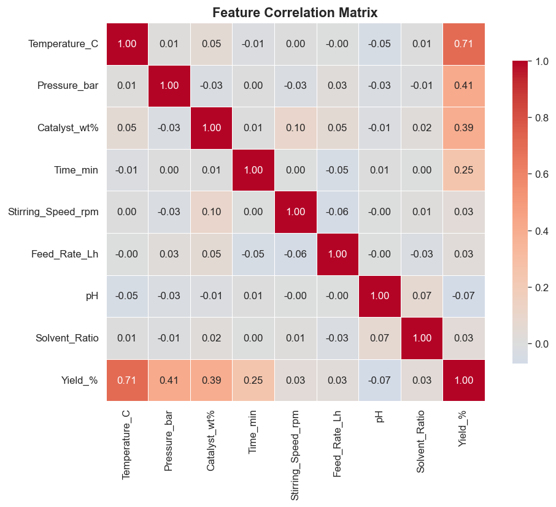
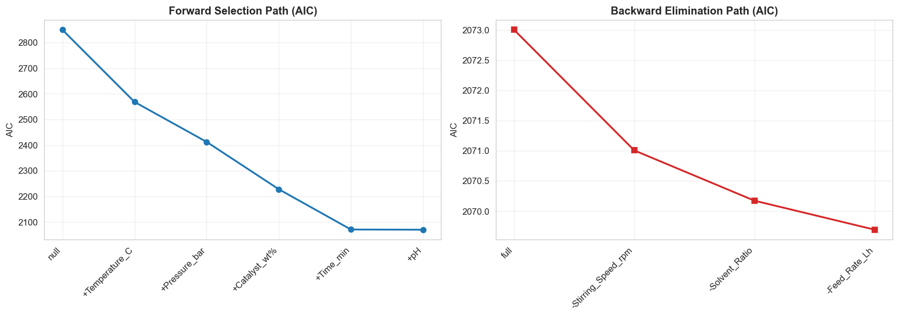
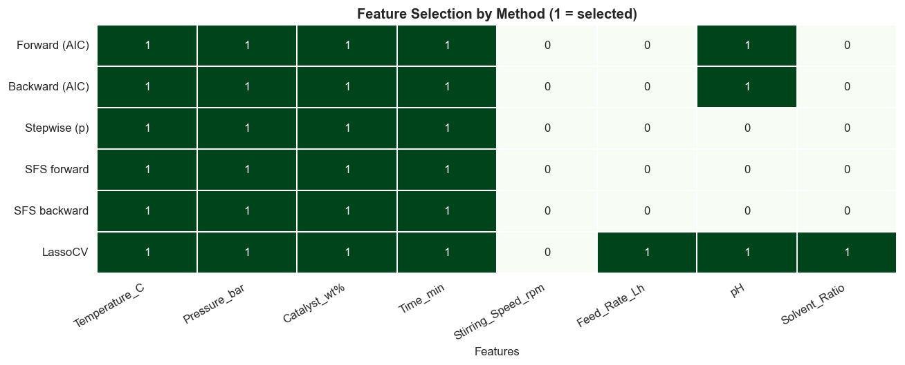
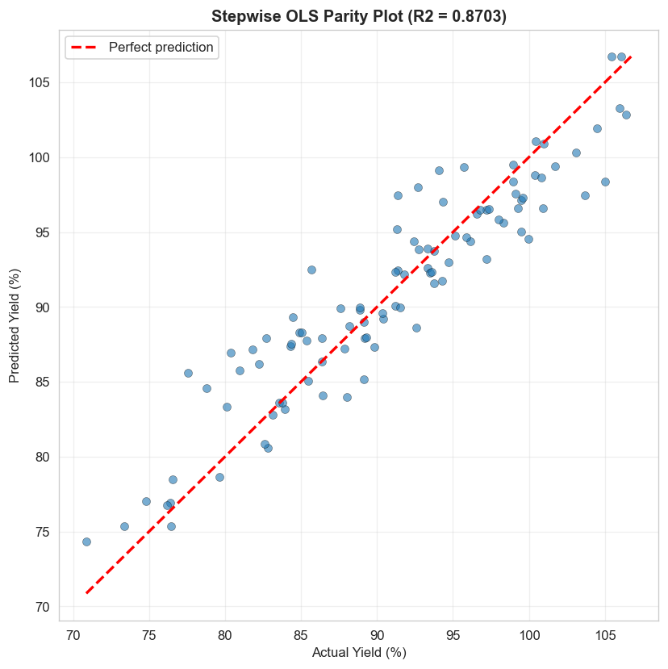

# Unit10 逐步回歸 | Stepwise Regression

> 包裹式特徵選擇方法：以模型評分準則驅動特徵的逐步增刪，建立精簡且可解釋的線性模型。

---

## 學習目標

完成本單元後，您將能夠：

1. **理解逐步回歸的定位**：將其視為線性回歸的「包裹式 (Wrapper)」特徵選擇方法，並與正則化 (Embedded) 方法區分。
2. **掌握三種搜尋策略**：前向選擇 (Forward Selection)、後向消除 (Backward Elimination)、雙向逐步 (Bidirectional Stepwise)。
3. **運用四種選擇準則**：p-value、AIC、BIC、調整後 $R^2$ ，並了解其差異與適用情境。
4. **以 Python 實作**：使用 `statsmodels` 手動實作 AIC / p-value 逐步回歸，並用 sklearn `SequentialFeatureSelector` 對照。
5. **應用於化工領域**：在軟測量、製程建模等場景中建立精簡模型，並認識逐步回歸的推論偏誤與不穩定風險。

---

## 1. 逐步回歸基本概念

### 1.1 什麼是逐步回歸？

**逐步回歸 (Stepwise Regression)** 是一種**自動特徵選擇 (Feature Selection)** 方法。它在一組候選特徵中，依據某個**統計準則** (如 p-value、AIC)，以「逐步加入」或「逐步移除」的方式，搜尋出一個表現良好且精簡的特徵子集，再以該子集建立線性回歸模型。

對於具有 $p$ 個候選特徵的資料，完整的「最佳子集搜尋 (Best Subset Selection)」需要檢驗 $2^p$ 種特徵組合。當 $p$ 稍大時 (例如 $p = 30$ ，組合數超過 10 億)，窮舉法在計算上不可行。逐步回歸採用**貪婪搜尋 (Greedy Search)**，每一步只做一個局部最佳的增刪決策，將搜尋成本從指數級降為多項式級，是一種實務上高效的近似方法。

### 1.2 為什麼需要逐步回歸？

在化工資料建模中，我們常面臨「特徵過多」的問題：感測器可能提供數十甚至上百個製程變數，但其中許多與目標無關或彼此高度相關。保留全部特徵會帶來以下問題：

1. **過擬合 (Overfitting)**：特徵越多，模型越容易記住訓練資料的雜訊，泛化能力下降。
2. **可解釋性降低**：冗餘特徵稀釋了真正重要變數的解釋力，不利工程決策。
3. **多重共線性 (Multicollinearity)**：高度相關的特徵使係數估計不穩定、符號甚至與物理直覺相反。
4. **維護成本**：模型部署後，每個輸入特徵都需要對應的感測器與資料管線，特徵越少越易維護。

逐步回歸透過**自動剔除冗餘特徵**，建立「以最少變數達到足夠準確度」的精簡模型 (Parsimonious Model)，直接回應上述需求。

### 1.3 逐步回歸 vs 正則化方法

特徵選擇方法通常分為三大類，逐步回歸屬於**包裹式 (Wrapper)**：

| 類別 | 代表方法 | 原理 | 特點 |
|------|---------|------|------|
| **過濾式 (Filter)** | 相關係數、互資訊、變異數門檻 | 先以統計指標篩選特徵，與模型無關 | 快速，但忽略特徵交互作用 |
| **包裹式 (Wrapper)** | **逐步回歸**、遞迴特徵消除 (RFE) | 反覆訓練模型、以模型評分驅動增刪 | 考慮特徵組合，計算成本較高 |
| **嵌入式 (Embedded)** | **Lasso**、ElasticNet、樹模型重要性 | 特徵選擇內建於模型訓練過程 | 一次訓練即完成選擇，效率高 |

**逐步回歸 (Wrapper) 與 Lasso (Embedded) 的關鍵差異**：

- **Lasso** 透過 L1 正則化將不重要特徵的係數**連續地收縮至零**，在一次最佳化中完成選擇與擬合。
- **逐步回歸** 是**離散地**加入或移除整個特徵，每一步都重新擬合一個普通最小二乘 (OLS) 模型，並比較評分準則。
- Lasso 會對保留特徵的係數產生**偏誤 (shrinkage bias)**；逐步回歸保留特徵後係數為**無偏的 OLS 估計**，但「選擇哪些特徵」這個決策本身會引入另一種偏誤 (見 §7.2)。

兩者常選出相近的重要特徵，但逐步回歸在小特徵集、需要標準 OLS 統計推論 (如 p-value、信賴區間) 的情境中仍有其價值。

---

## 2. 三種逐步回歸策略

### 2.1 前向選擇 (Forward Selection)

**前向選擇** 從**空模型** (僅含截距項) 出發，每一步加入「使選擇準則改善最多」的一個特徵，直到沒有任何特徵的加入能再改善準則為止。

**流程**：

1. 初始模型： $\hat{y} = \beta_0$ (無任何特徵)。
2. 對每個尚未納入的候選特徵，分別試加入並計算準則 (如 AIC)。
3. 選擇使準則改善最多的特徵正式加入。
4. 重複步驟 2–3，直到無法再改善。

**優點**：計算量小 (尤其當最終特徵數遠小於候選數時)；適合 $p$ 很大的高維資料。
**缺點**：一旦加入特徵便不再移除，可能保留「因後續特徵加入而變得多餘」的變數。

### 2.2 後向消除 (Backward Elimination)

**後向消除** 從**全特徵模型** 出發，每一步移除「移除後使準則改善最多 (或損失最小)」的一個特徵，直到移除任何特徵都會使準則變差為止。

**流程**：

1. 初始模型：包含所有 $p$ 個特徵。
2. 對每個目前在模型中的特徵，分別試移除並計算準則。
3. 移除使準則改善最多的特徵。
4. 重複步驟 2–3，直到無法再改善。

**優點**：在決定是否移除某特徵時，是在「其他所有特徵都存在」的脈絡下評估，較能處理特徵間的聯合效應。
**缺點**：必須先能擬合全特徵模型，當特徵數大於樣本數 ( $p > n$ ) 時無法使用；初始計算量較大。

### 2.3 雙向逐步 (Bidirectional Stepwise)

**雙向逐步** 結合前向與後向：每一步先嘗試**加入**一個顯著特徵，再嘗試**移除**一個已不再顯著的特徵。這使得「先前加入、但因後續特徵而變得多餘」的變數有機會被剔除，是實務上最常用的策略。

**流程 (以 p-value 為準則)**：

1. 從空模型開始。
2. **前向步驟**：在尚未納入的特徵中，找出加入後 p-value 最小者；若其 p-value $< \alpha_{\text{in}}$ (如 0.05)，則加入。
3. **後向步驟**：在目前模型中，找出 p-value 最大者；若其 p-value $> \alpha_{\text{out}}$ (如 0.05)，則移除。
4. 重複步驟 2–3，直到特徵集不再變動。

> 注意：通常設定 $\alpha_{\text{in}} \le \alpha_{\text{out}}$ 以避免特徵反覆進出造成無窮迴圈。

### 2.4 三種策略比較

| 策略 | 起點 | 每步動作 | 適用情境 | 主要限制 |
|------|------|---------|----------|----------|
| **前向選擇** | 空模型 | 只加入 | $p$ 很大、 $p > n$ | 無法移除已加入的特徵 |
| **後向消除** | 全模型 | 只移除 | $p < n$ 、特徵有聯合效應 | 需先擬合全模型 |
| **雙向逐步** | 空模型 | 加入 + 移除 | **一般情境首選** | 準則與門檻設定較敏感 |

三種策略都是**貪婪搜尋**，不保證找到全域最佳子集；不同策略可能得到不同結果，實務上建議交叉比對。

---

## 3. 特徵選擇準則

逐步回歸的每一步都需要一個**量化準則**來決定該加入或移除哪個特徵。常見準則有四種。

### 3.1 p-value (F 檢定 / t 檢定)

以**統計顯著性**判斷是否納入特徵。對於新加入的特徵，其迴歸係數的 t 檢定 p-value 反映「該係數顯著不為零」的證據強度：

- **加入規則**：若候選特徵加入後其 p-value $< \alpha_{\text{in}}$ (常設 0.05)，則納入。
- **移除規則**：若模型中某特徵的 p-value $> \alpha_{\text{out}}$ (常設 0.05 或 0.10)，則剔除。

**優點**：直觀、與傳統統計推論一致。
**缺點**：涉及**多重比較 (Multiple Comparisons)** 問題——反覆對許多特徵做檢定，會膨脹整體偽陽性率，使報告的 p-value 失去原本的意義 (見 §7.2)。

### 3.2 AIC (赤池資訊準則)

**赤池資訊準則 (Akaike Information Criterion, AIC)** 同時衡量模型的配適度與複雜度：

$$
\text{AIC} = 2k - 2\ln(\hat{L})
$$

其中：
- $k$ ：模型參數個數 (特徵數 + 截距 + 誤差變異數)
- $\hat{L}$ ：模型的最大概似值 (likelihood)

對於常態誤差的線性回歸，AIC 可改寫為：

$$
\text{AIC} = n \ln\!\left(\frac{\text{RSS}}{n}\right) + 2k + C
$$

其中 $\text{RSS} = \sum_{i=1}^{n}(y_i - \hat{y}_i)^2$ 為殘差平方和， $C$ 為常數。

**解讀**：
- 第一項 $n \ln(\text{RSS}/n)$ 隨配適度變好而**下降**。
- 第二項 $2k$ 為**複雜度懲罰**，隨特徵增加而**上升**。
- **AIC 越小越好**；加入一個特徵只有在其對配適度的改善大於 $2$ 單位懲罰時，AIC 才會下降。

### 3.3 BIC (貝氏資訊準則)

**貝氏資訊準則 (Bayesian Information Criterion, BIC)** 與 AIC 形式相似，但複雜度懲罰更重：

$$
\text{BIC} = n \ln\!\left(\frac{\text{RSS}}{n}\right) + k \ln(n) + C
$$

**AIC vs BIC**：
- BIC 的懲罰項為 $k \ln(n)$ ，當樣本數 $n > 7$ 時 $\ln(n) > 2$ ，懲罰比 AIC 的 $2k$ 更強。
- 因此 **BIC 傾向選出更精簡的模型** (更少特徵)，在大樣本下具有「選到真實模型」的一致性 (consistency)。
- **AIC 傾向選出較大的模型**，著重預測準確度，在真實模型未知時表現較穩健。

### 3.4 調整後 $R^2$

普通 $R^2$ 隨特徵增加只會上升或持平，無法用來比較不同特徵數的模型。**調整後 $R^2$ (Adjusted $R^2$ )** 對特徵數做了懲罰：

$$
R^2_{\text{adj}} = 1 - \frac{(1 - R^2)(n - 1)}{n - p - 1}
$$

其中 $n$ 為樣本數、 $p$ 為特徵數。加入無用特徵時，分母縮小但 $R^2$ 幾乎不變，使 $R^2_{\text{adj}}$ **下降**，因此可作為選擇準則 ( $R^2_{\text{adj}}$ 越大越好)。

### 3.5 準則比較與選用

| 準則 | 公式核心 | 傾向 | 適用情境 |
|------|---------|------|----------|
| **p-value** | 係數 t 檢定 | 依門檻 | 需統計推論、特徵數少 |
| **AIC** | $-2\ln\hat{L} + 2k$ | 較大模型 | **著重預測準確度** |
| **BIC** | $-2\ln\hat{L} + k\ln n$ | 較小模型 | 大樣本、著重找真實模型 |
| **調整後 $R^2$** | 懲罰特徵數的 $R^2$ | 中等 | 直觀、易向非技術人員解釋 |

**選用建議**：
1. 以**預測**為目標 → 優先使用 **AIC** 或交叉驗證分數。
2. 以**找出真正重要變數**為目標 (大樣本) → 使用 **BIC**。
3. 需要**標準統計推論** → 使用 **p-value**，但務必警覺多重比較問題。
4. 無論採用何種準則，最終都應以**獨立測試集或交叉驗證**確認泛化性能。

---

## 4. 演算法流程 (含偽代碼)

### 4.1 前向選擇流程 (AIC)

```text
輸入: 特徵集 F = {x_1, ..., x_p}, 目標 y
初始: selected = [], current_AIC = AIC(僅截距模型)
重複:
    best_AIC = current_AIC, best_feat = None
    對 F \ selected 中的每個特徵 f:
        以 selected + {f} 擬合 OLS, 計算 AIC_f
        若 AIC_f < best_AIC: best_AIC = AIC_f, best_feat = f
    若 best_feat 存在:
        selected.append(best_feat); current_AIC = best_AIC
    否則: 停止
輸出: selected
```

### 4.2 後向消除流程 (AIC)

```text
輸入: 特徵集 F = {x_1, ..., x_p}, 目標 y
初始: selected = F, current_AIC = AIC(全特徵模型)
重複:
    best_AIC = current_AIC, worst_feat = None
    對 selected 中的每個特徵 f:
        以 selected \ {f} 擬合 OLS, 計算 AIC_f
        若 AIC_f < best_AIC: best_AIC = AIC_f, worst_feat = f
    若 worst_feat 存在:
        selected.remove(worst_feat); current_AIC = best_AIC
    否則: 停止
輸出: selected
```

### 4.3 雙向逐步流程 (p-value)

```text
輸入: 特徵集 F, 目標 y, 門檻 alpha_in=0.05, alpha_out=0.05
初始: included = []
重複:
    changed = False
    # 前向步驟
    對 F \ included 中每個 f: 計算加入後 f 的 p-value
    若 最小 p-value < alpha_in:
        included.append(對應特徵); changed = True
    # 後向步驟
    以 included 擬合 OLS, 取各特徵 p-value
    若 最大 p-value > alpha_out:
        included.remove(對應特徵); changed = True
    若 not changed: 停止
輸出: included
```

---

## 5. Python 實作工具

### 5.1 statsmodels 手動實作 (AIC)

scikit-learn 並未內建以 AIC / p-value 為準則的逐步回歸，需以 `statsmodels` 自行實作。前向選擇範例：

```python
import numpy as np
import statsmodels.api as sm

def forward_selection_aic(X, y):
    remaining = list(X.columns)
    selected = []
    current_aic = sm.OLS(y, np.ones((len(y), 1))).fit().aic  # 空模型
    while remaining:
        best_aic, best_feat = current_aic, None
        for feat in remaining:
            model = sm.OLS(y, sm.add_constant(X[selected + [feat]])).fit()
            if model.aic < best_aic:
                best_aic, best_feat = model.aic, feat
        if best_feat is None:
            break
        selected.append(best_feat)
        remaining.remove(best_feat)
        current_aic = best_aic
    return selected
```

### 5.2 statsmodels 手動實作 (p-value 雙向)

```python
def stepwise_pvalue(X, y, threshold_in=0.05, threshold_out=0.05):
    included = []
    while True:
        changed = False
        # 前向步驟
        excluded = [c for c in X.columns if c not in included]
        new_pval = {}
        for feat in excluded:
            model = sm.OLS(y, sm.add_constant(X[included + [feat]])).fit()
            new_pval[feat] = model.pvalues[feat]
        if new_pval and min(new_pval.values()) < threshold_in:
            best_feat = min(new_pval, key=new_pval.get)
            included.append(best_feat)
            changed = True
        # 後向步驟
        if included:
            model = sm.OLS(y, sm.add_constant(X[included])).fit()
            pvals = model.pvalues.drop('const')
            if pvals.max() > threshold_out:
                included.remove(pvals.idxmax())
                changed = True
        if not changed:
            break
    return included
```

### 5.3 sklearn SequentialFeatureSelector

sklearn 提供以**交叉驗證評分**為準則的序列特徵選擇，可與統計式逐步回歸互補：

```python
from sklearn.linear_model import LinearRegression
from sklearn.feature_selection import SequentialFeatureSelector

sfs = SequentialFeatureSelector(
    LinearRegression(),
    n_features_to_select=4,     # 需指定目標特徵數
    direction='forward',        # 或 'backward'
    scoring='r2',
    cv=5)
sfs.fit(X_train, y_train)
selected = list(X_train.columns[sfs.get_support()])
```

> 差異：`SequentialFeatureSelector` 以 CV 分數為準則、需**預先指定特徵數**，無內建 AIC/p-value 停止條件；而 statsmodels 版本以統計準則**自動決定**特徵數。

---

## 6. 化學工程應用場景

逐步回歸在化工領域的典型應用：

### 6.1 軟測量模型精簡 (Soft Sensor Reduction)
- **情境**：以數十個易測量的製程變數 (溫度、流量、壓力) 推估難測量的品質指標 (如產品純度)。
- **逐步回歸角色**：從大量候選變數中挑出少數關鍵變數，降低感測器需求與模型複雜度。

### 6.2 反應器產率建模
- **情境**：反應器有多個操作變數，但只有部分真正影響產率。
- **逐步回歸角色**：剔除無關變數，建立精簡且可解釋的產率模型，供操作優化。

### 6.3 製程故障根因篩選
- **情境**：異常事件涉及眾多感測器讀數，需找出與偏差最相關的少數變數。
- **逐步回歸角色**：篩選出對目標偏差有顯著貢獻的變數，縮小根因分析範圍。

### 6.4 QSPR / QSAR 物性建模
- **情境**：分子描述符可能多達數百個，需找出與物性 (沸點、溶解度) 相關的關鍵描述符。
- **逐步回歸角色**：在高維描述符中進行特徵選擇，建立可解釋的結構–性質關係。

---

## 6A. 實戰案例：化學催化反應產率預測

> 本節對應程式範例 [Unit10_Stepwise_Regression.ipynb](Unit10_Stepwise_Regression.ipynb)，所有數值均來自該 Notebook 的實際執行結果 (隨機種子 `SEED = 42`)。

### 6A.1 案例背景

某化學催化反應的產率受多個操作變數影響。工程團隊收集了 **500 筆** 實驗數據，記錄 **8 個操作變數** 與對應的反應產率 (Yield)。然而並非所有變數都真正影響產率——本案例刻意設計了「重要特徵」與「冗餘特徵」，以檢驗逐步回歸的特徵選擇能力。

**特徵設計**：

| 類別 | 特徵 | 範圍 | 真實係數 |
|------|------|------|----------|
| 重要 | Temperature_C (溫度) | 80–120 °C | 0.50 |
| 重要 | Pressure_bar (壓力) | 1–5 bar | 3.00 |
| 重要 | Catalyst_wt% (催化劑) | 0.5–2.5 wt% | 5.00 |
| 重要 | Time_min (反應時間) | 30–180 min | 0.05 |
| 冗餘 | Stirring_Speed_rpm (攪拌速度) | 100–500 rpm | 0 |
| 冗餘 | Feed_Rate_Lh (進料速率) | 10–50 L/h | 0 |
| 冗餘 | pH | 6.0–8.0 | 0 |
| 冗餘 | Solvent_Ratio (溶劑比) | 0.1–0.5 | 0 |

真實產率模型為：

$$
\text{Yield} = 20 + 0.5 \cdot T + 3.0 \cdot P + 5.0 \cdot \text{Cat} + 0.05 \cdot t + \varepsilon
$$

其中雜訊 $\varepsilon \sim N(0, 3^2)$ 。此處 4 個重要特徵的截距與係數（20、0.5、3.0、5.0、0.05）與 [Unit10_Linear_Regression.md](Unit10_Linear_Regression.md) 單元一致，便於跨單元對照。**理想結果**：逐步回歸應保留前 4 個特徵、剔除後 4 個冗餘特徵。

### 6A.2 數據探索分析

計算各特徵與產率 `Yield_%` 的相關係數 (依絕對值排序)：

| 特徵 | 與 Yield 相關係數 |
|------|------------------|
| Temperature_C | 0.7109 |
| Pressure_bar | 0.4082 |
| Catalyst_wt% | 0.3916 |
| Time_min | 0.2459 |
| pH | -0.0706 |
| Stirring_Speed_rpm | 0.0344 |
| Solvent_Ratio | 0.0344 |
| Feed_Rate_Lh | 0.0280 |



**觀察**：4 個重要特徵與產率的相關係數明顯較高 (0.25–0.71)，4 個冗餘特徵則都低於 0.08，初步符合設計預期。溫度相關性最高 (0.71)，反映其係數影響範圍最大。

### 6A.3 資料準備

- 切分訓練集 (400 筆) 與測試集 (100 筆)，比例 80/20。
- 以 `StandardScaler` 標準化特徵。標準化為線性轉換，**不會改變 AIC/p-value 的特徵選擇結果**，但使係數尺度一致，便於與 Lasso 的係數比較。

---

### 6A.4 前向選擇 (Forward Selection, AIC)

從空模型開始，逐步加入使 AIC 下降最多的特徵，AIC 變化如下：

| 步驟 | 動作 | AIC |
|------|------|-----|
| 0 | 空模型 (僅截距) | 2850.08 |
| 1 | + Temperature_C | 2568.44 |
| 2 | + Pressure_bar | 2412.41 |
| 3 | + Catalyst_wt% | 2227.62 |
| 4 | + Time_min | 2070.40 |
| 5 | + pH | 2069.69 |

**前向選擇結果 (5 個特徵)**：`Temperature_C, Pressure_bar, Catalyst_wt%, Time_min, pH`

**關鍵觀察**：前 4 步加入的都是重要特徵，AIC 大幅下降 (2850 → 2070)。但第 5 步加入冗餘特徵 `pH` 後，AIC 僅從 2070.40 微降至 2069.69 (下降 0.71)。這說明 **AIC 是較寬鬆的準則**——只要加入特徵帶來的配適改善「略大於」 $2$ 單位的複雜度懲罰，就會被納入，因而偶爾會保留一個實際無用的特徵。

### 6A.5 後向消除 (Backward Elimination, AIC)

從全特徵模型開始，逐步移除使 AIC 下降最多的特徵：

| 步驟 | 動作 | AIC |
|------|------|-----|
| 0 | 全特徵 (8 個) | 2073.01 |
| 1 | − Stirring_Speed_rpm | 2071.01 |
| 2 | − Solvent_Ratio | 2070.17 |
| 3 | − Feed_Rate_Lh | 2069.69 |

**後向消除結果 (5 個特徵)**：`Temperature_C, Pressure_bar, Catalyst_wt%, Time_min, pH`

**關鍵觀察**：後向消除移除了 3 個冗餘特徵，但同樣**保留了 `pH`**。前向與後向最終 AIC **完全相同 (2069.69)**，選到的特徵集也一致——兩種 AIC 策略在本案例中殊途同歸。



左圖為前向選擇路徑：AIC 在加入 4 個重要特徵後急遽下降並趨於平坦，加入 `pH` 後幾乎無變化。右圖為後向消除路徑：移除 3 個冗餘特徵時 AIC 持續小幅下降。

### 6A.6 雙向逐步 (Bidirectional, p-value)

以 p-value 門檻 0.05 進行雙向逐步，加入順序與 p-value：

| 步驟 | 動作 | p-value |
|------|------|---------|
| 1 | + Temperature_C | $2.91 \times 10^{-63}$ |
| 2 | + Pressure_bar | $6.09 \times 10^{-36}$ |
| 3 | + Catalyst_wt% | $4.57 \times 10^{-42}$ |
| 4 | + Time_min | $5.04 \times 10^{-36}$ |

**雙向逐步結果 (4 個特徵)**：`Temperature_C, Pressure_bar, Catalyst_wt%, Time_min`

**關鍵觀察**：雙向逐步**精準選出 4 個重要特徵、剔除全部 4 個冗餘特徵**，包含 AIC 法保留的 `pH`。原因是 `pH` 加入後的 p-value 並未低於 0.05 門檻，因此不被納入。這突顯 **p-value 門檻 (0.05) 比 AIC 更嚴格**，在本案例中得到最精簡且正確的結果。四個重要特徵的 p-value 都極小 ( $< 10^{-35}$ )，統計上高度顯著。

**三種逐步策略彙整**：

| 策略 | 特徵數 | 命中重要特徵 | 多餘特徵 |
|------|--------|-------------|----------|
| Forward (AIC) | 5 | 4/4 | pH |
| Backward (AIC) | 5 | 4/4 | pH |
| Stepwise (p-value) | 4 | 4/4 | 無 |

### 6A.7 sklearn SequentialFeatureSelector 對照

以 5 折交叉驗證的 $R^2$ 為準則，固定選取 4 個特徵：

- **SFS forward (4 特徵)**：`Temperature_C, Pressure_bar, Catalyst_wt%, Time_min`
- **SFS backward (4 特徵)**：`Temperature_C, Pressure_bar, Catalyst_wt%, Time_min`

兩者都**命中全部 4 個重要特徵 (4/4)**。由於 SFS 預先指定了特徵數為 4，自然不會納入 `pH`，結果與 p-value 雙向逐步一致。

### 6A.8 模型比較：Stepwise vs Lasso vs OLS

以前向選擇特徵 (5 個) 建立精簡 OLS，與全特徵 OLS、LassoCV 比較測試集性能：

| 模型 | $R^2$ (測試) | RMSE | MAE | 特徵數 |
|------|-------------|------|-----|--------|
| Stepwise OLS | 0.8703 | 2.9760 | 2.3400 | 5 |
| Full OLS | 0.8711 | 2.9667 | 2.3353 | 8 |
| LassoCV | 0.8703 | 2.9761 | 2.3480 | 7 |

- LassoCV 最佳 $\alpha = 0.0429$ ，保留 7 個非零特徵 (僅剔除 `Stirring_Speed_rpm`)。
- Lasso 非零特徵：`Temperature_C, Pressure_bar, Catalyst_wt%, Time_min, Feed_Rate_Lh, pH, Solvent_Ratio`。

**關鍵觀察**：三種模型的測試集 $R^2$ 幾乎相同 (0.8703–0.8711)。**逐步回歸僅用 5 個特徵、雙向逐步僅用 4 個特徵**，就達到與全特徵 OLS (8 個) 相當的性能，驗證了多數冗餘特徵確實無用。值得注意的是，**LassoCV 在此案例保留了較多特徵 (7 個，其中含 3 個冗餘特徵 Feed_Rate_Lh、pH、Solvent_Ratio)**，因為交叉驗證選出的 $\alpha$ 偏小 (正則化較弱)——這提醒我們：Lasso 的特徵選擇結果高度依賴 $\alpha$ 的選擇。



熱圖彙整 6 種方法的選擇結果 (綠色=選用)。各特徵被選中的次數：

| 特徵 | 被選中次數 (共 6 法) |
|------|---------------------|
| Temperature_C | 6 |
| Pressure_bar | 6 |
| Catalyst_wt% | 6 |
| Time_min | 6 |
| pH | 3 |
| Feed_Rate_Lh | 1 |
| Solvent_Ratio | 1 |
| Stirring_Speed_rpm | 0 |

**4 個重要特徵被全部 6 種方法一致選中**，展現高度共識；`pH` 僅被 AIC 法 (前向/後向) 及 Lasso 選中。這種「多方法投票」是實務上判斷特徵可靠性的有效手段。

### 6A.9 預測結果評估 (Parity Plot)

逐步回歸精簡模型在測試集上： $R^2 = 0.8703$ 、RMSE $= 2.9760$ 、MAE $= 2.3400$ 。



散點緊密分佈於對角線 (完美預測線) 附近，無明顯系統性偏差，顯示模型預測準確且無偏。

### 6A.10 交叉驗證穩定性評估

以 5 折交叉驗證評估逐步回歸精簡模型的穩定性：

- **各折 $R^2$**：0.8634, 0.8532, 0.8557, 0.8580, 0.8433
- **平均 $R^2$**：0.8547 (± 0.0066)
- **全特徵 OLS 平均 $R^2$**：0.8540 (± 0.0083)

**觀察**：精簡模型的 CV $R^2$ 標準差 (0.0066) **略小於**全特徵模型 (0.0083)，代表移除冗餘特徵後模型**更穩定**。精簡模型以 5 個特徵達到與 8 個特徵相當 (甚至略佳) 的泛化性能。

### 6A.11 新操作條件預測

使用逐步回歸精簡模型預測 3 組新操作條件的產率：

| 條件 | 溫度 | 壓力 | 催化劑 | 時間 | 預測產率 (%) |
|------|------|------|--------|------|-------------|
| 1 | 90 | 2.0 | 1.0 | 60 | 79.21 |
| 2 | 110 | 4.0 | 2.0 | 150 | 104.75 |
| 3 | 100 | 3.0 | 1.5 | 100 | 91.52 |

條件 2 (高溫、高壓、高催化劑、長時間) 預測產率最高 (104.75%)，條件 1 (低操作條件) 最低 (79.21%)，符合各變數的正向影響與工程直覺。

### 6A.12 案例總結

本案例完整驗證了逐步回歸的特徵選擇能力：

1. **三種策略都命中全部 4 個重要特徵**，差異僅在於是否額外保留冗餘特徵 `pH`。
2. **p-value 雙向逐步 (門檻 0.05) 得到最精簡且正確的結果** (恰好 4 個重要特徵)。
3. **AIC 較寬鬆**，傾向多保留一個邊際特徵；若改用 BIC (懲罰更重) 通常能剔除 `pH`。
4. 精簡模型以更少特徵達到與全特徵模型相當的性能，且更穩定、更易解釋。

---

## 7. 逐步回歸的優勢與限制

### 7.1 優勢

1. **自動化特徵選擇**：無需人工逐一嘗試特徵組合，演算法自動搜尋。
2. **模型精簡可解釋**：保留的特徵為無偏 OLS 估計，係數可直接解讀，適合工程決策。
3. **計算高效**：相較於窮舉 $2^p$ 個子集，貪婪搜尋將成本降至多項式級。
4. **相容標準統計推論**：以 OLS 為基礎，可輸出 p-value、信賴區間等傳統統計量。
5. **策略與準則彈性**：可依目標選擇前向/後向/雙向，以及 AIC/BIC/p-value 準則。

### 7.2 限制

1. **選擇性推論偏誤 (Selective Inference Bias)**：在同一份資料上「先選特徵、再做推論」，會使最終模型的 p-value、 $R^2$ 、信賴區間過度樂觀。報告的 p-value 不再具有名目上的意義，因為它們沒有考慮「這個特徵是被挑選出來的」這件事。
2. **多重比較問題 (Multiple Comparisons)**：每步對多個特徵反覆檢定，膨脹整體偽陽性率，可能納入純屬巧合顯著的雜訊特徵 (本案例 AIC 法保留 `pH` 即為一例)。
3. **不穩定性 (Instability)**：資料的微小擾動 (如重新抽樣) 可能導致選出完全不同的特徵集，結果對樣本敏感。
4. **貪婪搜尋非全域最佳**：每步只做局部最佳決策，不保證找到整體最佳子集。
5. **難以處理多重共線性**：高度相關的特徵中，演算法可能任意選一個而排除另一個，選擇結果不穩定。
6. **準則與門檻敏感**：採用 AIC、BIC 或不同 p-value 門檻，可能得到不同模型。

> **學術界的提醒**：許多統計學家 (如 Frank Harrell) 強烈建議，若目的是**統計推論**，應避免使用逐步回歸，改用正則化 (Lasso/Ridge) 或領域知識驅動的特徵選擇。若目的是**預測**，逐步回歸仍是實用的基準方法，但務必以獨立測試集或交叉驗證驗證。

### 7.3 改進方法

1. **搭配交叉驗證**：以 CV 分數而非單一準則作最終判斷，降低過擬合風險。
2. **穩定性選擇 (Stability Selection)**：對多次重抽樣分別執行逐步回歸，只保留**高頻率被選中**的特徵。
3. **改用正則化方法**：Lasso / ElasticNet 提供更穩定的連續式特徵選擇。
4. **納入領域知識**：以工程/化學原理約束候選特徵，減少盲目搜尋。
5. **保留獨立測試集**：特徵選擇只在訓練集進行，最終性能在未參與選擇的測試集上評估。

---

## 8. 完整建模流程

```python
import numpy as np, pandas as pd
import statsmodels.api as sm
from sklearn.model_selection import train_test_split, cross_val_score
from sklearn.preprocessing import StandardScaler
from sklearn.linear_model import LinearRegression
from sklearn.metrics import r2_score, mean_squared_error

# 步驟 1: 資料準備與切分 (特徵選擇只在訓練集進行)
X_train, X_test, y_train, y_test = train_test_split(
    X, y, test_size=0.2, random_state=42)

# 步驟 2: 標準化
scaler = StandardScaler()
X_train_s = pd.DataFrame(scaler.fit_transform(X_train),
                         columns=X.columns, index=X_train.index)
X_test_s = pd.DataFrame(scaler.transform(X_test),
                        columns=X.columns, index=X_test.index)

# 步驟 3: 逐步回歸選擇特徵 (AIC 前向, 見 §5.1)
selected = forward_selection_aic(X_train_s, y_train)

# 步驟 4: 以選定特徵訓練最終 OLS
model = LinearRegression().fit(X_train_s[selected], y_train)

# 步驟 5: 交叉驗證確認穩定性
cv = cross_val_score(LinearRegression(), X_train_s[selected],
                     y_train, cv=5, scoring='r2')
print(f"CV R2: {cv.mean():.4f} (+/- {cv.std():.4f})")

# 步驟 6: 測試集評估 (未參與選擇)
pred = model.predict(X_test_s[selected])
print(f"Test R2: {r2_score(y_test, pred):.4f}")
print(f"Test RMSE: {np.sqrt(mean_squared_error(y_test, pred)):.4f}")
```

---

## 9. 實務技巧與注意事項

### 9.1 特徵選擇只在訓練集進行
務必在切分出測試集**之後**，只用訓練集做特徵選擇，避免測試集資訊洩漏 (Data Leakage) 造成性能高估。

### 9.2 準則的選擇
- 著重**預測** → AIC 或交叉驗證分數。
- 著重**精簡/找真實變數** → BIC。
- 需要**統計推論** → p-value，但警覺其偏誤。

### 9.3 處理多重共線性
執行逐步回歸前，先以 **VIF (變異數膨脹因子)** 檢查共線性。若存在高度相關特徵，考慮先合併或移除，以避免選擇結果不穩定。

### 9.4 多方法交叉驗證
如本案例，同時執行前向、後向、雙向與 Lasso，觀察哪些特徵被**一致選中**。被多種方法共同選中的特徵最可信。

### 9.5 不要盲目信任報告的 p-value
逐步回歸後，模型輸出的 p-value 已因選擇過程而失真，不應直接用於正式的假設檢定。若需嚴謹推論，應採用專門的選擇性推論 (Selective Inference) 方法或獨立驗證資料。

---

## 10. 總結

本單元系統性介紹了逐步回歸作為線性模型的特徵選擇方法：

- **定位**：逐步回歸是**包裹式 (Wrapper)** 特徵選擇，以反覆擬合 OLS 並比較統計準則來增刪特徵，與 Lasso 的**嵌入式**連續收縮互補。
- **三種策略**：前向選擇 (從空模型加入)、後向消除 (從全模型移除)、雙向逐步 (加入+移除，最常用)。
- **四種準則**：p-value (統計顯著性)、AIC (著重預測)、BIC (著重精簡)、調整後 $R^2$ 。AIC 較寬鬆、BIC 較嚴格。
- **實作**：sklearn 未內建統計式逐步回歸，需以 `statsmodels` 自行實作；`SequentialFeatureSelector` 提供 CV 式替代方案。
- **案例驗證**：三種策略都正確識別 4 個重要特徵；p-value 雙向逐步得到最精簡結果，AIC 法則多保留一個邊際特徵 `pH`。精簡模型以更少特徵達到與全特徵模型相當的性能。
- **限制警示**：選擇性推論偏誤、多重比較、不穩定性是逐步回歸的主要缺陷。以**預測**為目標時仍實用，但以**推論**為目標時應謹慎，建議改用正則化或搭配交叉驗證與穩定性選擇。

---

## 11. 延伸學習

### 11.1 進階主題
- **穩定性選擇 (Stability Selection)**：以重抽樣提升特徵選擇的可靠性。
- **選擇性推論 (Selective / Post-Selection Inference)**：為逐步選擇後的模型提供有效的 p-value 與信賴區間。
- **最佳子集選擇 (Best Subset Selection)**：以混合整數最佳化求全域最佳子集 (如 `abess` 套件)。

### 11.2 相關模型
- **Lasso / ElasticNet** (本單元)：嵌入式連續特徵選擇。
- **遞迴特徵消除 (RFE)**：sklearn `RFE` / `RFECV`，以模型係數或重要性迭代消除特徵。
- **樹模型特徵重要性**：隨機森林、梯度提升的特徵重要性 (Unit13)。

### 11.3 Python 套件
- `statsmodels`：OLS 擬合、AIC/BIC/p-value 來源。
- `scikit-learn`：`SequentialFeatureSelector`、`RFE`、`RFECV`。
- `mlxtend`：`SequentialFeatureSelector` 的另一實作，支援 floating 版本。

### 11.4 參考資源
- [statsmodels 官方文件](https://www.statsmodels.org/stable/index.html)
- [scikit-learn Feature Selection](https://scikit-learn.org/stable/modules/feature_selection.html)
- Hastie, Tibshirani, Friedman, *The Elements of Statistical Learning*, 第 3 章。

---

## 12. 下一步

- 逐步回歸的「內核」是普通最小二乘法，若尚未熟悉 OLS 的擬合與評估，建議先研讀 [Unit10_Linear_Regression.md](Unit10_Linear_Regression.md)（本單元的案例資料與真實係數即沿用自該單元）。
- 完成本單元後，建議回顧 [Unit10_Lasso_Regression.md](Unit10_Lasso_Regression.md) 與 [Unit10_ElasticNet_Regression.md](Unit10_ElasticNet_Regression.md)，比較包裹式與嵌入式特徵選擇的差異。
- 參考 [Unit10_Linear_Models_Overview.md](Unit10_Linear_Models_Overview.md) 複習線性模型與交叉驗證的整體架構。
- 完成程式範例 [Unit10_Stepwise_Regression.ipynb](Unit10_Stepwise_Regression.ipynb)，親手執行三種逐步策略並觀察結果差異。

---

**課程資訊**
- 課程名稱：AI在化工上之應用 (ChemE 3590)
- 課程單元：Unit10 Stepwise Regression 逐步回歸
- 課程製作：逢甲大學 化工系 智慧程序系統工程實驗室
- 授課教師：莊曜禎 助理教授
- 更新日期：2026-11-19

**課程授權 [CC BY-NC-SA 4.0]**
 - 本教材遵循 [創用CC 姓名標示-非商業性-相同方式分享 4.0 國際 (CC BY-NC-SA 4.0)](https://creativecommons.org/licenses/by-nc-sa/4.0/deed.zh) 授權。

---
