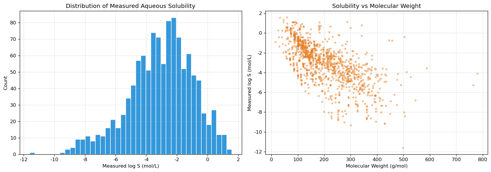
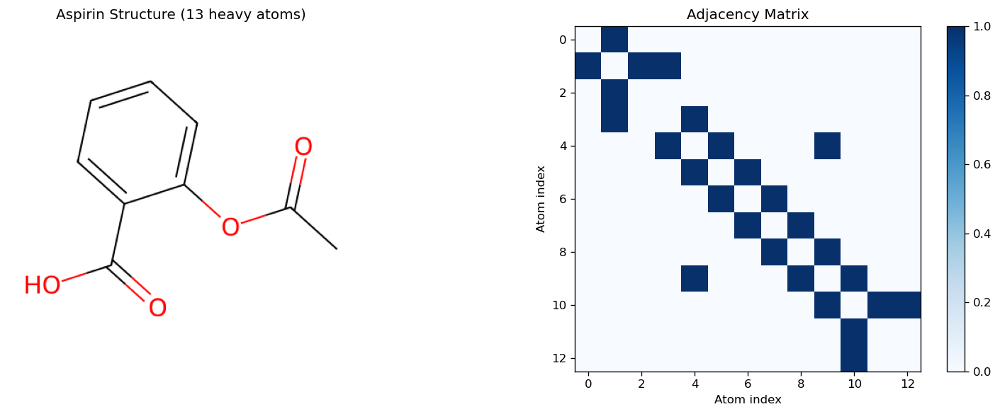
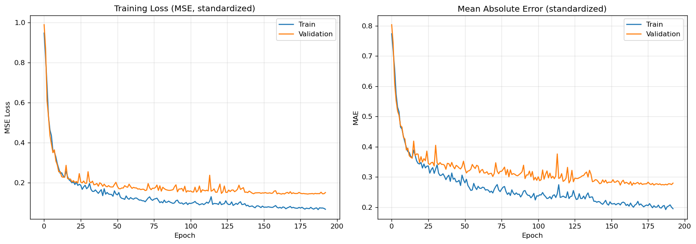
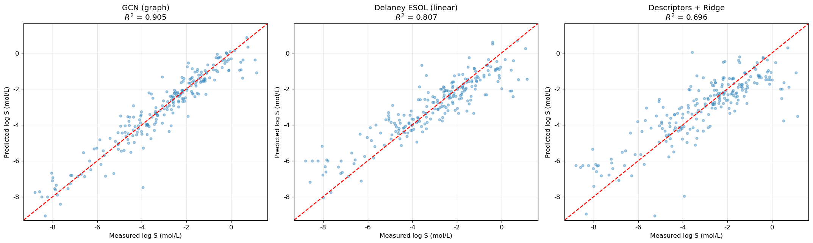
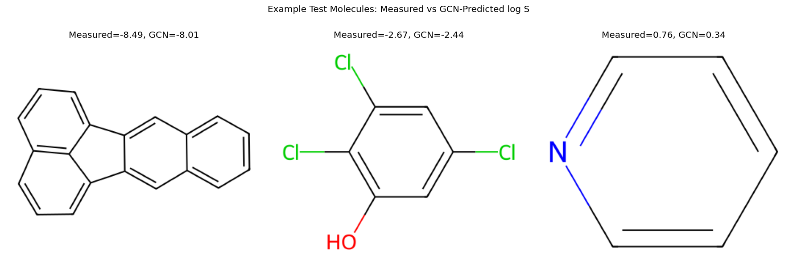
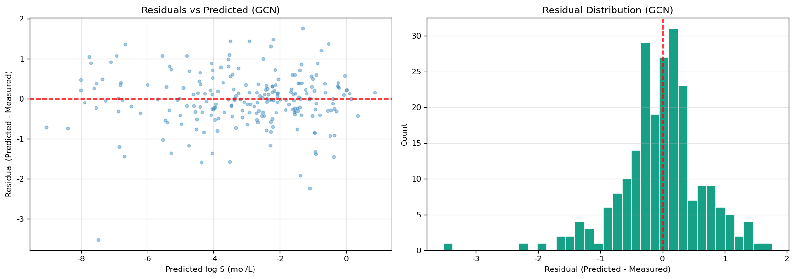
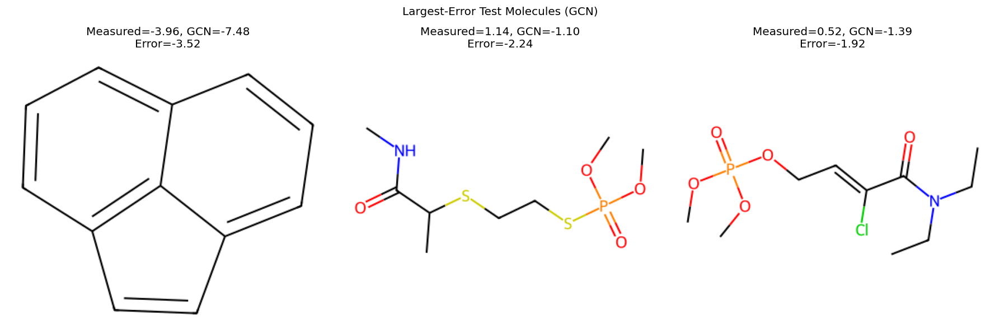
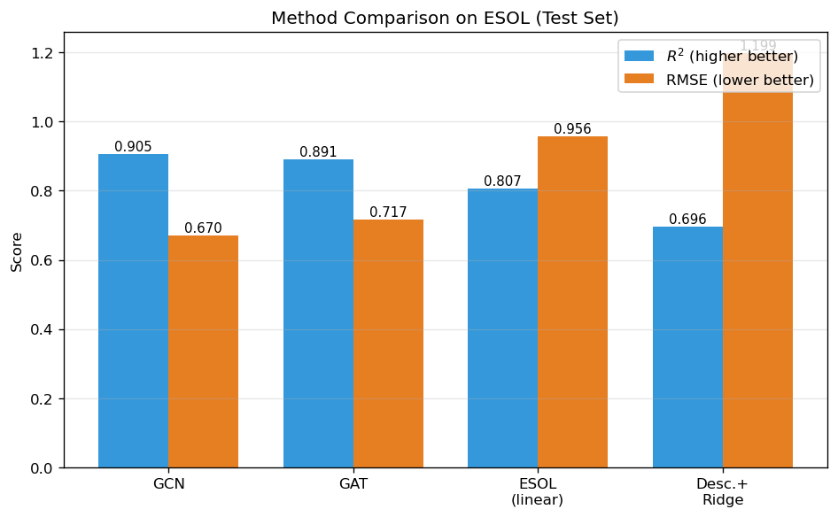

# Unit 18 應用實例：以圖神經網路預測分子水溶解度

## 課程目標
- 認識圖神經網路(GNN)在**化工/化學**領域的代表性應用：定量結構-性質關係 (QSPR)
- 了解如何以 RDKit 將 **SMILES** 字串轉換成**分子圖**（原子為節點、化學鍵為邊）
- 掌握以 **padding + 節點遮罩** 批次化不同大小分子圖的技巧
- 理解 **graph-level regression** 與 **讀出(Readout)池化** 的實作
- 以真實的 **ESOL 水溶解度資料集** 訓練 GCN，並與傳統方法比較

---

## 1. 應用背景：為什麼要預測水溶解度？

**水溶解度(Aqueous Solubility)** 是化工與製藥領域最重要的物性之一，常以 $\log S$ 表示（ $S$ 為飽和莫耳濃度，單位 mol/L）：

- **製程與分離**：結晶、萃取、吸收等單元操作都依賴溶解度資料
- **配方設計**：藥物、農藥、塗料的配方需要適當的溶解特性
- **環境評估**：污染物在水體中的傳輸與歸趨取決於溶解度
- **藥物開發**：口服藥物的生體可用率與溶解度密切相關

傳統上，溶解度需要**實驗量測**（耗時、耗成本），或透過**半經驗關係式**（如 Delaney 的 ESOL 線性模型）估算。近年來，**圖神經網路**能**直接從分子結構**學習，無需人工挑選描述子，成為 QSPR 建模的有力工具。

> [!NOTE]
> **QSPR (Quantitative Structure-Property Relationship)** 是化學資訊學的核心任務：建立分子結構與其物理化學性質之間的定量關係。溶解度、沸點、黏度、 $\log P$ 、毒性都是常見的預測目標。

---

## 2. ESOL 資料集

本範例使用公開的 **ESOL (Delaney) 水溶解度資料集**，由 MoleculeNet / DeepChem 整理提供。

| 項目 | 內容 |
|------|------|
| **分子數** | 1128 個有機小分子 |
| **輸入** | SMILES 字串（分子結構的文字表示） |
| **目標** | 實測水溶解度 $\log S$ （mol/L） |
| **目標範圍** | $-11.60$ 到 $1.58$ （平均 $-3.05$ ，標準差 $2.10$ ） |
| **重原子數** | 1 到 55（平均約 13） |
| **附加欄位** | Delaney 原始 ESOL 模型預測值、分子量、氫鍵供體數、環數、可旋轉鍵數、極性表面積等 |

**資料來源**：
- Delaney, J. S. (2004). "ESOL: Estimating Aqueous Solubility Directly from Molecular Structure." *Journal of Chemical Information and Computer Sciences*, 44(3), 1000-1005.

> [!TIP]
> $\log S = -3$ 代表飽和濃度約 $10^{-3}$ mol/L。數值越小代表越難溶於水。例如大型、芳香、疏水的分子通常 $\log S$ 較低（較難溶）。

### 2.1 資料預覽與溶解度分佈

下表為資料集前 3 個分子的範例（實測與 Delaney ESOL 預測的 $\log S$ 、分子量）：

| Compound ID | SMILES | 實測 $\log S$ | ESOL 預測 | 分子量 |
|-------------|--------|--------------|-----------|--------|
| Amigdalin | `OCC3OC(OCC2OC(OC(C#N)c1ccccc1)C(O)C(O)C2O)C(O)C(O)C3O` | $-0.77$ | $-0.974$ | 457.43 |
| Fenfuram | `Cc1occc1C(=O)Nc2ccccc2` | $-3.30$ | $-2.885$ | 201.23 |
| citral | `CC(C)=CCCC(C)=CC(=O)` | $-2.06$ | $-2.579$ | 152.24 |

全資料集 1128 個分子的實測 $\log S$ 統計為：最小值 $-11.60$ 、最大值 $1.58$ 、平均 $-3.05$ 、標準差 $2.10$ 。



**討論**：
- **左圖（溶解度分佈）**：實測 $\log S$ 大致呈單峰分佈，集中在 $-4$ 到 $-1$ 之間，與平均值 $-3.05$ 一致；少數極難溶的分子（ $\log S < -8$ ）形成左側長尾。
- **右圖（溶解度 vs 分子量）**：可見明顯的**負相關**趨勢 — 分子量越大，水溶解度通常越低，符合「大分子疏水表面積大、與水作用較弱」的化學直覺。但散佈仍相當分散，顯示**單用分子量不足以**準確預測溶解度，需要更完整的結構資訊（正是 GNN 的切入點）。

---

## 3. 分子的圖表示

### 3.1 從 SMILES 到分子圖

**SMILES (Simplified Molecular Input Line Entry System)** 是以文字字串描述分子結構的標準格式。例如：

- 乙醇 `CCO`
- 阿斯匹靈 `CC(=O)Oc1ccccc1C(=O)O`

RDKit 可將 SMILES 解析成分子物件，再轉為 GNN 所需的兩個矩陣：

- **節點特徵矩陣** $X \in \mathbb{R}^{N \times F}$ ：每個原子一個特徵向量
- **鄰接矩陣** $A \in \mathbb{R}^{N \times N}$ ：原子間的化學鍵連接

以乙醇 `CCO`（3 個重原子 C-C-O）為例，其鄰接矩陣為：

$$
A_{\mathrm{ethanol}} = \begin{bmatrix} 0 & 1 & 0 \\ 1 & 0 & 1 \\ 0 & 1 & 0 \end{bmatrix}
$$

表示第 1 個碳與第 2 個碳相連、第 2 個碳與氧相連。

### 3.2 原子特徵設計

本範例為每個原子設計一個 **27 維** 特徵向量，涵蓋常見的化學屬性：

| 特徵 | 維度 | 說明 |
|------|------|------|
| 原子種類 | 9 | C, N, O, F, S, Cl, Br, I, P 的 one-hot |
| 其他原子 | 1 | 是否為上述以外的原子 |
| 度(degree) | 6 | 連接的鍵數（0 到 5）的 one-hot |
| 形式電荷 | 1 | 原子的形式電荷 |
| 雜化狀態 | 3 | sp, sp2, sp3 的 one-hot |
| 芳香性 | 1 | 是否為芳香原子 |
| 連接氫數 | 5 | 連接的氫原子數（0 到 4）的 one-hot |
| 是否在環上 | 1 | 原子是否屬於某個環 |

> [!NOTE]
> 這些特徵都是**局部**的原子性質。GNN 的威力在於透過訊息傳遞，讓每個原子還能「感知」其化學環境（鄰居與更遠的結構），從而學到與整體分子性質相關的表示。

### 3.3 分子圖視覺化範例（阿斯匹靈）

以阿斯匹靈（Aspirin, `CC(=O)Oc1ccccc1C(=O)O`）為例，下圖左為其分子結構、右為對應的鄰接矩陣：



阿斯匹靈共有 **13 個重原子** 與 **13 條化學鍵**。

**討論**：
- 鄰接矩陣是**對稱**的（無向圖， $A_{ij} = A_{ji}$ ），且非常**稀疏** — 每個原子平均只與約 2 個鄰居相連（ $2 \times 13 / 13 = 2$ ），這是分子圖的典型特徵。
- 矩陣中可辨識出**苯環**對應的環狀連接模式，以及酯基與羧基的鏈狀連接。
- 13 個原子、13 條鍵、恰含 1 個環，符合環數關係（鍵數 $-$ 原子數 $+ 1 = 1$ ）。

---

## 4. 方法：批次化的圖卷積網路

### 4.1 Padding 與節點遮罩

不同分子的原子數不同（本資料集 1 到 55），無法直接堆成單一張量。常見解法是把所有分子 **padding(補零)** 到最大原子數 $M = 55$ ：

- 節點特徵 $X$ ：形狀統一為 $(M, F) = (55, 27)$ ，不足的原子補零
- 鄰接矩陣 $A$ ：形狀統一為 $(M, M) = (55, 55)$
- **節點遮罩(mask)**：標記哪些是真實原子（1）、哪些是填充（0）

批次化後，整個資料集成為三個張量： $X \in \mathbb{R}^{B \times M \times F}$ 、 $\hat{A} \in \mathbb{R}^{B \times M \times M}$ 、 $\mathrm{mask} \in \mathbb{R}^{B \times M \times 1}$ ，其中 $B$ 為批次大小。

### 4.2 正規化鄰接矩陣

對每個分子計算 GCN 的正規化鄰接矩陣，自連接**只加在真實原子**上：

$$
\tilde{A} = A + I_{\mathrm{real}}, \quad \hat{A} = \tilde{D}^{-1/2}\, \tilde{A}\, \tilde{D}^{-1/2}
$$

其中 $I_{\mathrm{real}}$ 僅在真實原子的對角位置為 1，填充位置保持為 0，確保填充節點不參與運算。

### 4.3 批次化的 GCN 傳播

每一層 GCN 對批次中的每個分子執行：

$$
H' = \sigma\left( \hat{A}\, (H W) + b \right)
$$

實作上拆成兩步：
- **特徵轉換** $HW$ ：用 `einsum('bnf,fu->bnu')` 對 $(B,M,F)$ 的張量套用權重 $W \in \mathbb{R}^{F \times U}$
- **鄰居聚合** $\hat{A}H$ ：用批次矩陣乘法 `tf.matmul`，形狀 $(B,M,M) \times (B,M,U) \to (B,M,U)$

每層之後，將輸出乘上節點遮罩，清除填充節點殘留的數值。

### 4.4 讀出(Readout)：從原子到分子

溶解度是**整個分子**的性質（圖層級任務），因此需要把所有原子的表示彙整成單一「分子表示向量」。本範例使用 **masked mean pooling**（只對真實原子取平均）：

$$
h_{\mathrm{mol}} = \frac{\sum_{v} \mathrm{mask}_v \cdot h_v}{\sum_{v} \mathrm{mask}_v}
$$

得到 $h_{\mathrm{mol}}$ 後，再接一個 MLP（含 Dropout）輸出預測的 $\log S$ 。

### 4.5 模型架構總覽

```
SMILES → 分子圖 (X, A)
    ↓  padding + 正規化
[X, A_hat, mask]
    ↓  GCN 層 1 (ReLU) → 乘遮罩
    ↓  GCN 層 2 (ReLU) → 乘遮罩
    ↓  masked mean pooling (讀出)
    ↓  Dense(64, ReLU) → Dropout → Dense(1)
預測 log S
```

訓練設定：損失 MSE（目標先做 z-score 標準化）、Adam 優化器、EarlyStopping、80/20 訓練/測試分割（902/226 個分子）。

### 4.6 模型參數規模

建立的 GCN 回歸模型參數摘要如下：

| 層 | 輸出形狀 | 參數量 |
|----|---------|--------|
| GCNLayer 1 | (None, 55, 64) | 1,792 |
| GCNLayer 2 | (None, 55, 64) | 4,160 |
| Readout（masked mean pool） | (None, 64) | 0 |
| Dense | (None, 64) | 4,160 |
| Dense（logS 輸出） | (None, 1) | 65 |
| **總計** | | **10,177** |

整個模型僅約 **1 萬個參數**，非常輕量（遠小於典型 CNN/Transformer），卻能達到良好的預測表現，展現 GNN 在小資料、結構化問題上的參數效率。

---

## 5. 實驗結果與討論

### 5.1 訓練過程

模型以 MSE 損失訓練（最多 200 個 epoch，EarlyStopping 提前停止；本次於第 193 個 epoch 停止），目標已 z-score 標準化，最終訓練損失約 $0.067$ 、驗證損失約 $0.151$ 。



**討論**：
- 訓練與驗證損失都隨 epoch 穩定下降並收斂，顯示模型有效學習了分子結構與溶解度之間的關係。
- 訓練損失低於驗證損失，存在**輕微過擬合**，但透過 Dropout 與 EarlyStopping（`restore_best_weights` 還原最佳權重）已獲得良好控制。
- EarlyStopping 還原的**最佳權重**在測試集上的 RMSE 約 $0.67$ （見第 5.2 節），顯示模型泛化良好。

### 5.2 三種方法比較

在**相同測試集（226 個分子）** 上，比較三種方法預測實測 $\log S$ 的表現：

| 模型 | $R^2$ | MAE | RMSE |
|------|-------|-----|------|
| **GCN（本範例，圖結構）** | **0.905** | **0.481** | **0.670** |
| Delaney ESOL（原始線性模型） | 0.807 | 0.708 | 0.956 |
| 分子描述子 + Ridge 回歸 | 0.696 | 0.892 | 1.199 |

**觀察與討論**：

- **GCN 表現最佳**（ $R^2 = 0.905$ ，RMSE $= 0.670$ ），明顯優於兩個傳統基線。這說明直接從分子圖學習的表示，比人工挑選的描述子或固定形式的線性模型更有效。
- **Delaney ESOL 線性模型**（ $R^2 = 0.807$ ）作為 2004 年的經典半經驗方法，表現仍相當穩健，是很好的參考基準。
- **描述子 + Ridge**（ $R^2 = 0.696$ ）僅用 6 個全域描述子（分子量、氫鍵供體數、環數等），資訊量較少，表現最弱。

> [!TIP]
> GCN 的優勢在於它**自動**從原子與鍵的連接關係學習特徵，不需化學家手動設計描述子。這也是深度學習「表示學習(representation learning)」的核心價值。

### 5.3 Parity Plot

下圖為三種方法在測試集上的 parity plot（預測值 vs 實測值），對角虛線為理想預測。GCN 的散點最緊密貼近對角線。



### 5.4 範例分子

下圖展示測試集中低、中、高溶解度各一個分子的結構，以及實測與 GCN 預測的 $\log S$ ，可見 GCN 預測值與實測值相當接近。



> [!NOTE]
> 本範例採用**隨機分割(random split)**。在藥物設計等實務中，常用更嚴格的 **scaffold split（依分子骨架分割）** 來評估模型對**全新結構**的泛化能力，此時各方法的誤差通常都會增大。

### 5.5 殘差分析：模型在哪裡出錯？

單一 $R^2$ 無法說明模型**在哪些分子上出錯**。回歸任務的標準診斷是**殘差分析**：把預測誤差 $r_i = \hat{y}_i - y_i$ 對預測值作圖，並檢視誤差分佈。



測試集（226 個分子）的殘差統計為：平均 $-0.024$ 、標準差 $0.669$ ；誤差在 $\pm 0.7$ log 單位內的比例為 **74.8%** ，在 $\pm 1.0$ log 單位內為 **87.2%** 。

**討論**：
- **左圖（殘差 vs 預測值）**：殘差大致隨機散佈在 0 附近、無明顯趨勢，顯示模型**沒有系統性偏差**（既不普遍高估、也不普遍低估）。
- **右圖（殘差分佈）**：殘差近似以 0 為中心的鐘形分佈，平均 $-0.024$ 幾乎為 0，再次印證無偏。標準差 $0.669$ 與測試集 RMSE（ $0.670$ ）一致。
- 大多數分子（約 87%）的誤差在 1 個 log 單位內，對溶解度初篩而言已相當實用。

#### 誤差最大的分子：模型的盲點

找出 GCN 預測最離譜的 3 個分子，往往能揭露模型的**適用範圍(applicability domain)** 限制：



| 分子 | 實測 $\log S$ | GCN 預測 | 誤差 | 結構特徵 |
|------|--------------|----------|------|----------|
| 苊烯 (acenaphthylene) | $-3.96$ | $-7.48$ | $-3.52$ | 稠環芳香烴 (PAH) |
| 畏瘟磷 (vamidothion) | $+1.14$ | $-1.10$ | $-2.24$ | 有機磷農藥 |
| 磷胺 (phosphamidon) | $+0.52$ | $-1.39$ | $-1.92$ | 有機磷農藥 |

**討論**：
- 三個分子都被 GCN **低估溶解度**（預測比實測更難溶）。其中兩個是**高水溶性的有機磷農藥**（實測 $\log S > 0$ ），但 GCN 預測它們相當難溶 —— 這類含磷的極性結構在訓練集中較**罕見**，模型缺乏足夠樣本學習。
- 苊烯則是稠環 PAH，GCN 把它預測得比實際更難溶。
- 這說明了 GNN（及所有資料驅動模型）的核心限制：**對訓練集中罕見或未見過的結構，外推能力較差**。實務上應留意模型的**適用範圍**，對結構迥異的新分子保持審慎。

### 5.6 與圖注意力網路 (GAT) 的對照

本範例用的 **GCN** 以固定的正規化鄰接矩陣聚合鄰居。另一個經典圖架構 **GAT (圖注意力網路)** 則以**可學習的注意力係數** $\alpha_{ij}$ 自適應加權鄰居：

$$
h_i' = \sigma\left( \sum_{j \in \mathcal{N}(i) \cup \{i\}} \alpha_{ij}\, W h_j \right)
$$

我們以**相同的資料切分、標準化與訓練設定**訓練一個 GAT 回歸模型（第一層 4 個注意力頭、串接成 64 維），只差在聚合方式，藉此公平比較兩種圖架構。

| 模型 | $R^2$ | MAE | RMSE |
|------|-------|-----|------|
| **GCN（圖卷積）** | **0.905** | **0.481** | **0.670** |
| GAT（圖注意力） | 0.891 | 0.504 | 0.717 |
| Delaney ESOL（線性） | 0.807 | 0.708 | 0.956 |
| 描述子 + Ridge | 0.696 | 0.892 | 1.199 |



**討論：GAT 與 GCN 表現相當**

- 在**這個任務與切分**上，**GCN 與 GAT 的表現相當接近**，但 GCN 在三項指標都**略優於** GAT（ $R^2$ 0.905 vs 0.891、MAE 0.481 vs 0.504、RMSE 0.670 vs 0.717）。兩者都明顯優於 Delaney ESOL 線性模型與描述子 + Ridge。
- GAT 擁有可學習的注意力權重（理論表達力更強、且可解釋），參數量（約 10,305）也與 GCN（10,177）相當；但在**中小型資料集**（約 900 個訓練分子）上，額外的注意力機制並未帶來明顯優勢。

> [!IMPORTANT]
> 這再次呼應機器學習的通則：**模型複雜度要與資料規模匹配**。更複雜的架構（GAT）不保證更好；選擇時應同時考量效能、資料量、可解釋性與計算成本。

> [!NOTE]
> GPU 訓練具隨機性，每次重新執行的 GCN/GAT 數值會略有變動（約 $\pm 0.01$ ），但「兩者表現相當、皆明顯優於傳統基線」的結論穩定成立。

---

## 6. 結論與延伸

### 6.1 核心重點回顧

1. **分子即圖**：原子為節點、化學鍵為邊，溶解度為圖層級標籤
2. **SMILES → 圖**：以 RDKit 建立原子特徵矩陣 $X$ 與鄰接矩陣 $A$
3. **批次化**：padding 到相同原子數 + 節點遮罩處理不同大小的分子
4. **batched GCN**： $H' = \sigma(\hat{A}(HW)+b)$ + masked mean pooling 讀出
5. **結果**：GCN（ $R^2 = 0.905$ ）優於 Delaney ESOL 線性模型與描述子 + Ridge；同場的 GAT（ $R^2 = 0.891$ ）與 GCN 相當（GCN 略優）—— 更複雜的架構不保證更好
6. **殘差分析**：模型整體無系統性偏差（約 87% 誤差在 1 個 log 單位內），但對訓練集罕見的結構（如有機磷農藥）外推能力較差

### 6.2 GNN 在化工的價值

- **免特徵工程**：直接從結構學習，省去人工計算大量分子描述子
- **可遷移**：同一架構可套用到沸點、 $\log P$ 、毒性、反應性等不同性質
- **可擴展**：適用於藥物篩選、材料設計、催化劑開發等高通量場景

### 6.3 延伸學習方向

- **更強架構**：加入**邊特徵(鍵級)** 的 MPNN、更深的 GNN 或其他讀出(readout)方式
- **其他資料集**：FreeSolv（水合自由能）、Lipophilicity（ $\log D$ ）、QM9（量子性質）
- **嚴格評估**：scaffold split、交叉驗證、不確定性量化
- **專業工具**：PyTorch Geometric (PyG)、DGL、DeepChem

**推薦閱讀**：
- Delaney, J. S. (2004). "ESOL: Estimating Aqueous Solubility Directly from Molecular Structure." *J. Chem. Inf. Comput. Sci.* 44(3), 1000-1005.
- Wu, Z. et al. (2018). "MoleculeNet: a benchmark for molecular machine learning." *Chemical Science* 9(2), 513-530.
- Kipf & Welling (2017). "Semi-Supervised Classification with Graph Convolutional Networks."

---

**課程資訊**
- 課程名稱：AI在化工上之應用
- 課程單元：Unit18 - GNN 應用實例：分子水溶解度預測
- 課程製作：逢甲大學 化工系 智慧程序系統工程實驗室
- 授課教師：莊曜禎 助理教授
- 更新日期：2026-11-15

**課程授權 [CC BY-NC-SA 4.0]**
 - 本教材遵循 [創用CC 姓名標示-非商業性-相同方式分享 4.0 國際 (CC BY-NC-SA 4.0)](https://creativecommons.org/licenses/by-nc-sa/4.0/deed.zh) 授權。
