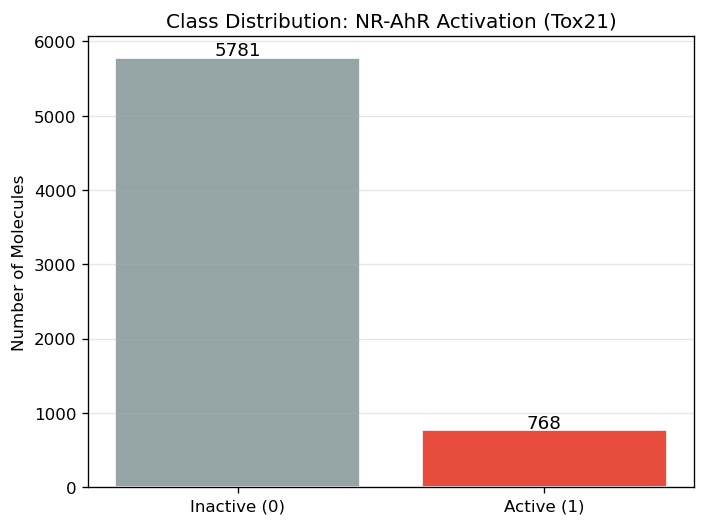
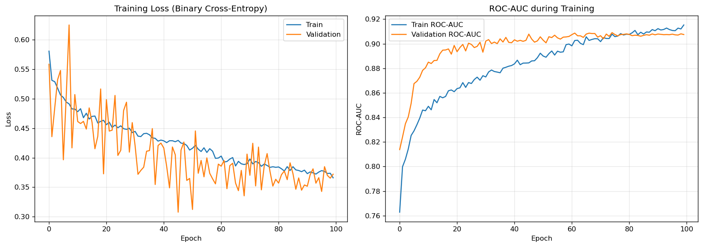
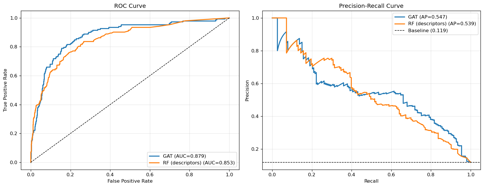
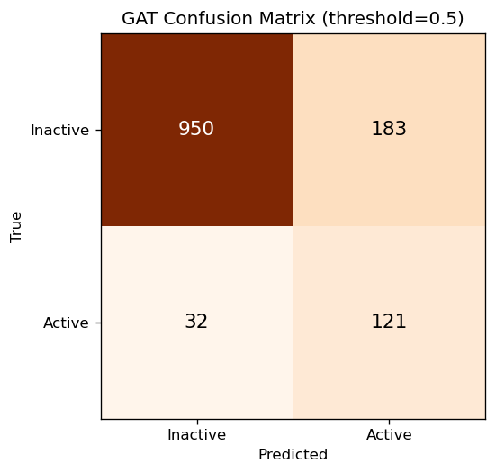
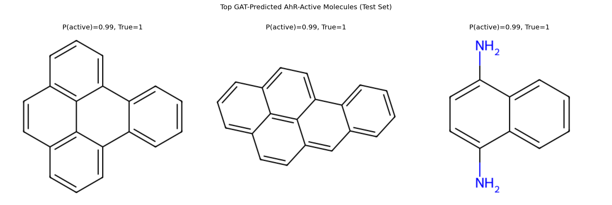

# Unit 18 應用實例（二）：以圖注意力網路(GAT)預測分子毒性

## 課程目標
- 認識 GNN 在**分子分類**任務的應用（與第一個範例的回歸任務互補）
- 理解**圖注意力網路 (Graph Attention Network, GAT)** 的注意力機制與多頭設計
- 學會處理**類別不平衡**資料：class weight、ROC-AUC、PR-AUC
- 以真實的 **Tox21 毒理學資料集** 訓練 GAT，預測分子是否活化芳香烴受體(AhR)
- 與 **描述子 + 隨機森林** 基線比較，並從預測結果解讀化學意義

---

## 1. 應用背景：分子毒性篩選與 AhR

**分子毒性篩選** 是化工、製藥與環境工程的共同關鍵議題：

- **製程安全**：評估原料、中間體、產物的潛在毒性與危害
- **綠色化學**：篩選低毒性的替代溶劑與試劑
- **環境風險評估**：預測工業化學品對生態與人體的影響
- **法規遵循**：REACH、GHS 等規範要求化學品的毒理資料

傳統毒性測試需要**動物實驗或體外試驗**，耗時且昂貴。以 GNN 直接從**分子結構**預測毒性，可大幅加速初步篩選。

### 1.1 芳香烴受體 (AhR)

**芳香烴受體 (Aryl hydrocarbon Receptor, AhR)** 是環境毒理學中最受關注的標靶之一。它會被以下**工業污染物**活化：

- **戴奧辛 (Dioxins)** —— 燃燒與化工製程的副產物
- **多環芳香烴 (PAHs)** —— 石化燃料不完全燃燒的產物（如苯并芘 benzo[a]pyrene）
- **多氯聯苯 (PCBs)** —— 早期工業絕緣與冷卻液

AhR 被活化後會引發一系列毒性反應（致癌、免疫毒性、發育毒性）。因此，**預測分子是否活化 AhR**，對石化、環境與材料產業的化學品安全評估極具價值。

> [!NOTE]
> 本範例的任務 **NR-AhR** 正是預測分子對 AhR 的活化能力。模型若能從結構辨識出 PAH 這類已知的 AhR 活化劑，即代表它學到了真實的「結構-毒性關係」。

---

## 2. Tox21 資料集與 NR-AhR 任務

**Tox21 (Toxicology in the 21st Century)** 是由美國 NIH、EPA、FDA 等機構共同發起的大型毒理學計畫，提供約 7800 個化合物在 12 種生物檢測(assay)上的毒性標記。

| 項目 | 內容 |
|------|------|
| **完整資料集** | 7831 列 $\times$ 14 欄（12 個 assay + mol_id + SMILES） |
| **本範例任務** | NR-AhR（芳香烴受體活化） |
| **有標記樣本** | 6549 個分子 |
| **正例（活化）** | 768 個（11.73%） |
| **負例（未活化）** | 5781 個（88.27%） |
| **類別不平衡比** | 約 7.5 : 1（負 : 正） |

**資料來源**：
- Huang R. et al. (2016). "Tox21 Challenge to Build Predictive Models of Nuclear Receptor and Stress Response Pathways Using Chemical Structure." *Frontiers in Environmental Science*, 3:85.
- 透過 MoleculeNet / DeepChem 公開提供：`tox21.csv.gz`

### 2.1 類別分佈

正例（有毒性）僅約 12%，是典型的**不平衡分類**問題。這會影響評估指標的選擇與訓練策略（見第 4.5 節）。



---

## 3. 分子圖與資料前處理

### 3.1 從 SMILES 到分子圖

與第一個範例相同，以 RDKit 把 SMILES 轉成原子特徵矩陣 $X \in \mathbb{R}^{N \times F}$ （ $F = 27$ ）與鄰接矩陣 $A$ 。原子特徵包含原子種類、度、形式電荷、雜化、芳香性、連接氫數、是否在環上。

### 3.2 去除鹽類與反離子

Tox21 含有**鹽類與混合物**（SMILES 以 `.` 分隔多個片段）。我們取**最大的分子片段**並重新 sanitize，以聚焦主要結構、去除反離子（如 Na⁺、Cl⁻）。

### 3.3 Padding 與過濾

- 少數分子非常大（最多逾百個原子）。為控制記憶體與計算量，**過濾掉原子數 > 50 的分子**（涵蓋約 95% 以上資料）。
- 將所有分子 padding 到相同原子數 $M = 50$ ，並以**節點遮罩(mask)** 標記真實原子。

經前處理後：解析失敗 7 個、過大剔除 114 個，**最終使用 6428 個分子**（正例率 11.89%）。

> [!NOTE]
> GAT 使用**含自連接**的二元鄰接矩陣 $A + I_{\mathrm{real}}$ （注意力在「鄰居 + 自身」之間計算），與 GCN 使用正規化鄰接矩陣 $\hat{A}$ 的作法不同。

---

## 4. 方法：圖注意力網路 (GAT)

### 4.1 GAT 與 GCN 的差異

第一個範例使用的 **GCN** 在聚合鄰居時，權重由圖結構**固定**決定（正規化鄰接矩陣），對所有鄰居一視同仁。**GAT** 則引入**注意力機制**，讓模型**自適應地學習**每個鄰居的重要性：

| 特性 | GCN | GAT |
|------|-----|-----|
| 鄰居權重 | 固定（由度正規化決定） | 可學習（注意力係數） |
| 表達能力 | 較弱 | 較強 |
| 可解釋性 | 低 | 高（注意力權重可視化） |
| 計算量 | 低 | 較高 |

### 4.2 注意力機制

GAT 單層對節點 $i$ 的更新為：

$$
h_i' = \sigma\left( \sum_{j \in \mathcal{N}(i) \cup \{i\}} \alpha_{ij}\, W h_j \right)
$$

其中注意力係數 $\alpha_{ij}$ 衡量鄰居 $j$ 對節點 $i$ 的重要性，由可學習的注意力向量計算後經 LeakyReLU 與 softmax 正規化：

$$
\alpha_{ij} = \mathrm{softmax}_j\left( \mathrm{LeakyReLU}\left( \vec{a}_{\mathrm{src}}^\top W h_i + \vec{a}_{\mathrm{dst}}^\top W h_j \right) \right)
$$

直覺上：模型學會「對預測毒性而言，哪些相鄰原子更值得關注」。例如芳香環上的碳原子可能獲得較高的注意力權重。

### 4.3 多頭注意力 (Multi-Head Attention)

為提升穩定性與表達力，GAT 使用**多組獨立的注意力**（multi-head）並行計算，再將結果合併：

- **串接 (concat)**：將各 head 的輸出串接（用於中間層）
- **平均 (average)**：將各 head 的輸出平均（用於輸出層）

本範例第一層用 4 個 head（每個 16 維，串接成 64 維），第二層用 1 個 head（32 維）。

### 4.4 讀出與分類頭

- 以 **masked mean pooling** 將所有原子的表示彙整成單一分子表示 $h_{\mathrm{mol}}$
- 接一個 MLP + **sigmoid** 輸出活化機率 $P(\text{active}) \in [0, 1]$

模型架構：

```
SMILES → 最大片段 → 分子圖 (X, A)
    ↓  padding + 自連接
[X, A+I, mask]
    ↓  GAT 層 1 (4 heads × 16, concat → 64, ELU) → 乘遮罩
    ↓  GAT 層 2 (1 head × 32, ELU) → 乘遮罩
    ↓  masked mean pooling (讀出)
    ↓  Dense(32, ReLU) → Dropout → Dense(1, sigmoid)
P(AhR active)
```

### 4.5 類別不平衡處理

正例僅約 12%，若不處理，模型會傾向全部預測為「無毒」而仍有高準確率（但毫無用處）。對策：

- **Class weight**：訓練時給少數類別（正例）更高的損失權重。本範例計算得 $w_0 = 0.567$ 、 $w_1 = 4.208$ 。
- **評估指標改用 ROC-AUC 與 PR-AUC**：準確率在不平衡資料下具誤導性；ROC-AUC 衡量整體排序能力，PR-AUC（平均精確率）更聚焦於少數的正例。

> [!TIP]
> 在不平衡分類中，**切勿只看準確率**。一個「全部預測為多數類」的模型準確率可達 88%，但完全無法辨識毒性分子（Recall = 0）。

---

## 5. 實驗結果與討論

以**分層抽樣**進行 80/20 分割：訓練集 5142 個分子（正例 611）、測試集 1286 個分子（正例 153）。

### 5.1 訓練過程

模型以二元交叉熵損失訓練 100 個 epoch，套用 class weight，並以驗證集 ROC-AUC 作為 EarlyStopping 依據，**最佳驗證 ROC-AUC 約 0.908**。



**討論**：左圖為二元交叉熵損失，右圖為訓練/驗證 ROC-AUC。驗證 AUC 穩定上升並收斂於約 0.90，顯示模型有效學習結構與毒性的關係。

### 5.2 方法比較

在**相同測試集（1286 個分子）** 上比較兩種方法：

| 模型 | ROC-AUC | PR-AUC |
|------|---------|--------|
| **GAT（圖注意力）** | **0.884** | **0.575** |
| 描述子 + 隨機森林 | 0.853 | 0.539 |
| 參考：隨機猜測 / 正例基準率 | 0.500 | 0.119 |

**觀察與討論**：

- **GAT 在兩項指標都優於隨機森林基線**（ROC-AUC 0.884 vs 0.853、PR-AUC 0.575 vs 0.539），顯示從分子圖學習的表示優於固定的全域描述子。
- **PR-AUC（0.575）** 遠高於正例基準率（0.119），代表模型對少數的毒性分子具有實質的辨識能力（約 5 倍於隨機）。
- GAT 的 ROC-AUC 約 0.88，與文獻中 Tox21 任務的 GNN 表現相當。

### 5.3 ROC 曲線與 PR 曲線



- **左圖（ROC）**：GAT（藍）整條曲線都在隨機森林（橘）之上，且遠離對角線（隨機）。
- **右圖（PR）**：兩者都遠高於基準線（0.119）；GAT 在中高 recall 區間的 precision 略優。

### 5.4 混淆矩陣與分類報告

以閾值 0.5 的分類報告（測試集）：

| 類別 | Precision | Recall | F1-score | Support |
|------|-----------|--------|----------|---------|
| Inactive（無毒） | 0.96 | 0.85 | 0.90 | 1133 |
| Active（有毒） | 0.41 | 0.76 | 0.53 | 153 |
| **Accuracy** | | | **0.84** | 1286 |



**討論**：
- 由於套用了 class weight，模型對正例的 **Recall 達 0.76**（成功抓到約四分之三的毒性分子），這在安全篩選中非常重要（寧可多篩、不可漏檢）。
- 代價是正例 **Precision 僅 0.41**（存在較多誤報）。這是**不平衡分類的典型取捨**：提高 Recall 會降低 Precision。
- 實務上可依需求調整決策**閾值**：安全導向可降低閾值以提高 Recall，精準導向則提高閾值。

### 5.5 範例分子：模型學到了真實化學

下圖為測試集中模型最有信心判定為「AhR 活化」的 3 個分子（預測機率皆約 0.99，且實際標記皆為陽性）：



**關鍵發現**：這些高信心的毒性預測，正是**多環芳香烴 (PAHs)** 與**偶氮染料 (azo dye)** 等已知的 AhR 活化劑。其中大型稠環芳香結構（類似苯并芘 benzo[a]pyrene）是環境毒理學的經典 AhR 致癌物。

> [!IMPORTANT]
> 這代表 GAT **並非黑箱背誦**，而是學到了真實的「結構-毒性關係」：**稠環芳香結構 → 活化 AhR**。這與數十年的毒理學知識一致，大幅提升了模型的可信度。

---

## 6. 結論與延伸

### 6.1 核心重點回顧

1. **分類任務**：GNN 將輸出層改為 sigmoid + 交叉熵即可做二元分類
2. **GAT 架構**：注意力機制自適應加權鄰居，表達力與可解釋性優於 GCN
3. **不平衡處理**：class weight + ROC-AUC / PR-AUC 才能正確訓練與評估
4. **結果**：GAT（ROC-AUC 0.884）優於描述子 + 隨機森林（0.853）
5. **可解釋性**：模型高信心預測的毒性分子為 PAH，符合真實毒理學

### 6.2 GNN 分類在化工的價值

- **化學品安全篩選**：快速初篩大量候選化合物的潛在毒性
- **綠色溶劑設計**：排除高毒性結構，篩選環境友善替代品
- **環境風險評估**：預測工業污染物的生物活性

### 6.3 延伸學習方向

- **多任務學習**：同時預測 12 個 Tox21 任務，共享分子表示
- **注意力視覺化**：將 GAT 的注意力權重映射回分子，標示致毒的關鍵子結構
- **邊特徵**：加入鍵級（單/雙/芳香鍵）使用 MPNN
- **嚴格評估**：scaffold split 評估對全新骨架的泛化能力

**推薦閱讀**：
- Veličković, P. et al. (2018). "Graph Attention Networks." *ICLR*.
- Huang R. et al. (2016). "Tox21 Challenge..." *Frontiers in Environmental Science*, 3:85.
- Wu, Z. et al. (2018). "MoleculeNet: a benchmark for molecular machine learning." *Chemical Science* 9(2), 513-530.

---

**課程資訊**
- 課程名稱：AI在化工上之應用
- 課程單元：Unit18 - GNN 應用實例：分子毒性分類 (GAT)
- 課程製作：逢甲大學 化工系 智慧程序系統工程實驗室
- 授課教師：莊曜禎 助理教授
- 更新日期：2026-11-15

**課程授權 [CC BY-NC-SA 4.0]**
 - 本教材遵循 [創用CC 姓名標示-非商業性-相同方式分享 4.0 國際 (CC BY-NC-SA 4.0)](https://creativecommons.org/licenses/by-nc-sa/4.0/deed.zh) 授權。
