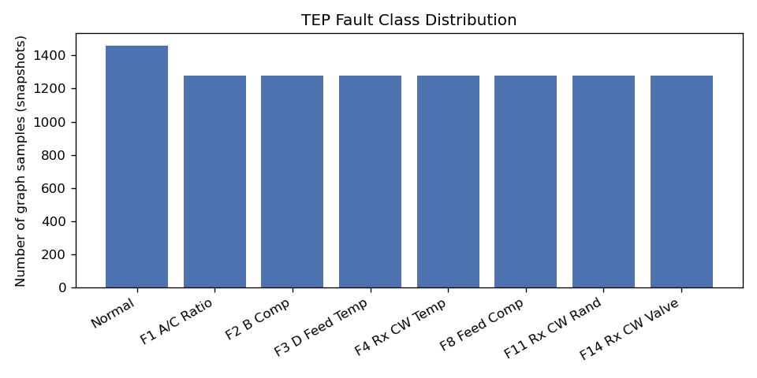
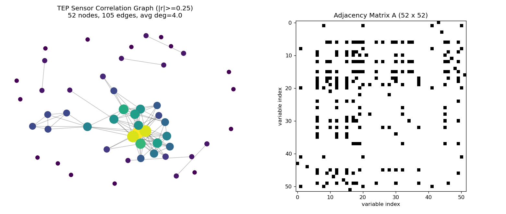
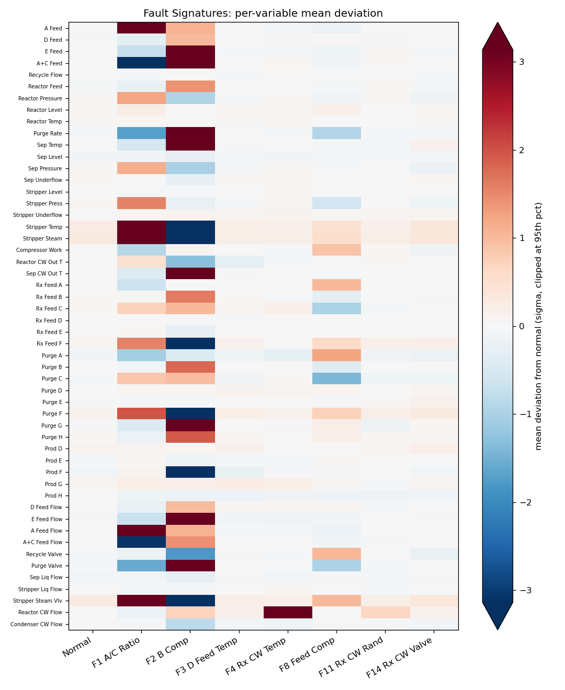
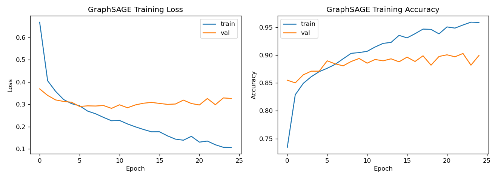
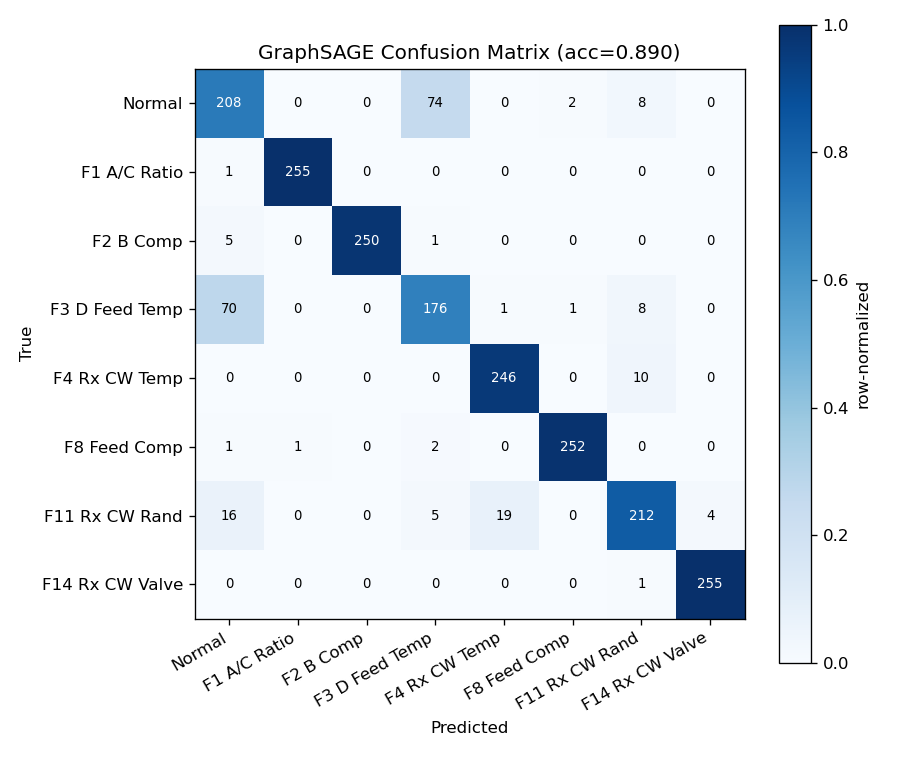
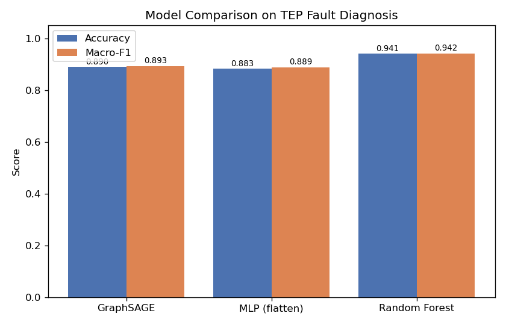
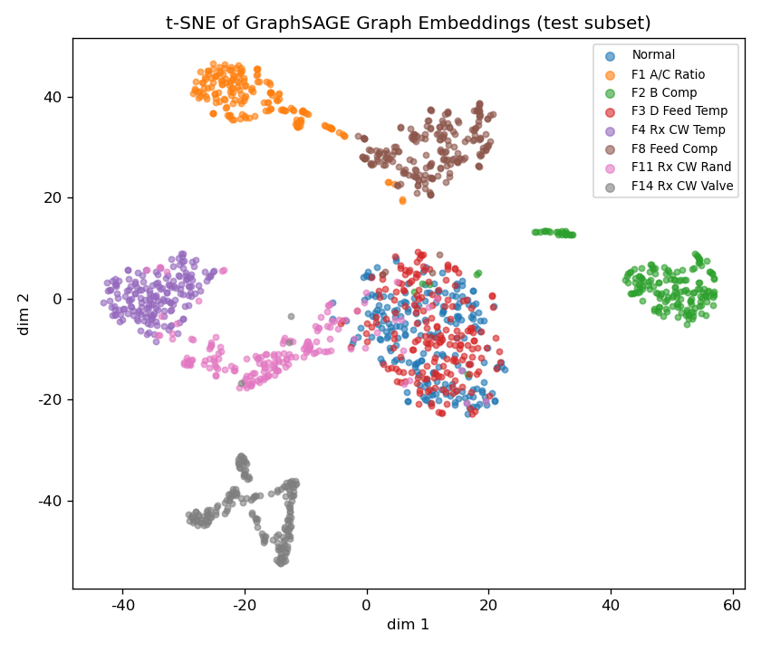
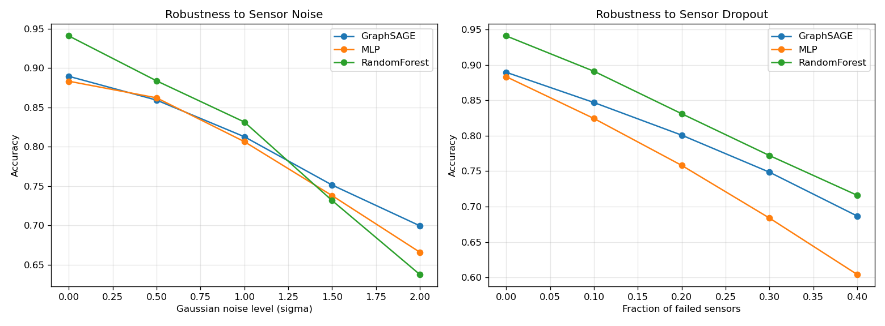

# Unit 18 應用實例（三）：以 GraphSAGE 進行製程故障診斷

## 課程目標
- 認識 GNN 在**製程系統工程**的應用：把感測器網路建模為圖，進行故障診斷（與前兩個分子範例互補）
- 學會從**正常操作資料的相關性**建立固定拓撲的**感測器關聯圖**
- 從零實作 **GraphSAGE**（鄰居聚合 + 自身串接）層，理解其與 GCN / GAT 的差異
- 理解「**固定拓撲 → 節點對齊 flatten 讀出**」與分子圖「排列不變 pooling」的根本區別
- 以真實的 **田納西-伊士曼製程 (TEP)** 資料訓練 GraphSAGE 做多類別故障分類，並與 **MLP、Random Forest** 誠實比較
- 透過**感測器失效與雜訊**的穩健性測試，展現 GNN 利用圖結構的獨特價值

---

## 1. 應用背景：製程故障診斷與 TEP

**製程故障診斷(Process Fault Diagnosis)** 是化工廠安全與效益的核心課題：

- **製程安全**：及早偵測並辨識異常，避免事故與停車
- **產品品質**：故障常導致產品規格偏移，需快速定位成因
- **設備維護**：區分感測器故障、閥門卡住、冷卻系統異常等不同根因
- **自動化監控**：現代化工廠有數百至數千個感測器，需自動化的診斷工具

傳統故障診斷多以**多變量統計製程管制(MSPC)**（如 PCA 的 $T^2$ 與 SPE 統計量，見 Unit09）進行，擅長**偵測**異常，但對「是**哪一種**故障」的**分類**能力有限。近年來，把製程感測器視為**圖**、以 **GNN** 進行診斷成為新興方向，因為它能**明確利用變數之間的關聯結構**。

> [!NOTE]
> 本範例是 Unit18 的第三個應用案例。前兩個案例（分子溶解度回歸、分子毒性分類）都是**分子圖**上的圖層級預測；本案例改用**製程感測器圖**，示範 GNN 在**節點對齊、固定拓撲**情境下的建模方式，並以 **GraphSAGE** 架構補齊 Unit18 的 GCN / GAT / GraphSAGE 三大經典架構。

### 1.1 田納西-伊士曼製程 (TEP)

**田納西-伊士曼製程 (Tennessee Eastman Process, TEP)** 由 Downs 與 Vogel（1993）提出，是製程控制與故障診斷領域最著名的**基準測試案例**。它模擬一個連續式化學製程，由四種氣態反應物生成兩種液態產品，包含**反應器、冷凝器、氣液分離器、汽提塔與壓縮機**等單元操作。

TEP 共量測 **52 個製程變數**：

- `XMEAS(1..41)`：連續與取樣量測（進料流量、反應器溫度/壓力/液位、分離器與汽提塔狀態、各物流成分分析等）
- `XMV(1..11)`：操作變數（各進料閥、冷卻水流量、閥位、壓縮機回流閥等）

資料集提供 1 個正常狀態與 21 種預先定義的故障（IDV 1~21）。

**資料來源**：
- Downs, J. J., & Vogel, E. F. (1993). "A Plant-Wide Industrial Process Control Problem." *Computers & Chemical Engineering*, 17(3), 245-255.
- Russell, Chiang & Braatz 整理的訓練/測試資料集（本課程 Unit09 亦使用同一資料）。

---

## 2. TEP 資料集與「快照圖」框架

### 2.1 選定的故障類別

本範例選取 **Normal + 7 種故障** 共 **8 個類別**，刻意混入不同難度與物理成因的故障以產生有意義的混淆：

| 類別 | IDV | 說明 | 型態 |
|------|-----|------|------|
| Normal | — | 正常操作 | — |
| F1 | 1 | A/C 進料比例改變 | Step |
| F2 | 2 | B 成分改變 | Step |
| F3 | 3 | D 進料溫度改變 | Step（**難偵測**） |
| F4 | 4 | 反應器冷卻水入口溫度 | Step |
| F8 | 8 | A,B,C 進料成分 | Random |
| F11 | 11 | 反應器冷卻水入口溫度 | Random |
| F14 | 14 | 反應器冷卻水閥卡住 | Sticking |

> [!TIP]
> **F3** 是 TEP 文獻中著名的**難偵測故障**（D 進料溫度的小幅步階變化，幾乎不影響穩態量測）；而 **F4、F11、F14** 都與**反應器冷卻水**有關，物理成因相近。這樣的選擇讓混淆矩陣能呈現真實且可解讀的錯誤模式。

### 2.2 核心概念：快照即圖

本範例採用最直觀的建模方式 —— **每一個時間點的 52 個感測器讀數視為一張圖**（52 個節點）。節點特徵為該時刻各變數相對正常基準的**標準化偏差**（z-score），整張圖對應一個故障類別標籤，於是故障診斷就成為**圖層級(graph-level)分類**問題。

所有快照共用**同一張固定拓撲**的感測器圖（見第 3 章），只是節點特徵隨時間變化。

> [!NOTE]
> TEP 原始資料中，正常訓練檔 `d00.dat` 以**轉置**形式儲存（52 列 × 500 行），載入時需轉置回 $(500, 52)$ ；測試檔 `_te.dat` 的故障於第 161 個樣本才導入，故僅取索引 160 之後作為故障樣本。正常類別使用 `d00.dat` 與 `d00_te.dat` 全部樣本。

### 2.3 資料集規模與類別分佈

載入並建立快照圖後，各類別樣本數如下（總計 **10420** 張圖）：

| 類別 | 樣本數 | 類別 | 樣本數 |
|------|--------|------|--------|
| Normal | 1460 | F4 Rx CW Temp | 1280 |
| F1 A/C Ratio | 1280 | F8 Feed Comp | 1280 |
| F2 B Comp | 1280 | F11 Rx CW Rand | 1280 |
| F3 D Feed Temp | 1280 | F14 Rx CW Valve | 1280 |



各類別樣本數接近平衡（Normal 略多），是典型的多類別分類設定。

---

## 3. 感測器關聯圖

### 3.1 從相關性建圖

GNN 的輸入是圖。製程變數之間存在物理關聯（例如反應器壓力與多個流量/成分、冷卻水流量與反應器溫度），這些關聯會反映在**正常操作資料的相關性**上。我們以正常資料計算 52 個變數兩兩的 **Pearson 相關係數** $r_{ij}$ ，取 $|r_{ij}| \ge 0.25$ 建立無向邊：

$$
A_{ij} = \begin{cases} 1 & |r_{ij}| \ge 0.25 \text{ 且 } i \ne j \\ 0 & \text{否則} \end{cases}
$$

得到的感測器圖為**固定拓撲**（所有快照共用），統計為：**105 條邊、平均度 4.04、15 個孤立節點**。GraphSAGE 使用**平均聚合器**，因此預先計算**列正規化**的鄰接矩陣：

$$
\hat{A} = D^{-1} A, \qquad D_{ii} = \sum_{j} A_{ij}
$$

> [!NOTE]
> 部分變數（如低頻取樣的成分分析、某些操作變數）在正常操作下與其他變數線性關聯較弱，形成**孤立節點**。這在物理上是合理的；GraphSAGE 透過「自身串接」機制，即使是孤立節點仍能保留並轉換自身特徵。

### 3.2 感測器圖視覺化



連接度最高的感測器依序為 **Reactor Pressure（度 18）、Sep Pressure（17）、Stripper Press（17）、Stripper Temp（12）、Compressor Work（11）**。

**討論**：
- **左圖（感測器圖）**：節點大小與顏色對應連接度。壓力類變數（反應器、分離器、汽提塔）是圖中的**樞紐(hub)** —— 符合化工直覺，因為壓力在氣相迴路中全域耦合，牽一髮而動全身。
- **右圖（鄰接矩陣）**：矩陣稀疏且對稱，可見壓力/流量相關變數形成的區塊狀連接模式。

### 3.3 故障特徵 (Fault Signatures)

每種故障會讓**特定子集**的感測器偏離正常值。下圖以 heatmap 顯示各類別每個變數的**平均標準化偏差**（單位：標準差 $\sigma$ ）：



各故障的平均絕對偏差幅度差異極大：**Normal 僅 $0.051\ \sigma$ 、F3 僅 $0.074\ \sigma$ （兩者幾乎無異）**，而 **F1 高達 $1.684\ \sigma$** 。

**討論**：
- 不同故障有不同的「指紋」—— F1（A/C 比例）、F8（進料成分）在成分相關變數上有強烈偏差；F4/F11/F14 則集中在反應器溫度與冷卻水相關變數。
- **F3 的偏差幾乎與 Normal 無異**（ $0.074$ vs $0.051\ \sigma$ ），這正是它難以偵測、且容易與 Normal 混淆的根本原因（見第 5 章混淆矩陣）。

---

## 4. 方法：GraphSAGE 圖層級分類

### 4.1 GraphSAGE 層

**GraphSAGE**（Hamilton et al., 2017）的核心是「**取樣並聚合(Sample and Aggregate)**」。對每個節點 $v$ ，先聚合鄰居的表示，再與自身表示**串接(concatenate)**後做線性轉換：

$$
h_v' = \sigma\left( W \cdot \mathrm{CONCAT}\big(h_v,\; \mathrm{AGG}_{u \in \mathcal{N}(v)} h_u\big) + b \right)
$$

本範例使用**平均聚合器(mean aggregator)**，即 $\mathrm{AGG} = \frac{1}{|\mathcal{N}(v)|}\sum_{u \in \mathcal{N}(v)} h_u$ ，可用列正規化鄰接矩陣 $\hat{A}$ 一次算出整張圖所有節點的鄰居平均。對批次張量 $H \in \mathbb{R}^{B \times N \times F}$ ，一層運算為：

$$
H' = \sigma\Big( \big[\,H \; \| \; \hat{A} H\,\big]\, W + b \Big)
$$

其中 $\|$ 表示沿特徵維度串接，實作上鄰居聚合 $\hat{A}H$ 以 `einsum('ij,bjf->bif')` 計算。

> [!IMPORTANT]
> **GraphSAGE 與 GCN / GAT 的關鍵差異**：
> - **GCN**（案例一）把自身與鄰居**一起**做對稱正規化加總（ $\hat{A} = \tilde{D}^{-1/2}\tilde{A}\tilde{D}^{-1/2}$ ）。
> - **GAT**（案例二）以**可學習的注意力係數**自適應加權鄰居。
> - **GraphSAGE**（本案例）把自身表示與鄰居聚合**分開後串接**再轉換，更能保留節點自身資訊，並天然支援**歸納式(inductive)** 學習。

### 4.2 讀出方式：固定拓撲的節點對齊 flatten

得到各節點的表示後，需進行**讀出(Readout)**，將 52 個節點彙整成單一圖向量。**這是本範例與分子範例最關鍵的設計差異**：

| | 分子圖（案例一/二） | 感測器圖（本案例） |
|---|---|---|
| 圖的大小 | 每個分子原子數不同 | 固定 52 個節點 |
| 節點對應 | 無（分子間原子不對應） | **一一對應**（節點 9 永遠是反應器溫度） |
| 必要性質 | **排列不變** | 可保留節點身分 |
| 讀出方式 | masked mean/max **pooling** | **flatten**（攤平 52 個節點表示） |

因為感測器圖是**固定拓撲、節點一一對應**，我們採用 **flatten 讀出**，直接攤平 $52 \times 64$ 的節點表示，**完整保留每個感測器的身分資訊** —— 這對「哪個感測器異常」的診斷至關重要。若改用 pooling（如分子範例）會抹除感測器身分，反而降低診斷準確率。這是感測器網路、交通網路等**固定圖**任務的常見設計。

### 4.3 模型架構總覽

```
每個時間點 52 感測器讀數 (z-score)
    ↓  建立節點特徵 (52, 1)
[X, 固定 A_hat]
    ↓  GraphSAGE 層 1 (ReLU)  → 1-hop 鄰域
    ↓  GraphSAGE 層 2 (ReLU)  → 2-hop 鄰域
    ↓  Flatten 讀出 (52 x 64 = 3328)  ← 保留感測器身分
    ↓  Dense(64, ReLU) → Dropout(0.3) → Dense(8, softmax)
8 類別故障機率
```

訓練設定：損失為交叉熵、Adam 優化器（學習率 $10^{-3}$ ）、EarlyStopping（監看驗證損失、還原最佳權重）、80/20 分層分割（訓練 **8336** 圖 / 測試 **2084** 圖）。

### 4.4 模型參數規模

| 層 | 輸出形狀 | 參數量 |
|----|---------|--------|
| GraphSAGE 層 1 | (None, 52, 64) | 192 |
| GraphSAGE 層 2 | (None, 52, 64) | 8,256 |
| Flatten（讀出） | (None, 3328) | 0 |
| Dense | (None, 64) | 213,056 |
| Dense（8 類輸出） | (None, 8) | 520 |
| **總計** | | **222,024** |

> [!NOTE]
> 參數主要集中在 flatten 後的 Dense 層（213,056）。這是保留感測器身分的代價；若改用 pooling 讀出可大幅減少參數，但會犧牲診斷準確率。

---

## 5. 實驗結果與討論

### 5.1 訓練過程

模型以交叉熵損失訓練，EarlyStopping 於第 **25** 個 epoch 停止；最終訓練準確率約 $0.959$ 、驗證準確率約 $0.899$ 。



**討論**：訓練與驗證準確率同步上升並收斂；訓練準確率略高於驗證，存在輕微過擬合，已由 Dropout 與 EarlyStopping 控制。

### 5.2 測試集表現與混淆矩陣

GraphSAGE 在測試集（2084 圖）的整體**準確率 $0.890$ 、macro-F1 $0.893$** 。各類別表現（完整 classification report）：

| 類別 | Precision | Recall | F1 | Support |
|------|-----------|--------|-----|---------|
| Normal | 0.691 | 0.712 | 0.702 | 292 |
| F1 A/C Ratio | 0.996 | 0.996 | 0.996 | 256 |
| F2 B Comp | 1.000 | 0.977 | 0.988 | 256 |
| F3 D Feed Temp | 0.682 | 0.688 | 0.685 | 256 |
| F4 Rx CW Temp | 0.925 | 0.961 | 0.943 | 256 |
| F8 Feed Comp | 0.988 | 0.984 | 0.986 | 256 |
| F11 Rx CW Rand | 0.887 | 0.828 | 0.857 | 256 |
| F14 Rx CW Valve | 0.985 | 0.996 | 0.990 | 256 |
| **macro avg** | **0.894** | **0.893** | **0.893** | **2084** |



**討論：錯誤模式完全符合物理直覺**

- **F1、F2、F8、F14 近乎完美**（F1 分類正確 255/256，異常特徵明顯且獨特）。
- **F3 ↔ Normal 嚴重混淆**：F3 有 **70** 個被判為 Normal，Normal 也有 **74** 個被判為 F3。這完全符合 3.3 節的發現 —— F3（D 進料溫度小幅步階）的感測器偏差（ $0.074\ \sigma$ ）幾乎與 Normal（ $0.051\ \sigma$ ）無法區分，是 TEP 著名的難偵測故障。
- **F4 ↔ F11 混淆**：F11 有 **19** 個被誤判為 F4、F4 有 **10** 個被誤判為 F11。兩者**都是反應器冷卻水入口溫度異常**（F4 為 Step、F11 為 Random），物理成因相同，區分本就困難。

這些錯誤**不是模型缺陷，而是故障本質相似性的真實反映** —— 正是診斷模型評估時最該關注的洞察。

### 5.3 基線比較：GNN 真的比較好嗎？

在**相同測試集**上比較三種模型：

| 模型 | 準確率 | Macro-F1 | 參數量 |
|------|--------|----------|--------|
| **GraphSAGE（本範例，用圖結構）** | 0.890 | 0.893 | 222,024 |
| MLP（攤平輸入，忽略圖結構） | 0.883 | 0.889 | 15,560 |
| Random Forest（樹集成） | **0.941** | **0.942** | — |



**誠實的觀察**：

- 在**乾淨資料**上，**Random Forest 反而最準**（ $0.941$ ）。這是一個重要且誠實的事實：對 TEP 這類**表格式**故障分類，樹集成往往是極強的基線，GNN 不必然勝過它。
- GraphSAGE（ $0.890$ ）**優於同為神經網路的 MLP**（ $0.883$ ），顯示感測器圖結構確實帶來幫助。
- 那麼 GNN 的價值何在？答案在下一節的**穩健性測試**。

> [!IMPORTANT]
> 這再次呼應機器學習的通則（與案例一「GAT 不必然勝 GCN」一致）：**不要只看乾淨資料上的單一準確率**。模型的真正價值要放在**部署情境**（雜訊、感測器失效、可解釋性、可擴展性）下評估。

### 5.4 學習到的圖嵌入 (t-SNE)

把 GraphSAGE 分類頭前的 64 維圖向量以 t-SNE 投影到 2D：



**討論**：
- **F1、F2、F8、F14、F4** 各自形成**清楚分離的簇**，代表模型學到了可分辨的故障表示。
- **Normal 與 F3 的點完全交疊在中央** —— 視覺化地印證了 5.2 節的 F3 ↔ Normal 混淆。
- t-SNE 圖與混淆矩陣相互印證，是檢視分類模型「學到什麼」的有力工具。

---

## 6. 穩健性測試：GNN 的真正價值

工業現場的感測器會**老化、產生雜訊、甚至失效(讀數遺失)**。GNN 的鄰居聚合機制理論上能**從相關的鄰近感測器重建被破壞的資訊**，因此對感測器劣化應更穩健。我們用訓練好的三個模型，在**逐步破壞的測試集**上評估，模擬兩種情境：

- **感測器雜訊**：對每個讀數加上不同強度的高斯雜訊（以 $\sigma$ 為單位）
- **感測器失效**：隨機將一定比例的感測器讀數設為 0（模擬訊號遺失）



### 6.1 感測器失效（右圖）：GraphSAGE 明顯勝過 MLP

| 失效比例 | GraphSAGE | MLP | Random Forest |
|---------|-----------|-----|---------------|
| 0%（乾淨） | 0.890 | 0.883 | 0.941 |
| 10% | **0.847** | 0.824 | 0.891 |
| 20% | **0.801** | 0.758 | 0.831 |
| 30% | **0.749** | 0.684 | 0.772 |
| 40% | **0.687** | 0.604 | 0.716 |

**這是 GNN 在此任務的真正價值**：隨著感測器失效比例上升，**GraphSAGE 與 MLP 的差距持續擴大**（10% 時領先 $+0.023$ ，40% 時擴大到 $+0.083$ ）。原因是 GraphSAGE 透過感測器圖的鄰居聚合，能用**相關的鄰近感測器**補償遺失的讀數；而只看攤平輸入的 MLP 完全無此能力。在此情境下 GraphSAGE 已很接近 Random Forest。

### 6.2 感測器雜訊（左圖）：神經網路在高雜訊下反超樹模型

| 雜訊強度 | GraphSAGE | MLP | Random Forest |
|---------|-----------|-----|---------------|
| $0.5\ \sigma$ | 0.859 | 0.862 | 0.884 |
| $1.0\ \sigma$ | 0.813 | 0.807 | 0.832 |
| $1.5\ \sigma$ | 0.751 | 0.738 | 0.732 |
| $2.0\ \sigma$ | 0.700 | 0.666 | 0.638 |

在**高雜訊**下（ $\ge 1.5\ \sigma$ ），兩個神經網路模型都**反超 Random Forest** —— 深度模型學到的平滑表示對加性雜訊較不敏感。此情境下 GraphSAGE 與 MLP 互有高下、大致相當（雜訊是全域的，鄰居聚合的補償效果不如「失效」情境明顯）。

> [!IMPORTANT]
> **結論：模型的選擇取決於部署情境。**
> - 乾淨、穩定的量測 → Random Forest 這類樹集成是高效強基線。
> - **感測器可能失效/遺失**（工業常態）→ GraphSAGE 的圖結構補償能力使其顯著優於 MLP，是更穩健的選擇。
> - GNN 的價值不在於乾淨準確率的小幅領先，而在於**把製程拓撲作為歸納偏置(inductive bias)**，帶來結構化、可擴展、抗劣化的診斷能力。

---

## 7. 結論與延伸

### 7.1 核心重點回顧

1. **快照即圖**：每個時間點的 52 個感測器讀數構成一張固定拓撲的圖，故障診斷化為圖層級分類。
2. **從相關性建圖**：以正常操作資料的變數相關性（ $|r| \ge 0.25$ ，105 條邊）建立感測器關聯圖，壓力類變數為樞紐節點。
3. **GraphSAGE**：以「鄰居平均聚合 + 自身串接」更新節點表示；因圖為**固定拓撲、節點對齊**，採用保留感測器身分的 **flatten 讀出**（與分子圖的 pooling 讀出形成鮮明對比）。
4. **誠實的基線比較**：乾淨資料上 Random Forest（ $0.941$ ）最強，GraphSAGE（ $0.890$ ）優於 MLP（ $0.883$ ）但不必然勝過樹集成。
5. **穩健性才是關鍵優勢**：在**感測器失效**情境下，GraphSAGE 透過圖結構補償遺失資訊，**顯著優於 MLP**（失效 40% 時領先 $+0.083$ ），展現 GNN 利用製程拓撲的價值。
6. **可解讀的錯誤**：混淆矩陣與 t-SNE 一致顯示 F3 ↔ Normal（難偵測故障）、F4 ↔ F11（同為反應器冷卻異常）的混淆，皆符合物理直覺。

### 7.2 與前兩個分子範例的對照

| 面向 | 案例一/二（分子） | 案例三（製程） |
|------|-----------------|---------------|
| 圖的種類 | 分子圖（原子-鍵） | 感測器關聯圖 |
| 圖的拓撲 | 每個分子不同、大小不一 | 固定、節點一一對應 |
| 讀出方式 | 排列不變 pooling | 節點對齊 flatten |
| 架構 | GCN / GAT | GraphSAGE |
| 任務層級 | 圖層級回歸 / 分類 | 圖層級多類別分類 |
| 應用領域 | 化學資訊學 (QSPR/QSAR) | 製程系統工程 |

三個案例合起來，完整涵蓋了 Unit18 的 **GCN、GAT、GraphSAGE** 三大經典架構，以及**可變拓撲 pooling** 與**固定拓撲 flatten** 兩種讀出範式。

### 7.3 延伸方向

- **物理建圖**：用製程流程圖(PFD/P&ID)的實際物理連接取代相關性建圖，納入領域知識。
- **節點層級任務**：改為**故障根因定位**（判斷哪個感測器/單元最先異常），這是節點層級的 GNN 應用。
- **時空圖網路 (ST-GNN)**：結合時間窗與 GNN，同時捕捉故障的**空間關聯**與**動態演化**。
- **可解釋性**：以注意力或 GNNExplainer 找出對某次診斷最關鍵的感測器子圖，輔助工程師判讀。

> [!TIP]
> 本範例展示了 GNN 不是「永遠最好」的萬靈丹，而是一個在**結構化、感測器可能劣化**的製程環境中，具備獨特優勢的工具。學會誠實評估、針對部署情境選擇模型，才是化工 AI 應用的關鍵素養。

---

**課程資訊**
- 課程名稱：AI在化工上之應用 (ChemE 3590)
- 課程單元：Unit 18 圖神經網路(GNN) — 應用實例（三）製程故障診斷
- 課程製作：逢甲大學 化工系 智慧程序系統工程實驗室
- 授課教師：莊曜禎 助理教授
- 更新日期：2026-11-15

**課程授權 [CC BY-NC-SA 4.0]**
 - 本教材遵循 [創用CC 姓名標示-非商業性-相同方式分享 4.0 國際 (CC BY-NC-SA 4.0)](https://creativecommons.org/licenses/by-nc-sa/4.0/deed.zh) 授權。

---
