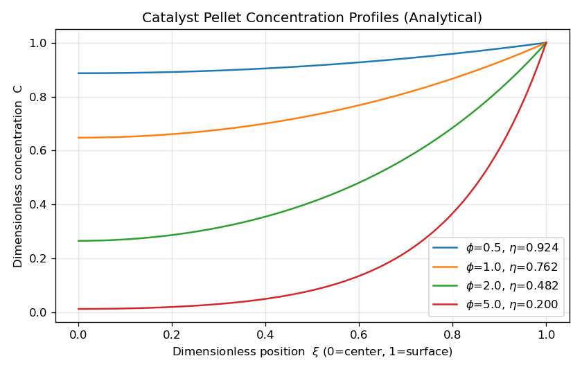
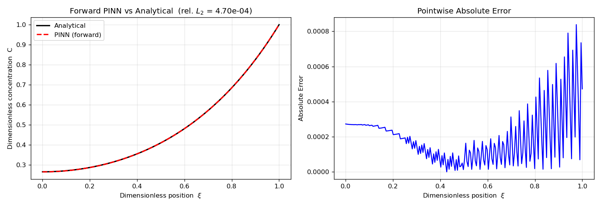
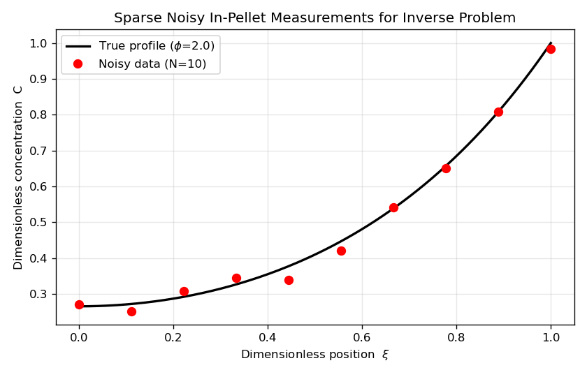
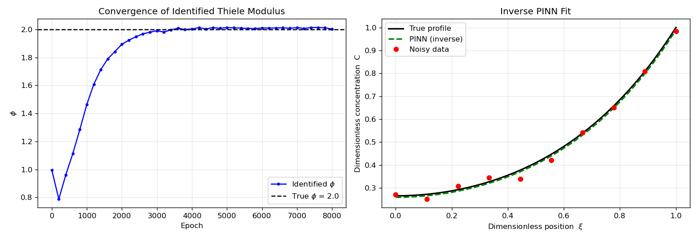

# Unit 19 應用實例：以物理資訊神經網路求解觸媒顆粒內擴散-反應

## 課程目標
- 認識物理資訊神經網路(PINN)在**反應工程**的代表性應用：多孔觸媒顆粒內的擴散-反應
- 理解 **Thiele 模數** $\phi$ 與**有效因子** $\eta$ 的物理意義與工程重要性
- 掌握以 PINN 求解**二階邊界值問題(BVP)**，並用**巢狀自動微分**計算二階導數
- 學會同時處理 **Dirichlet(表面)** 與 **Neumann(中心對稱)** 邊界條件
- 以 PINN 完成**正問題**（求濃度分佈與有效因子）與**反問題**（由稀疏量測辨識 Thiele 模數）

---

## 1. 應用背景：為什麼要研究觸媒顆粒內的擴散-反應？

在石化與化工產業中，**非均相催化(Heterogeneous Catalysis)** 無所不在：加氫裂解、觸媒重組、氨合成、汽車尾氣淨化、費托合成等，都依賴多孔固體觸媒。反應物分子必須：

1. 從主體流體**擴散**到觸媒顆粒外表面
2. 繼續**向顆粒內部擴散**（孔道內擴散）
3. 吸附在活性位並**反應**
4. 產物**擴散**離開

當反應很快而擴散相對較慢時，反應物還來不及深入顆粒就已消耗殆盡，顆粒**中心的濃度遠低於表面**，內部的活性位沒有被充分利用。這種現象稱為**內擴散限制(Internal Diffusion Limitation)**，是觸媒設計與反應器放大時必須量化的關鍵因素。

> [!NOTE]
> 這個問題由 **Ernest Thiele** 於 1939 年在《Industrial & Engineering Chemistry》提出，奠定了至今仍廣泛使用的 **Thiele 模數** 與 **有效因子** 理論。它是每一本反應工程教科書（如 Fogler、Froment & Bischoff）的核心內容。

**為什麼用 PINN？**

- 傳統上此 BVP 以**有限差分/正交配置法**求解；對於簡單幾何與一級反應甚至有**解析解**
- 但在**實務**中，觸媒的有效擴散係數 $D_e$ 與反應速率常數 $k$ 常**未知**，需要由**實驗量測的顆粒內濃度分佈**反推 — 這正是 PINN 的強項：**同一框架同時求解分佈並辨識未知物性參數**

---

## 2. 問題的物理模型與控制方程

### 2.1 無因次化與 Thiele 模數

考慮**平板(slab)幾何**的觸媒（半厚度 $L$ ），內部進行一級不可逆反應 $A \rightarrow B$ ，反應速率 $-r_A = k\, c$ 。在穩態下，對微元做質量平衡（擴散項 = 反應項）：

$$
D_e \frac{d^2 c}{dx^2} = k\, c
$$

其中 $c$ 是反應物濃度、 $x$ 是從中心量起的位置、 $D_e$ 是有效擴散係數。引入無因次變數：

$$
C = \frac{c}{c_s}, \qquad \xi = \frac{x}{L}
$$

（ $c_s$ 為外表面濃度）可得無因次控制方程：

$$
\frac{d^2 C}{d\xi^2} = \phi^2\, C
$$

其中 **Thiele 模數** 定義為：

$$
\phi = L\sqrt{\frac{k}{D_e}}
$$

它是一個無因次群，物理意義為「**反應速率相對於擴散速率**」。 $\phi$ 大表示反應遠快於擴散（強內擴散限制）； $\phi$ 小表示擴散充分（反應控制）。

### 2.2 邊界條件與解析解

此二階 ODE 需要兩個邊界條件：

$$
\left.\frac{dC}{d\xi}\right|_{\xi=0} = 0 \quad (\text{中心對稱，無通量}), \qquad C(1) = 1 \quad (\text{外表面濃度})
$$

- **中心 Neumann 條件**：由對稱性，顆粒中心沒有淨擴散通量
- **表面 Dirichlet 條件**：外表面濃度等於主體流體濃度（忽略外部膜阻力）

此線性 BVP 具有**解析解**，方便驗證 PINN：

$$
C(\xi) = \frac{\cosh(\phi\,\xi)}{\cosh(\phi)}
$$

可驗證： $\xi=1$ 時 $C=1$ ；對 $\xi$ 微分含 $\sinh(\phi\xi)$ ，在 $\xi=0$ 時為 0，滿足 Neumann 條件。

### 2.3 有效因子

**有效因子(Effectiveness Factor)** $\eta$ 定義為「顆粒實際平均反應速率」與「假設整顆粒都處於表面濃度時的反應速率」之比。對無因次一級反應（速率 $\propto C$ ，表面 $C=1$ ）：

$$
\eta = \frac{\int_0^1 C(\xi)\, d\xi}{\int_0^1 1\, d\xi} = \int_0^1 C(\xi)\, d\xi
$$

代入解析解積分可得平板一級反應的經典結果：

$$
\eta = \frac{\tanh\phi}{\phi}
$$

> [!TIP]
> 當 $\phi \to 0$ （無擴散限制）時 $\eta \to 1$ （整顆粒都有效）；當 $\phi$ 很大時 $\eta \approx 1/\phi$ （只有近表面薄層有效）。本範例取 $\phi = 2.0$ ，對應 $\eta = \tanh(2)/2 = 0.4820$ ，代表只有約 48% 的觸媒被有效利用，屬於明顯的內擴散限制。

下圖為不同 Thiele 模數下的解析濃度分佈：  $\phi$ 越大，顆粒中心濃度越低、分佈越陡。

| Thiele 模數 $\phi$ | 中心濃度 $C(0)=1/\cosh\phi$ | 有效因子 $\eta=\tanh\phi/\phi$ | 物理意義 |
|---|---|---|---|
| 0.5 | 0.887 | 0.924 | 反應控制，擴散充分 |
| 1.0 | 0.648 | 0.762 | 中度限制 |
| 2.0 | 0.266 | 0.482 | 明顯內擴散限制（本範例） |
| 5.0 | 0.013 | 0.200 | 強內擴散限制 |

---

## 3. PINN 建模策略

### 3.1 用網路表示濃度分佈

我們用一個神經網路 $\hat{C}_\theta(\xi)$ 來近似顆粒內的濃度分佈，輸入是無因次位置 $\xi$ ，輸出是無因次濃度 $C$ 。網路採用 4 個隱藏層、每層 20 個神經元、 $\tanh$ 激活（因為要計算**二階導數**，激活函數必須夠平滑），共 1,321 個可訓練參數。

### 3.2 二階導數與巢狀自動微分

與 Unit19 概述範例（一階 ODE）不同，本問題的控制方程含**二階導數** $\dfrac{d^2 C}{d\xi^2}$ 。在 TensorFlow 中以**兩層巢狀 `tf.GradientTape`** 計算：內層對 $\xi$ 求一階導數 $\dfrac{dC}{d\xi}$ ，外層再對 $\xi$ 求一次得到二階導數。PDE 殘差為：

$$
r(\xi) = \frac{d^2 \hat{C}_\theta}{d\xi^2} - \phi^2\,\hat{C}_\theta(\xi)
$$

中心 Neumann 條件也以一層 `tf.GradientTape` 計算 $\dfrac{dC}{d\xi}\big|_{\xi=0}$ 。

### 3.3 複合損失

總損失由 PDE 殘差與兩個邊界條件組成。由於邊界條件對 BVP 的唯一解至關重要，我們將邊界項**加權 10 倍**以強化約束：

$$
\mathcal{L} = \mathcal{L}_{\mathrm{pde}} + 10\big(\mathcal{L}_{\mathrm{surf}} + \mathcal{L}_{\mathrm{center}}\big)
$$

其中：

- $\mathcal{L}_{\mathrm{pde}} = \dfrac{1}{N_r}\sum_i |r(\xi_i)|^2$ ：在 100 個配點上的 PDE 殘差均方
- $\mathcal{L}_{\mathrm{surf}} = |\hat{C}_\theta(1) - 1|^2$ ：表面 Dirichlet 條件
- $\mathcal{L}_{\mathrm{center}} = \big|\hat{C}_\theta'(0)\big|^2$ ：中心 Neumann 條件

反問題時再加上資料損失 $\mathcal{L}_{\mathrm{data}}$ ，並把 $\phi$ 設為可訓練變數。

---

## 4. 正問題：求解濃度分佈與有效因子

**正問題**：已知 $\phi = 2.0$ ，**不使用任何濃度資料**，僅憑 PDE 與邊界條件求解。使用 Adam 優化器（學習率 $10^{-3}$ ）訓練 8000 個 epoch。

訓練收斂後，PINN 解與解析解幾乎完全重合：

- **相對 $L_2$ 誤差**： $4.70 \times 10^{-4}$
- **逐點絕對誤差**：全域 $< 9 \times 10^{-4}$

左圖中紅色虛線（PINN）與黑色實線（解析解）完全貼合：濃度從顆粒中心的 $C(0) \approx 0.266$ 上升到表面的 $C(1)=1$ ，清楚呈現內擴散限制造成的中心濃度衰減。右圖顯示逐點誤差在表面附近略大（約 $8 \times 10^{-4}$ ），仍屬極小。

**有效因子驗證**：以數值積分 $\eta = \int_0^1 \hat{C}_\theta(\xi)\, d\xi$ 計算 PINN 推得的有效因子：

| 有效因子來源 | 數值 |
|---|---|
| PINN 數值積分 | 0.4820 |
| 理論值 $\tanh\phi/\phi$ | 0.4820 |
| 相對誤差 | 0.00% |

PINN 不僅重建了濃度分佈，也**精確地推得工程上最關心的有效因子**，與理論值完全吻合。

---

## 5. 反問題：辨識 Thiele 模數

**反問題**：在實務中， $\phi = L\sqrt{k/D_e}$ 封裝的速率常數 $k$ 與有效擴散係數 $D_e$ 往往未知。我們假設只能量測顆粒內**少數位置的濃度**（例如以顯微探針或切片分析），且量測帶有雜訊。

本範例從解析解（ $\phi=2.0$ ）取 **10 個位置**，加上標準差 0.02 的高斯雜訊作為觀測資料：

將 $\phi$ 設為**可訓練變數**（初始猜測 $\phi_{\mathrm{init}}=1.0$ ，遠離真值），與網路權重一起用 Adam（學習率 $5 \times 10^{-3}$ ）訓練 8000 個 epoch。損失同時包含資料項與含未知 $\phi$ 的 PDE 殘差。

**辨識結果**：

| 項目 | 數值 |
|---|---|
| 真值 $\phi_{\mathrm{true}}$ | 2.0 |
| 辨識值 $\phi_{\mathrm{pred}}$ | 2.0027 |
| 相對誤差 | 0.14% |
| 由辨識 $\phi$ 推得 $\eta$ | 0.4815（真值 0.4820） |

左圖顯示 $\phi$ 的收斂軌跡：從初始的 1.0 先略降（網路尚在隨機初始化階段），隨後在約 3500 個 epoch 後穩定收斂到真值 2.0。右圖顯示 PINN 解（綠色虛線）同時**擬合了稀疏的帶雜訊資料**（紅點）並**符合物理方程**（與真實分佈的黑線重合）——即使資料只有 10 個點且帶雜訊，物理約束仍使解保持合理。

> [!IMPORTANT]
> 這展示了 PINN 在反應工程的核心價值：**由有限且不完美的實驗量測，反推觸媒的擴散-反應特性參數**。傳統做法需要先假設 $\phi$ 、數值求解 BVP、再以外層最佳化迴圈反覆擬合；PINN 則把參數辨識與求解**合而為一**。

---

## 6. 結果討論

### 6.1 為什麼這個例子適合教學？

- **有解析解**：可嚴格驗證 PINN 精度（本例正問題相對 $L_2$ 僅 $4.70\times 10^{-4}$ ）
- **二階 BVP**：示範巢狀自動微分與混合邊界條件，比一階 IVP 更有代表性
- **導出工程量**：有效因子 $\eta$ 是反應器設計的實用指標，不只是抽象的解
- **正反問題兼具**：一個物理模型同時示範求解與參數辨識

### 6.2 數值觀察

- **邊界加權的重要性**：BVP 的解由邊界條件唯一決定，將邊界損失加權（本例 10 倍）有助於收斂與精度
- **反問題的穩健性**：即使只有 10 個帶雜訊的量測點，辨識出的 $\phi$ 相對誤差僅 0.14%，因為 PDE 殘差提供了強力的物理正則化
- **$\phi$ 的收斂軌跡**：初期網路權重尚未學到合理分佈， $\phi$ 的梯度資訊有限會短暫下探，待濃度分佈成形後才穩定收斂

### 6.3 限制與注意事項

- 本例為**線性、一級、等溫、平板**的理想情形；真實觸媒常為**球形**、**非一級動力學**、**非等溫**（放熱反應可能出現多重穩態），PDE 更複雜、PINN 訓練也更具挑戰
- Thiele 模數很大（如 $\phi > 10$ ）時，濃度在近表面出現**陡峭邊界層**，標準 PINN 可能需要配點加密或特殊技巧
- 參數辨識的可辨識性取決於量測位置與雜訊水準；量測若全部集中在表面附近，對 $\phi$ 的敏感度會下降

---

## 7. 總結

本範例以 PINN 求解反應工程的經典問題——多孔觸媒顆粒內的擴散-反應，完成了：

1. **物理建模**：無因次 BVP $\dfrac{d^2 C}{d\xi^2}=\phi^2 C$ ，Thiele 模數 $\phi$ 與有效因子 $\eta=\tanh\phi/\phi$
2. **二階自動微分**：兩層巢狀 `tf.GradientTape` 計算 $d^2C/d\xi^2$
3. **混合邊界條件**：表面 Dirichlet 與中心 Neumann 同時滿足
4. **正問題**：無資料下重建濃度分佈（相對 $L_2$ $4.70\times 10^{-4}$ ），有效因子 0.4820 與理論完全吻合
5. **反問題**：由 10 個帶雜訊量測辨識 $\phi=2.0027$ （誤差 0.14%），並推得有效因子

PINN 為化工程序提供了**物理一致、可融合稀疏資料、正反問題統一**的建模工具，特別適合觸媒設計、反應器放大與製程參數辨識等資料有限但物理已知的情境。

**文獻參考**：
- Thiele, E. W. (1939). "Relation between Catalytic Activity and Size of Particle." *Industrial & Engineering Chemistry*, 31(7), 916-920.
- Fogler, H. S. *Elements of Chemical Reaction Engineering* (內擴散限制與有效因子章節). Prentice Hall.
- Froment, G. F., Bischoff, K. B., De Wilde, J. (2011). *Chemical Reactor Analysis and Design*, 3rd ed. Wiley.
- Raissi, M., Perdikaris, P., Karniadakis, G. E. (2019). "Physics-Informed Neural Networks: A Deep Learning Framework for Solving Forward and Inverse Problems Involving Nonlinear Partial Differential Equations." *Journal of Computational Physics*, 378, 686-707.
- Karniadakis, G. E., Kevrekidis, I. G., Lu, L., Perdikaris, P., Wang, S., Yang, L. (2021). "Physics-Informed Machine Learning." *Nature Reviews Physics*, 3, 422-440.
- Cuomo, S., et al. (2022). "Scientific Machine Learning Through Physics-Informed Neural Networks: Where We Are and What's Next." *Journal of Scientific Computing*, 92, 88.

---

**課程資訊**
- 課程名稱：AI在化工上之應用
- 課程單元：Unit19 - PINN 應用實例：觸媒顆粒內擴散-反應
- 課程製作：逢甲大學 化工系 智慧程序系統工程實驗室
- 授課教師：莊曜禎 助理教授
- 更新日期：2026-11-16

**課程授權 [CC BY-NC-SA 4.0]**
 - 本教材遵循 [創用CC 姓名標示-非商業性-相同方式分享 4.0 國際 (CC BY-NC-SA 4.0)](https://creativecommons.org/licenses/by-nc-sa/4.0/deed.zh) 授權。
