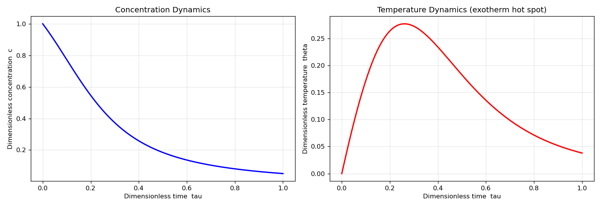
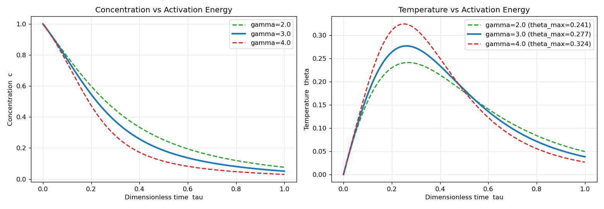
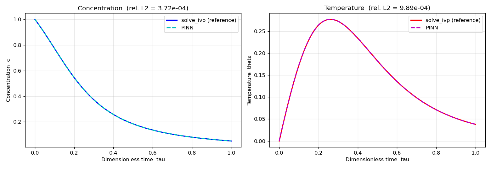
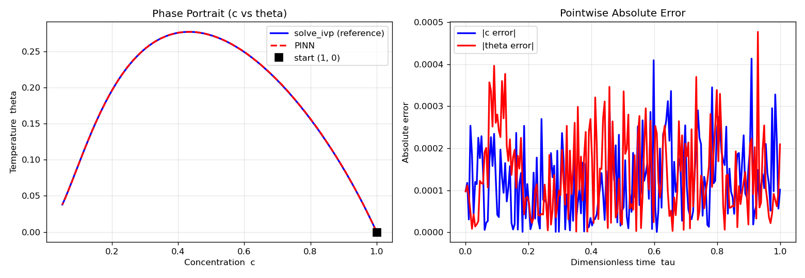
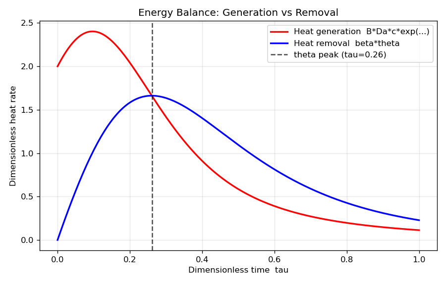
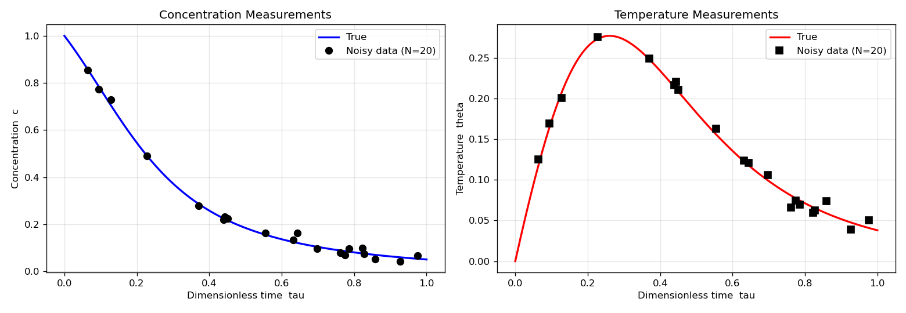
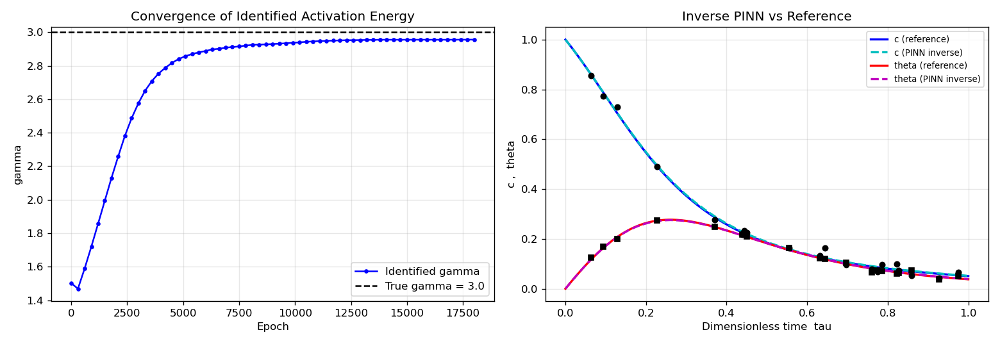

# Unit 19 進階實例：以物理資訊神經網路求解非等溫反應器動態與辨識活化能

## 課程目標
- 認識 PINN 在**反應工程**的進階應用：耦合非線性反應器動態
- 理解**非等溫反應器**的質量平衡、能量平衡與 **Arrhenius 動力學**耦合
- 掌握**單一網路、雙輸出** PINN 同時求解多個狀態變數（濃度與溫度）
- 學會在**無解析解**時，以高精度數值解器 `solve_ivp` 作為驗證基準
- 以 PINN 完成**正問題**（求解反應器動態）與**反問題**（由稀疏量測**辨識活化能**）

---

## 1. 應用背景：非等溫反應器與動力學參數估計

放熱反應在石化與化工產業中無所不在（聚合、氧化、加氫、硝化等）。這些反應會釋放大量熱量，若移熱不及，反應器溫度會急速上升，進一步加快反應、釋放更多熱——形成正回饋的**熱失控(thermal runaway)**，是製程安全的頭號風險。因此，**非等溫反應器**的設計必須同時追蹤**濃度**與**溫度**的耦合動態。

這類系統的數學模型有兩個核心特徵，使其比前三個 PINN 範例更具挑戰：

- **耦合**：質量平衡與能量平衡彼此牽動（溫度影響反應速率，反應放熱又改變溫度）
- **強非線性**：反應速率對溫度呈 **Arrhenius 指數**關係，微小溫升即大幅加速反應

> [!NOTE]
> 本範例是 Unit19 PINN 系列的**進階**篇。前三個範例都是**單一方程、單一輸出**（概述的一階 ODE、觸媒的二階 BVP、暫態擴散的 PDE）；本例進展到**耦合非線性 ODE 系統**，並以**單網路雙輸出**同時學習濃度與溫度。

**為什麼用 PINN？**

反應工程最核心的任務之一是**動力學參數估計**：由實驗量測反推速率常數、**活化能**、反應級數等。傳統做法（如非線性最小平方搭配數值積分）需要反覆求解 ODE，且對初值與雜訊敏感。PINN 把**求解狀態軌跡**與**辨識參數**合而為一，並天生融入物理定律，特別適合**資料有限但機理已知**的情境。

> [!TIP]
> PINN 用於化學動力學是近年的活躍方向。例如 Ji 等人 (2021) 的 Stiff-PINN 專門處理剛性化學動力學，顯示此方法在反應工程的潛力。

---

## 2. 問題的物理模型與控制方程

### 2.1 批次反應器的質能平衡

考慮一個攪拌均勻的**批次反應器**，進行放熱的一級不可逆反應 $A \rightarrow B$ ，並以冷卻移除反應熱。質量平衡與能量平衡為：

$$
\frac{dC_A}{dt} = -k(T)\,C_A, \qquad \rho C_p \frac{dT}{dt} = (-\Delta H_r)\,k(T)\,C_A - \frac{UA}{V}(T - T_c)
$$

反應速率常數遵循 **Arrhenius 定律**：

$$
k(T) = k_0 \exp\!\left(-\frac{E}{RT}\right)
$$

其中 $E$ 是**活化能**， $k_0$ 是指前因子， $(-\Delta H_r)$ 是反應熱， $UA$ 是冷卻熱傳係數。

### 2.2 無因次化

引入無因次變數：濃度 $c = C_A/C_{A0}$ 、溫度 $\theta = (T-T_0)/T_0$ 、時間 $\tau = t/t_{\mathrm{ref}}$ ，可整理成**無因次耦合方程**：

$$
\frac{dc}{d\tau} = -\mathrm{Da}\,c\,e^{\frac{\gamma\theta}{1+\theta}}, \qquad
\frac{d\theta}{d\tau} = B\,\mathrm{Da}\,c\,e^{\frac{\gamma\theta}{1+\theta}} - \beta\,\theta
$$

初始條件 $c(0)=1,\ \theta(0)=0$ 。四個無因次群為：

| 符號 | 名稱 | 物理意義 |
|---|---|---|
| $\mathrm{Da}$ | Damköhler 數 | 反應速率相對於特徵時間尺度 |
| $\gamma$ | 無因次活化能 | $E/(R T_0)$ ，反應對溫度的敏感度 |
| $B$ | 放熱參數 | 絕熱溫升幅度 |
| $\beta$ | 冷卻係數 | 移熱能力 |

本範例取 $\mathrm{Da}=2.0,\ \gamma=3.0,\ B=1.0,\ \beta=6.0$ 。

### 2.3 參考解：熱點行為

此方程**沒有解析解**（Arrhenius 指數使其強非線性），我們以高精度數值解器 `scipy.integrate.solve_ivp`（RK45，容差 $10^{-10}$ ）求「真實解」作為驗證基準。

數值解顯示典型的放熱反應熱點(hot spot)行為：

- **濃度** $c$ 由 1 單調下降，到 $\tau=1$ 時 $c=0.051$ ，**轉化率達 95%**
- **溫度** $\theta$ 先上升到**峰值 0.277**（ $\tau=0.261$ ），隨反應物耗盡與冷卻作用再回落到 0.038

這個「先升後降」的溫度峰正是放熱反應器設計最關心的熱點，決定了冷卻需求與安全邊界。

| 量 | 數值 |
|---|---|
| 最終轉化率 $1-c(1)$ | 0.949 |
| 溫度峰值 $\theta_{\max}$ | 0.277（ $\tau=0.261$ ） |
| $c(0.5),\ \theta(0.5)$ | 0.183, 0.181 |

### 2.4 活化能對動態的影響

活化能 $\gamma$ 決定反應對溫度的敏感度。下圖比較 $\gamma = 2, 3, 4$ 時的動態： $\gamma$ 越大，溫度對速率的正回饋越強，**熱點越高、反應越快**。這個明顯的差異正是反問題能從動態量測反推 $\gamma$ 的基礎。

| $\gamma$ | 溫度峰值 $\theta_{\max}$ | 最終轉化率 |
|---|---|---|
| 2.0 | 0.241 | 0.924 |
| 3.0 | 0.277 | 0.949 |
| 4.0 | 0.325 | 0.970 |

---

## 3. PINN 建模策略

### 3.1 單網路、雙輸出

反應器有**兩個狀態變數** $c$ 與 $\theta$ ，兩者由同一時間 $\tau$ 驅動且彼此耦合。我們用**單一網路、兩個輸出**同時表示 $[\hat{c}(\tau),\ \hat{\theta}(\tau)]$ ，共享隱藏層讓網路自然學到兩者的耦合關係。網路採 5 個隱藏層、每層 32 個神經元、 $\tanh$ 激活，共 **4,354 個可訓練參數**。

> [!NOTE]
> 相較於前三個範例的單一輸出，雙輸出是 PINN 處理**方程系統**的標準做法：輸出層有幾個節點，就同時求解幾個耦合的狀態變數。

### 3.2 耦合非線性殘差

兩條 ODE 各對應一個殘差：

$$
r_c = \frac{d\hat{c}}{d\tau} + \mathrm{Da}\,\hat{c}\,e^{\frac{\gamma\hat{\theta}}{1+\hat{\theta}}}, \qquad
r_\theta = \frac{d\hat{\theta}}{d\tau} - B\,\mathrm{Da}\,\hat{c}\,e^{\frac{\gamma\hat{\theta}}{1+\hat{\theta}}} + \beta\,\hat{\theta}
$$

用一個 `persistent=True` 的 `tf.GradientTape` 一次取得 $d\hat{c}/d\tau$ 與 $d\hat{\theta}/d\tau$ 兩個導數。Arrhenius 項 $e^{\gamma\theta/(1+\theta)}$ 直接以 `tf.exp` 計算，這是 PINN 能處理任意非線性的關鍵。

### 3.3 複合損失

正問題總損失為兩條殘差加上初始條件（IC 加權 20 倍）：

$$
\mathcal{L} = \mathcal{L}_{r_c} + \mathcal{L}_{r_\theta} + 20\big(|\hat{c}(0)-1|^2 + |\hat{\theta}(0)|^2\big)
$$

耦合非線性系統的損失地形崎嶇，採用**學習率分段衰減**（ $10^{-3}\to 3\times10^{-4}\to 10^{-4}$ ）穩定後期收斂。反問題再加上資料損失，並把 $\gamma$ 設為可訓練變數。

---

## 4. 正問題：求解反應器動態

**正問題**：已知所有參數，**不使用任何資料**，僅憑耦合 ODE 與初始條件求解。使用 Adam 搭配學習率分段衰減，訓練 18000 個 epoch。

PINN 重建的濃度與溫度軌跡與 `solve_ivp` 參考解幾乎完全重合：

- **濃度 $c$ 相對 $L_2$ 誤差**： $3.72 \times 10^{-4}$
- **溫度 $\theta$ 相對 $L_2$ 誤差**： $9.89 \times 10^{-4}$
- **PINN 溫度峰值**：0.2770（參考 0.2770）

左圖濃度（青色虛線 PINN）與參考解（藍線）完全貼合；右圖溫度（洋紅虛線 PINN）精確捕捉了**熱點峰**的位置與高度。值得注意的是，PINN 僅憑物理方程就重現了這個非線性耦合系統的完整動態，且溫度峰值與參考解幾乎完全一致。

> [!TIP]
> 兩個狀態的相對 $L_2$ 誤差都在 $10^{-4}\sim10^{-3}$ 等級（濃度 $3.72\times10^{-4}$ 、溫度 $9.89\times10^{-4}$ ），對一個耦合非線性系統而言相當精確。質量與能量方程緊密耦合，兩狀態同步收斂。

### 4.3 相圖與逐點誤差

**相圖(phase portrait)** 在 $c$-$\theta$ 平面上畫出系統軌跡，直觀呈現耦合動態：系統從初始點 $(1, 0)$ 出發，濃度下降的同時溫度先升後降，形成一條彎曲軌跡。PINN 解與參考解完全重合。右圖為兩狀態的逐點絕對誤差（濃度最大 $4.14\times10^{-4}$ 、溫度最大 $4.77\times10^{-4}$ ），全域都在 $10^{-3}$ 等級以下。

### 4.4 能量平衡：產熱與移熱

溫度的升降由能量平衡中兩項的競爭決定：**產熱項** $B\,\mathrm{Da}\,c\,e^{\gamma\theta/(1+\theta)}$ 與**移熱項** $\beta\theta$ 。產熱 > 移熱時溫度上升；兩者相等時 $\mathrm{d}\theta/\mathrm{d}\tau=0$ ，達到**熱點峰**；之後移熱主導使溫度回落。下圖以參考解分解這兩項，可見它們恰好在溫度峰值處（ $\tau=0.261$ ）交會（產熱 1.658 ≈ 移熱 1.662）。

---

## 5. 反問題：辨識活化能

**反問題**：在動力學研究中，**活化能** $E$ （無因次化為 $\gamma$ ）通常**未知**，需由實驗量測反推。這是反應工程**最核心的參數估計任務**，直接影響反應器選型、操作溫度與安全設計。

本範例假設可在少數時間點量測濃度與溫度（帶雜訊）：**20 個隨機時間點**，濃度雜訊標準差 0.02、溫度 0.01。

將 $\gamma$ 設為**可訓練變數**（初始猜測 $\gamma_{\mathrm{init}}=1.5$ ，遠離真值 3.0），與網路權重一起用 Adam（學習率分段衰減）訓練 18000 個 epoch。損失同時包含資料項與含未知 $\gamma$ 的 ODE 殘差。

**辨識結果**：

| 項目 | 數值 |
|---|---|
| 真值 $\gamma_{\mathrm{true}}$ | 3.000 |
| 辨識值 $\gamma_{\mathrm{pred}}$ | 2.9559 |
| 相對誤差 | 1.47% |

左圖顯示活化能 $\gamma$ 的收斂軌跡：從初始的 1.5 快速上升，約在 8000 個 epoch 後穩定收斂到真值 3.0 附近。右圖顯示辨識後 PINN 解（虛線）同時**擬合了稀疏帶雜訊的濃度與溫度量測**（黑點）並**符合耦合物理方程**（與參考解重合）——即使只有 20 個帶雜訊的量測點，物理約束仍使解與參數的估計保持穩健。

> [!IMPORTANT]
> 這展示了 PINN 在反應工程的進階價值：**由稀疏且不完美的實驗量測，同時重建濃度與溫度軌跡並反推活化能**。傳統的動力學參數估計需要反覆數值積分搭配外層最佳化；PINN 把兩者統一，且對雜訊穩健。

---

## 6. 結果討論

### 6.1 進階之處

- **耦合系統**：單網路雙輸出同時求解質量與能量平衡，兩個狀態共享表示、互相約束
- **強非線性**：Arrhenius 指數項直接以 `tf.exp` 納入殘差，PINN 可處理任意可微非線性
- **無解析解**：以 `solve_ivp` 作為基準，示範 PINN 與傳統數值方法的互補驗證
- **參數辨識**：反問題辨識活化能——反應工程最重要、也最困難的反問題之一

### 6.2 數值觀察

- **誤差量級**：濃度與溫度的相對 $L_2$ 誤差都在 $10^{-4}\sim10^{-3}$ 等級（ $3.72\times10^{-4}$ 與 $9.89\times10^{-4}$ ），反映質能緊密耦合下兩狀態同步收斂
- **學習率衰減**：耦合非線性系統的損失地形崎嶇，分段衰減對穩定收斂很重要
- **辨識穩健性**：即使 $\gamma$ 出現在指數項內（高度非線性），由濃度與溫度的聯合資料仍能穩定辨識（誤差 1.47%）

### 6.3 限制與注意事項

- 本例參數選在**無熱失控**的穩定區；若 $B$ 大、 $\beta$ 小，系統可能出現**熱失控**或**多重穩態**，解有尖銳的點火轉折，標準 PINN 難以收斂（需 Stiff-PINN 等進階技巧）
- **剛性(stiffness)**：真實化學動力學常跨越多個時間尺度（快慢反應並存），剛性問題是 PINN 的已知難點
- 活化能的可辨識性取決於溫度變化範圍；若反應近似等溫（ $\theta$ 很小），對 $\gamma$ 的敏感度會下降

---

## 7. 總結與文獻參考

本範例以 PINN 求解反應工程的**耦合非線性動態系統**，完成了：

1. **耦合系統建模**：非等溫批次反應器的質量 + 能量平衡，含 Arrhenius 指數非線性
2. **單網路雙輸出**：同時表示濃度 $c(\tau)$ 與溫度 $\theta(\tau)$
3. **數值解器驗證**：無解析解，以 `scipy.solve_ivp` 作為真實解基準
4. **正問題**：無資料下重建放熱反應的濃度與溫度熱點動態（相對 $L_2$ 達 $10^{-3}$ 等級）
5. **反問題**：由 20 個帶雜訊量測**辨識活化能** $\gamma=2.9559$ （誤差 1.47%）

**工程意義**：活化能與動力學參數的估計是反應器設計、放大與安全評估的基礎。PINN 能從**有限的量測**同時重建狀態軌跡並反推動力學參數，特別適合實驗資料有限、但機理已知的動力學研究與製程數位分身。

**Unit19 PINN 系列的四個範例**（由淺入深）：

| 範例 | 方程類型 | 自變數 | 輸出 | 待辨識參數 |
|---|---|---|---|---|
| PINN 概述 | 一階 ODE (IVP) | $t$ | 單一 | 速率常數 $k$ |
| 觸媒擴散-反應 | 二階 ODE (BVP) | $\xi$ | 單一 | Thiele 模數 $\phi$ |
| 暫態擴散 | 拋物線 PDE | $x, t$ | 單一 | 擴散係數 $D$ |
| 反應器動態（本例） | 耦合非線性 ODE 系統 | $\tau$ | 雙輸出 $c, \theta$ | 活化能 $\gamma$ |

四個範例完整涵蓋 IVP、BVP、時空 PDE 與耦合非線性系統，以及四種不同的參數辨識任務，呈現 PINN 在化工領域由淺入深的應用光譜。

**文獻參考**：
- Fogler, H. S. *Elements of Chemical Reaction Engineering* (非等溫反應器設計章節). Prentice Hall.
- Froment, G. F., Bischoff, K. B., De Wilde, J. (2011). *Chemical Reactor Analysis and Design*, 3rd ed. Wiley.
- Raissi, M., Perdikaris, P., Karniadakis, G. E. (2019). "Physics-Informed Neural Networks: A Deep Learning Framework for Solving Forward and Inverse Problems Involving Nonlinear Partial Differential Equations." *Journal of Computational Physics*, 378, 686-707.
- Ji, W., Qiu, W., Shi, Z., Pan, S., Deng, S. (2021). "Stiff-PINN: Physics-Informed Neural Network for Stiff Chemical Kinetics." *The Journal of Physical Chemistry A*, 125(36), 8098-8106.
- Karniadakis, G. E., Kevrekidis, I. G., Lu, L., Perdikaris, P., Wang, S., Yang, L. (2021). "Physics-Informed Machine Learning." *Nature Reviews Physics*, 3, 422-440.

---

**課程資訊**
- 課程名稱：AI在化工上之應用
- 課程單元：Unit19 - PINN 進階實例：非等溫反應器動態與活化能辨識
- 課程製作：逢甲大學 化工系 智慧程序系統工程實驗室
- 授課教師：莊曜禎 助理教授
- 更新日期：2026-11-18

**課程授權 [CC BY-NC-SA 4.0]**
 - 本教材遵循 [創用CC 姓名標示-非商業性-相同方式分享 4.0 國際 (CC BY-NC-SA 4.0)](https://creativecommons.org/licenses/by-nc-sa/4.0/deed.zh) 授權。
