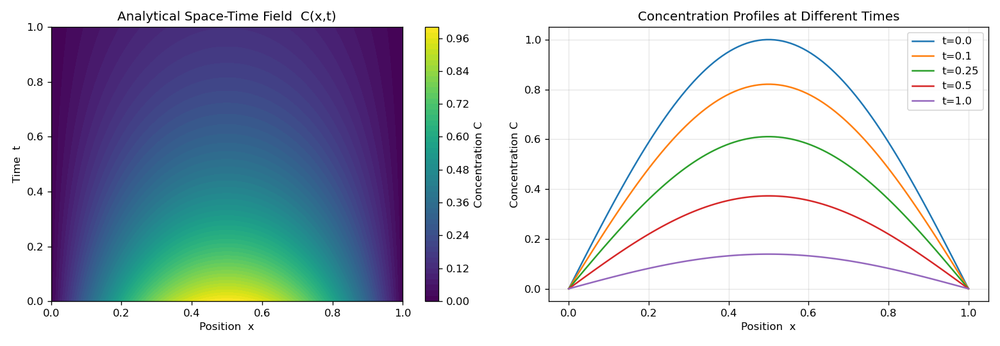
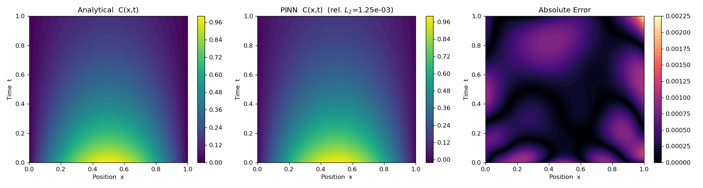
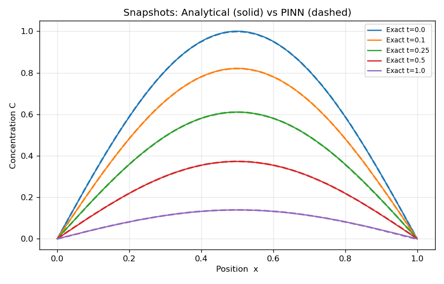
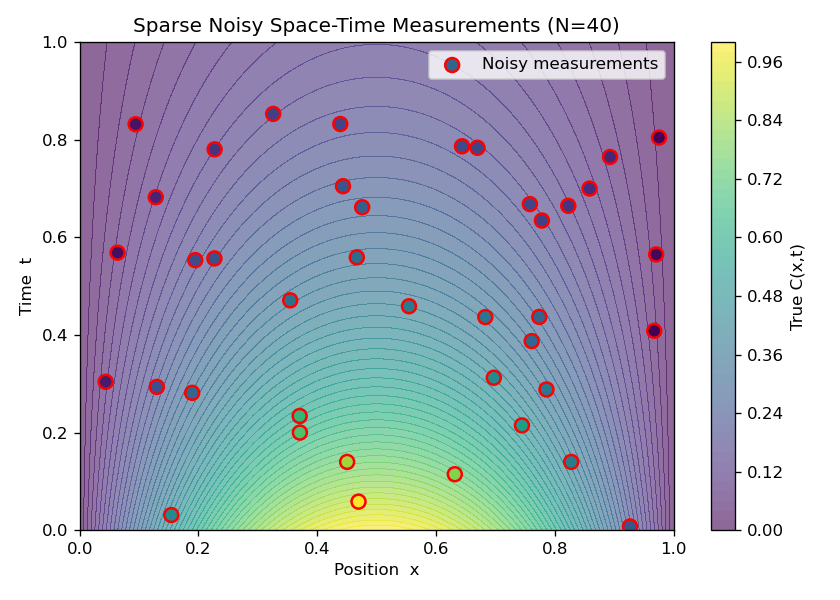
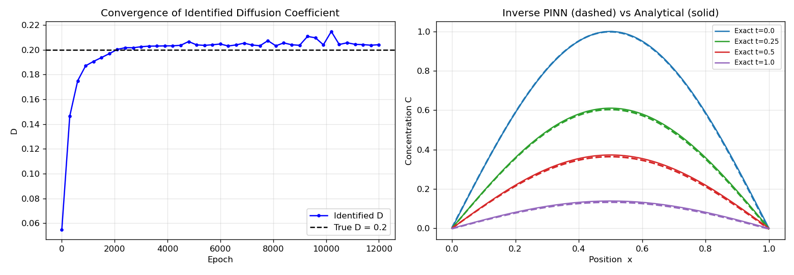

# Unit 19 應用實例：以物理資訊神經網路求解薄膜內的暫態擴散

## 課程目標
- 認識物理資訊神經網路(PINN)在**化工傳遞現象**的代表性應用：時間相依的擴散問題
- 理解**拋物線型偏微分方程(PDE)** 與 **Fick 第二定律** 的物理意義
- 掌握以 PINN 在**二維時空域 $(x,t)$** 上求解 PDE，同時滿足**初始條件(IC)** 與**邊界條件(BC)**
- 學會用巢狀自動微分同時計算**時間一階導數**與**空間二階導數**
- 以 PINN 完成**正問題**（求整個時空濃度場）與**反問題**（由稀疏量測辨識擴散係數 $D$ ）

---

## 1. 應用背景：為什麼要研究暫態擴散？

**擴散(Diffusion)** 是化工傳遞現象的三大支柱之一，描述物質因濃度梯度而產生的淨移動。在石化與化工程序中，暫態（時間相依）擴散無所不在：

- **薄膜分離與滲透**：氣體/液體透過高分子薄膜的滲透，決定分離效率
- **乾燥程序**：固體內部水分隨時間向表面擴散
- **吸附與脫附**：吸附劑顆粒內吸附質的傳輸
- **藥物控釋**：藥物由載體基質緩慢釋放
- **熱傳導**：暫態熱傳與擴散在數學上同型（都是拋物線型 PDE）

這些程序的核心是**擴散係數 $D$**，它決定了物質傳輸的快慢。然而 $D$ 往往需要由**實驗量測的濃度變化**反推——這正是 PINN 的強項。

> [!NOTE]
> 暫態擴散由 **Fick 第二定律** 描述，是每一本傳遞現象教科書（如 Bird, Stewart & Lightfoot《Transport Phenomena》、Crank《The Mathematics of Diffusion》）的核心內容。它與暫態熱傳導方程在數學上完全同型。

**為什麼用 PINN？**

- 傳統上此 PDE 以**有限差分/有限元素**法在網格上求解，需要完整已知的 $D$ 與邊界/初始條件
- 但材料鑑定時， $D$ 常**未知**，需由**滲透實驗(permeation test)** 的稀疏量測反推。傳統反推需反覆求解 PDE 搭配外層最佳化，計算昂貴
- PINN 能把**求解濃度場**與**辨識 $D$** **合而為一**，且天生能融合時空上任意位置的量測資料

本範例延續 Unit19 前兩個 PINN 範例（一階 ODE、二階 BVP），進一步示範 PINN 求解**時間相依 PDE**——這是 PINN 最具代表性的應用場景。

---

## 2. 問題的物理模型與控制方程

### 2.1 Fick 第二定律

考慮溶質在一塊**薄膜 / 平板**內沿厚度方向 $x$ 的一維擴散。以無因次形式，濃度 $C(x,t)$ 遵循 **Fick 第二定律**（拋物線型 PDE）：

$$
\frac{\partial C}{\partial t} = D\,\frac{\partial^2 C}{\partial x^2}, \qquad x\in[0,1],\ t\in[0,1]
$$

其中 $D$ 是無因次**擴散係數**。方程左邊是濃度的**時間變化率**，右邊是擴散造成的**空間曲率**——這是「濃度隨時間變平滑」的數學描述。

### 2.2 初始條件與邊界條件

拋物線型 PDE 需要**一個初始條件**（時間方向）與**兩個邊界條件**（空間方向）：

$$
C(x,0) = \sin(\pi x) \quad (\text{初始濃度分佈}), \qquad C(0,t)=C(1,t)=0 \quad (\text{兩端維持零濃度})
$$

- **初始條件(IC)**：薄膜初始帶有正弦形的濃度分佈
- **邊界條件(BC)**：兩側表面維持零濃度（例如被大量溶劑持續沖走，Dirichlet 條件）

物理圖像：溶質從薄膜內部逐漸向兩側表面擴散並流失，整體濃度隨時間下降。

### 2.3 解析解

此線性 PDE 具有**解析解**，可嚴格驗證 PINN：

$$
C(x,t) = \sin(\pi x)\,\exp(-D\pi^2 t)
$$

空間形狀維持正弦，但**振幅隨時間指數衰減**，衰減速率 $D\pi^2$ 由擴散係數決定。本範例取 $D = 0.2$ ，對應衰減常數 $D\pi^2 = 1.974$ 。

下圖左為解析時空濃度場 $C(x,t)$ ：在 $t=0$ 時中央濃度最高（ $C=1$ ），隨時間向上逐漸衰減。右圖為不同時間的濃度切片，可見正弦形狀維持、振幅遞減。

| 時間 $t$ | 中點振幅 $C(0.5,t)=e^{-D\pi^2 t}$ | 物理狀態 |
|---|---|---|
| 0.00 | 1.000 | 初始分佈 |
| 0.25 | 0.610 | 擴散進行中 |
| 0.50 | 0.373 | 濃度明顯下降 |
| 1.00 | 0.139 | 大部分溶質已流失 |

---

## 3. PINN 建模策略

### 3.1 二維輸入的網路

與 Unit19 前兩個範例（單一輸入 $t$ 或 $\xi$ ）不同，暫態 PDE 的解 $C(x,t)$ 依賴**兩個自變數**。因此 PINN 的**輸入層有 2 個節點** $(x, t)$ ，輸出為該時空點的濃度 $C$ 。網路採 4 個隱藏層、每層 30 個神經元、 $\tanh$ 激活，共 **2,911 個可訓練參數**。

### 3.2 時空殘差與巢狀自動微分

PDE 殘差同時用到**對時間的一階導數**與**對空間的二階導數**：

$$
r(x,t) = \frac{\partial \hat{C}_\theta}{\partial t} - D\,\frac{\partial^2 \hat{C}_\theta}{\partial x^2}
$$

在 TensorFlow 中以巢狀 `tf.GradientTape` 計算：外層對 $x$ 求導得到 $\partial^2 C/\partial x^2$ ，內層以 `persistent=True` 一次取得 $\partial C/\partial x$ 與 $\partial C/\partial t$ 。

### 3.3 配點與複合損失

PINN 在時空域 $[0,1]\times[0,1]$ 內隨機採樣 **2000 個配點**評估 PDE 殘差，並在 **100 個初始點** 與**兩端各 100 個邊界點**施加 IC/BC。總損失為：

$$
\mathcal{L} = \mathcal{L}_{\mathrm{pde}} + 10\,\mathcal{L}_{\mathrm{ic}} + 10\,\mathcal{L}_{\mathrm{bc}}
$$

其中 IC/BC 項加權 10 倍以強化定解條件。反問題時再加上資料損失 $\mathcal{L}_{\mathrm{data}}$ ，並把 $D$ 設為可訓練變數。

> [!TIP]
> 時空 PDE 的損失地形比單變數 ODE 更崎嶇，訓練較難收斂。本範例在正問題採用**學習率分段衰減**（ $10^{-3} \to 3\times10^{-4} \to 10^{-4}$ ），讓訓練後期更穩定，避免在最小值附近震盪。

---

## 4. 正問題：求解整個時空濃度場

**正問題**：已知 $D = 0.2$ ，**不使用任何濃度資料**，僅憑 PDE、IC、BC 求解。使用 Adam 優化器搭配學習率分段衰減，訓練 12000 個 epoch。

訓練收斂後，PINN 重建的時空濃度場與解析解幾乎完全一致：

- **相對 $L_2$ 誤差**： $1.25 \times 10^{-3}$
- **最大絕對誤差**： $2.25 \times 10^{-3}$

上圖三個時空場（解析、PINN、絕對誤差）顯示：PINN 場（中）與解析場（左）在視覺上完全相同，誤差（右）全域低於 $2.25\times10^{-3}$ ，略集中於長時間、近邊界的角落。

下圖以不同時間切片進一步比較：PINN（虛線）與解析解（實線）在 $t=0, 0.1, 0.25, 0.5, 1.0$ 完全重合，正弦形狀與指數衰減的振幅都被精確捕捉。

> [!NOTE]
> 相較於 Unit19 的穩態觸媒範例（相對 $L_2$ 約 $4.7\times10^{-4}$ ），時空 PDE 的誤差略高（ $1.25\times10^{-3}$ ），這反映了時間相依問題在二維時空域上求解本質上更具挑戰——這也是 PINN 研究的活躍方向。

---

## 5. 反問題：辨識擴散係數

**反問題**：在材料鑑定中，薄膜的擴散係數 $D$ 往往**未知**，需由**量測的濃度隨時空變化**反推。這是**滲透實驗**與**材料擴散特性鑑定**的核心任務。

本範例假設只能在 **40 個隨機時空位置** $(x_j, t_j)$ 取得帶雜訊（標準差 0.02）的濃度量測：

圖中背景為真實濃度場，紅圈標記的散點為稀疏的帶雜訊量測。將 $D$ 設為**可訓練變數**（初始猜測 $D_{\mathrm{init}}=0.05$ ，遠離真值），與網路權重一起用 Adam（學習率 $5\times10^{-3}$ ）訓練 12000 個 epoch。

**辨識結果**：

| 項目 | 數值 |
|---|---|
| 真值 $D_{\mathrm{true}}$ | 0.200 |
| 辨識值 $D_{\mathrm{pred}}$ | 0.2040 |
| 相對誤差 | 2.00% |

左圖顯示 $D$ 的收斂軌跡：從初始的 0.05 快速上升，約在 2500 個 epoch 後穩定收斂到真值 0.2 附近（小幅震盪源自資料雜訊）。右圖顯示辨識後 PINN 解（虛線）在各時間切片都與解析解（實線）吻合——即使只有 40 個帶雜訊的時空量測點，物理約束仍使解保持正確。

> [!IMPORTANT]
> 這展示了 PINN 在傳遞現象的核心價值：**由稀疏的時空感測資料，同時重建完整濃度場並反推擴散係數**。這正是薄膜滲透鑑定、乾燥動力學分析與製程數位分身的實務需求。

---

## 6. 結果討論

### 6.1 時空 PDE 的特點

- **二維輸入**：PINN 同時學習空間與時間依賴，一次訓練即可查詢**任意 $(x,t)$** 的濃度，無需像有限差分那樣逐時間步推進
- **混合階導數**：殘差同時含時間一階、空間二階導數，凸顯自動微分的彈性
- **無網格**：配點在連續時空域隨機採樣，不需建立時空網格

### 6.2 數值觀察

- **學習率衰減的效果**：固定學習率在訓練後期會在最小值附近震盪；分段衰減讓正問題相對 $L_2$ 從約 $10^{-2}$ 降到 $1.25\times10^{-3}$
- **誤差分佈**：絕對誤差略集中於**長時間、近邊界**處，因該區濃度梯度與數值尺度較小，相對較難擬合
- **反問題的穩健性**：即使只有 40 個帶雜訊量測，辨識 $D$ 的相對誤差僅 2.00%，因 PDE 殘差提供了強力的物理正則化

### 6.3 限制與注意事項

- 本例為**線性、常數 $D$ 、固定邊界**的理想情形；真實程序常有**濃度相依擴散係數** $D(C)$ 、**移動邊界**（如乾燥的濕潤前緣）或**耦合反應**，PDE 更複雜
- **對流主導**問題（如高流速管式反應器）會出現陡峭前緣，標準 PINN 不易收斂，需特殊技巧（域分解、因果加權等）
- 反問題的可辨識性取決於量測在時空上的分佈；若量測集中在單一時間，對 $D$ 的敏感度會下降

---

## 7. 總結與文獻參考

本範例以 PINN 求解化工傳遞現象的時間相依 PDE，完成了：

1. **時空域 PDE 建模**：Fick 第二定律 $\dfrac{\partial C}{\partial t}=D\dfrac{\partial^2 C}{\partial x^2}$ ，解析解 $C=\sin(\pi x)e^{-D\pi^2 t}$
2. **二維輸入 PINN**：網路輸入 $(x,t)$ ，在時空域採樣 2000 個配點
3. **混合導數殘差**：以巢狀 `tf.GradientTape` 同時算 $\partial C/\partial t$ 與 $\partial^2 C/\partial x^2$
4. **IC + 兩端 BC**：初始正弦分佈與兩端零濃度
5. **正問題**：無資料下重建整個時空濃度場（相對 $L_2$ $1.25\times10^{-3}$ ）
6. **反問題**：由 40 個帶雜訊時空量測辨識擴散係數 $D=0.2040$ （誤差 2.00%）

**與 Unit19 其他 PINN 範例的比較**：

| 範例 | 方程類型 | 自變數 | 導數階數 | 待辨識參數 |
|---|---|---|---|---|
| PINN 概述 | 一階 ODE (IVP) | $t$ | 一階 | 速率常數 $k$ |
| 觸媒擴散-反應 | 二階 ODE (BVP) | $\xi$ | 二階 | Thiele 模數 $\phi$ |
| 暫態擴散（本例） | 拋物線 PDE | $x, t$ | 一階 + 二階 | 擴散係數 $D$ |

三個範例循序漸進，從單變數 ODE 到時空 PDE，涵蓋 IVP、BVP 與時間相依問題，以及三種不同的參數辨識任務，完整呈現 PINN 在化工領域的應用光譜。

**工程意義**：暫態擴散方程廣泛用於薄膜滲透、乾燥、吸附/脫附、藥物釋放與熱傳導。PINN 能由**有限的時空感測資料**反推擴散/傳遞係數，是材料特性鑑定與製程數位分身的實用工具。

**文獻參考**：
- Crank, J. (1975). *The Mathematics of Diffusion*, 2nd ed. Oxford University Press.
- Bird, R. B., Stewart, W. E., Lightfoot, E. N. (2007). *Transport Phenomena*, 2nd ed. Wiley.
- Raissi, M., Perdikaris, P., Karniadakis, G. E. (2019). "Physics-Informed Neural Networks: A Deep Learning Framework for Solving Forward and Inverse Problems Involving Nonlinear Partial Differential Equations." *Journal of Computational Physics*, 378, 686-707.
- Serebrennikova, A., Teubler, R., Hoffellner, L., Leitner, E., Hirn, U., Zojer, K. (2022). "Transport of Organic Volatiles through Paper: Physics-Informed Neural Networks for Solving Inverse and Forward Problems." *Transport in Porous Media*, 145(3), 589-612.
- Karniadakis, G. E., Kevrekidis, I. G., Lu, L., Perdikaris, P., Wang, S., Yang, L. (2021). "Physics-Informed Machine Learning." *Nature Reviews Physics*, 3, 422-440.

---

**課程資訊**
- 課程名稱：AI在化工上之應用
- 課程單元：Unit19 - PINN 應用實例：薄膜內暫態擴散
- 課程製作：逢甲大學 化工系 智慧程序系統工程實驗室
- 授課教師：莊曜禎 助理教授
- 更新日期：2026-11-16

**課程授權 [CC BY-NC-SA 4.0]**
 - 本教材遵循 [創用CC 姓名標示-非商業性-相同方式分享 4.0 國際 (CC BY-NC-SA 4.0)](https://creativecommons.org/licenses/by-nc-sa/4.0/deed.zh) 授權。
